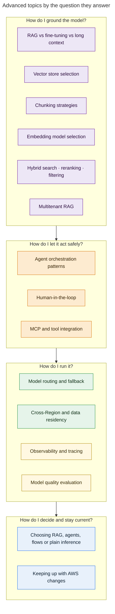

# Advanced architecture topics

> **Level:** Advanced · **Verified:** 2026-11-15 · **Time:** about 4 days at 2 hours a day

The decisions that do not have a single right answer. Each chapter lays out the options, the
forces, a decision matrix and the trade-offs — and marks clearly which parts are documented
behaviour and which are the academy's judgement.

[Academy home](../README.md) · [Architecture decisions](../ARCHITECTURE-DECISIONS.md) · Previous: [Cost, performance and reliability](../08-cost-performance-and-reliability/README.md) · Next: [Labs](../labs/README.md)

## Topic map

Security-specific advanced topics — prompt injection, data leakage, retrieval poisoning, IAM
isolation for agents and untrusted tool output — are in
[Security and governance](../06-security-governance/README.md). Cost, latency, caching, quotas,
resilience and disaster recovery are in
[Cost, performance and reliability](../08-cost-performance-and-reliability/README.md).

## How to read a decision matrix here

| Element | Meaning |
|:--|:--|
| Rows | The options |
| Columns | The forces that matter for this decision |
| Cells | How each option behaves — a documented fact where a source is linked, otherwise our assessment |
| "Choose when" | The situations where the option is the right default |
| "Avoid when" | The situations where it will hurt |

> [!TIP]
> **Academy recommendation** — Start from the simplest design that meets the requirement: plain
> inference before RAG, RAG before agents, one agent before several. Each step up adds cost,
> latency and failure modes. This is our design guidance, not an official AWS reference architecture.

## Chapters

<!-- TOC:START — generated by scripts/build-nav.py; do not edit by hand -->
| # | Chapter | Group | Status |
|--:|:--|:--|:-:|
| 1 | [RAG versus fine-tuning versus long-context inference](01-rag-vs-fine-tuning-vs-long-context.md) | Advanced architecture topics | 🚧 planned |
| 2 | [Vector store selection](02-vector-store-selection.md) | Advanced architecture topics | 🚧 planned |
| 3 | [Chunking strategies](03-chunking-strategies.md) | Advanced architecture topics | 🚧 planned |
| 4 | [Embedding model selection](04-embedding-model-selection.md) | Advanced architecture topics | 🚧 planned |
| 5 | [Hybrid search, reranking and metadata filtering](05-hybrid-search-reranking-metadata-filtering.md) | Advanced architecture topics | 🚧 planned |
| 6 | [Multitenant RAG](06-multitenant-rag.md) | Advanced architecture topics | 🚧 planned |
| 7 | [Agent orchestration patterns](07-agent-orchestration-patterns.md) | Advanced architecture topics | 🚧 planned |
| 8 | [Human-in-the-loop workflows](08-human-in-the-loop.md) | Advanced architecture topics | 🚧 planned |
| 9 | [MCP and tool integration on AWS](09-mcp-and-tool-integration.md) | Advanced architecture topics | 🚧 planned |
| 10 | [Model routing and fallback models](10-model-routing-and-fallback.md) | Advanced architecture topics | 🚧 planned |
| 11 | [Cross-Region considerations and data residency](11-cross-region-and-data-residency.md) | Advanced architecture topics | 🚧 planned |
| 12 | [Observability and tracing for GenAI](12-observability-and-tracing.md) | Advanced architecture topics | 🚧 planned |
| 13 | [Model quality evaluation in production](13-model-quality-evaluation.md) | Advanced architecture topics | 🚧 planned |
| 14 | [Choosing between RAG, agents, flows and plain inference](14-choosing-rag-agents-flows.md) | Advanced architecture topics | 🚧 planned |
| 15 | [Keeping up with AWS changes without outdated tutorials](15-keeping-up-with-aws-changes.md) | Advanced architecture topics | ✅ |
<!-- TOC:END -->
