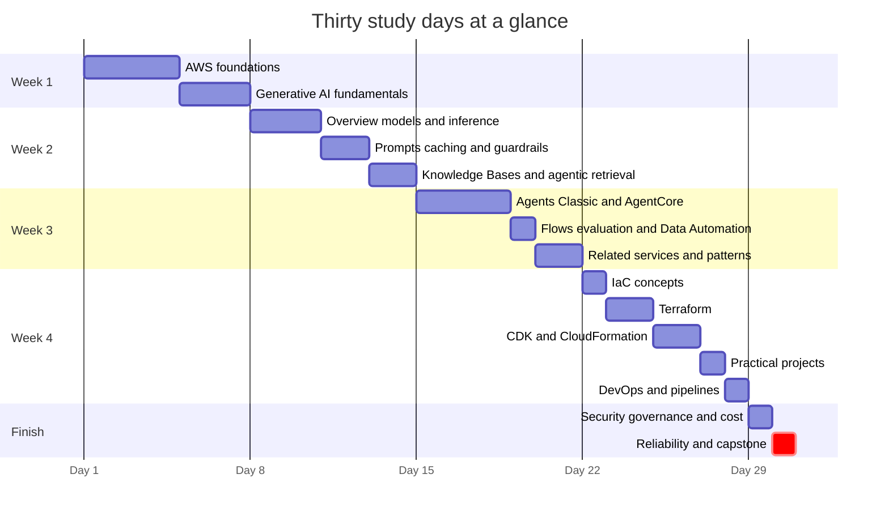
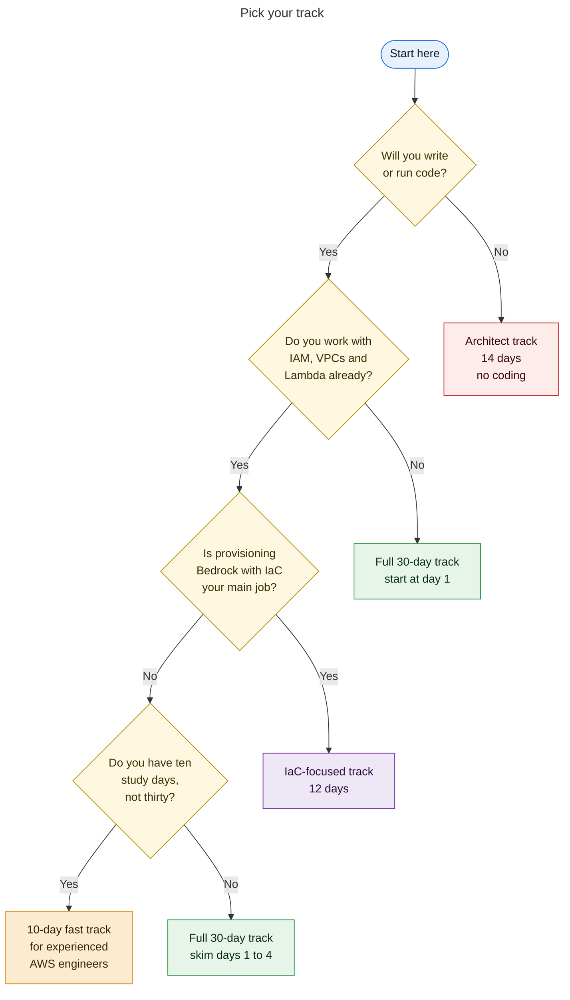

# 30-day learning roadmap

> **Verified:** 2026-11-15 · About 1.5–2.5 hours per day · No AWS account needed until the optional deployment exercises

A day-by-day path through the academy: 169 chapters, 30 numbered diagram sets, 8 labs and 6 practical projects. It is a pacing plan, not a promise. Thirty study days take you to the point where you can read, design and validate an Amazon Bedrock architecture and its infrastructure code. They do not make you an expert — that comes from building and operating one.

[Academy home](README.md) · [Content map](CONTENT-MAP.md) · [Diagram index](diagrams/diagram-index.md) · [Feature verification matrix](FEATURE-VERIFICATION.md) · [Glossary](GLOSSARY.md)

## How to use this roadmap

Every day has the same five parts. Do them in this order.

| Part | What you do | Planning figure |
|:--|:--|:--|
| **Objectives** | Read them first. They say what the day is for | — |
| **Read** | Three to five chapters, in the order listed | About 20 minutes a chapter; each chapter's header gives its own estimate |
| **Study the diagram** | One or two numbered diagram sets, with a question to answer while you look | 10 to 25 minutes |
| **Do** | One exercise: on paper, an offline lab, or a step in a project | 25 to 60 minutes |
| **Checkpoint** | Answer one question without looking anything up. If you cannot, re-read before you move on | A few minutes |

Six things to know before you start:

- **Thirty study days, not thirty calendar days.** No rest days are built in. At five days a week the roadmap takes six weeks, and that is a normal pace. The days add up to roughly 66 hours; the shortest is 1 h 40 min and the longest 2 h 25 min.
- **The course is bigger than thirty days.** Reading every chapter, studying every diagram set and finishing every project is, by the same planning figures, more than 80 hours of work. The roadmap therefore puts 118 chapters on a day and lists the other 51 as *optional deeper reading* at the end of each week. No later day depends on an optional chapter.
- **Diagram sets have three views**: A conceptual, B detailed implementation, C sequence. Week 1 uses view A of sets that you study in full later.
- **There are three kinds of exercise.** *Paper exercises* need a notebook. *Offline labs and project steps* run `terraform validate`, `terraform test` with mock providers or `cdk synth`; they download tools and packages from public registries but never contact an AWS account. Anything that does call AWS is marked **optional — needs a sandbox account, costs apply**, and you can finish the roadmap without doing any of it.
- **Nothing in this course has been deployed by its authors.** The code is validated offline and labelled with how far it was tested ([ADR-003](ARCHITECTURE-DECISIONS.md#adr-003-validate-offline-never-deploy)). If you deploy something in a sandbox, you are the first to run it against AWS: read the project's cost and teardown sections first, and expect to debug.
- **Names and status follow the [feature verification matrix](FEATURE-VERIFICATION.md).** Where a feature is in maintenance mode — Amazon Bedrock Agents Classic is the main one — the roadmap teaches it for context and sends new work to its successor.

If a link leads nowhere, that chapter is not published yet; [PROGRESS.md](PROGRESS.md) shows what is written. Unfamiliar term? Look it up in the [glossary](GLOSSARY.md), which points to the chapter that teaches it.

## Before you start

Tick these off before day 1. An AWS account is not on the required list.

- [ ] **Git** — to clone the repository. Check with `git --version`.
- [ ] **Terraform 1.11 or later** — first used on day 23. Check with `terraform version`. The course's Terraform code declares `required_version = ">= 1.11.0"`.
- [ ] **Node.js 22** — first used on day 25, for AWS CDK in TypeScript. Check with `node --version`.
- [ ] **Python 3.11 or later** — for the Python Lambda handlers, their stubbed tests and the repository's check scripts. Check with `python3 --version`.
- [ ] **Internet access to public package registries** — `terraform init` and `npm ci` download the AWS provider and npm packages. Neither needs AWS credentials.
- [ ] **A way to view Mermaid diagrams** — GitHub renders them inline; locally, use an editor with a Mermaid preview.
- [ ] **A notebook or a notes file** — for paper exercises and checkpoint answers. Keep everything: days 29 and 30 reuse earlier work.
- [ ] **Optional: an AWS sandbox account** — only for exercises marked **optional — needs a sandbox account, costs apply**. You can complete all thirty days without one.

> [!CAUTION]
> **Cost or security hazard** — If you do use an AWS account, use a sandbox that holds nothing else, never a production account. Model calls, knowledge bases, agent sessions and interface endpoints are all billable. Set a budget alert before your first call, deploy one project at a time, and run that project's "Teardown" section the same day. Nothing in this repository has been deployed by its authors.

## The four weeks at a glance

**What this shows** — the thirty study days grouped into four weeks plus two closing days. The axis counts study days, not calendar dates. Each bar is a block of days on one theme; the last bar is the capstone design.

| Block | Days | Theme | Mostly from |
|:--|:--|:--|:--|
| [Week 1](#week-1--aws-foundations-and-generative-ai-fundamentals) | 1–7 | AWS foundations and generative-AI fundamentals | [Foundations](00-foundations/README.md) |
| [Week 2](#week-2--amazon-bedrock-core) | 8–14 | Bedrock overview, models, inference, prompts and caching, guardrails, knowledge bases, agentic retrieval | [Amazon Bedrock deep dive](01-amazon-bedrock/README.md) |
| [Week 3](#week-3--agents-agentcore-related-services-and-patterns) | 15–21 | Agents Classic and AgentCore, flows, evaluation, Data Automation, related AWS services, architecture patterns | [Amazon Bedrock deep dive](01-amazon-bedrock/README.md) · [Related AWS services](02-related-aws-services/README.md) · [Architecture patterns](03-architecture-patterns/README.md) |
| [Week 4](#week-4--infrastructure-as-code-projects-and-devops) | 22–28 | IaC concepts, Terraform, AWS CDK, CloudFormation, the practical projects, DevOps and CI/CD | [Infrastructure as Code](04-infrastructure-as-code/README.md) · [Practical projects](05-practical-projects/README.md) · [DevOps and CI/CD](07-devops-and-cicd/README.md) |
| [Days 29 and 30](#days-29-and-30--security-cost-reliability-and-the-capstone) | 29–30 | Security, cost, reliability and a capstone design | [Security and governance](06-security-governance/README.md) · [Cost, performance and reliability](08-cost-performance-and-reliability/README.md) |

Chapters from [Advanced topics](09-advanced-topics/README.md) are not a block of their own: each one sits on the day that covers its subject, or in that week's optional list.

## Pick your track

**What this shows** — four questions that lead to one of four tracks. Yellow diamonds are questions; each coloured box is a track described in the table below.

| Track | For | Length | Where |
|:--|:--|:--|:--|
| Full 30-day track | Anyone new to AWS, to generative AI, or to both | 30 study days | Starts at [week 1](#week-1--aws-foundations-and-generative-ai-fundamentals) |
| 10-day fast track | AWS engineers who are new to generative AI and short of time | 10 study days | [10-day fast track](#10-day-fast-track) |
| IaC-focused track | Platform and DevOps engineers who will provision and maintain Bedrock | 12 study days | [IaC-focused track](#iac-focused-track) |
| Architect track | Architects and technical leads who decide but do not write the code | 14 study days | [Architect track — no coding](#architect-track--no-coding) |

If you maintain an existing Bedrock system, read [What changed since older tutorials](FEATURE-VERIFICATION.md#what-changed-since-older-tutorials) before you choose. It is one table, and it tells you which parts of your system the last year has affected.

## Labs and projects at a glance

| Exercise | Full-track day | Needs an AWS account? |
|:--|:--|:--|
| [Lab 1: verify a feature from the official docs](labs/lab-01-verify-a-feature-from-the-docs.md) | [day 7](#day-7--agents-evaluation-and-verifying-what-you-read) | No — browser and official documentation |
| [Lab 2: your first Converse call](labs/lab-02-first-converse-call.md) | [day 9](#day-9--choosing-a-model-and-making-your-first-call) | Not to build the request. Sending it is **optional — needs a sandbox account, costs apply** |
| [Lab 3: validate and test Terraform offline](labs/lab-03-terraform-validate-and-test-offline.md) | [day 24](#day-24--terraform-ii-change-safely-test-offline-check-bedrock-coverage) | No — offline |
| [Lab 4: synthesize a CDK app and read the template](labs/lab-04-cdk-synth-and-inspect.md) | [day 25](#day-25--aws-cdk-constructs-synthesis-and-tests) | No — offline |
| [Lab 5: design a RAG pipeline](labs/lab-05-design-a-rag-pipeline.md) | [day 14](#day-14--retrieval-reranking-and-agentic-retrieval) | No — design lab |
| [Lab 6: threat-model an agent](labs/lab-06-threat-model-an-agent.md) | [day 17](#day-17--agentcore-identity-and-policy-and-a-threat-model) | No — design lab |
| [Lab 7: estimate the cost of a chatbot](labs/lab-07-estimate-chatbot-cost.md) | [day 20](#day-20--serverless-patterns-and-what-a-chatbot-costs) | No — arithmetic on public prices |
| [Lab 8: run the IaC pipeline checks locally](labs/lab-08-pipeline-dry-run.md) | [day 28](#day-28--devops-from-pull-request-to-pipeline-checks) | No — runs on your machine |
| [Project A: basic Bedrock model inference](05-practical-projects/project-01-basic-inference/README.md) | [day 22](#day-22--iac-concepts-and-choosing-a-tool) read, [day 23](#day-23--terraform-i-variables-modules-state-and-repetition) validate, [day 24](#day-24--terraform-ii-change-safely-test-offline-check-bedrock-coverage) optional deployment | Not to validate |
| [Project B: serverless chatbot with API Gateway and Lambda](05-practical-projects/project-02-serverless-chatbot/README.md) | [day 26](#day-26--cloudformation-and-bedrock-coverage-in-cloudformation-and-cdk) synthesize | Not to validate |
| [Project C: enterprise RAG with Knowledge Bases](05-practical-projects/project-03-enterprise-rag/README.md) | [day 27](#day-27--environments-accounts-and-the-practical-projects) choose one of C to F | Not to validate |
| [Project D: agentic application on AgentCore](05-practical-projects/project-04-agentic-ai/README.md) | [day 18](#day-18--agentcore-memory-observability-and-evaluations) read, [day 27](#day-27--environments-accounts-and-the-practical-projects) choose one of C to F | Not to validate |
| [Project E: secure private enterprise GenAI](05-practical-projects/project-05-private-genai/README.md) | [day 27](#day-27--environments-accounts-and-the-practical-projects) choose one of C to F | Not to validate |
| [Project F: multi-account enterprise GenAI platform](05-practical-projects/project-06-multi-account-platform/README.md) | [day 27](#day-27--environments-accounts-and-the-practical-projects) choose one of C to F | Not to validate |

Deploying any project is **optional — needs a sandbox account, costs apply**. The lab rows describe each lab by its title and by the academy's rule that offline labs need no account; the lab itself has the final word.

## Week 1 — AWS foundations and generative-AI fundamentals

Days 1 to 7 build the vocabulary the rest of the course assumes: where things run, how they connect, who is allowed to do what, and how a model turns tokens into text. The days are shorter than in later weeks on purpose — new vocabulary takes longer to settle than its word count suggests. If you already work with AWS every day, look at the [10-day fast track](#10-day-fast-track) instead.

| Day | Focus | Exercise | Time |
|--:|:--|:--|:--|
| [1](#day-1--aws-global-infrastructure-and-core-building-blocks) | AWS global infrastructure and core building blocks | Paper: map one Region | 1 h 40 min |
| [2](#day-2--networking-vpcs-private-subnets-and-endpoints) | Networking: VPCs, private subnets and endpoints | Paper: two paths to an AWS API | 1 h 45 min |
| [3](#day-3--iam-principals-policies-roles-and-trust) | IAM: principals, policies, roles and trust | Paper: write and evaluate two policies | 1 h 45 min |
| [4](#day-4--encryption-audit-trails-and-multi-account-basics) | Encryption, audit trails and multi-account basics | Paper: one encrypted read, fully accounted for | 1 h 40 min |
| [5](#day-5--generative-ai-models-tokens-and-what-inference-costs) | Generative AI: models, tokens and what inference costs | Paper: token arithmetic | 1 h 40 min |
| [6](#day-6--embeddings-retrieval-augmented-generation-and-customization) | Embeddings, retrieval-augmented generation and customization | Paper: sketch a RAG system | 1 h 40 min |
| [7](#day-7--agents-evaluation-and-verifying-what-you-read) | Agents, evaluation and verifying what you read | Lab 1 | 1 h 55 min |

### Day 1 — AWS global infrastructure and core building blocks

*About 1 h 40 min: reading 60 min · diagram 10 min · exercise 30 min.*

**Objectives**

- Explain how Regions, Availability Zones and edge locations relate to one another.
- Describe what Amazon S3, AWS Lambda and Amazon API Gateway each contribute to a request path.
- Distinguish a synchronous call from an event delivered through Amazon EventBridge, Amazon SQS or Amazon SNS.

**Read**

1. [AWS global infrastructure: Regions, Availability Zones and the edge](00-foundations/aws-fundamentals/01-global-infrastructure.md)
2. [Amazon S3, AWS Lambda and Amazon API Gateway](00-foundations/aws-fundamentals/02-s3-lambda-api-gateway.md)
3. [Amazon EventBridge, Amazon SQS and Amazon SNS](00-foundations/aws-fundamentals/03-eventbridge-sqs-sns.md)

**Study the diagram**

- [Diagram 01 — AWS global infrastructure and networking](diagrams/mermaid/01-aws-global-infrastructure-and-networking.md)

View A only. Find the Region, the Availability Zones and the edge. Views B and C are tomorrow's.

**Do**

Paper exercise. Draw one Region with three Availability Zones. Add an S3 bucket, a Lambda function, an API Gateway API, an SQS queue and an EventBridge event bus. Next to each, write whether you choose a Region, an Availability Zone or neither when you create it, then check your answers against today's chapters. Finish by confirming that the tools in [Before you start](#before-you-start) are installed.

**Checkpoint**

What is the difference between a Region and an Availability Zone, and which of the two do you choose when you call a Regional service endpoint?

### Day 2 — Networking: VPCs, private subnets and endpoints

*About 1 h 45 min: reading 60 min · diagram 15 min · exercise 30 min.*

**Objectives**

- Describe a VPC, its subnets and route tables, and what makes a subnet public or private.
- Trace how a workload in a private subnet reaches the internet and how it reaches an AWS service API.
- Explain what an interface VPC endpoint and AWS PrivateLink change about that path.

**Read**

1. [VPCs and subnets](00-foundations/networking/01-vpc-and-subnets.md)
2. [Public and private networking](00-foundations/networking/02-public-private-networking.md)
3. [VPC endpoints and AWS PrivateLink](00-foundations/networking/03-vpc-endpoints-and-privatelink.md)

**Study the diagram**

- [Diagram 01 — AWS global infrastructure and networking](diagrams/mermaid/01-aws-global-infrastructure-and-networking.md)

Views B and C. In view C, follow the numbered steps and say at each one whether the traffic is inside the VPC, on the AWS network or on the internet.

**Do**

Paper exercise. Sketch a VPC across two Availability Zones with one public and one private subnet in each. Draw two paths from a function in a private subnet to an AWS service API: (a) through a NAT gateway to the public endpoint, and (b) through an interface VPC endpoint. On each path, mark where traffic leaves your VPC and which security group or endpoint policy could block it.

**Checkpoint**

What changes — and what does not — about authentication when you call an AWS API through an interface VPC endpoint instead of its public endpoint?

### Day 3 — IAM: principals, policies, roles and trust

*About 1 h 45 min: reading 60 min · diagram 10 min · exercise 35 min.*

**Objectives**

- Explain how IAM evaluates a request: explicit deny, allow, and implicit deny by default.
- Write a role's trust policy and its permissions policy, and say what each one controls.
- Distinguish identity-based from resource-based policies, including in cross-account access.

**Read**

1. [IAM fundamentals: principals, policies and evaluation](00-foundations/security/01-iam-fundamentals.md)
2. [IAM roles, trust policies and cross-account access](00-foundations/security/02-iam-roles-and-trust.md)
3. [Resource-based policies](00-foundations/security/03-resource-policies.md)

**Study the diagram**

- [Diagram 24 — Secure private enterprise Bedrock architecture](diagrams/mermaid/24-secure-private-enterprise-bedrock.md)

View A only — a preview. Look for one thing: every place where an IAM role or a resource policy is the security control. The rest of the set returns on days 21 and 29.

**Do**

Paper exercise. In a notes file, write (1) a trust policy that lets the AWS Lambda service assume a role and (2) an identity-based policy that allows one read action on one S3 bucket. Use the documentation placeholder account ID `111122223333`. Then walk three requests through the evaluation logic and write the outcome of each: the allowed action; a different action on the same bucket; the allowed action when the bucket's resource policy explicitly denies it. You are reasoning, not deploying, so no account is needed.

**Checkpoint**

A role's identity policy allows an action and the resource's policy explicitly denies it. What is the result, and which rule decides it?

### Day 4 — Encryption, audit trails and multi-account basics

*About 1 h 40 min: reading 60 min · diagram 10 min · exercise 30 min.*

**Objectives**

- Explain envelope encryption with AWS KMS and what a key policy controls.
- Distinguish what Amazon CloudWatch records from what AWS CloudTrail records.
- Describe why organisations split workloads across accounts with AWS Organizations and AWS Control Tower.

**Read**

1. [AWS KMS and encryption](00-foundations/security/04-kms-encryption.md)
2. [Amazon CloudWatch and AWS CloudTrail](00-foundations/aws-fundamentals/04-cloudwatch-cloudtrail.md)
3. [AWS Organizations and AWS Control Tower](00-foundations/aws-fundamentals/05-organizations-control-tower.md)

**Study the diagram**

- [Diagram 25 — Multi-account AWS architecture](diagrams/mermaid/25-multi-account-aws.md)

View A only — a preview. Find which account holds the workloads and which holds the logs. You return to this set on day 27.

**Do**

Paper exercise. Take one event: a Lambda function reads an object from an S3 bucket that is encrypted with a customer managed KMS key. Write down (1) every permission that must exist for the read to succeed and which policy holds it, (2) which service records the API calls involved, and (3) which account you would want those records stored in, and why.

**Checkpoint**

Which service do you query to learn who changed a configuration last Tuesday, and which to learn how many requests failed in the last hour?

### Day 5 — Generative AI: models, tokens and what inference costs

*About 1 h 40 min: reading 60 min · diagram 10 min · exercise 30 min.*

**Objectives**

- Define foundation model, large language model and inference in plain language.
- Explain tokens and context windows, and why output length drives both latency and cost.
- Estimate the tokens sent over a multi-turn conversation.

**Read**

1. [Generative AI, foundation models and LLMs](00-foundations/generative-ai-fundamentals/01-generative-ai-and-foundation-models.md)
2. [Tokens, context windows, and training versus inference](00-foundations/generative-ai-fundamentals/02-tokens-context-windows-inference.md)
3. [Latency and token economics](00-foundations/generative-ai-fundamentals/08-latency-and-token-economics.md)

**Study the diagram**

- [Diagram 03 — Bedrock model inference lifecycle](diagrams/mermaid/03-model-inference-lifecycle.md)

View A only. Follow one request from the caller to the model and back, and name what is counted in tokens.

**Do**

Paper exercise — token arithmetic. Assume a 1,500-token system prompt, user turns of 100 tokens and answers of 300 tokens, with the full history resent on every turn. Work out the input tokens sent on turns 1, 5 and 10, then the total input and output tokens for the ten-turn conversation. Note which figure grows in a straight line and which grows faster. Check figure: turn 10 sends 5,200 input tokens. No prices today — the point is the shape of the curve.

**Checkpoint**

Why does the tenth turn of a chat cost more than the first, even when the user's question is the same length?

### Day 6 — Embeddings, retrieval-augmented generation and customization

*About 1 h 40 min: reading 60 min · diagram 10 min · exercise 30 min.*

**Objectives**

- Explain what an embedding is and how vector, keyword and hybrid search differ.
- Describe the two halves of RAG: ingestion, and retrieval followed by generation.
- Compare RAG with fine-tuning as ways to give a model knowledge it was not trained on.

**Read**

1. [Embeddings, vector search, semantic search and hybrid search](00-foundations/generative-ai-fundamentals/03-embeddings-and-vector-search.md)
2. [Retrieval-augmented generation (RAG)](00-foundations/generative-ai-fundamentals/04-rag-fundamentals.md)
3. [Fine-tuning and model customization](00-foundations/generative-ai-fundamentals/05-fine-tuning-and-customization.md)

**Study the diagram**

- [Diagram 05 — Enterprise RAG architecture](diagrams/mermaid/05-enterprise-rag.md)

View A only. Separate the ingestion half from the question-time half.

**Do**

Paper exercise. For a corpus of 500 internal policy PDFs that change every month, draw the ingestion path (document, chunks, embeddings, index) and the question path (question, retrieval, prompt, answer). Then write one sentence on why you would, and one on why you would not, fine-tune a model for this instead.

**Checkpoint**

In a RAG system, what is stored in the vector index, and what is sent to the model at question time?

### Day 7 — Agents, evaluation and verifying what you read

*About 1 h 55 min: reading 60 min · diagram 10 min · exercise 45 min.*

**Objectives**

- Describe the tool-calling loop that turns a model into an agent.
- Name the main ways to evaluate a model, and say why a public benchmark score is not enough to choose one.
- Verify one feature claim against the official documentation, using the academy's method.

**Read**

1. [Agentic AI, tool calling and multi-agent architectures](00-foundations/generative-ai-fundamentals/06-agents-tool-calling-multi-agent.md)
2. [Model evaluation and model selection](00-foundations/generative-ai-fundamentals/07-model-evaluation-and-selection.md)
3. [Keeping up with AWS changes without outdated tutorials](09-advanced-topics/15-keeping-up-with-aws-changes.md)

**Study the diagram**

- [Diagram 02 — Amazon Bedrock high-level architecture](diagrams/mermaid/02-bedrock-high-level-architecture.md)

View A only — a preview of next week. Name every box you can with this week's vocabulary, and list the ones you cannot yet.

**Do**

Work through [Lab 1: verify a feature from the official docs](labs/lab-01-verify-a-feature-from-the-docs.md). It needs a browser and the official documentation — no AWS account.

**Checkpoint**

A 2025 tutorial says a Bedrock feature works a certain way. Where do you look first to find out whether that is still true?

### Optional deeper reading — week 1

There is no optional list this week: later days assume all twenty foundation chapters. If you have time to spare, read [What changed since older tutorials](FEATURE-VERIFICATION.md#what-changed-since-older-tutorials). It is short, and it tells you which things you may have picked up elsewhere are no longer true.

> [!TIP]
> **Milestone — end of week 1** — By the academy's own yardstick, not a certification, you can now:
>
> - read an AWS architecture diagram and name the Region, VPC, subnets, endpoints, roles and keys in it;
> - explain how IAM decides a request, and what a trust policy is for;
> - explain tokens, context windows, embeddings, RAG and the agent loop in plain language, and estimate the tokens in a conversation;
> - check a claim about an AWS feature against the official documentation.
>
> You cannot yet design a Bedrock system. That starts tomorrow.

## Week 2 — Amazon Bedrock core

Days 8 to 14 cover the Bedrock features that nearly every system uses: the shape of the service, models, inference, prompts and caching, guardrails, knowledge bases and agentic retrieval. A few chapters from the security and cost sections are pulled forward to the day that explains the same feature.

| Day | Focus | Exercise | Time |
|--:|:--|:--|:--|
| [8](#day-8--what-amazon-bedrock-is-and-how-you-reach-it) | What Amazon Bedrock is and how you reach it | Paper: the namespace map | 2 h 20 min |
| [9](#day-9--choosing-a-model-and-making-your-first-call) | Choosing a model and making your first call | Lab 2 | 2 h 25 min |
| [10](#day-10--inference-options-profiles-service-tiers-capacity-and-batch) | Inference options: profiles, service tiers, capacity and batch | Paper: pick the inference option | 2 h 25 min |
| [11](#day-11--prompts-prompt-caching-and-the-pricing-model) | Prompts, prompt caching and the pricing model | Paper: place the cache checkpoints | 2 h 25 min |
| [12](#day-12--guardrails-and-protecting-data) | Guardrails and protecting data | Paper: design a guardrail | 2 h 25 min |
| [13](#day-13--knowledge-bases-managed-versus-customer-managed-and-ingestion) | Knowledge Bases: managed versus customer-managed, and ingestion | Paper: Managed or customer-managed | 2 h 15 min |
| [14](#day-14--retrieval-reranking-and-agentic-retrieval) | Retrieval, reranking and agentic retrieval | Lab 5 | 2 h 15 min |

### Day 8 — What Amazon Bedrock is and how you reach it

*About 2 h 20 min: reading 100 min · diagram 15 min · exercise 25 min.*

**Objectives**

- Name the Bedrock namespaces and endpoints, and say which carry control-plane calls and which carry data-plane calls.
- Explain how a caller authenticates, and how access to a model is granted now that the console request step is gone.
- Describe what the model catalog contains and who the model providers are.

**Read**

1. [What Amazon Bedrock is: services, namespaces and planes](01-amazon-bedrock/overview/01-what-is-amazon-bedrock.md)
2. [Endpoints, APIs and authentication](01-amazon-bedrock/overview/02-endpoints-apis-and-authentication.md)
3. [Model access and subscriptions](01-amazon-bedrock/overview/03-model-access-and-subscriptions.md)
4. [Projects, Workspaces and the Web Search tool](01-amazon-bedrock/overview/04-projects-workspaces-and-web-search.md)
5. [Model providers and the model catalog](01-amazon-bedrock/foundation-models/01-model-providers-and-catalog.md)

**Study the diagram**

- [Diagram 02 — Amazon Bedrock high-level architecture](diagrams/mermaid/02-bedrock-high-level-architecture.md)

All three views. In view C, say for each step which namespace receives the call.

**Do**

Paper exercise — the namespace map. From memory, draw the namespaces `bedrock`, `bedrock-runtime`, `bedrock-mantle`, `bedrock-agent` and `bedrock-agent-runtime`. Place each of these on the one that serves it: Converse, `CreateGuardrail`, `ApplyGuardrail`, `Retrieve`, `CreatePrompt` and the Web Search tool. Check yourself against [section A of the feature verification matrix](FEATURE-VERIFICATION.md#a-amazon-bedrock--core-service).

**Checkpoint**

AWS recommends `bedrock-runtime` for new applications. Which two needs would still send you to the `bedrock-mantle` endpoint?

### Day 9 — Choosing a model and making your first call

*About 2 h 25 min: reading 80 min · diagram 20 min · exercise 45 min.*

**Objectives**

- Explain what the Legacy and end-of-life stages mean for a model you depend on, and why the model ID belongs in configuration.
- Build a Converse request and read its response, including the stop reason and token usage.
- Decide when InvokeModel, or an OpenAI- or Anthropic-compatible API, fits better than Converse.

**Read**

1. [Model lifecycle and selection](01-amazon-bedrock/foundation-models/02-model-lifecycle-and-selection.md)
2. [The Converse API](01-amazon-bedrock/inference/01-converse-api.md)
3. [InvokeModel and streaming APIs](01-amazon-bedrock/inference/02-invokemodel-and-streaming.md)
4. [OpenAI- and Anthropic-compatible APIs](01-amazon-bedrock/inference/03-openai-and-anthropic-compatible-apis.md)

**Study the diagram**

- [Diagram 04 — Bedrock Converse API application architecture](diagrams/mermaid/04-converse-api-application.md)
- [Diagram 03 — Bedrock model inference lifecycle](diagrams/mermaid/03-model-inference-lifecycle.md)

Set 04, all three views. Then return to set 03 and follow view C, which you met in outline on day 5.

**Do**

Work through [Lab 2: your first Converse call](labs/lab-02-first-converse-call.md). Reading the lab and building the request need no account. Sending the request to Amazon Bedrock is **optional — needs a sandbox account, costs apply**.

**Checkpoint**

What does the Converse API give you that InvokeModel does not, and when would you still choose InvokeModel?

### Day 10 — Inference options: profiles, service tiers, capacity and batch

*About 2 h 25 min: reading 100 min · diagram 15 min · exercise 30 min.*

**Objectives**

- Distinguish Geo from Global cross-Region inference profiles, and say what each means for where a request can be processed.
- Explain what an application inference profile is for.
- Compare the service tiers, Provisioned Throughput and batch inference as trades between price, latency and capacity.

**Read**

1. [Cross-Region inference: Geo and Global profiles](01-amazon-bedrock/inference/04-cross-region-inference.md)
2. [Application inference profiles](01-amazon-bedrock/inference/05-application-inference-profiles.md)
3. [Service tiers: Reserved, Priority, Standard and Flex](01-amazon-bedrock/inference/06-service-tiers.md)
4. [Provisioned Throughput](01-amazon-bedrock/inference/07-provisioned-throughput.md)
5. [Batch inference](01-amazon-bedrock/inference/08-batch-inference.md)

**Study the diagram**

- [Diagram 21 — Cross-Region inference architecture](diagrams/mermaid/21-cross-region-inference.md)

All three views. For one request through a Geo profile, name the Regions that could process it; repeat for a Global profile.

**Do**

Paper exercise. Pick the inference option for four workloads and justify each in one line: (1) an interactive chatbot with EU data-residency rules; (2) a nightly job that summarises 200,000 documents; (3) a latency-sensitive checkout assistant during a sales peak; (4) a cost report per team across ten applications. Check your reasoning against the Notes column of [section A1 of the matrix](FEATURE-VERIFICATION.md#a1-inference).

**Checkpoint**

Why can a Global inference profile be the wrong choice for a workload with data-residency rules, and what do you use instead?

### Day 11 — Prompts, prompt caching and the pricing model

*About 2 h 25 min: reading 100 min · diagram 15 min · exercise 30 min.*

**Objectives**

- Explain why prompts are versioned, deployable artefacts, and what prompt management stores.
- Describe how prompt caching works, where cache checkpoints go, and why the cache lifetime depends on the model.
- Name the pricing dimensions of model inference and say which ones caching changes.

**Read**

1. [Prompt management](01-amazon-bedrock/prompt-management/01-prompt-management.md)
2. [Prompt optimization](01-amazon-bedrock/prompt-management/02-prompt-optimization.md)
3. [Prompt caching](01-amazon-bedrock/prompt-caching/01-prompt-caching.md)
4. [Caching strategies](08-cost-performance-and-reliability/04-caching-strategies.md)
5. [Pricing model and cost drivers](08-cost-performance-and-reliability/01-pricing-model-and-cost-drivers.md)

**Study the diagram**

- [Diagram 19 — Prompt caching architecture](diagrams/mermaid/19-prompt-caching.md)

All three views. Find the cache checkpoint, then trace a cache write on the first request and a cache read on the second.

**Do**

Paper exercise. Take a chatbot prompt made of a system prompt, tool definitions, three reference documents, the conversation history and the new user message. Order the parts from most stable to most volatile, mark where you would put cache checkpoints, and say which parts are read from the cache on the next turn and which are billed as new input. Then say what happens if the next request arrives after the cache lifetime for your model has passed.

**Checkpoint**

"Prompt caching lasts five minutes" is out of date. What does the cache lifetime depend on today?

### Day 12 — Guardrails and protecting data

*About 2 h 25 min: reading 100 min · diagram 15 min · exercise 30 min.*

**Objectives**

- List the guardrail policy types and say what each can and cannot catch.
- Explain where a guardrail runs: attached to an inference call, or on its own through `ApplyGuardrail`.
- Describe prompt injection, and why retrieved documents and tool output are untrusted input.

**Read**

1. [Amazon Bedrock Guardrails](01-amazon-bedrock/guardrails/01-guardrails.md)
2. [Automated Reasoning checks and guardrail enforcement](01-amazon-bedrock/guardrails/02-automated-reasoning-and-enforcement.md)
3. [Data protection, privacy and data leakage prevention](06-security-governance/03-data-protection-and-privacy.md)
4. [Prompt injection, untrusted tool output and retrieval poisoning](06-security-governance/04-prompt-injection-and-untrusted-content.md)
5. [AWS KMS, Secrets Manager and Parameter Store](02-related-aws-services/security/02-kms-secrets-manager-parameter-store.md)

**Study the diagram**

- [Diagram 18 — Guardrails architecture](diagrams/mermaid/18-guardrails.md)

All three views. Find the two places a guardrail evaluates content — input and output — and what the caller receives when it intervenes.

**Do**

Paper exercise. Design the guardrail for a customer-support chatbot that answers from product manuals. For each of the six policy types — content filters, denied topics, word filters, sensitive information, contextual grounding and Automated Reasoning — decide whether to use it, on input, output or both, and what a blocked response should say. Then name one attack the guardrail alone does not stop, and the control that does.

**Checkpoint**

A retrieved document contains instructions aimed at the model. Which controls, besides a guardrail, limit the damage?

### Day 13 — Knowledge Bases: managed versus customer-managed, and ingestion

*About 2 h 15 min: reading 80 min · diagram 25 min · exercise 30 min.*

**Objectives**

- Distinguish a Managed Knowledge Base from a customer-managed one: who runs the storage, which connectors exist and which APIs work.
- Describe the ingestion pipeline: connect, parse, chunk, embed, index.
- Choose a knowledge base type for a scenario and name the fact that decides it.

**Read**

1. [Knowledge Bases overview: managed versus customer-managed](01-amazon-bedrock/knowledge-bases/01-knowledge-bases-overview.md)
2. [Managed Knowledge Base](01-amazon-bedrock/knowledge-bases/02-managed-knowledge-base.md)
3. [Customer-managed knowledge bases and vector stores](01-amazon-bedrock/knowledge-bases/03-customer-managed-knowledge-bases.md)
4. [Ingestion, parsing and chunking](01-amazon-bedrock/knowledge-bases/04-ingestion-parsing-chunking.md)

**Study the diagram**

- [Diagram 08 — Managed Knowledge Base architecture](diagrams/mermaid/08-managed-knowledge-base.md)
- [Diagram 06 — Knowledge Base ingestion pipeline](diagrams/mermaid/06-knowledge-base-ingestion-pipeline.md)

Set 08 first, then set 06. In set 06, name the stage where a document becomes chunks and the stage where chunks become vectors.

**Do**

Paper exercise. For three scenarios, decide Managed or customer-managed and write down the deciding fact from [section A4 of the matrix](FEATURE-VERIFICATION.md#a4-knowledge-bases-and-retrieval): (1) a new corpus in SharePoint and Confluence; (2) an existing application that calls `RetrieveAndGenerate`; (3) a team that must keep its vectors in its own Amazon OpenSearch Serverless collection.

**Checkpoint**

Which one-call RAG API is not supported on a Managed Knowledge Base, and what replaces it?

### Day 14 — Retrieval, reranking and agentic retrieval

*About 2 h 15 min: reading 60 min · diagram 25 min · exercise 50 min.*

**Objectives**

- Explain how hybrid search, reranking and metadata filters each change what is retrieved.
- Describe what agentic retrieval adds: planned sub-queries, iteration and a streamed answer with citations.
- Design a RAG pipeline end to end and state its assumptions.

**Read**

1. [Retrieval, reranking and metadata filtering](01-amazon-bedrock/knowledge-bases/05-retrieval-reranking-filtering.md)
2. [Structured data retrieval and GraphRAG](01-amazon-bedrock/knowledge-bases/06-structured-data-and-graphrag.md)
3. [Agentic retrieval with AgenticRetrieveStream](01-amazon-bedrock/agentic-retrieval/01-agentic-retrieval.md)

**Study the diagram**

- [Diagram 07 — Knowledge Base retrieval pipeline](diagrams/mermaid/07-knowledge-base-retrieval-pipeline.md)
- [Diagram 09 — Agentic retrieval architecture](diagrams/mermaid/09-agentic-retrieval.md)

In set 07, find where filtering and reranking sit relative to the search. In set 09, count how many retrievals one question can trigger.

**Do**

Work through [Lab 5: design a RAG pipeline](labs/lab-05-design-a-rag-pipeline.md) — a design lab, no AWS account. When you have finished, compare your design with views B and C of [Diagram 05 — Enterprise RAG architecture](diagrams/mermaid/05-enterprise-rag.md), which you saw in outline on day 6.

**Checkpoint**

What does `AgenticRetrieveStream` do when `maxAgentIteration` is 0, when it is 1, and when it is higher?

### Optional deeper reading — week 2

None of these is needed for week 3. Read a row when its condition applies to you.

| Read these if… | Chapters |
|:--|:--|
| You may customize a model or bring your own | [RAG versus fine-tuning versus long-context inference](09-advanced-topics/01-rag-vs-fine-tuning-vs-long-context.md) [Model customization: fine-tuning, reinforcement fine-tuning and distillation](01-amazon-bedrock/foundation-models/03-model-customization.md) [Custom Model Import and on-demand custom model deployment](01-amazon-bedrock/foundation-models/04-custom-model-import.md) [Amazon Bedrock Marketplace](01-amazon-bedrock/foundation-models/05-bedrock-marketplace.md) |
| You will run a customer-managed knowledge base, or must choose a vector store | [Vector store selection](09-advanced-topics/02-vector-store-selection.md) [Amazon S3 and Amazon S3 Vectors](02-related-aws-services/storage/01-amazon-s3-and-s3-vectors.md) [Amazon OpenSearch Service and OpenSearch Serverless](02-related-aws-services/databases/01-opensearch.md) [Amazon Aurora PostgreSQL with pgvector, and Amazon RDS](02-related-aws-services/databases/02-aurora-pgvector-and-rds.md) |
| Retrieval quality or tenant isolation is your problem | [Chunking strategies](09-advanced-topics/03-chunking-strategies.md) [Embedding model selection](09-advanced-topics/04-embedding-model-selection.md) [Hybrid search, reranking and metadata filtering](09-advanced-topics/05-hybrid-search-reranking-metadata-filtering.md) [Multitenant RAG](09-advanced-topics/06-multitenant-rag.md) |
| You expect high traffic or tight latency targets | [Latency optimization](08-cost-performance-and-reliability/03-latency-optimization.md) [Quotas, rate limits and throttling](08-cost-performance-and-reliability/05-quotas-rate-limits-and-throttling.md) |

> [!TIP]
> **Milestone — end of week 2** — By the academy's own yardstick, not a certification, you can now:
>
> - place a Bedrock operation on the right namespace and endpoint, and say how the caller authenticates;
> - build a Converse request, and choose between cross-Region profiles, service tiers, Provisioned Throughput and batch for a workload;
> - place cache checkpoints in a prompt and design a guardrail, and say what each does not cover;
> - choose between a Managed and a customer-managed knowledge base, and sketch ingestion and retrieval;
> - spot three outdated claims: the model access request, the five-minute cache, and `RetrieveAndGenerate` on every knowledge base.
>
> You have not yet met agents, and you have deployed nothing — which is fine.

## Week 3 — Agents, AgentCore, related services and patterns

Days 15 to 21 start with agents — Agents Classic for context, then AgentCore, where new agent work goes — and continue with flows, evaluation and Data Automation. The week ends with the AWS services around Bedrock and the academy's architecture patterns. The patterns are the academy's own designs, not official AWS reference architectures.

| Day | Focus | Exercise | Time |
|--:|:--|:--|:--|
| [15](#day-15--agents-classic-for-context-and-the-move-to-agentcore) | Agents Classic for context, and the move to AgentCore | Paper: migration table | 2 h 15 min |
| [16](#day-16--agentcore-runtime-harness-tools-and-gateway) | AgentCore Runtime, harness, tools and Gateway | Paper: trace one agent session | 2 h 25 min |
| [17](#day-17--agentcore-identity-and-policy-and-a-threat-model) | AgentCore Identity and Policy, and a threat model | Lab 6 | 2 h 25 min |
| [18](#day-18--agentcore-memory-observability-and-evaluations) | AgentCore Memory, Observability and Evaluations | Project D: read the design | 2 h 10 min |
| [19](#day-19--flows-evaluation-data-automation--and-choosing-an-approach) | Flows, evaluation, Data Automation — and choosing an approach | Paper: choose the approach | 2 h 15 min |
| [20](#day-20--serverless-patterns-and-what-a-chatbot-costs) | Serverless patterns and what a chatbot costs | Lab 7 | 2 h 20 min |
| [21](#day-21--enterprise-rag-event-driven-and-private-architectures) | Enterprise RAG, event-driven and private architectures | Paper: request path and trust boundaries | 2 h 25 min |

### Day 15 — Agents Classic for context, and the move to AgentCore

*About 2 h 15 min: reading 80 min · diagram 25 min · exercise 30 min.*

> [!IMPORTANT]
> **Status** — Amazon Bedrock Agents Classic is in maintenance mode and has been closed to new customers since 2026-07-30. Today's two Classic chapters exist so that you can read and migrate existing systems. Every new agent in this course is built on AgentCore.
> Source: [feature verification matrix, section A5](FEATURE-VERIFICATION.md#a5-agents-classic-flows-guardrails-data-automation) · [ADR-008](ARCHITECTURE-DECISIONS.md#adr-008-new-agent-work-targets-agentcore)

**Objectives**

- Explain how Amazon Bedrock Agents Classic works, well enough to read an existing system.
- State its status — maintenance mode, closed to new customers — and what that means for a new design.
- Name the AgentCore services, and compare the common agent orchestration patterns.

**Read**

1. [Amazon Bedrock Agents Classic](01-amazon-bedrock/agents/01-agents-classic.md)
2. [Agents Classic versus AgentCore, and migrating](01-amazon-bedrock/agents/03-agents-classic-vs-agentcore.md)
3. [AgentCore overview](01-amazon-bedrock/agentcore/01-agentcore-overview.md)
4. [Agent orchestration patterns](09-advanced-topics/07-agent-orchestration-patterns.md)

**Study the diagram**

- [Diagram 10 — Bedrock Agents (Classic) architecture](diagrams/mermaid/10-bedrock-agents-classic.md)
- [Diagram 12 — Amazon Bedrock AgentCore architecture](diagrams/mermaid/12-agentcore-architecture.md)

Read the two side by side, view A of each first. For every box in the Agents Classic diagram, find the AgentCore service that does that job now.

**Do**

Paper exercise. Build a three-column migration table from today's chapters. Left: each Agents Classic concept (agent, action group, knowledge base association, alias, multi-agent collaboration). Middle: the AgentCore service that takes over. Right: anything with no direct equivalent. Keep the table — you correct it on days 16 to 18.

**Checkpoint**

An account that has never used Agents Classic calls `CreateAgent` today. What happens, and what does AWS recommend instead?

### Day 16 — AgentCore Runtime, harness, tools and Gateway

*About 2 h 25 min: reading 100 min · diagram 15 min · exercise 30 min.*

**Objectives**

- Explain what AgentCore Runtime isolates — one microVM per session — and what the AgentCore harness manages for you.
- Describe how an agent reaches tools through the Model Context Protocol, and how Gateway turns APIs and Lambda functions into MCP tools.
- Say what the built-in Browser and Code Interpreter tools are for, and when not to use them.

**Read**

1. [AgentCore Runtime](01-amazon-bedrock/agentcore/02-agentcore-runtime.md)
2. [AgentCore harness](01-amazon-bedrock/agentcore/03-agentcore-harness.md)
3. [AgentCore Browser and Code Interpreter](01-amazon-bedrock/agentcore/08-agentcore-browser-and-code-interpreter.md)
4. [MCP and tool integration on AWS](09-advanced-topics/09-mcp-and-tool-integration.md)
5. [AgentCore Gateway](01-amazon-bedrock/agentcore/04-agentcore-gateway.md)

**Study the diagram**

- [Diagram 13 — AgentCore Runtime and tool execution](diagrams/mermaid/13-agentcore-runtime-and-tool-execution.md)

All three views. In view C, mark the steps that run inside the session's microVM and the steps that leave it.

**Do**

Paper exercise. Trace one agent session: a client calls `InvokeAgentRuntime`, the session's microVM calls a model, then calls one tool through a Gateway, and the answer returns. Mark every trust boundary. At each hop, write which authentication option you would choose from those listed in [section B of the matrix](FEATURE-VERIFICATION.md#b-amazon-bedrock-agentcore) — inbound to Runtime, inbound to Gateway, and outbound from Gateway to the tool.

**Checkpoint**

What is the difference between deploying your own agent code to AgentCore Runtime and declaring an agent with the AgentCore harness?

### Day 17 — AgentCore Identity and Policy, and a threat model

*About 2 h 25 min: reading 80 min · diagram 15 min · exercise 50 min.*

**Objectives**

- Describe workload identity and the token vault, and match an OAuth flow to a use case.
- Explain how a Cedar policy on a Gateway allows or refuses a tool call, and what happens when no rule matches.
- Threat-model an agent: assets, entry points, trust boundaries and a control for each threat.

**Read**

1. [AgentCore Identity](01-amazon-bedrock/agentcore/05-agentcore-identity.md)
2. [AgentCore Policy](01-amazon-bedrock/agentcore/09-agentcore-policy.md)
3. [Shared responsibility and a GenAI threat model](06-security-governance/01-shared-responsibility-and-threat-model.md)
4. [Identity, least privilege and IAM isolation for agents](06-security-governance/02-identity-and-least-privilege.md)

**Study the diagram**

- [Diagram 14 — AgentCore Gateway and Identity](diagrams/mermaid/14-agentcore-gateway-and-identity.md)

All three views. Find where the caller's identity is checked, where the agent's own identity is used, and where a policy decision is made.

**Do**

Work through [Lab 6: threat-model an agent](labs/lab-06-threat-model-an-agent.md) — a design lab, no AWS account. Keep the result: day 29 builds on it.

**Checkpoint**

A manipulated agent tries to call a refund tool it should not use. Which AgentCore service can refuse the call deterministically, and what does it decide when no rule matches?

### Day 18 — AgentCore Memory, Observability and Evaluations

*About 2 h 10 min: reading 80 min · diagram 25 min · exercise 25 min.*

**Objectives**

- Distinguish short-term memory (events) from long-term memory (records extracted by strategies).
- Explain where AgentCore traces, metrics and logs land, and how evaluations score an agent.
- Assemble the AgentCore services into the academy's agentic pattern, and say which ones a given agent can do without.

**Read**

1. [AgentCore Memory](01-amazon-bedrock/agentcore/06-agentcore-memory.md)
2. [AgentCore Observability](01-amazon-bedrock/agentcore/07-agentcore-observability.md)
3. [AgentCore Evaluations and Optimization](01-amazon-bedrock/agentcore/10-agentcore-evaluations-and-optimization.md)
4. [Pattern: agentic AI](03-architecture-patterns/agentic-ai/README.md)

**Study the diagram**

- [Diagram 15 — AgentCore Memory architecture](diagrams/mermaid/15-agentcore-memory.md)
- [Diagram 16 — AgentCore observability architecture](diagrams/mermaid/16-agentcore-observability.md)

In set 15, tell short-term from long-term memory. In set 16, follow one trace from the agent to the place where you would read it.

**Do**

Project step — reading only. Open [Project D: agentic application on AgentCore](05-practical-projects/project-04-agentic-ai/README.md) and read "Architecture" and "Security and IAM". List every role, who assumes it, and one thing it must not be able to do. Then correct your migration table from day 15. No tools and no account are needed.

**Checkpoint**

Which kind of AgentCore Memory holds the last few messages of a session, and which holds "this user prefers answers in German"?

### Day 19 — Flows, evaluation, Data Automation — and choosing an approach

*About 2 h 15 min: reading 80 min · diagram 25 min · exercise 30 min.*

**Objectives**

- Describe what a flow is, and when a fixed pipeline is a better fit than an agent.
- Explain the evaluation job types: automatic, LLM-as-judge, human workers and RAG evaluation.
- Choose between plain inference, RAG, a flow and an agent for a use case, and say where Data Automation fits.

**Read**

1. [Amazon Bedrock Flows](01-amazon-bedrock/flows/01-bedrock-flows.md)
2. [Model and RAG evaluation](01-amazon-bedrock/model-evaluation/01-model-evaluation.md)
3. [Amazon Bedrock Data Automation](01-amazon-bedrock/data-automation/01-bedrock-data-automation.md)
4. [Choosing between RAG, agents, flows and plain inference](09-advanced-topics/14-choosing-rag-agents-flows.md)

**Study the diagram**

- [Diagram 17 — Bedrock Flows architecture](diagrams/mermaid/17-bedrock-flows.md)
- [Diagram 20 — Model evaluation architecture](diagrams/mermaid/20-model-evaluation.md)

In set 17, follow one input through the nodes of a flow. In set 20, find who or what produces the score.

**Do**

Paper exercise. For five use cases, choose plain inference, RAG, a flow or an agent, and write the single deciding factor: (1) classify support tickets into ten categories; (2) answer questions from 40,000 policy documents; (3) extract fields from scanned invoices and route them by amount; (4) rebook a traveller across airline and hotel APIs; (5) summarise a 30-page contract supplied in the request. Check your answers against the decision chapter you read today.

**Checkpoint**

What would make you choose a flow rather than an agent for a multi-step task?

### Day 20 — Serverless patterns and what a chatbot costs

*About 2 h 20 min: reading 80 min · diagram 15 min · exercise 45 min.*

**Objectives**

- Explain the job of each service in a serverless chat request: entry point, compute, conversation state, guardrail and model.
- Compare the basic-inference and serverless-chatbot patterns by what each one adds.
- Estimate the monthly cost of a chatbot from its pricing dimensions.

**Read**

1. [Pattern: basic model inference](03-architecture-patterns/basic-inference/README.md)
2. [Pattern: serverless enterprise chatbot](03-architecture-patterns/serverless/README.md)
3. [AWS Lambda with Bedrock](02-related-aws-services/compute/01-lambda.md)
4. [API Gateway, CloudFront and Application Load Balancer](02-related-aws-services/compute/04-api-gateway-cloudfront-alb.md)

**Study the diagram**

- [Diagram 22 — Serverless enterprise chatbot architecture](diagrams/mermaid/22-serverless-enterprise-chatbot.md)

All three views. In view C, note which steps you would be billed for.

**Do**

Work through [Lab 7: estimate the cost of a chatbot](labs/lab-07-estimate-chatbot-cost.md). It is arithmetic on public prices — no AWS account. You read the pricing model on day 11; today you apply it to a whole architecture.

**Checkpoint**

In your Lab 7 estimate, which single assumption moves the total most, and how would you measure it instead of guessing?

### Day 21 — Enterprise RAG, event-driven and private architectures

*About 2 h 25 min: reading 100 min · diagram 20 min · exercise 25 min.*

**Objectives**

- Assemble the enterprise RAG pattern from the knowledge base pieces you studied in week 2.
- Explain when to put a model call behind a queue or an event bus instead of a synchronous request.
- Describe how interface endpoints keep Bedrock traffic off the internet, and what they do not protect against.

**Read**

1. [Pattern: enterprise RAG](03-architecture-patterns/enterprise-rag/README.md)
2. [Pattern: event-driven generative AI](03-architecture-patterns/event-driven/README.md)
3. [Pattern: secure private enterprise Bedrock](03-architecture-patterns/private-enterprise/README.md)
4. [Private connectivity for Bedrock: interface endpoints and PrivateLink](02-related-aws-services/networking/01-private-connectivity-for-bedrock.md)
5. [EventBridge, SQS and SNS with Bedrock](02-related-aws-services/messaging/01-eventbridge-sqs-sns.md)

**Study the diagram**

- [Diagram 23 — Event-driven GenAI architecture](diagrams/mermaid/23-event-driven-genai.md)
- [Diagram 24 — Secure private enterprise Bedrock architecture](diagrams/mermaid/24-secure-private-enterprise-bedrock.md)

Set 23, all three views. Set 24, view B only for now — you study the whole set on day 29. In set 24, list every interface endpoint and the service behind it.

**Do**

Paper exercise. Sketch the request path of a private chatbot — client, entry point, compute in private subnets, interface endpoints, Amazon Bedrock — and mark each trust boundary. Add one asynchronous branch that hands a finished conversation to a queue for summarisation. For every arrow, write the protocol and the control that authorises it.

**Checkpoint**

You add an interface endpoint for `bedrock-runtime`. What does it change, and which risk does it do nothing about?

### Optional deeper reading — week 3

Most of the related-service chapters are here, because each one matters only if your design uses that service. Read a row when its condition applies to you.

| Read these if… | Chapters |
|:--|:--|
| You maintain an existing Agents Classic multi-agent system | [Multi-agent collaboration](01-amazon-bedrock/agents/02-multi-agent-collaboration.md) |
| Your agents need a catalog, payments or web search | [AWS Agent Registry](01-amazon-bedrock/agentcore/11-agentcore-registry.md) [AgentCore Payments, Web Search and Web Answer](01-amazon-bedrock/agentcore/12-agentcore-payments-and-web-search.md) |
| People approve agent actions, or you score quality in production | [Human-in-the-loop workflows](09-advanced-topics/08-human-in-the-loop.md) [Model quality evaluation in production](09-advanced-topics/13-model-quality-evaluation.md) |
| Your design uses the service | [Amazon ECS, Amazon EKS and AWS Fargate](02-related-aws-services/compute/02-containers-ecs-eks-fargate.md) [Amazon EC2 and AWS App Runner](02-related-aws-services/compute/03-ec2-and-app-runner.md) [Amazon DynamoDB](02-related-aws-services/databases/03-dynamodb.md) [Amazon Redshift, Amazon Kendra and AWS DMS](02-related-aws-services/databases/04-redshift-kendra-dms.md) [AWS Glue and AWS Lake Formation](02-related-aws-services/storage/02-glue-and-lake-formation.md) [AWS Step Functions with Bedrock](02-related-aws-services/messaging/02-step-functions.md) [Amazon Kinesis and Amazon MSK](02-related-aws-services/messaging/03-kinesis-and-msk.md) |
| You own identity, edge protection, threat detection or tracing | [IAM and IAM Identity Center for Bedrock](02-related-aws-services/security/01-iam-and-identity-center.md) [AWS WAF and AWS Shield](02-related-aws-services/security/03-waf-and-shield.md) [GuardDuty, Security Hub, AWS Config and Macie](02-related-aws-services/security/04-guardduty-security-hub-config-macie.md) [AWS X-Ray, OpenTelemetry and ADOT](02-related-aws-services/observability/02-xray-opentelemetry-adot.md) |

The multi-agent chapter in the first row pairs with [Diagram 11 — Multi-agent collaboration architecture](diagrams/mermaid/11-multi-agent-collaboration.md). Amazon Kendra, covered in [one of the database chapters](02-related-aws-services/databases/04-redshift-kendra-dms.md), is in maintenance mode: read that part to understand an existing system, not to design a new one ([matrix](FEATURE-VERIFICATION.md#maintenance-mode-and-deprecations-to-design-around)).

> [!TIP]
> **Milestone — end of week 3** — By the academy's own yardstick, not a certification, you can now:
>
> - read an existing Agents Classic system and explain why new agent work goes to AgentCore;
> - name the AgentCore services and say which ones a given agent needs;
> - threat-model an agent, and place identity, policy and guardrail controls on it;
> - choose between plain inference, RAG, a flow and an agent, and estimate what a chatbot costs;
> - draw the basic-inference, serverless, RAG, agentic, event-driven and private patterns with boundaries, numbered arrows and controls.
>
> None of it exists as code yet. That is week 4.

## Week 4 — Infrastructure as Code, projects and DevOps

Days 22 to 28 turn designs into code. Every hands-on step this week runs offline: `terraform validate`, `terraform test` with mock providers and `cdk synth` need no AWS account. Each of the six projects is a couple of hours of work if you do all of it, so the roadmap samples one step from each instead of pretending you can finish them in a week.

| Day | Focus | Exercise | Time |
|--:|:--|:--|:--|
| [22](#day-22--iac-concepts-and-choosing-a-tool) | IaC concepts and choosing a tool | Project A: read the design | 2 h 20 min |
| [23](#day-23--terraform-i-variables-modules-state-and-repetition) | Terraform I: variables, modules, state and repetition | Project A: validate the Terraform | 2 h 15 min |
| [24](#day-24--terraform-ii-change-safely-test-offline-check-bedrock-coverage) | Terraform II: change safely, test offline, check Bedrock coverage | Lab 3 | 2 h 20 min |
| [25](#day-25--aws-cdk-constructs-synthesis-and-tests) | AWS CDK: constructs, synthesis and tests | Lab 4 | 2 h 20 min |
| [26](#day-26--cloudformation-and-bedrock-coverage-in-cloudformation-and-cdk) | CloudFormation, and Bedrock coverage in CloudFormation and CDK | Project B: synthesize and read the template | 2 h 10 min |
| [27](#day-27--environments-accounts-and-the-practical-projects) | Environments, accounts and the practical projects | Projects C to F: validate one | 2 h 15 min |
| [28](#day-28--devops-from-pull-request-to-pipeline-checks) | DevOps: from pull request to pipeline checks | Lab 8 | 2 h 25 min |

### Day 22 — IaC concepts and choosing a tool

*About 2 h 20 min: reading 100 min · diagram 10 min · exercise 30 min.*

**Objectives**

- Explain declarative versus imperative, state, the dependency graph, drift and idempotency.
- Compare how Terraform and the CloudFormation-based tools record what they created.
- Choose a tool for a team and defend the choice.

**Read**

1. [IaC concepts: declarative versus imperative, state, graphs, drift and idempotency](04-infrastructure-as-code/comparison/01-iac-concepts.md)
2. [Terraform, AWS CDK, CloudFormation, SAM and Pulumi compared](04-infrastructure-as-code/comparison/02-tool-comparison.md)
3. [Choosing an IaC tool](04-infrastructure-as-code/comparison/03-choosing-an-iac-tool.md)
4. [The infrastructure change lifecycle](04-infrastructure-as-code/maintenance/01-lifecycle-workflow.md)
5. [Providers, resources and data sources](04-infrastructure-as-code/terraform/01-providers-resources-data-sources.md)

**Study the diagram**

- [Diagram 26 — CI/CD and IaC deployment architecture](diagrams/mermaid/26-cicd-and-iac-deployment.md)

View A only. It is the map for this week: find where code is validated, where it is planned and where it is applied.

**Do**

Project step — reading only. Open [Project A: basic Bedrock model inference](05-practical-projects/project-01-basic-inference/README.md) and read "What gets created" and "Resource dependencies". For each resource, note the Terraform resource type and the CDK or CloudFormation equivalent, and write where each tool would record that the resource exists. Nothing is run today.

**Checkpoint**

What is drift, and how does Terraform find out about it compared with CloudFormation?

### Day 23 — Terraform I: variables, modules, state and repetition

*About 2 h 15 min: reading 80 min · diagram 15 min · exercise 40 min.*

**Objectives**

- Read a Terraform configuration: variables, outputs, locals, modules and the resources they wrap.
- Explain what state is for, why it is locked, and how the S3 backend locks it natively.
- Use `for_each` and modules to remove repetition without hiding intent.

**Read**

1. [Variables, outputs and locals](04-infrastructure-as-code/terraform/02-variables-outputs-locals.md)
2. [Modules](04-infrastructure-as-code/terraform/03-modules.md)
3. [State, remote backends and state locking](04-infrastructure-as-code/terraform/04-state-backends-locking.md)
4. [for_each, count and dynamic blocks](04-infrastructure-as-code/terraform/06-for-each-count-dynamic.md)

**Study the diagram**

- [Diagram 27 — Terraform state and module architecture](diagrams/mermaid/27-terraform-state-and-modules.md)

Views A and B. Find the state, the lock and the module boundaries.

**Do**

Project step — offline. In [Project A](05-practical-projects/project-01-basic-inference/README.md), run the Terraform commands under "Validate without deploying" as far as `terraform validate`. Then open `terraform/main.tf` and label every block as provider, resource, data source, variable, local or output. `terraform init -backend=false` downloads the AWS provider from the public registry; it contacts no AWS account and needs no credentials.

**Checkpoint**

Older tutorials create a DynamoDB table for Terraform state locking. What replaced it, and since which Terraform version is it generally available?

### Day 24 — Terraform II: change safely, test offline, check Bedrock coverage

*About 2 h 20 min: reading 80 min · diagram 10 min · exercise 50 min.*

**Objectives**

- Read a plan and predict which resources are created, changed in place or replaced.
- Refactor without destroying anything, using `moved`, `import` and `removed` blocks.
- Test a configuration offline with `terraform test` and mock providers, and look up which Bedrock features the provider covers.

**Read**

1. [Lifecycle rules, import, moved and removed blocks](04-infrastructure-as-code/terraform/07-lifecycle-import-moved-removed.md)
2. [Plan, apply and drift detection](04-infrastructure-as-code/terraform/08-plan-apply-drift.md)
3. [Testing and version pinning](04-infrastructure-as-code/terraform/09-testing-and-version-pinning.md)
4. [Terraform coverage for Amazon Bedrock](04-infrastructure-as-code/terraform/10-terraform-for-bedrock.md)

**Study the diagram**

- [Diagram 27 — Terraform state and module architecture](diagrams/mermaid/27-terraform-state-and-modules.md)

View C. Follow a change from plan to apply, and say where the state is read, locked and written.

**Do**

Work through [Lab 3: validate and test Terraform offline](labs/lab-03-terraform-validate-and-test-offline.md) — offline, no AWS account. Optional extension: deploy Project A by following the "Deploying in your own sandbox (optional)" and "Teardown" sections of [its README](05-practical-projects/project-01-basic-inference/README.md). That extension is **optional — needs a sandbox account, costs apply**.

**Checkpoint**

Which Bedrock features have no Terraform resource in provider 6.73.0, and what alternative does the matrix give for one of them?

### Day 25 — AWS CDK: constructs, synthesis and tests

*About 2 h 20 min: reading 80 min · diagram 15 min · exercise 45 min.*

**Objectives**

- Explain apps, stacks and constructs, and the difference between L1, L2 and L3 constructs.
- Describe what `cdk synth` produces, and why the course's CDK apps synthesize without credentials.
- Write an assertion against a synthesized template.

**Read**

1. [Apps, stacks and constructs](04-infrastructure-as-code/aws-cdk/01-apps-stacks-constructs.md)
2. [L1, L2 and L3 constructs](04-infrastructure-as-code/aws-cdk/02-l1-l2-l3-constructs.md)
3. [Synthesis and CloudFormation templates](04-infrastructure-as-code/aws-cdk/03-synthesis-and-cloudformation.md)
4. [Testing CDK applications](04-infrastructure-as-code/aws-cdk/07-testing.md)

**Study the diagram**

- [Diagram 28 — AWS CDK and CloudFormation synthesis architecture](diagrams/mermaid/28-cdk-and-cloudformation-synthesis.md)

Views A and B. Find the point where your code stops and CloudFormation starts.

**Do**

Work through [Lab 4: synthesize a CDK app and read the template](labs/lab-04-cdk-synth-and-inspect.md) — offline, no AWS account. `npm ci` downloads packages from the public registry; nothing is deployed.

**Checkpoint**

What is the relationship between an L2 construct in your code and the resources in the synthesized template?

### Day 26 — CloudFormation, and Bedrock coverage in CloudFormation and CDK

*About 2 h 10 min: reading 80 min · diagram 10 min · exercise 40 min.*

**Objectives**

- Read a CloudFormation template: parameters, mappings, conditions, resources, outputs and intrinsic functions.
- Look up which Bedrock and AgentCore resource types exist in CloudFormation, and at which construct level in CDK.
- Trace a construct in code to the resources it synthesizes.

**Read**

1. [Template anatomy: parameters, mappings, conditions, resources and outputs](04-infrastructure-as-code/cloudformation/01-template-anatomy.md)
2. [Intrinsic functions](04-infrastructure-as-code/cloudformation/02-intrinsic-functions.md)
3. [CloudFormation coverage for Amazon Bedrock](04-infrastructure-as-code/cloudformation/07-cloudformation-for-bedrock.md)
4. [CDK coverage for Amazon Bedrock](04-infrastructure-as-code/aws-cdk/09-cdk-for-bedrock.md)

**Study the diagram**

- [Diagram 28 — AWS CDK and CloudFormation synthesis architecture](diagrams/mermaid/28-cdk-and-cloudformation-synthesis.md)

View C. Follow a construct from code to template to stack.

**Do**

Project step — offline. In [Project B: serverless chatbot with API Gateway and Lambda](05-practical-projects/project-02-serverless-chatbot/README.md), run the CDK commands under "Validate without deploying" through `cdk synth`. Open the synthesized template and find three things: the Lambda function's execution role, the statement that allows the model call, and the guardrail. Match each to the construct that produced it, and name every intrinsic function you meet on the way.

**Checkpoint**

Which Bedrock constructs are stable L2s in `aws-cdk-lib`, and which still live in an experimental alpha package?

### Day 27 — Environments, accounts and the practical projects

*About 2 h 15 min: reading 60 min · diagram 15 min · exercise 60 min.*

**Objectives**

- Explain how a change is promoted through isolated environments, one AWS account per environment.
- Outline how a multi-account platform separates workloads, shared services, security and logging.
- Validate one complete project offline and read its limitations honestly.

**Read**

1. [Environments, isolation and controlled promotion](04-infrastructure-as-code/maintenance/03-environments-and-promotion.md)
2. [Multi-account and multi-Region deployments](04-infrastructure-as-code/maintenance/06-multi-account-multi-region.md)
3. [Pattern: multi-account generative AI platform](03-architecture-patterns/multi-account/README.md)

**Study the diagram**

- [Diagram 25 — Multi-account AWS architecture](diagrams/mermaid/25-multi-account-aws.md)

Views B and C — you saw view A on day 4. Find the path a change takes from one environment's account to the next.

**Do**

Project step — offline. Choose the project closest to your work:

- [Project C: enterprise RAG with Knowledge Bases](05-practical-projects/project-03-enterprise-rag/README.md) — document Q&A in two variants, customer-managed on Amazon S3 Vectors and Managed Knowledge Base.
- [Project D: agentic application on AgentCore](05-practical-projects/project-04-agentic-ai/README.md) — an agent with tools behind a gateway and long-term memory.
- [Project E: secure private enterprise GenAI](05-practical-projects/project-05-private-genai/README.md) — a VPC-only design with interface endpoints, customer managed keys and audit logging.
- [Project F: multi-account enterprise GenAI platform](05-practical-projects/project-06-multi-account-platform/README.md) — Terraform and CloudFormation StackSets for an organisation-wide platform.

Run its "Validate without deploying" block, then read "Security and IAM", "Potential costs" and "Limitations and unverified parts". For the other three, read "Architecture" only. Deploying any of them is **optional — needs a sandbox account, costs apply** — and read "Teardown" before you start.

**Checkpoint**

Why does the academy give each environment its own AWS account, and what has to be true before a change moves from one environment to the next?

### Day 28 — DevOps: from pull request to pipeline checks

*About 2 h 25 min: reading 80 min · diagram 15 min · exercise 50 min.*

**Objectives**

- Lay out the stages of an IaC pipeline, from pull request to drift detection.
- Explain what formatting, linting, security scanning and tests each catch, and in which order to run them.
- Describe how a pipeline obtains short-lived AWS credentials through OIDC, and why Actions are pinned to commit SHAs.

**Read**

1. [From developer change to drift detection: the pipeline](07-devops-and-cicd/01-pipeline-overview.md)
2. [Formatting, linting and security scanning](07-devops-and-cicd/02-static-analysis-and-security-scanning.md)
3. [Testing infrastructure code](07-devops-and-cicd/03-testing-iac.md)
4. [GitHub Actions for IaC](07-devops-and-cicd/04-github-actions.md)

**Study the diagram**

- [Diagram 26 — CI/CD and IaC deployment architecture](diagrams/mermaid/26-cicd-and-iac-deployment.md)

Views B and C — you saw view A on day 22. For each stage, name the check that runs and the failure that stops the pipeline.

**Do**

Work through [Lab 8: run the IaC pipeline checks locally](labs/lab-08-pipeline-dry-run.md) — the checks run on your machine, no AWS account.

**Checkpoint**

Why pin a third-party GitHub Action to a full commit SHA instead of a version tag?

### Optional deeper reading — week 4

Week 4 teaches every tool at reading level. Go deeper in the one your team uses.

| Read these if… | Chapters |
|:--|:--|
| Terraform is your tool | [Workspaces and environment strategies](04-infrastructure-as-code/terraform/05-environments-and-workspaces.md) |
| You will maintain infrastructure code for years, whatever the tool | [Module and construct versioning](04-infrastructure-as-code/maintenance/02-module-and-construct-versioning.md) [Version upgrades, refactoring and importing existing resources](04-infrastructure-as-code/maintenance/05-upgrades-refactoring-import.md) |
| AWS CDK is your tool | [Context and environment configuration](04-infrastructure-as-code/aws-cdk/04-context-and-environments.md) [Permissions and Aspects](04-infrastructure-as-code/aws-cdk/05-permissions-and-aspects.md) [Bootstrap and deployment](04-infrastructure-as-code/aws-cdk/06-bootstrap-and-deployment.md) [Reusable construct libraries](04-infrastructure-as-code/aws-cdk/08-construct-libraries.md) |
| CloudFormation is your tool, or you chose Project F | [Nested stacks and StackSets](04-infrastructure-as-code/cloudformation/03-nested-stacks-and-stacksets.md) [Change sets and drift detection](04-infrastructure-as-code/cloudformation/04-change-sets-and-drift.md) [Hooks and CloudFormation Guard](04-infrastructure-as-code/cloudformation/05-hooks-and-guard.md) [CloudFormation modules and reuse](04-infrastructure-as-code/cloudformation/06-modules-and-reuse.md) |
| Your team uses AWS SAM or Pulumi | [AWS SAM](04-infrastructure-as-code/aws-sam/01-aws-sam.md) [Pulumi](04-infrastructure-as-code/pulumi/01-pulumi.md) |
| You are building the pipeline | [Secrets management and policy as code](04-infrastructure-as-code/maintenance/04-secrets-and-policy-as-code.md) [AWS CodePipeline and AWS CodeBuild](07-devops-and-cicd/05-codepipeline-and-codebuild.md) [Policy validation, cost estimation and human approval](07-devops-and-cicd/06-policy-cost-and-approvals.md) [Post-deployment validation, monitoring and drift detection](07-devops-and-cicd/07-post-deploy-validation-and-drift.md) |

> [!TIP]
> **Milestone — end of week 4** — By the academy's own yardstick, not a certification, you can now:
>
> - read Terraform, AWS CDK and CloudFormation for Bedrock and say what each resource is for;
> - validate and test infrastructure code offline, and read a synthesized template;
> - look up whether a Bedrock feature has a resource type in each tool, and name the alternative when it does not;
> - describe a pipeline from pull request to drift detection, and what each check catches.
>
> Be honest about the gap: you have validated code, not deployed it. How a plan or a deployment behaves against a real account is something you have read about, unless you did the optional sandbox work.

## Days 29 and 30 — Security, cost, reliability and the capstone

The last two days pull the threads together. Day 29 completes the security and cost material that earlier days started: you met data protection and prompt injection on day 12, the threat model and agent identity on day 17, and the pricing model on days 11 and 20. Day 30 covers reliability, then asks you to put everything on one page.

| Day | Focus | Exercise | Time |
|--:|:--|:--|:--|
| [29](#day-29--security-governance-and-cost-control) | Security, governance and cost control | Paper: controls table and token budget | 2 h 25 min |
| [30](#day-30--reliability-operations-and-your-capstone-design) | Reliability, operations and your capstone design | Capstone design | 2 h 25 min |

### Day 29 — Security, governance and cost control

*About 2 h 25 min: reading 100 min · diagram 15 min · exercise 30 min.*

**Objectives**

- Combine identity, network, data and guardrail controls into layers, and say which layer stops which threat.
- Explain how an organisation enforces guardrails and limits model use across accounts, and what evidence an auditor would ask for.
- Set a token budget for a workload and name its largest cost lever.

**Read**

1. [Network security and private access](06-security-governance/05-network-security-and-private-access.md)
2. [Governance at scale: Organizations, SCPs and guardrail enforcement](06-security-governance/06-governance-at-scale.md)
3. [Logging, audit and compliance evidence](06-security-governance/07-logging-audit-and-compliance.md)
4. [AWS CloudTrail for Bedrock](02-related-aws-services/security/05-cloudtrail-for-bedrock.md)
5. [Cost optimization and token budgeting](08-cost-performance-and-reliability/02-cost-optimization-and-token-budgeting.md)

**Study the diagram**

- [Diagram 24 — Secure private enterprise Bedrock architecture](diagrams/mermaid/24-secure-private-enterprise-bedrock.md)

All three views this time. Point at every security control and name the chapter that explains it.

**Do**

Paper exercise. Take your threat model from day 17 and your private chatbot sketch from day 21. Build a table with one row per threat: the preventive control, the detective control, and the log that would prove each one worked. Then write a token budget for the same system — a cap on input and on output tokens per request, where each cap is enforced, and what the user sees when one is hit.

**Checkpoint**

For the top threat in your table: what prevents it, what detects it, and which log would prove it?

### Day 30 — Reliability, operations and your capstone design

*About 2 h 25 min: reading 60 min · diagram 25 min · exercise 60 min.*

**Objectives**

- Design for throttling and model unavailability with retries, fallback models and routing.
- Decide what a Regional failure means for your workload, and what you would actually fail over.
- Produce a one-page design and defend it against the checkpoint questions in this roadmap.

**Read**

1. [Resilience, fallback models and model routing](08-cost-performance-and-reliability/06-resilience-fallback-and-model-routing.md)
2. [Disaster recovery and business continuity](08-cost-performance-and-reliability/07-disaster-recovery-and-business-continuity.md)
3. [Production monitoring and incident response](08-cost-performance-and-reliability/08-monitoring-and-incident-response.md)

**Study the diagram**

- [Diagram 29 — Production monitoring and incident-response architecture](diagrams/mermaid/29-production-monitoring-and-incident-response.md)
- [Diagram 30 — Enterprise end-to-end GenAI reference architecture](diagrams/mermaid/30-enterprise-end-to-end-genai-reference.md)

Set 29 first: find what raises an alarm and who is told. Set 30 is the reference for your capstone — read it last, after you have drawn your own.

**Do**

Capstone design — on paper, about an hour, no AWS account. Pick a use case from your own work, or use this one: an internal assistant that answers from company policies and can open an IT ticket. Produce:

1. **One architecture diagram** that follows the academy's rules: account and Region boundary, trust boundaries, numbered arrows with protocols, data stores, security controls and a legend.
2. **A decision table**: plain inference, RAG, a flow or an agent; the model and inference option; Managed or customer-managed knowledge base; which AgentCore services, if any.
3. **Security**: the five most important threats and the control for each.
4. **Cost**: the pricing dimensions and a rough monthly token estimate.
5. **Reliability**: what happens on throttling, when the model reaches end of life, and in a Regional outage.
6. **Infrastructure as Code**: the tool, the resources that have no native resource type in it, and the pipeline checks.
7. **Facts to re-verify** before anyone builds this, each with the page you would check.

Building it afterwards is not part of the roadmap; if you do, it is **optional — needs a sandbox account, costs apply**.

**Checkpoint**

Pick any arrow on your capstone diagram: who authenticates, who authorises, what is logged, and what does it cost?

### Optional deeper reading — days 29 and 30

Read these before you turn the capstone into a real design.

| Read these if… | Chapters |
|:--|:--|
| You are designing for failure, more than one Region, or deep observability | [Model routing and fallback models](09-advanced-topics/10-model-routing-and-fallback.md) [Cross-Region considerations and data residency](09-advanced-topics/11-cross-region-and-data-residency.md) [Observability and tracing for GenAI](09-advanced-topics/12-observability-and-tracing.md) [CloudWatch and Bedrock-specific observability](02-related-aws-services/observability/01-cloudwatch-and-bedrock-observability.md) |

> [!TIP]
> **Milestone — after day 30** — By the academy's own yardstick, not a certification, you can now:
>
> - produce a one-page Bedrock design and defend each arrow on it: authentication, authorisation, logging and cost;
> - say what your design does when it is throttled, when its model reaches end of life and when a Region fails;
> - list the facts your design depends on and re-verify them yourself.
>
> What the roadmap has not given you is operating experience. Thirty days of reading, drawing and offline validation is a sound base for a first real project — it is not a substitute for one.

## Alternative tracks

Each row is one study day of about two to two and a half hours, built by the same rules as the full track: read the chapters in order, study the diagram sets, do the exercise. Exercises that point to a full-track day use the **Do** text of that day. Chapter names are shortened to keep the tables compact.

### 10-day fast track

For engineers who already work with IAM, VPCs, Lambda and CloudWatch and are new to generative AI. It skips days 1 to 4 completely and takes the most direct line through Bedrock, AgentCore, the patterns and Infrastructure as Code. It is a survey: you will know what exists and where to look, not every detail.

| Day | Focus | Read | Diagram sets | Do |
|--:|:--|:--|:--|:--|
| 1 | Generative-AI fundamentals in one sitting | [Tokens and context windows](00-foundations/generative-ai-fundamentals/02-tokens-context-windows-inference.md) · [Embeddings and vector search](00-foundations/generative-ai-fundamentals/03-embeddings-and-vector-search.md) · [RAG fundamentals](00-foundations/generative-ai-fundamentals/04-rag-fundamentals.md) · [Agents and tool calling](00-foundations/generative-ai-fundamentals/06-agents-tool-calling-multi-agent.md) | [05](diagrams/mermaid/05-enterprise-rag.md) | Token arithmetic from [day 5](#day-5--generative-ai-models-tokens-and-what-inference-costs) |
| 2 | How to verify, then Bedrock's shape | [Keeping up with AWS changes](09-advanced-topics/15-keeping-up-with-aws-changes.md) · [What Amazon Bedrock is](01-amazon-bedrock/overview/01-what-is-amazon-bedrock.md) · [Endpoints, APIs and authentication](01-amazon-bedrock/overview/02-endpoints-apis-and-authentication.md) · [Model access and subscriptions](01-amazon-bedrock/overview/03-model-access-and-subscriptions.md) | [02](diagrams/mermaid/02-bedrock-high-level-architecture.md) | [Lab 1](labs/lab-01-verify-a-feature-from-the-docs.md) |
| 3 | Models and a first call | [Model lifecycle and selection](01-amazon-bedrock/foundation-models/02-model-lifecycle-and-selection.md) · [Converse API](01-amazon-bedrock/inference/01-converse-api.md) · [InvokeModel and streaming](01-amazon-bedrock/inference/02-invokemodel-and-streaming.md) · [Cross-Region inference](01-amazon-bedrock/inference/04-cross-region-inference.md) | [04](diagrams/mermaid/04-converse-api-application.md) | [Lab 2](labs/lab-02-first-converse-call.md) — sending the call is **optional — needs a sandbox account, costs apply** |
| 4 | Inference options, caching and guardrails | [Application inference profiles](01-amazon-bedrock/inference/05-application-inference-profiles.md) · [Service tiers](01-amazon-bedrock/inference/06-service-tiers.md) · [Batch inference](01-amazon-bedrock/inference/08-batch-inference.md) · [Prompt caching](01-amazon-bedrock/prompt-caching/01-prompt-caching.md) · [Guardrails](01-amazon-bedrock/guardrails/01-guardrails.md) | [21](diagrams/mermaid/21-cross-region-inference.md) | Exercise from [day 10](#day-10--inference-options-profiles-service-tiers-capacity-and-batch) |
| 5 | Knowledge bases and agentic retrieval | [Knowledge Bases overview](01-amazon-bedrock/knowledge-bases/01-knowledge-bases-overview.md) · [Managed Knowledge Base](01-amazon-bedrock/knowledge-bases/02-managed-knowledge-base.md) · [Retrieval, reranking and filtering](01-amazon-bedrock/knowledge-bases/05-retrieval-reranking-filtering.md) · [Agentic retrieval](01-amazon-bedrock/agentic-retrieval/01-agentic-retrieval.md) | [08](diagrams/mermaid/08-managed-knowledge-base.md) | [Lab 5](labs/lab-05-design-a-rag-pipeline.md) |
| 6 | From Agents Classic to AgentCore | [Agents Classic versus AgentCore](01-amazon-bedrock/agents/03-agents-classic-vs-agentcore.md) · [AgentCore overview](01-amazon-bedrock/agentcore/01-agentcore-overview.md) · [AgentCore Runtime](01-amazon-bedrock/agentcore/02-agentcore-runtime.md) · [AgentCore harness](01-amazon-bedrock/agentcore/03-agentcore-harness.md) · [AgentCore Gateway](01-amazon-bedrock/agentcore/04-agentcore-gateway.md) | [12](diagrams/mermaid/12-agentcore-architecture.md) | Exercise from [day 16](#day-16--agentcore-runtime-harness-tools-and-gateway) |
| 7 | Agent identity, memory, policy and threats | [AgentCore Identity](01-amazon-bedrock/agentcore/05-agentcore-identity.md) · [AgentCore Memory](01-amazon-bedrock/agentcore/06-agentcore-memory.md) · [AgentCore Policy](01-amazon-bedrock/agentcore/09-agentcore-policy.md) · [Shared responsibility and threat model](06-security-governance/01-shared-responsibility-and-threat-model.md) | [14](diagrams/mermaid/14-agentcore-gateway-and-identity.md) | [Lab 6](labs/lab-06-threat-model-an-agent.md) |
| 8 | Architecture patterns | [Pattern: serverless chatbot](03-architecture-patterns/serverless/README.md) · [Pattern: enterprise RAG](03-architecture-patterns/enterprise-rag/README.md) · [Pattern: agentic AI](03-architecture-patterns/agentic-ai/README.md) · [Pattern: private enterprise](03-architecture-patterns/private-enterprise/README.md) · [Choosing RAG, agents, flows or inference](09-advanced-topics/14-choosing-rag-agents-flows.md) | [24](diagrams/mermaid/24-secure-private-enterprise-bedrock.md) | Exercise from [day 21](#day-21--enterprise-rag-event-driven-and-private-architectures) |
| 9 | IaC for Bedrock, in your tool | [Choosing an IaC tool](04-infrastructure-as-code/comparison/03-choosing-an-iac-tool.md) · [Terraform coverage for Bedrock](04-infrastructure-as-code/terraform/10-terraform-for-bedrock.md) · [CDK coverage for Bedrock](04-infrastructure-as-code/aws-cdk/09-cdk-for-bedrock.md) · [The pipeline, end to end](07-devops-and-cicd/01-pipeline-overview.md) | [26](diagrams/mermaid/26-cicd-and-iac-deployment.md) | [Lab 3](labs/lab-03-terraform-validate-and-test-offline.md) or [Lab 4](labs/lab-04-cdk-synth-and-inspect.md), whichever tool you use |
| 10 | Governance, cost, reliability and capstone | [Governance at scale](06-security-governance/06-governance-at-scale.md) · [Pricing model and cost drivers](08-cost-performance-and-reliability/01-pricing-model-and-cost-drivers.md) · [Resilience, fallback and routing](08-cost-performance-and-reliability/06-resilience-fallback-and-model-routing.md) | [30](diagrams/mermaid/30-enterprise-end-to-end-genai-reference.md) | Capstone from [day 30](#day-30--reliability-operations-and-your-capstone-design) |

### IaC-focused track

For platform and DevOps engineers. One day on what Bedrock is, then every chapter of the Infrastructure as Code and DevOps sections, with a project step or an offline lab on most days. Everything runs without an AWS account.

| Day | Focus | Read | Diagram sets | Do |
|--:|:--|:--|:--|:--|
| 1 | What you will be provisioning | [What Amazon Bedrock is](01-amazon-bedrock/overview/01-what-is-amazon-bedrock.md) · [Endpoints, APIs and authentication](01-amazon-bedrock/overview/02-endpoints-apis-and-authentication.md) · [Knowledge Bases overview](01-amazon-bedrock/knowledge-bases/01-knowledge-bases-overview.md) · [AgentCore overview](01-amazon-bedrock/agentcore/01-agentcore-overview.md) · [Guardrails](01-amazon-bedrock/guardrails/01-guardrails.md) | [02](diagrams/mermaid/02-bedrock-high-level-architecture.md) | Exercise from [day 8](#day-8--what-amazon-bedrock-is-and-how-you-reach-it) |
| 2 | IaC concepts and tool choice | [IaC concepts](04-infrastructure-as-code/comparison/01-iac-concepts.md) · [IaC tools compared](04-infrastructure-as-code/comparison/02-tool-comparison.md) · [Choosing an IaC tool](04-infrastructure-as-code/comparison/03-choosing-an-iac-tool.md) · [The change lifecycle](04-infrastructure-as-code/maintenance/01-lifecycle-workflow.md) · [Providers, resources and data sources](04-infrastructure-as-code/terraform/01-providers-resources-data-sources.md) | [26](diagrams/mermaid/26-cicd-and-iac-deployment.md) | Exercise from [day 22](#day-22--iac-concepts-and-choosing-a-tool) |
| 3 | Terraform I | [Variables, outputs and locals](04-infrastructure-as-code/terraform/02-variables-outputs-locals.md) · [Modules](04-infrastructure-as-code/terraform/03-modules.md) · [State, backends and locking](04-infrastructure-as-code/terraform/04-state-backends-locking.md) · [for_each, count and dynamic](04-infrastructure-as-code/terraform/06-for-each-count-dynamic.md) | [27](diagrams/mermaid/27-terraform-state-and-modules.md) | Exercise from [day 23](#day-23--terraform-i-variables-modules-state-and-repetition) |
| 4 | Terraform II | [Lifecycle, import, moved, removed](04-infrastructure-as-code/terraform/07-lifecycle-import-moved-removed.md) · [Plan, apply and drift detection](04-infrastructure-as-code/terraform/08-plan-apply-drift.md) · [Testing and version pinning](04-infrastructure-as-code/terraform/09-testing-and-version-pinning.md) · [Terraform coverage for Bedrock](04-infrastructure-as-code/terraform/10-terraform-for-bedrock.md) | [27](diagrams/mermaid/27-terraform-state-and-modules.md) | [Lab 3](labs/lab-03-terraform-validate-and-test-offline.md) |
| 5 | AWS CDK I | [Apps, stacks and constructs](04-infrastructure-as-code/aws-cdk/01-apps-stacks-constructs.md) · [L1, L2 and L3 constructs](04-infrastructure-as-code/aws-cdk/02-l1-l2-l3-constructs.md) · [Synthesis](04-infrastructure-as-code/aws-cdk/03-synthesis-and-cloudformation.md) · [Testing CDK applications](04-infrastructure-as-code/aws-cdk/07-testing.md) | [28](diagrams/mermaid/28-cdk-and-cloudformation-synthesis.md) | [Lab 4](labs/lab-04-cdk-synth-and-inspect.md) |
| 6 | AWS CDK II | [Context and environments](04-infrastructure-as-code/aws-cdk/04-context-and-environments.md) · [Permissions and Aspects](04-infrastructure-as-code/aws-cdk/05-permissions-and-aspects.md) · [Bootstrap and deployment](04-infrastructure-as-code/aws-cdk/06-bootstrap-and-deployment.md) · [CDK coverage for Bedrock](04-infrastructure-as-code/aws-cdk/09-cdk-for-bedrock.md) | [28](diagrams/mermaid/28-cdk-and-cloudformation-synthesis.md) | Exercise from [day 26](#day-26--cloudformation-and-bedrock-coverage-in-cloudformation-and-cdk) |
| 7 | CloudFormation I | [Template anatomy](04-infrastructure-as-code/cloudformation/01-template-anatomy.md) · [Intrinsic functions](04-infrastructure-as-code/cloudformation/02-intrinsic-functions.md) · [Nested stacks and StackSets](04-infrastructure-as-code/cloudformation/03-nested-stacks-and-stacksets.md) · [Change sets and drift detection](04-infrastructure-as-code/cloudformation/04-change-sets-and-drift.md) · [CloudFormation coverage for Bedrock](04-infrastructure-as-code/cloudformation/07-cloudformation-for-bedrock.md) | [28](diagrams/mermaid/28-cdk-and-cloudformation-synthesis.md) | Re-read the template you synthesized yesterday: label every parameter, condition and intrinsic function |
| 8 | CloudFormation II, AWS SAM, Pulumi and reuse | [Hooks and CloudFormation Guard](04-infrastructure-as-code/cloudformation/05-hooks-and-guard.md) · [CloudFormation modules and reuse](04-infrastructure-as-code/cloudformation/06-modules-and-reuse.md) · [AWS SAM](04-infrastructure-as-code/aws-sam/01-aws-sam.md) · [Pulumi](04-infrastructure-as-code/pulumi/01-pulumi.md) · [Reusable construct libraries](04-infrastructure-as-code/aws-cdk/08-construct-libraries.md) | [25](diagrams/mermaid/25-multi-account-aws.md) | Read "Architecture" and "What gets created" in [Project F](05-practical-projects/project-06-multi-account-platform/README.md); note which parts are StackSets |
| 9 | Keeping IaC healthy | [Module and construct versioning](04-infrastructure-as-code/maintenance/02-module-and-construct-versioning.md) · [Environments and promotion](04-infrastructure-as-code/maintenance/03-environments-and-promotion.md) · [Secrets and policy as code](04-infrastructure-as-code/maintenance/04-secrets-and-policy-as-code.md) · [Upgrades, refactoring and import](04-infrastructure-as-code/maintenance/05-upgrades-refactoring-import.md) | [27](diagrams/mermaid/27-terraform-state-and-modules.md) | Run "Validate without deploying" in [Project C](05-practical-projects/project-03-enterprise-rag/README.md) or [Project D](05-practical-projects/project-04-agentic-ai/README.md) |
| 10 | Pipelines I | [The pipeline, end to end](07-devops-and-cicd/01-pipeline-overview.md) · [Linting and security scanning](07-devops-and-cicd/02-static-analysis-and-security-scanning.md) · [Testing infrastructure code](07-devops-and-cicd/03-testing-iac.md) · [GitHub Actions for IaC](07-devops-and-cicd/04-github-actions.md) | [26](diagrams/mermaid/26-cicd-and-iac-deployment.md) | [Lab 8](labs/lab-08-pipeline-dry-run.md) |
| 11 | Pipelines II and governance | [CodePipeline and CodeBuild](07-devops-and-cicd/05-codepipeline-and-codebuild.md) · [Policy, cost and approvals](07-devops-and-cicd/06-policy-cost-and-approvals.md) · [Post-deployment validation and drift](07-devops-and-cicd/07-post-deploy-validation-and-drift.md) · [Governance at scale](06-security-governance/06-governance-at-scale.md) | [24](diagrams/mermaid/24-secure-private-enterprise-bedrock.md) | Run "Validate without deploying" in [Project E](05-practical-projects/project-05-private-genai/README.md), then read "Security and IAM" |
| 12 | Environments, accounts and platform design | [Workspaces and environments](04-infrastructure-as-code/terraform/05-environments-and-workspaces.md) · [Multi-account and multi-Region](04-infrastructure-as-code/maintenance/06-multi-account-multi-region.md) · [Pattern: multi-account](03-architecture-patterns/multi-account/README.md) | [25](diagrams/mermaid/25-multi-account-aws.md) | Capstone from [day 30](#day-30--reliability-operations-and-your-capstone-design), with item 6 expanded: repository layout, module or construct boundaries, state or stack boundaries, environments and pipeline |

### Architect track — no coding

For architects and technical leads. No tool is installed and nothing is run: the exercises are the design labs, the paper exercises and reading steps in the projects. It reaches the same capstone as the full track.

| Day | Focus | Read | Diagram sets | Do |
|--:|:--|:--|:--|:--|
| 1 | Generative-AI concepts | [Foundation models and LLMs](00-foundations/generative-ai-fundamentals/01-generative-ai-and-foundation-models.md) · [Tokens and context windows](00-foundations/generative-ai-fundamentals/02-tokens-context-windows-inference.md) · [RAG fundamentals](00-foundations/generative-ai-fundamentals/04-rag-fundamentals.md) · [Agents and tool calling](00-foundations/generative-ai-fundamentals/06-agents-tool-calling-multi-agent.md) · [Latency and token economics](00-foundations/generative-ai-fundamentals/08-latency-and-token-economics.md) | [03](diagrams/mermaid/03-model-inference-lifecycle.md) | Token arithmetic from [day 5](#day-5--generative-ai-models-tokens-and-what-inference-costs) |
| 2 | How to verify, then Bedrock's shape | [Keeping up with AWS changes](09-advanced-topics/15-keeping-up-with-aws-changes.md) · [What Amazon Bedrock is](01-amazon-bedrock/overview/01-what-is-amazon-bedrock.md) · [Endpoints, APIs and authentication](01-amazon-bedrock/overview/02-endpoints-apis-and-authentication.md) · [Model lifecycle and selection](01-amazon-bedrock/foundation-models/02-model-lifecycle-and-selection.md) | [02](diagrams/mermaid/02-bedrock-high-level-architecture.md) | [Lab 1](labs/lab-01-verify-a-feature-from-the-docs.md) |
| 3 | Inference options and capacity | [Converse API](01-amazon-bedrock/inference/01-converse-api.md) · [Cross-Region inference](01-amazon-bedrock/inference/04-cross-region-inference.md) · [Application inference profiles](01-amazon-bedrock/inference/05-application-inference-profiles.md) · [Service tiers](01-amazon-bedrock/inference/06-service-tiers.md) · [Batch inference](01-amazon-bedrock/inference/08-batch-inference.md) | [21](diagrams/mermaid/21-cross-region-inference.md) | Exercise from [day 10](#day-10--inference-options-profiles-service-tiers-capacity-and-batch) |
| 4 | RAG design | [Knowledge Bases overview](01-amazon-bedrock/knowledge-bases/01-knowledge-bases-overview.md) · [Managed Knowledge Base](01-amazon-bedrock/knowledge-bases/02-managed-knowledge-base.md) · [Retrieval, reranking and filtering](01-amazon-bedrock/knowledge-bases/05-retrieval-reranking-filtering.md) · [Agentic retrieval](01-amazon-bedrock/agentic-retrieval/01-agentic-retrieval.md) | [05](diagrams/mermaid/05-enterprise-rag.md) | [Lab 5](labs/lab-05-design-a-rag-pipeline.md) |
| 5 | RAG trade-offs | [RAG versus fine-tuning versus long context](09-advanced-topics/01-rag-vs-fine-tuning-vs-long-context.md) · [Vector store selection](09-advanced-topics/02-vector-store-selection.md) · [Chunking strategies](09-advanced-topics/03-chunking-strategies.md) · [Hybrid search and reranking](09-advanced-topics/05-hybrid-search-reranking-metadata-filtering.md) · [Multitenant RAG](09-advanced-topics/06-multitenant-rag.md) | [07](diagrams/mermaid/07-knowledge-base-retrieval-pipeline.md) | Exercise from [day 13](#day-13--knowledge-bases-managed-versus-customer-managed-and-ingestion) |
| 6 | Agents and AgentCore | [Agents Classic versus AgentCore](01-amazon-bedrock/agents/03-agents-classic-vs-agentcore.md) · [AgentCore overview](01-amazon-bedrock/agentcore/01-agentcore-overview.md) · [AgentCore Runtime](01-amazon-bedrock/agentcore/02-agentcore-runtime.md) · [AgentCore harness](01-amazon-bedrock/agentcore/03-agentcore-harness.md) · [AgentCore Gateway](01-amazon-bedrock/agentcore/04-agentcore-gateway.md) | [12](diagrams/mermaid/12-agentcore-architecture.md) | Exercise from [day 16](#day-16--agentcore-runtime-harness-tools-and-gateway) |
| 7 | Agent identity, policy and threats | [AgentCore Identity](01-amazon-bedrock/agentcore/05-agentcore-identity.md) · [AgentCore Policy](01-amazon-bedrock/agentcore/09-agentcore-policy.md) · [Shared responsibility and threat model](06-security-governance/01-shared-responsibility-and-threat-model.md) · [Identity and least privilege for agents](06-security-governance/02-identity-and-least-privilege.md) | [14](diagrams/mermaid/14-agentcore-gateway-and-identity.md) | [Lab 6](labs/lab-06-threat-model-an-agent.md) |
| 8 | Choosing an approach | [Choosing RAG, agents, flows or inference](09-advanced-topics/14-choosing-rag-agents-flows.md) · [Agent orchestration patterns](09-advanced-topics/07-agent-orchestration-patterns.md) · [Human-in-the-loop workflows](09-advanced-topics/08-human-in-the-loop.md) · [Amazon Bedrock Flows](01-amazon-bedrock/flows/01-bedrock-flows.md) · [Model and RAG evaluation](01-amazon-bedrock/model-evaluation/01-model-evaluation.md) | [17](diagrams/mermaid/17-bedrock-flows.md) | Exercise from [day 19](#day-19--flows-evaluation-data-automation--and-choosing-an-approach) |
| 9 | Patterns I, with a cost estimate | [Pattern: basic inference](03-architecture-patterns/basic-inference/README.md) · [Pattern: serverless chatbot](03-architecture-patterns/serverless/README.md) · [Pattern: enterprise RAG](03-architecture-patterns/enterprise-rag/README.md) · [Pricing model and cost drivers](08-cost-performance-and-reliability/01-pricing-model-and-cost-drivers.md) | [22](diagrams/mermaid/22-serverless-enterprise-chatbot.md) | [Lab 7](labs/lab-07-estimate-chatbot-cost.md) |
| 10 | Patterns II | [Pattern: agentic AI](03-architecture-patterns/agentic-ai/README.md) · [Pattern: event-driven](03-architecture-patterns/event-driven/README.md) · [Pattern: private enterprise](03-architecture-patterns/private-enterprise/README.md) · [Pattern: multi-account](03-architecture-patterns/multi-account/README.md) · [Private connectivity for Bedrock](02-related-aws-services/networking/01-private-connectivity-for-bedrock.md) | [24](diagrams/mermaid/24-secure-private-enterprise-bedrock.md) | Exercise from [day 21](#day-21--enterprise-rag-event-driven-and-private-architectures) |
| 11 | Security and governance | [Guardrails](01-amazon-bedrock/guardrails/01-guardrails.md) · [Data protection and privacy](06-security-governance/03-data-protection-and-privacy.md) · [Prompt injection and untrusted content](06-security-governance/04-prompt-injection-and-untrusted-content.md) · [Network security and private access](06-security-governance/05-network-security-and-private-access.md) · [Governance at scale](06-security-governance/06-governance-at-scale.md) | [18](diagrams/mermaid/18-guardrails.md) | Exercise from [day 12](#day-12--guardrails-and-protecting-data) |
| 12 | IaC and delivery, at decision level | [IaC concepts](04-infrastructure-as-code/comparison/01-iac-concepts.md) · [IaC tools compared](04-infrastructure-as-code/comparison/02-tool-comparison.md) · [Choosing an IaC tool](04-infrastructure-as-code/comparison/03-choosing-an-iac-tool.md) · [The change lifecycle](04-infrastructure-as-code/maintenance/01-lifecycle-workflow.md) · [The pipeline, end to end](07-devops-and-cicd/01-pipeline-overview.md) | [26](diagrams/mermaid/26-cicd-and-iac-deployment.md) | Reading step from [day 22](#day-22--iac-concepts-and-choosing-a-tool) |
| 13 | Cost, performance and residency | [Cost optimization and token budgeting](08-cost-performance-and-reliability/02-cost-optimization-and-token-budgeting.md) · [Latency optimization](08-cost-performance-and-reliability/03-latency-optimization.md) · [Caching strategies](08-cost-performance-and-reliability/04-caching-strategies.md) · [Quotas and throttling](08-cost-performance-and-reliability/05-quotas-rate-limits-and-throttling.md) · [Cross-Region and data residency](09-advanced-topics/11-cross-region-and-data-residency.md) | [19](diagrams/mermaid/19-prompt-caching.md) | Exercise from [day 29](#day-29--security-governance-and-cost-control) |
| 14 | Reliability and capstone | [Resilience, fallback and routing](08-cost-performance-and-reliability/06-resilience-fallback-and-model-routing.md) · [Disaster recovery](08-cost-performance-and-reliability/07-disaster-recovery-and-business-continuity.md) · [Monitoring and incident response](08-cost-performance-and-reliability/08-monitoring-and-incident-response.md) | [29](diagrams/mermaid/29-production-monitoring-and-incident-response.md), [30](diagrams/mermaid/30-enterprise-end-to-end-genai-reference.md) | Capstone from [day 30](#day-30--reliability-operations-and-your-capstone-design) |

## After day 30

Amazon Bedrock changes faster than any course can be rewritten, so the last skill is keeping what you learned current.

**Keep current**

1. Re-read [Keeping up with AWS changes without outdated tutorials](09-advanced-topics/15-keeping-up-with-aws-changes.md). You read it on day 7 as a beginner; it reads differently now.
2. Use the [feature verification matrix](FEATURE-VERIFICATION.md) as your baseline. Its section [How to re-verify](FEATURE-VERIFICATION.md#how-to-re-verify) links the two documentation histories, which are the fastest way to see what changed.
3. Once a month, compare those histories with [What changed since older tutorials](FEATURE-VERIFICATION.md#what-changed-since-older-tutorials), [Maintenance mode and deprecations to design around](FEATURE-VERIFICATION.md#maintenance-mode-and-deprecations-to-design-around) and the [open items](FEATURE-VERIFICATION.md#open-items--unverified). Then re-check item 7 of your capstone: the facts your own design depends on.
4. Before you upgrade a pinned Terraform provider or `aws-cdk-lib` version, look at the [generated resource references](references/README.md) and the academy's [changelog](CHANGELOG.md). Resource coverage for Bedrock moves with almost every release.

**Finish what the roadmap only sampled**

- Work through the [six projects](05-practical-projects/README.md) completely. The roadmap used one step of each.
- Read the optional lists for the weeks that match your work, or follow one of the [alternative tracks](#alternative-tracks) for a second pass from a different angle.
- Answer the thirty checkpoint questions again from memory after a month. The ones you miss tell you what to re-read.

**Build something small**

Deploying [Project A](05-practical-projects/project-01-basic-inference/README.md), then [Project B](05-practical-projects/project-02-serverless-chatbot/README.md), in a sandbox is the shortest route from validated code to operating experience. It is **optional — needs a sandbox account, costs apply**. Follow each project's deployment and teardown sections, and treat the first failure as part of the lesson — the code has been validated offline, never applied.
