# AWS Bedrock Architecture Academy

> **Feature verification date: 2026-11-15** · Terraform 1.17.2 · `hashicorp/aws` 6.73.0 · `aws-cdk-lib` 2.277.0
>
> A visual-first, documentation-driven course on **Amazon Bedrock**, the AWS services around it,
> production generative-AI architecture, and **Infrastructure as Code** with Terraform, AWS CDK
> and CloudFormation.

> [!IMPORTANT]
> **Status** — This is an independent learning repository. It is not affiliated with or endorsed
> by AWS. The diagrams are the academy's own designs, **not official AWS reference
> architectures**. Nothing here has been deployed to AWS by its authors: code is validated
> offline and labelled with exactly how far it was tested. See the
> [quality check report](QUALITY-CHECK-REPORT.md).

**Start here:** [30-day roadmap](LEARNING-ROADMAP.md) · [Content map](CONTENT-MAP.md) · [Diagram index](diagrams/diagram-index.md) · [What changed since older tutorials](FEATURE-VERIFICATION.md#what-changed-since-older-tutorials) · [Glossary](GLOSSARY.md)

## What this academy teaches

By the end you can answer seven questions with confidence:

1. How does Amazon Bedrock work, architecturally — planes, endpoints, namespaces, data flow?
2. How does every relevant AWS service interact with Bedrock, and in which direction does data move?
3. How do you design a production-grade generative-AI system?
4. When do you choose plain inference, RAG, agents or flows?
5. How do you provision it with Terraform, AWS CDK and CloudFormation?
6. How do you maintain, test, secure, upgrade and monitor that infrastructure code over time?
7. How do you keep up with AWS changes without relying on outdated tutorials?

## Why it is built the way it is

Amazon Bedrock changed more in 2026 than most tutorials reflect. A few examples, each verified
on the date above:

| If you learned this… | …it is now this |
|:--|:--|
| "Bedrock Agents" is how you build agents | It is **Agents Classic**, in maintenance mode and closed to new customers; new work uses **AgentCore** |
| A knowledge base needs a vector store you run | **Managed Knowledge Base** is the AWS-recommended default; agentic retrieval works only on it |
| You request model access before using a model | Access is on by default, governed by IAM and AWS Marketplace permissions |
| AgentCore has seven components | It has **thirteen services**, including a managed harness, policy engine, evaluations and a registry |
| Terraform state locking needs DynamoDB | The S3 backend locks natively |

So nothing in this repository is written from memory. Every feature is recorded in the
[feature verification matrix](FEATURE-VERIFICATION.md) with its status and source, every chapter
separates **documented facts** from **academy recommendations**, and anything that could not be
confirmed is labelled `UNVERIFIED — REQUIRES DOCUMENTATION REVIEW`.

## Who it is for

| You are… | Start at | Track |
|:--|:--|:--|
| New to AWS and generative AI | [Level 1 — Foundations](00-foundations/README.md) | Full 30 days |
| An AWS engineer new to generative AI | [Generative AI fundamentals](00-foundations/generative-ai-fundamentals/README.md) | 10-day fast track |
| A platform or DevOps engineer | [Infrastructure as Code](04-infrastructure-as-code/README.md) | IaC track |
| An architect or technical lead | [Architecture patterns](03-architecture-patterns/README.md) | Architect track |
| Maintaining an existing Bedrock system | [What changed](FEATURE-VERIFICATION.md#what-changed-since-older-tutorials) | Read the matrix first |

The tracks are laid out day by day in the [learning roadmap](LEARNING-ROADMAP.md).

## Prerequisites

- Comfort with a command line and Git.
- Basic programming in any language (examples use Python and TypeScript).
- **No AWS account is required** to read the course or to run the offline labs
  (`terraform validate`, `terraform test` with mock providers, `cdk synth`).
- An AWS sandbox account is optional, only for exercises marked as needing one. Those create
  billable resources — each one carries a cost warning and teardown steps.

## Curriculum map

```mermaid
---
title: How the academy is organised
---
flowchart TB
    subgraph l1["Level 1 and 2 — Foundations"]
        f1["AWS fundamentals<br/>networking · security"]:::client
        f2["Generative AI fundamentals"]:::client
    end
    subgraph l3["Level 3 — Amazon Bedrock deep dive"]
        b1["Overview · models · inference"]:::ai
        b2["Prompts · caching · guardrails"]:::ai
        b3["Knowledge Bases · agentic retrieval"]:::ai
        b4["Agents Classic · AgentCore"]:::ai
        b5["Flows · evaluation · Data Automation"]:::ai
    end
    subgraph arch["Architecture"]
        r["Related AWS services"]:::compute
        p["Architecture patterns"]:::compute
    end
    subgraph iac["Infrastructure as Code"]
        i1["Concepts and comparison"]:::data
        i2["Terraform · CDK · CloudFormation<br/>SAM · Pulumi"]:::data
        i3["Six practical projects"]:::data
        i4["DevOps and CI/CD"]:::data
    end
    subgraph adv["Production"]
        s["Security and governance"]:::security
        c["Cost · performance · reliability"]:::obs
        a["Advanced topics"]:::obs
    end
    f1 --> f2 --> b1 --> b2 --> b3 --> b4 --> b5
    b5 --> r --> p
    p --> i1 --> i2 --> i3 --> i4
    i4 --> s --> c --> a

    classDef client   fill:#E8F1FB,stroke:#1F6FEB,color:#0B1F33
    classDef compute  fill:#FDEBD0,stroke:#D97706,color:#3B2300
    classDef ai       fill:#E6F4EA,stroke:#1E8E3E,color:#0B2E13
    classDef data     fill:#EDE7F6,stroke:#6A1B9A,color:#2A0A3D
    classDef security fill:#FDECEA,stroke:#C62828,color:#3D0A0A
    classDef obs      fill:#FFF8E1,stroke:#B28704,color:#3D2E00
```



## Learning sequence — beginner to advanced

| Step | Section | Level | You come out able to |
|--:|:--|:--|:--|
| 1 | [Foundations](00-foundations/README.md) | Beginner | Read an AWS architecture: Regions, VPCs, IAM, KMS, core services; explain tokens, embeddings, RAG and agents |
| 2 | [Amazon Bedrock deep dive](01-amazon-bedrock/README.md) | Intermediate | Explain every Bedrock feature: what it is, when not to use it, its lifecycle, security, networking, pricing dimensions and IaC support |
| 3 | [Related AWS services](02-related-aws-services/README.md) | Intermediate | Say exactly how each surrounding service interacts with Bedrock and which way data flows |
| 4 | [Architecture patterns](03-architecture-patterns/README.md) | Intermediate | Design inference, RAG, agentic, event-driven, private and multi-account systems |
| 5 | [Infrastructure as Code](04-infrastructure-as-code/README.md) | Intermediate | Write, test and maintain Terraform, CDK and CloudFormation for Bedrock |
| 6 | [Practical projects](05-practical-projects/README.md) | Intermediate–Advanced | Build six reference projects and validate them without deploying |
| 7 | [Security and governance](06-security-governance/README.md) | Advanced | Threat-model a GenAI system and layer the controls |
| 8 | [DevOps and CI/CD](07-devops-and-cicd/README.md) | Advanced | Run a change from pull request to drift detection |
| 9 | [Cost, performance and reliability](08-cost-performance-and-reliability/README.md) | Advanced | Budget tokens, cut latency, survive throttling and Regional failure |
| 10 | [Advanced topics](09-advanced-topics/README.md) | Advanced | Make and defend the hard trade-offs with decision matrices |

Hands-on work is in [`labs/`](labs/README.md); day-by-day pacing is in the
[learning roadmap](LEARNING-ROADMAP.md).

## Chapters

<!-- CURRICULUM:START — generated by scripts/build-nav.py; do not edit by hand -->

### [Level 1 — Foundations](00-foundations/README.md)

_Level: Beginner · 0/20 chapters written_

| Group | Chapters |
|:--|:--|
| **AWS fundamentals** | AWS global infrastructure: Regions, Availability Zones and the edge _(planned)_<br/>Amazon S3, AWS Lambda and Amazon API Gateway _(planned)_<br/>Amazon EventBridge, Amazon SQS and Amazon SNS _(planned)_<br/>Amazon CloudWatch and AWS CloudTrail _(planned)_<br/>AWS Organizations and AWS Control Tower _(planned)_ |
| **Networking** | VPCs and subnets _(planned)_<br/>Public and private networking _(planned)_<br/>VPC endpoints and AWS PrivateLink _(planned)_ |
| **Security** | IAM fundamentals: principals, policies and evaluation _(planned)_<br/>IAM roles, trust policies and cross-account access _(planned)_<br/>Resource-based policies _(planned)_<br/>AWS KMS and encryption _(planned)_ |
| **Level 2 — Generative AI fundamentals** | Generative AI, foundation models and LLMs _(planned)_<br/>Tokens, context windows, and training versus inference _(planned)_<br/>Embeddings, vector search, semantic search and hybrid search _(planned)_<br/>Retrieval-augmented generation (RAG) _(planned)_<br/>Fine-tuning and model customization _(planned)_<br/>Agentic AI, tool calling and multi-agent architectures _(planned)_<br/>Model evaluation and model selection _(planned)_<br/>Latency and token economics _(planned)_ |

### [Level 3 — Amazon Bedrock deep dive](01-amazon-bedrock/README.md)

_Level: Intermediate · 0/47 chapters written_

| Group | Chapters |
|:--|:--|
| **Overview** | What Amazon Bedrock is: services, namespaces and planes _(planned)_<br/>Endpoints, APIs and authentication _(planned)_<br/>Model access and subscriptions _(planned)_<br/>Projects, Workspaces and the Web Search tool _(planned)_ |
| **Foundation models** | Model providers and the model catalog _(planned)_<br/>Model lifecycle and selection _(planned)_<br/>Model customization: fine-tuning, reinforcement fine-tuning and distillation _(planned)_<br/>Custom Model Import and on-demand custom model deployment _(planned)_<br/>Amazon Bedrock Marketplace _(planned)_ |
| **Inference** | The Converse API _(planned)_<br/>InvokeModel and streaming APIs _(planned)_<br/>OpenAI- and Anthropic-compatible APIs _(planned)_<br/>Cross-Region inference: Geo and Global profiles _(planned)_<br/>Application inference profiles _(planned)_<br/>Service tiers: Reserved, Priority, Standard and Flex _(planned)_<br/>Provisioned Throughput _(planned)_<br/>Batch inference _(planned)_ |
| **Prompt management** | Prompt management _(planned)_<br/>Prompt optimization _(planned)_ |
| **Prompt caching** | Prompt caching _(planned)_ |
| **Knowledge Bases** | Knowledge Bases overview: managed versus customer-managed _(planned)_<br/>Managed Knowledge Base _(planned)_<br/>Customer-managed knowledge bases and vector stores _(planned)_<br/>Ingestion, parsing and chunking _(planned)_<br/>Retrieval, reranking and metadata filtering _(planned)_<br/>Structured data retrieval and GraphRAG _(planned)_ |
| **Agentic retrieval** | Agentic retrieval with AgenticRetrieveStream _(planned)_ |
| **Agents (Classic)** | Amazon Bedrock Agents Classic _(planned)_<br/>Multi-agent collaboration _(planned)_<br/>Agents Classic versus AgentCore, and migrating _(planned)_ |
| **Amazon Bedrock AgentCore** | AgentCore overview _(planned)_<br/>AgentCore Runtime _(planned)_<br/>AgentCore harness _(planned)_<br/>AgentCore Gateway _(planned)_<br/>AgentCore Identity _(planned)_<br/>AgentCore Memory _(planned)_<br/>AgentCore Observability _(planned)_<br/>AgentCore Browser and Code Interpreter _(planned)_<br/>AgentCore Policy _(planned)_<br/>AgentCore Evaluations and Optimization _(planned)_<br/>AWS Agent Registry _(planned)_<br/>AgentCore Payments, Web Search and Web Answer _(planned)_ |
| **Flows** | Amazon Bedrock Flows _(planned)_ |
| **Guardrails** | Amazon Bedrock Guardrails _(planned)_<br/>Automated Reasoning checks and guardrail enforcement _(planned)_ |
| **Model evaluation** | Model and RAG evaluation _(planned)_ |
| **Data Automation** | Amazon Bedrock Data Automation _(planned)_ |

### [Related AWS services and integrations](02-related-aws-services/README.md)

_Level: Intermediate · 0/21 chapters written_

| Group | Chapters |
|:--|:--|
| **Data and storage** | Amazon S3 and Amazon S3 Vectors _(planned)_<br/>AWS Glue and AWS Lake Formation _(planned)_ |
| **Databases and search** | Amazon OpenSearch Service and OpenSearch Serverless _(planned)_<br/>Amazon Aurora PostgreSQL with pgvector, and Amazon RDS _(planned)_<br/>Amazon DynamoDB _(planned)_<br/>Amazon Redshift, Amazon Kendra and AWS DMS _(planned)_ |
| **Compute and applications** | AWS Lambda with Bedrock _(planned)_<br/>Amazon ECS, Amazon EKS and AWS Fargate _(planned)_<br/>Amazon EC2 and AWS App Runner _(planned)_<br/>API Gateway, CloudFront and Application Load Balancer _(planned)_ |
| **Networking** | Private connectivity for Bedrock: interface endpoints and PrivateLink _(planned)_ |
| **Event-driven architecture** | EventBridge, SQS and SNS with Bedrock _(planned)_<br/>AWS Step Functions with Bedrock _(planned)_<br/>Amazon Kinesis and Amazon MSK _(planned)_ |
| **Security services** | IAM and IAM Identity Center for Bedrock _(planned)_<br/>AWS KMS, Secrets Manager and Parameter Store _(planned)_<br/>AWS WAF and AWS Shield _(planned)_<br/>GuardDuty, Security Hub, AWS Config and Macie _(planned)_<br/>AWS CloudTrail for Bedrock _(planned)_ |
| **Observability** | CloudWatch and Bedrock-specific observability _(planned)_<br/>AWS X-Ray, OpenTelemetry and ADOT _(planned)_ |

### [Architecture patterns](03-architecture-patterns/README.md)

_Level: Intermediate · 0/7 chapters written_

| Group | Chapters |
|:--|:--|
| **Basic inference** | Pattern: basic model inference _(planned)_ |
| **Serverless** | Pattern: serverless enterprise chatbot _(planned)_ |
| **Enterprise RAG** | Pattern: enterprise RAG _(planned)_ |
| **Agentic AI** | Pattern: agentic AI _(planned)_ |
| **Event-driven** | Pattern: event-driven generative AI _(planned)_ |
| **Private enterprise** | Pattern: secure private enterprise Bedrock _(planned)_ |
| **Multi-account** | Pattern: multi-account generative AI platform _(planned)_ |

### [Infrastructure as Code](04-infrastructure-as-code/README.md)

_Level: Intermediate · 0/37 chapters written_

| Group | Chapters |
|:--|:--|
| **IaC concepts and comparison** | IaC concepts: declarative versus imperative, state, graphs, drift and idempotency _(planned)_<br/>Terraform, AWS CDK, CloudFormation, SAM and Pulumi compared _(planned)_<br/>Choosing an IaC tool _(planned)_ |
| **Terraform** | Providers, resources and data sources _(planned)_<br/>Variables, outputs and locals _(planned)_<br/>Modules _(planned)_<br/>State, remote backends and state locking _(planned)_<br/>Workspaces and environment strategies _(planned)_<br/>for_each, count and dynamic blocks _(planned)_<br/>Lifecycle rules, import, moved and removed blocks _(planned)_<br/>Plan, apply and drift detection _(planned)_<br/>Testing and version pinning _(planned)_<br/>Terraform coverage for Amazon Bedrock _(planned)_ |
| **AWS CDK** | Apps, stacks and constructs _(planned)_<br/>L1, L2 and L3 constructs _(planned)_<br/>Synthesis and CloudFormation templates _(planned)_<br/>Context and environment configuration _(planned)_<br/>Permissions and Aspects _(planned)_<br/>Bootstrap and deployment _(planned)_<br/>Testing CDK applications _(planned)_<br/>Reusable construct libraries _(planned)_<br/>CDK coverage for Amazon Bedrock _(planned)_ |
| **AWS CloudFormation** | Template anatomy: parameters, mappings, conditions, resources and outputs _(planned)_<br/>Intrinsic functions _(planned)_<br/>Nested stacks and StackSets _(planned)_<br/>Change sets and drift detection _(planned)_<br/>Hooks and CloudFormation Guard _(planned)_<br/>CloudFormation modules and reuse _(planned)_<br/>CloudFormation coverage for Amazon Bedrock _(planned)_ |
| **AWS SAM** | AWS SAM _(planned)_ |
| **Pulumi** | Pulumi _(planned)_ |
| **IaC maintenance and engineering excellence** | The infrastructure change lifecycle _(planned)_<br/>Module and construct versioning _(planned)_<br/>Environments, isolation and controlled promotion _(planned)_<br/>Secrets management and policy as code _(planned)_<br/>Version upgrades, refactoring and importing existing resources _(planned)_<br/>Multi-account and multi-Region deployments _(planned)_ |

### [Practical IaC projects](05-practical-projects/README.md)

_Level: Intermediate to Advanced · 0/6 chapters written_

| Group | Chapters |
|:--|:--|
| **Project A** | Project A: basic Bedrock model inference _(planned)_ |
| **Project B** | Project B: serverless chatbot with API Gateway and Lambda _(planned)_ |
| **Project C** | Project C: enterprise RAG with Knowledge Bases _(planned)_ |
| **Project D** | Project D: agentic application on AgentCore _(planned)_ |
| **Project E** | Project E: secure private enterprise GenAI _(planned)_ |
| **Project F** | Project F: multi-account enterprise GenAI platform _(planned)_ |

### [Security and governance](06-security-governance/README.md)

_Level: Advanced · 0/7 chapters written_

| Group | Chapters |
|:--|:--|
| **Security and governance** | Shared responsibility and a GenAI threat model _(planned)_<br/>Identity, least privilege and IAM isolation for agents _(planned)_<br/>Data protection, privacy and data leakage prevention _(planned)_<br/>Prompt injection, untrusted tool output and retrieval poisoning _(planned)_<br/>Network security and private access _(planned)_<br/>Governance at scale: Organizations, SCPs and guardrail enforcement _(planned)_<br/>Logging, audit and compliance evidence _(planned)_ |

### [DevOps and CI/CD](07-devops-and-cicd/README.md)

_Level: Advanced · 0/7 chapters written_

| Group | Chapters |
|:--|:--|
| **DevOps and CI/CD** | From developer change to drift detection: the pipeline _(planned)_<br/>Formatting, linting and security scanning _(planned)_<br/>Testing infrastructure code _(planned)_<br/>GitHub Actions for IaC _(planned)_<br/>AWS CodePipeline and AWS CodeBuild _(planned)_<br/>Policy validation, cost estimation and human approval _(planned)_<br/>Post-deployment validation, monitoring and drift detection _(planned)_ |

### [Cost, performance and reliability](08-cost-performance-and-reliability/README.md)

_Level: Advanced · 0/8 chapters written_

| Group | Chapters |
|:--|:--|
| **Cost, performance and reliability** | Pricing model and cost drivers _(planned)_<br/>Cost optimization and token budgeting _(planned)_<br/>Latency optimization _(planned)_<br/>Caching strategies _(planned)_<br/>Quotas, rate limits and throttling _(planned)_<br/>Resilience, fallback models and model routing _(planned)_<br/>Disaster recovery and business continuity _(planned)_<br/>Production monitoring and incident response _(planned)_ |

### [Advanced architecture topics](09-advanced-topics/README.md)

_Level: Advanced · 0/15 chapters written_

| Group | Chapters |
|:--|:--|
| **Advanced architecture topics** | RAG versus fine-tuning versus long-context inference _(planned)_<br/>Vector store selection _(planned)_<br/>Chunking strategies _(planned)_<br/>Embedding model selection _(planned)_<br/>Hybrid search, reranking and metadata filtering _(planned)_<br/>Multitenant RAG _(planned)_<br/>Agent orchestration patterns _(planned)_<br/>Human-in-the-loop workflows _(planned)_<br/>MCP and tool integration on AWS _(planned)_<br/>Model routing and fallback models _(planned)_<br/>Cross-Region considerations and data residency _(planned)_<br/>Observability and tracing for GenAI _(planned)_<br/>Model quality evaluation in production _(planned)_<br/>Choosing between RAG, agents, flows and plain inference _(planned)_<br/>Keeping up with AWS changes without outdated tutorials _(planned)_ |

### [Labs](labs/README.md)

_Level: All levels · 0/8 chapters written_

| Group | Chapters |
|:--|:--|
| **Hands-on labs** | Lab 1: verify a feature from the official docs _(planned)_<br/>Lab 2: your first Converse call _(planned)_<br/>Lab 3: validate and test Terraform offline _(planned)_<br/>Lab 4: synthesize a CDK app and read the template _(planned)_<br/>Lab 5: design a RAG pipeline _(planned)_<br/>Lab 6: threat-model an agent _(planned)_<br/>Lab 7: estimate the cost of a chatbot _(planned)_<br/>Lab 8: run the IaC pipeline checks locally _(planned)_ |
<!-- CURRICULUM:END -->

## Diagrams

Thirty numbered architecture diagram sets, each with a **conceptual** view, a **detailed
implementation** view and a **sequence** view, plus legend, variations and references. Chapters
add their own diagrams on top.

| # | Topic | # | Topic | # | Topic |
|--:|:--|--:|:--|--:|:--|
| 1 | AWS global infrastructure | 11 | Multi-agent collaboration | 21 | Cross-Region inference |
| 2 | Bedrock high-level architecture | 12 | AgentCore architecture | 22 | Serverless chatbot |
| 3 | Inference lifecycle | 13 | AgentCore Runtime and tools | 23 | Event-driven GenAI |
| 4 | Converse API application | 14 | AgentCore Gateway and Identity | 24 | Secure private enterprise |
| 5 | Enterprise RAG | 15 | AgentCore Memory | 25 | Multi-account |
| 6 | Knowledge base ingestion | 16 | AgentCore observability | 26 | CI/CD and IaC deployment |
| 7 | Knowledge base retrieval | 17 | Bedrock Flows | 27 | Terraform state and modules |
| 8 | Managed Knowledge Base | 18 | Guardrails | 28 | CDK and CloudFormation synthesis |
| 9 | Agentic retrieval | 19 | Prompt caching | 29 | Monitoring and incident response |
| 10 | Agents Classic | 20 | Model evaluation | 30 | End-to-end enterprise reference |

Full list with links and status: **[diagram index](diagrams/diagram-index.md)**.

### Previewing the diagrams

- **On GitHub**: Mermaid renders inline — just open a file.
- **Locally**: VS Code with a Mermaid preview extension, or render to SVG:

```bash
cd aws-bedrock-architecture-academy/scripts && npm ci && npx playwright install chromium && cd ..
node scripts/check-mermaid.cjs --render diagrams/rendered     # Mermaid → SVG
bash scripts/check-plantuml.sh --render diagrams/rendered     # PlantUML → SVG (needs Java + plantuml.jar)
```

draw.io sources in [`diagrams/drawio/`](diagrams/drawio/) open at diagrams.net or in the desktop app.

## Practical projects

| Project | What you build | IaC | Key services |
|:--|:--|:--|:--|
| [A — Basic inference](05-practical-projects/project-01-basic-inference/README.md) | A least-privilege role and a script that calls a model | Terraform · CDK | Bedrock Runtime, IAM, CloudWatch |
| [B — Serverless chatbot](05-practical-projects/project-02-serverless-chatbot/README.md) | An HTTP chat API with conversation history and a guardrail | Terraform · CDK | API Gateway, Lambda, DynamoDB, Guardrails |
| [C — Enterprise RAG](05-practical-projects/project-03-enterprise-rag/README.md) | Document Q&A in two variants: customer-managed on S3 Vectors, and Managed Knowledge Base | Terraform · CDK | S3, Knowledge Bases, S3 Vectors, KMS |
| [D — Agentic application](05-practical-projects/project-04-agentic-ai/README.md) | An agent on AgentCore with tools behind a gateway and long-term memory | Terraform · CDK | AgentCore Runtime, Gateway, Memory, Identity |
| [E — Private GenAI](05-practical-projects/project-05-private-genai/README.md) | A VPC-only design with interface endpoints, customer managed keys and full audit logging | Terraform · CDK | VPC, PrivateLink, KMS, CloudTrail |
| [F — Multi-account platform](05-practical-projects/project-06-multi-account-platform/README.md) | An organisation-wide GenAI platform with guardrail enforcement and controlled promotion | Terraform · CloudFormation StackSets | Organizations, SCPs, IAM Identity Center |

Every project states its architecture, directory structure, dependencies, IAM, validation
commands, expected outputs, teardown, costs and limitations. Index: [practical projects](05-practical-projects/README.md).

## Infrastructure as Code at a glance

| | Terraform | AWS CDK | CloudFormation | AWS SAM | Pulumi |
|:--|:--|:--|:--|:--|:--|
| You write | HCL | A general-purpose language | YAML or JSON | YAML or JSON with a serverless transform | A general-purpose language or YAML |
| What deploys it | Terraform calling AWS APIs through a provider | CloudFormation, from a synthesized template | CloudFormation | CloudFormation | Pulumi engine calling AWS APIs through providers |
| Where state lives | A state file you manage | CloudFormation stacks | CloudFormation stacks | CloudFormation stacks | A Pulumi state backend |
| Bedrock coverage on the verification date | [55 Bedrock-related resource types](references/terraform-aws-provider-bedrock.md) | L1 for every CloudFormation type; stable L2 for AgentCore; experimental L2 for knowledge bases, guardrails, agents | [23 `AWS::Bedrock` and 27 `AWS::BedrockAgentCore` types](references/cdk-and-cloudformation-bedrock.md) | Uses the CloudFormation types | Bridged AWS provider and AWS Native provider |
| Chapters | [Terraform](04-infrastructure-as-code/terraform/README.md) | [AWS CDK](04-infrastructure-as-code/aws-cdk/README.md) | [CloudFormation](04-infrastructure-as-code/cloudformation/README.md) | [AWS SAM](04-infrastructure-as-code/aws-sam/README.md) | [Pulumi](04-infrastructure-as-code/pulumi/README.md) |

The full comparison — state, drift, testing, rollback, import, refactoring, multi-account — is in
[IaC concepts and comparison](04-infrastructure-as-code/comparison/README.md), and feature-by-feature
support is in the [verification matrix](FEATURE-VERIFICATION.md).

## Reference documents

| Document | Purpose |
|:--|:--|
| [FEATURE-VERIFICATION.md](FEATURE-VERIFICATION.md) | What exists today, its status, Regions, APIs and IaC support — with sources and open questions |
| [SOURCES.md](SOURCES.md) | The primary sources the academy is built on |
| [ARCHITECTURE-DECISIONS.md](ARCHITECTURE-DECISIONS.md) | The academy's design decisions, facts separated from opinions |
| [GLOSSARY.md](GLOSSARY.md) | Every term, with a link to where it is taught |
| [LEARNING-ROADMAP.md](LEARNING-ROADMAP.md) | 30 days, with daily objectives and exercises |
| [CONTENT-MAP.md](CONTENT-MAP.md) | Every chapter in course order |
| [PROGRESS.md](PROGRESS.md) | What is written and what is not |
| [QUALITY-CHECK-REPORT.md](QUALITY-CHECK-REPORT.md) | What was checked, what passed, what could not be tested |
| [CHANGELOG.md](CHANGELOG.md) | What changed and when it was re-verified |
| [references/](references/README.md) | Resource tables generated from the Terraform provider schema and the CDK library |

## Repository layout

```text
aws-bedrock-architecture-academy/
├── 00-foundations/                     AWS, networking, security, generative-AI fundamentals
├── 01-amazon-bedrock/                  One chapter per Bedrock and AgentCore feature
├── 02-related-aws-services/            How each surrounding service interacts with Bedrock
├── 03-architecture-patterns/           Seven reference patterns
├── 04-infrastructure-as-code/          Terraform, CDK, CloudFormation, SAM, Pulumi; modules and constructs
├── 05-practical-projects/              Six projects with source code
├── 06-security-governance/
├── 07-devops-and-cicd/                 Pipeline chapters and example workflows
├── 08-cost-performance-and-reliability/
├── 09-advanced-topics/
├── diagrams/                           mermaid/ · plantuml/ · drawio/ · rendered/ · diagram-index.md
├── labs/                               Hands-on labs, most needing no AWS account
├── references/                         Generated, machine-verified reference tables
├── scripts/                            Offline validators and generators
└── templates/                          Conventions and chapter templates
```

## Checking the repository yourself

Every check is offline and needs no AWS credentials.

```bash
cd aws-bedrock-architecture-academy
python3 scripts/check-links.py            # internal links and anchors
node scripts/check-mermaid.cjs            # every Mermaid diagram parses and renders
bash scripts/validate-terraform.sh        # fmt, validate, terraform test (mock providers)
bash scripts/validate-cdk.sh              # tsc, Jest, cdk synth
bash scripts/validate-all.sh              # everything, with a summary table
```

Setup and details: [scripts/README.md](scripts/README.md).

## Contributing and maintaining

1. Read the [author guide](templates/AUTHOR-GUIDE.md) and the [conventions](templates/CONVENTIONS.md).
2. **Verify before you write**: update the [verification matrix](FEATURE-VERIFICATION.md) from
   the official page first, then the chapters that depend on it.
3. Add new chapters to [`scripts/content-map.json`](scripts/content-map.json) and run
   `python3 scripts/build-nav.py` — navigation is generated, never hand-written.
4. Run `bash scripts/validate-all.sh` until it is green.
5. Record the change in the [changelog](CHANGELOG.md) and bump the **Verified** date of every
   chapter you re-checked.

To keep the academy current: re-open the two document histories listed in
[how to re-verify](FEATURE-VERIFICATION.md#how-to-re-verify), upgrade the pinned tool versions,
regenerate [`references/`](references/README.md), and work through the
[open items](FEATURE-VERIFICATION.md#open-items--unverified). The method is taught in
[Keeping up with AWS changes](09-advanced-topics/15-keeping-up-with-aws-changes.md).

## Safety

- No AWS resources were created while building this repository, and no command in `scripts/`
  can create any.
- There are no credentials, keys or personal data in the repository;
  `scripts/scan-secrets.py` checks on every run.
- Account IDs in examples are AWS documentation placeholders such as `111122223333`.
- If you deploy an example, you are responsible for its cost and for tearing it down.
