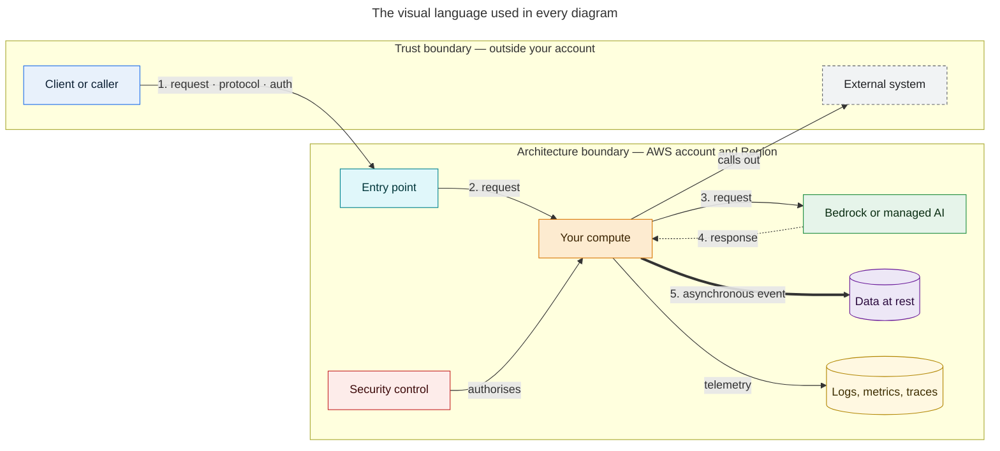

# Diagram index

> **Verified:** 2026-11-15 · All diagrams are the academy's own designs. They are **not official
> AWS reference architectures** and use no AWS logos.

[Academy home](../README.md) · [Diagram conventions](../templates/CONVENTIONS.md#5-diagrams) · [Content map](../CONTENT-MAP.md)

## How the diagrams are organised

| Location | What is there | Format |
|:--|:--|:--|
| [`mermaid/`](mermaid/) | The 30 numbered diagram sets. Each has three views — conceptual, detailed implementation and sequence — plus legend, variations and references | Mermaid inside Markdown |
| Inside chapters | Diagrams specific to one chapter | Mermaid inside Markdown |
| [`plantuml/`](plantuml/) | UML views where UML notation is clearer (sequence, component, deployment, state) | PlantUML `.puml` |
| [`drawio/`](drawio/) | Editable architecture diagrams for a few flagship designs | draw.io XML `.drawio` |
| [`rendered/`](rendered/) | SVG renderings of the Mermaid sets and PlantUML sources | SVG |

## Reading a diagram

| Element | Meaning |
|:--|:--|
| Outer box | Architecture boundary (an AWS account and Region) |
| Inner boxes | Trust or network boundaries (internet, VPC, subnet, AWS-managed service) |
| Solid arrow | Request, call or write — labelled with step number, operation, protocol and authentication |
| Dashed arrow | Response |
| Thick arrow | Asynchronous event or message |
| Cylinder | Data at rest |
| Colour | Role of the component — see the conventions for the palette |

## Numbered diagram sets

<!-- DIAGRAM-INDEX:START — generated by scripts/build-nav.py; do not edit by hand -->
| # | Diagram set | Mermaid source | Status |
|--:|:--|:--|:-:|
| 1 | AWS global infrastructure and networking | `mermaid/01-aws-global-infrastructure-and-networking.md` | 🚧 planned |
| 2 | Amazon Bedrock high-level architecture | `mermaid/02-bedrock-high-level-architecture.md` | 🚧 planned |
| 3 | Bedrock model inference lifecycle | `mermaid/03-model-inference-lifecycle.md` | 🚧 planned |
| 4 | Bedrock Converse API application architecture | `mermaid/04-converse-api-application.md` | 🚧 planned |
| 5 | Enterprise RAG architecture | `mermaid/05-enterprise-rag.md` | 🚧 planned |
| 6 | Knowledge Base ingestion pipeline | `mermaid/06-knowledge-base-ingestion-pipeline.md` | 🚧 planned |
| 7 | Knowledge Base retrieval pipeline | `mermaid/07-knowledge-base-retrieval-pipeline.md` | 🚧 planned |
| 8 | Managed Knowledge Base architecture | `mermaid/08-managed-knowledge-base.md` | 🚧 planned |
| 9 | Agentic retrieval architecture | `mermaid/09-agentic-retrieval.md` | 🚧 planned |
| 10 | Bedrock Agents (Classic) architecture | `mermaid/10-bedrock-agents-classic.md` | 🚧 planned |
| 11 | Multi-agent collaboration architecture | `mermaid/11-multi-agent-collaboration.md` | 🚧 planned |
| 12 | Amazon Bedrock AgentCore architecture | `mermaid/12-agentcore-architecture.md` | 🚧 planned |
| 13 | AgentCore Runtime and tool execution | `mermaid/13-agentcore-runtime-and-tool-execution.md` | 🚧 planned |
| 14 | AgentCore Gateway and Identity | `mermaid/14-agentcore-gateway-and-identity.md` | 🚧 planned |
| 15 | AgentCore Memory architecture | `mermaid/15-agentcore-memory.md` | 🚧 planned |
| 16 | AgentCore observability architecture | `mermaid/16-agentcore-observability.md` | 🚧 planned |
| 17 | Bedrock Flows architecture | `mermaid/17-bedrock-flows.md` | 🚧 planned |
| 18 | Guardrails architecture | `mermaid/18-guardrails.md` | 🚧 planned |
| 19 | Prompt caching architecture | `mermaid/19-prompt-caching.md` | 🚧 planned |
| 20 | Model evaluation architecture | `mermaid/20-model-evaluation.md` | 🚧 planned |
| 21 | Cross-Region inference architecture | `mermaid/21-cross-region-inference.md` | 🚧 planned |
| 22 | Serverless enterprise chatbot architecture | `mermaid/22-serverless-enterprise-chatbot.md` | 🚧 planned |
| 23 | Event-driven GenAI architecture | `mermaid/23-event-driven-genai.md` | 🚧 planned |
| 24 | Secure private enterprise Bedrock architecture | `mermaid/24-secure-private-enterprise-bedrock.md` | 🚧 planned |
| 25 | Multi-account AWS architecture | `mermaid/25-multi-account-aws.md` | 🚧 planned |
| 26 | CI/CD and IaC deployment architecture | `mermaid/26-cicd-and-iac-deployment.md` | 🚧 planned |
| 27 | Terraform state and module architecture | `mermaid/27-terraform-state-and-modules.md` | 🚧 planned |
| 28 | AWS CDK and CloudFormation synthesis architecture | `mermaid/28-cdk-and-cloudformation-synthesis.md` | 🚧 planned |
| 29 | Production monitoring and incident-response architecture | `mermaid/29-production-monitoring-and-incident-response.md` | 🚧 planned |
| 30 | Enterprise end-to-end GenAI reference architecture | `mermaid/30-enterprise-end-to-end-genai-reference.md` | 🚧 planned |
<!-- DIAGRAM-INDEX:END -->

## Previewing and rendering

- **On GitHub or GitLab**: Mermaid blocks render inline; open any file in `mermaid/`.
- **In VS Code**: install a Mermaid preview extension and open the Markdown preview.
- **To SVG**: `node scripts/check-mermaid.cjs --render diagrams/rendered` (see [scripts](../scripts/README.md)).
- **PlantUML**: `bash scripts/check-plantuml.sh --render diagrams/rendered`, or any PlantUML viewer.
- **draw.io**: open the `.drawio` file at diagrams.net or in the draw.io desktop app.
