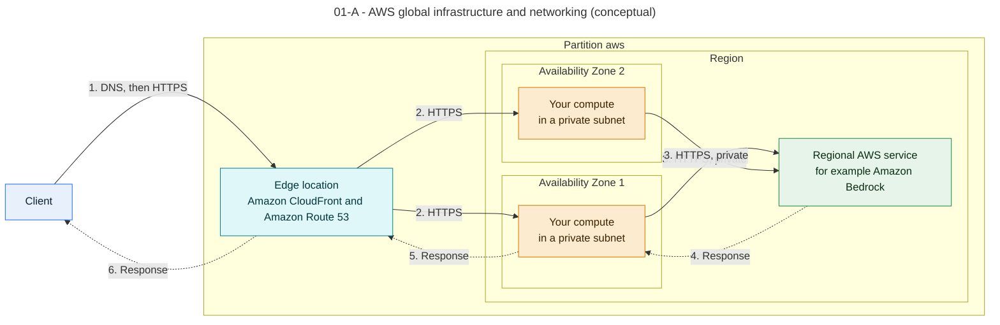
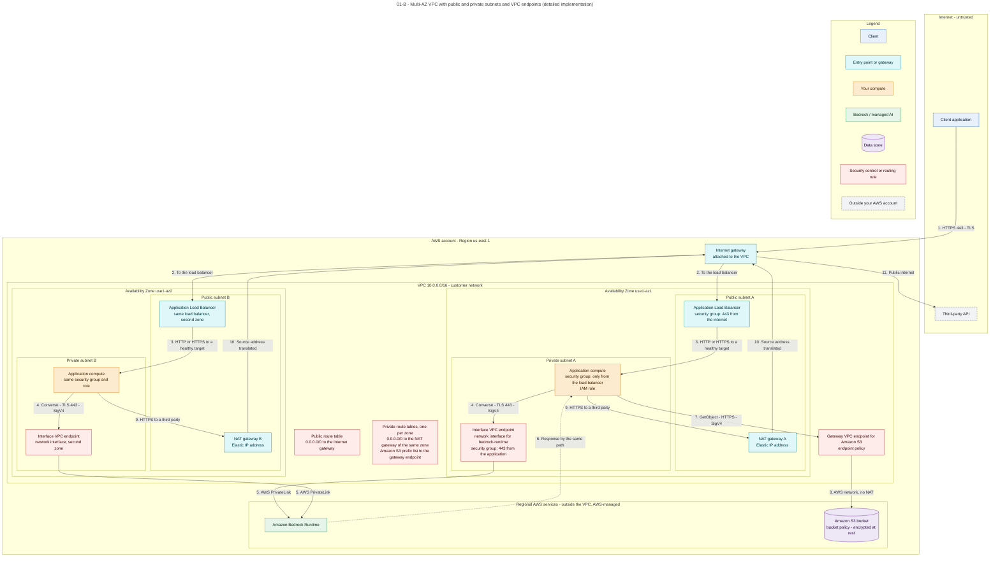
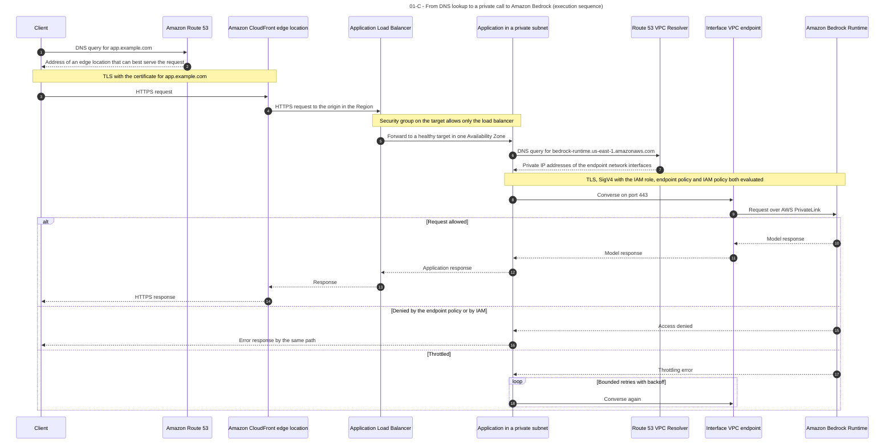

# Diagram 01 — AWS global infrastructure and networking

> **Verified:** 2026-11-15 · **Type:** academy design, not an official AWS reference architecture · **Related chapters:** [AWS global infrastructure](../../00-foundations/aws-fundamentals/01-global-infrastructure.md) · [VPCs and subnets](../../00-foundations/networking/01-vpc-and-subnets.md) · [Public and private networking](../../00-foundations/networking/02-public-private-networking.md) · [VPC endpoints and AWS PrivateLink](../../00-foundations/networking/03-vpc-endpoints-and-privatelink.md)

This set documents the ground every other diagram in the academy stands on: where AWS resources
live (partition, Region, Availability Zone, edge) and how a network inside one Region is laid out
so that a request can come in from the internet, reach compute that has no public address, and call
an AWS service such as Amazon Bedrock without crossing the internet again. It answers the question
"what are all those boxes around my application, and which one does my traffic go through?".

## A. Conceptual view

The idea in as few boxes as possible: a partition contains Regions, a Region contains Availability
Zones, and the edge sits in front.

**What this shows** — the nesting of AWS locations and the shortest useful request path. A client is
sent by DNS to an edge location (1), which forwards to your compute in one of at least two
Availability Zones (2). The compute calls a Regional service that AWS itself runs across the zones
(3) and the answers travel back the same way (4–6). Everything inside the outer box shares one
instance of IAM; nothing in it is reachable with credentials from another partition.

## B. Detailed implementation view

Every component, boundary, protocol, data store and security control of a two-zone network in one
Region.

**Legend** — solid arrow: request or write · dashed arrow: response · cylinder: data at rest · nested
boxes: trust and network boundaries (internet, account and Region, VPC, Availability Zone, subnet).
The two route-table nodes carry no arrows: they are the rules that make arrows 2, 7, 9 and 10
possible.

**Walkthrough**

1. A client opens an HTTPS connection to the application's public name.
2. The internet gateway delivers the traffic to the load balancer, which has a network presence in a public subnet of each zone.
3. The load balancer forwards the request to a healthy target in a private subnet. The target's security group accepts traffic only from the load balancer's security group.
4. The application calls `Converse`. Private DNS resolves the usual service name to the private IP addresses of the endpoint's network interfaces; the diagram draws the one in the same zone.
5. The interface endpoint carries the request to Amazon Bedrock Runtime over AWS PrivateLink.
6. The response returns along the same path.
7. The application reads an object from Amazon S3. The private route table sends S3-bound traffic to the gateway endpoint.
8. The gateway endpoint reaches Amazon S3 on the AWS network, with no NAT device involved.
9. For a destination that has no endpoint — a third-party API — the default route sends traffic to the NAT gateway in the same zone.
10. The NAT gateway replaces the private source address and forwards to the internet gateway.
11. The request leaves for the public internet. Nothing on the internet can open a connection back through the NAT gateway.

### Component roles

| Component | Role in this architecture | Security control |
|:--|:--|:--|
| Internet gateway | Connects the VPC to the internet; the target of the public route | None of its own: route tables and security groups decide what may use it |
| Public route table | Makes a subnet public by routing `0.0.0.0/0` to the internet gateway | Associated only with the two public subnets |
| Private route tables | One per zone: default route to that zone's NAT gateway, plus the Amazon S3 prefix-list route added by the gateway endpoint | No route to the internet gateway, so nothing in these subnets is reachable from the internet |
| Application Load Balancer | Single point of contact for clients; sends requests only to healthy targets, across zones | Security group; TLS on the listener |
| NAT gateway (zonal) | Outbound-only internet access for one zone's private subnet | Connections must start inside the VPC; a security group cannot be attached to it |
| Application compute | Runs your code: Amazon EC2, a container task, or an AWS Lambda function attached to the VPC | Security group that references the load balancer's security group; IAM role |
| Interface VPC endpoint | One network interface with a private IP address per selected subnet; private DNS points the service name at it | Security group on the network interfaces; endpoint policy |
| Gateway VPC endpoint | A route-table target for Amazon S3 (and Amazon DynamoDB); it does not use AWS PrivateLink | Endpoint policy; the bucket policy can require the endpoint |
| Amazon Bedrock Runtime | Regional service that runs the model; outside your VPC | IAM policy on the caller's role |
| Amazon S3 bucket | Regional storage; outside your VPC | Bucket policy, Block Public Access, encryption at rest |
| Security groups (on the nodes) | Stateful allow rules on network interfaces; a rule can name another security group as its source | They are the control |
| Network ACLs (not drawn) | Allow and deny rules for a whole subnet | Optional second layer |
| Route 53 VPC Resolver (see view C) | Answers DNS queries inside the VPC, including the private names of interface endpoints | Optional DNS Firewall |

### Connections

| # | From → To | Protocol / operation | Direction of data | Auth |
|--:|:--|:--|:--|:--|
| 1 | Client → internet gateway | HTTPS 443 (TLS) | Request in | Server certificate; your application's own sign-in |
| 2 | Internet gateway → load balancer | Routed to the load balancer's public address | Request in | Load balancer security group |
| 3 | Load balancer → application | HTTP or HTTPS | Request in | Security group reference |
| 4 | Application → interface endpoint | HTTPS 443, `Converse` | Prompt out | SigV4 with the IAM role; endpoint security group |
| 5 | Interface endpoint → Amazon Bedrock Runtime | AWS PrivateLink | Prompt out | Endpoint policy and IAM policy |
| 6 | Amazon Bedrock Runtime → application | HTTPS response | Model output back | — |
| 7 | Application → gateway endpoint | HTTPS, `GetObject`, routed by prefix list | Request out, object back | SigV4 with the IAM role |
| 8 | Gateway endpoint → Amazon S3 | AWS network | Request out, object back | Endpoint policy and bucket policy |
| 9 | Application → NAT gateway | HTTPS | Request out | Security group outbound rule |
| 10 | NAT gateway → internet gateway | Address translation to the Elastic IP address | Request out | — |
| 11 | Internet gateway → third-party API | HTTPS over the public internet | Request out, response back | Whatever the third party requires |

## C. Sequence view

Steps 1–2 are name resolution: public DNS sends the client to an edge location. Steps 3–5 bring the
request from the edge into the Region and through the load balancer to compute that has no public
address. Steps 6–7 are a second, private name resolution: because private DNS is enabled on the
interface endpoint, the normal Bedrock endpoint name resolves to private addresses inside the VPC.
Steps 8–9 are the model call, which never touches an internet gateway or a NAT gateway. The first
branch of the `alt` block returns the answer.

Failure paths:

- **Access denied.** The call fails if either the endpoint policy or the caller's IAM policy does
  not allow it. An endpoint policy "does not override or replace identity-based policies or
  resource-based policies"; both must agree.
- **Throttling.** The application retries a bounded number of times with backoff. AWS advises
  adding "bounded retries and multi-Region or multi-model fallback in your application".
- **One Availability Zone is impaired.** The load balancer sends requests only to healthy targets,
  and the endpoint has a network interface in each zone, so the other zone keeps working.
- **Private DNS is disabled, or the VPC's DNS attributes are off.** Step 7 returns public addresses.
  The call then leaves through the NAT gateway — or fails, in a VPC without one. Check the DNS
  answer first when a "private" workload shows NAT traffic.
- **The security group on the endpoint does not allow port 443 from the application.** **Our
  reading:** step 8 then typically times out rather than returning an error, which makes a network
  rule look like a model problem.

## Variations

| Variation | What changes |
|:--|:--|
| Regional NAT gateway instead of zonal ones | One NAT gateway for the VPC that expands across zones automatically; no public subnet is needed to host it and all private subnets can share one route entry. NAT gateways A and B merge into one node |
| No internet egress at all | Remove the NAT gateways and arrows 9–11. Every AWS service the application calls then needs its own endpoint — see [Diagram 24](24-secure-private-enterprise-bedrock.md) |
| Amazon CloudFront with VPC origins | The load balancer moves to a private subnet and CloudFront becomes the only way in. An internet gateway must still be attached to the VPC |
| Amazon API Gateway and AWS Lambda instead of a load balancer and containers | The entry point becomes a Regional service outside the VPC; only functions attached to the VPC use the subnets — see [Diagram 22](22-serverless-enterprise-chatbot.md) |
| Interface endpoint for Amazon S3 instead of the gateway endpoint | Amazon S3 supports both. Interface endpoints are billed per hour and per GB; gateway endpoints have no additional charge |
| Private DNS disabled on the interface endpoint | The application must be given the endpoint's own DNS name as the endpoint URL |
| Three Availability Zones | A third column; the interface endpoint gets one subnet per zone |
| Local Zone subnets | VPC endpoints cannot be created in Local Zone subnets, and outbound internet traffic leaves from the Local Zone |
| Cross-Region inference | The network picture does not change: the application still calls the endpoint in its own Region, and Amazon Bedrock routes onward on the AWS network — see [Diagram 21](21-cross-region-inference.md) |
| IPv6 | Dual-stack subnets; an egress-only internet gateway gives outbound-only IPv6 access |
| Clients on a corporate network | Traffic enters through AWS Site-to-Site VPN or AWS Direct Connect instead of the internet gateway, and Resolver endpoints join the two DNS worlds |
| Another partition | The same building blocks in `aws-us-gov`, `aws-cn` or `aws-eusc`, with different endpoints, ARNs and feature sets |

## Practical example

- **Concepts:** read [AWS global infrastructure](../../00-foundations/aws-fundamentals/01-global-infrastructure.md)
  for view A, then the three networking chapters linked in the header for view B.
- **Bedrock specifics:** [Private connectivity for Bedrock](../../02-related-aws-services/networking/01-private-connectivity-for-bedrock.md)
  lists the endpoint service names and endpoint policies.
- **Implementation:** [Project E: secure private enterprise GenAI](../../05-practical-projects/project-05-private-genai/README.md)
  is the project assigned to this architecture. It was not yet written on the verification date, so
  this set names no files: use the file list in the project's README once it exists, and look there
  for the VPC, the subnets and route tables, and the VPC endpoints.
- **Design pattern:** [Pattern: secure private enterprise Bedrock](../../03-architecture-patterns/private-enterprise/README.md).

## References

- [AWS Fault Isolation Boundaries — Partitions](https://docs.aws.amazon.com/whitepapers/latest/aws-fault-isolation-boundaries/partitions.html), [Regions](https://docs.aws.amazon.com/whitepapers/latest/aws-fault-isolation-boundaries/regions.html) and [Availability Zones](https://docs.aws.amazon.com/whitepapers/latest/aws-fault-isolation-boundaries/availability-zones.html) — the nesting in view A.
- [How CloudFront delivers content](https://docs.aws.amazon.com/AmazonCloudFront/latest/DeveloperGuide/HowCloudFrontWorks.html) — DNS routes each request to an edge location (view C, steps 1–3).
- [Restrict access with VPC origins](https://docs.aws.amazon.com/AmazonCloudFront/latest/DeveloperGuide/private-content-vpc-origins.html) — CloudFront in front of a load balancer in a private subnet.
- [What is Amazon Route 53?](https://docs.aws.amazon.com/Route53/latest/DeveloperGuide/Welcome.html) and [What is Route 53 VPC Resolver?](https://docs.aws.amazon.com/Route53/latest/DeveloperGuide/resolver.html) — public DNS and DNS inside the VPC.
- [How Amazon VPC works](https://docs.aws.amazon.com/vpc/latest/userguide/how-it-works.html) and [Subnets for your VPC](https://docs.aws.amazon.com/vpc/latest/userguide/configure-subnets.html) — VPC, subnets, public versus private, one zone per subnet.
- [Internet gateways](https://docs.aws.amazon.com/vpc/latest/userguide/VPC_Internet_Gateway.html) and [Configure route tables](https://docs.aws.amazon.com/vpc/latest/userguide/VPC_Route_Tables.html) — arrows 1, 2 and 11 and both route-table nodes.
- [NAT gateways](https://docs.aws.amazon.com/vpc/latest/userguide/vpc-nat-gateway.html), [NAT gateway basics](https://docs.aws.amazon.com/vpc/latest/userguide/nat-gateway-basics.html) and [Regional NAT gateways](https://docs.aws.amazon.com/vpc/latest/userguide/nat-gateways-regional.html) — arrows 9 and 10 and the first variation.
- [Security groups](https://docs.aws.amazon.com/vpc/latest/userguide/vpc-security-groups.html) and [Security group rules](https://docs.aws.amazon.com/vpc/latest/userguide/security-group-rules.html) — stateful rules and security group referencing.
- [What is an Application Load Balancer?](https://docs.aws.amazon.com/elasticloadbalancing/latest/application/introduction.html) — arrow 3 and health checks.
- [Gateway endpoints](https://docs.aws.amazon.com/vpc/latest/privatelink/gateway-endpoints.html) — arrows 7 and 8.
- [Access AWS services through AWS PrivateLink](https://docs.aws.amazon.com/vpc/latest/privatelink/privatelink-access-aws-services.html), [Access an AWS service using an interface VPC endpoint](https://docs.aws.amazon.com/vpc/latest/privatelink/create-interface-endpoint.html) and [Endpoint policies](https://docs.aws.amazon.com/vpc/latest/privatelink/vpc-endpoints-access.html) — arrows 4 and 5, private DNS, security groups and policies.
- [Interface VPC endpoints for Amazon Bedrock](https://docs.aws.amazon.com/bedrock/latest/userguide/vpc-interface-endpoints.html) — service names and private DNS names for Bedrock.
- [Cross-Region inference](https://docs.aws.amazon.com/bedrock/latest/userguide/cross-region-inference.html) — retries and fallback; traffic stays on the AWS network.
- [How AWS Local Zones work](https://docs.aws.amazon.com/local-zones/latest/ug/how-local-zones-work.html) — the Local Zone variation.
