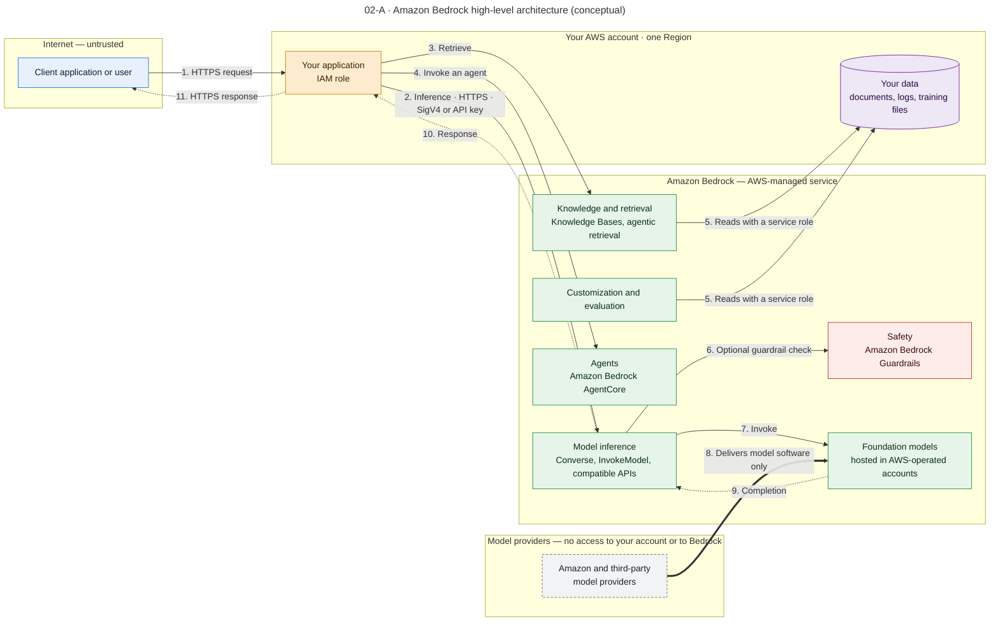
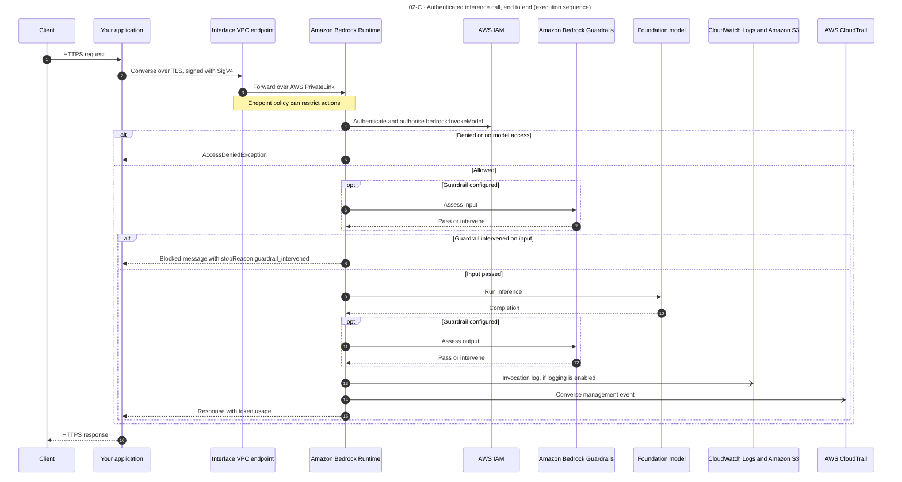

# Diagram 02 — Amazon Bedrock high-level architecture

> **Verified:** 2026-11-15 · **Type:** academy design, not an official AWS reference architecture · **Related chapters:** [What Amazon Bedrock is](../../01-amazon-bedrock/overview/01-what-is-amazon-bedrock.md) · [Endpoints, APIs and authentication](../../01-amazon-bedrock/overview/02-endpoints-apis-and-authentication.md) · [Model access and subscriptions](../../01-amazon-bedrock/overview/03-model-access-and-subscriptions.md) · [Private connectivity for Bedrock](../../02-related-aws-services/networking/01-private-connectivity-for-bedrock.md)

This set documents Amazon Bedrock as a whole: what your application talks to, which endpoints
belong to the control plane and which to the data plane, and where your prompts, outputs and
logs can come to rest. It answers the question "when my application calls a model, what exactly
is involved, and what is mine to secure?". AWS documents the endpoints, permissions and data
handling shown here; the internal wiring inside the service boundary is a conceptual model.

## A. Conceptual view

Three parties: your application, the Bedrock capabilities it calls, and the model providers
whose models AWS hosts.

**What this shows** — your application is the only component that talks to both your users and
Bedrock. Bedrock groups its capabilities around inference; features that need your data read it
with an IAM role you pass to the service. Model providers deliver their models to AWS and take no
part in a request: AWS states that providers "don't have access to Amazon Bedrock logs or to
customer prompts and completions".

**Walkthrough**

1. A user or client calls your application.
2. The application sends an inference request, authenticated with SigV4 or a Bedrock API key.
3. For grounded answers it calls a knowledge base.
4. For multi-step tasks it invokes an agent hosted on AgentCore.
5. Knowledge bases, customization jobs and evaluations read your data through a service role.
6. Inference can pass input and output through a guardrail.
7. The request reaches a foundation model in an AWS-operated model deployment account.
8. Separately, and never per request, a provider delivers model software to AWS.
9. The model returns a completion.
10. Bedrock returns the response to your application.
11. Your application answers the user.

**Legend** — solid arrow: request · dashed arrow: response · thick arrow: asynchronous, out-of-band delivery · cylinder: data at rest · boxes: trust boundaries.

## B. Detailed implementation view

Every endpoint family, boundary, protocol, data store and security control for a private
inference path.

```mermaid
---
title: 02-B · Amazon Bedrock high-level architecture (detailed implementation)
---
flowchart TB
    subgraph internet["Internet — untrusted"]
        user["Client application"]:::client
    end
    subgraph account["Your AWS account · one Region"]
        pipeline["IaC pipeline role<br/>control-plane permissions"]:::client
        subgraph vpc["VPC — private subnets"]
            app["Your application<br/>IAM role · data-plane permissions"]:::compute
            vpce["Interface VPC endpoints<br/>bedrock · bedrock-runtime · bedrock-mantle<br/>bedrock-agent · bedrock-agent-runtime"]:::security
        end
        iam["AWS IAM<br/>identity policies · SCPs · endpoint policies"]:::security
        kms["AWS KMS<br/>customer managed key"]:::security
        cwl[("Amazon CloudWatch Logs<br/>model invocation logs")]:::obs
        s3logs[("Amazon S3<br/>invocation logs · large payloads")]:::obs
        trail[("AWS CloudTrail<br/>management and data events")]:::obs
        s3data[("Amazon S3<br/>your documents and training data")]:::data
    end
    subgraph bedrock["Amazon Bedrock — AWS-managed service boundary"]
        subgraph cplane["Control plane"]
            cp["bedrock<br/>models, access, guardrails, logging config"]:::ai
            cpAgent["bedrock-agent<br/>knowledge bases, flows, prompts"]:::ai
            cpOther["bedrock-data-automation<br/>bedrock-agentcore-control"]:::ai
        end
        subgraph dplane["Data plane"]
            rt["bedrock-runtime<br/>Converse · InvokeModel<br/>/openai/v1 · /anthropic"]:::ai
            mantle["bedrock-mantle<br/>Responses · Chat Completions · Messages"]:::ai
            agentRt["bedrock-agent-runtime<br/>Retrieve · AgenticRetrieveStream · InvokeFlow"]:::ai
            dpOther["bedrock-data-automation-runtime<br/>bedrock-agentcore"]:::ai
        end
        guard["Amazon Bedrock Guardrails"]:::security
        held[("Service-held customer data<br/>stored responses · managed knowledge bases<br/>custom models")]:::data
        subgraph mda["Model deployment accounts — AWS-operated, one per provider per Region"]
            fm["Foundation models"]:::ai
        end
    end
    subgraph providers["Model providers"]
        provider["Model provider"]:::external
    end

    user -- "1. HTTPS" --> app
    app -- "2. Converse · TLS 1.2 or later · SigV4" --> vpce
    vpce -- "3. AWS PrivateLink" --> rt
    vpce --> mantle
    vpce --> agentRt
    rt -- "4. Authorise bedrock:InvokeModel" --> iam
    rt -- "5. Optional guardrail · input and output" --> guard
    rt -- "6. Inference" --> fm
    fm -. "7. Completion" .-> rt
    rt -. "8. Response" .-> app
    rt == "9. Invocation log, if enabled" ==> cwl
    rt == "9. Invocation log, if enabled" ==> s3logs
    rt == "10. API event" ==> trail
    pipeline -- "11. Configure · HTTPS · SigV4" --> cp
    cp == "12. Management event" ==> trail
    kms -- "13. Encrypts" --> s3logs
    kms -- "13. Encrypts" --> cwl
    cpAgent -- "14. Ingestion reads with a service role" --> s3data
    rt -- "15. Stores a response when store is true" --> held
    provider == "16. Model delivery · no access to prompts or logs" ==> fm

    classDef client   fill:#E8F1FB,stroke:#1F6FEB,color:#0B1F33
    classDef compute  fill:#FDEBD0,stroke:#D97706,color:#3B2300
    classDef ai       fill:#E6F4EA,stroke:#1E8E3E,color:#0B2E13
    classDef data     fill:#EDE7F6,stroke:#6A1B9A,color:#2A0A3D
    classDef security fill:#FDECEA,stroke:#C62828,color:#3D0A0A
    classDef obs      fill:#FFF8E1,stroke:#B28704,color:#3D2E00
    classDef external fill:#F1F3F4,stroke:#5F6368,color:#202124,stroke-dasharray:4 3
```

**Legend** — solid arrow: request or write · dashed arrow: response · thick arrow: asynchronous record or delivery · cylinder: data at rest · nested boxes: trust and network boundaries.

| Colour class | Meaning in this diagram |
|:--|:--|
| Blue (`client`) | Callers: users, and the pipeline that configures Bedrock |
| Orange (`compute`) | Your compute |
| Green (`ai`) | Bedrock endpoints and models |
| Purple (`data`) | Customer data at rest |
| Red (`security`) | Security controls: IAM, KMS, guardrails, VPC endpoints |
| Yellow (`obs`) | Logs and audit records |
| Grey, dashed (`external`) | Outside your account and outside Bedrock operations |

**What this shows** — two roles with different permissions reach two different planes. The
application's traffic stays on AWS PrivateLink; authorisation, guardrails and logging happen
around the model call; and customer data rests in four places: your S3 buckets, your log
destinations, your CloudTrail trail, and service-held stores inside Bedrock. Interface endpoints
for AgentCore exist under their own service names (see the
[feature verification matrix](../../FEATURE-VERIFICATION.md)); none was found documented for
Data Automation.

**Walkthrough**

1. A client calls your application over HTTPS.
2. The application calls `Converse` with SigV4, over TLS, addressed to the interface endpoint.
3. AWS PrivateLink carries the request to `bedrock-runtime` without crossing the internet.
4. Bedrock authorises `bedrock:InvokeModel` for the calling role.
5. If the request names a guardrail, input and output are assessed.
6. The model runs in an AWS-operated model deployment account.
7. The completion returns to the runtime endpoint.
8. The response returns to the application.
9. If model invocation logging is enabled, the request and response are delivered to CloudWatch Logs, Amazon S3, or both.
10. The API call is recorded in CloudTrail.
11. Separately, a pipeline role configures guardrails, logging and other resources on the control plane.
12. Control-plane calls are recorded as CloudTrail management events.
13. A customer managed KMS key can encrypt the log bucket and the log group.
14. Knowledge base ingestion reads your documents with a service role.
15. The Responses API keeps a response for 30 days unless `store` is `false`.
16. Providers deliver model software to AWS; they cannot reach prompts, completions or logs.

### Component roles

| Component | Role in this architecture | Security control |
|:--|:--|:--|
| Client application | Sends user requests | Your own authentication, outside this diagram |
| Your application | Builds prompts and calls Bedrock | IAM role with data-plane actions only |
| IaC pipeline role | Creates and changes Bedrock resources | IAM role with control-plane actions; change review |
| Interface VPC endpoints | Private entry points per namespace | Endpoint policy; security groups; private DNS |
| AWS IAM | Authenticates and authorises every call | Identity policies, SCPs, condition keys |
| `bedrock` and other control-plane endpoints | Hold configuration: guardrails, knowledge bases, logging, access | `bedrock:` actions; CloudTrail management events |
| `bedrock-runtime` | Inference: Converse, InvokeModel, OpenAI- and Anthropic-compatible APIs | `bedrock:InvokeModel`; guardrails; invocation logging |
| `bedrock-mantle` | Inference with Projects, Workspaces, server-side tools | `bedrock-mantle:CreateInference`; no guardrails or invocation logging |
| `bedrock-agent-runtime` | Retrieval, flows, Agents Classic | CloudTrail data events when enabled |
| Amazon Bedrock Guardrails | Assesses prompts and completions | `bedrock:ApplyGuardrail`; guardrail version pinned in the request |
| Model deployment accounts | Run the models | Operated by AWS; providers have no access |
| CloudWatch Logs and Amazon S3 (logs) | Hold full prompts and outputs when logging is on | Same account and Region only; KMS; least-privilege read access |
| AWS CloudTrail | Audit trail of API calls | Trail to a protected bucket; data events for mantle and agents |
| AWS KMS | Encrypts log destinations and selected Bedrock resources | Key policy allowing `bedrock.amazonaws.com` where needed |
| Service-held customer data | Stored responses, managed knowledge bases, custom models | `store` parameter; data retention mode; KMS key where supported |

### Connections

| # | From → To | Protocol / operation | Direction of data | Auth |
|--:|:--|:--|:--|:--|
| 1 | Client → application | HTTPS | Request in | Your application's own |
| 2 | Application → interface endpoint | `Converse` · HTTPS, TLS 1.2 or later | Prompt out | SigV4 with the application role |
| 3 | Interface endpoint → `bedrock-runtime` | AWS PrivateLink | Prompt out | Endpoint policy |
| 4 | `bedrock-runtime` → IAM | Policy evaluation | — | `bedrock:InvokeModel` |
| 5 | `bedrock-runtime` → Guardrails | Guardrail assessment | Prompt and completion | `bedrock:ApplyGuardrail` |
| 6 | `bedrock-runtime` → model | Inference inside AWS | Prompt | Service-internal |
| 7 | Model → `bedrock-runtime` | Completion | Completion back | Service-internal |
| 8 | `bedrock-runtime` → application | HTTPS response or event stream | Completion back | Same TLS session |
| 9 | `bedrock-runtime` → CloudWatch Logs, S3 | Log delivery, asynchronous | Prompt, completion, metadata | Service principal `bedrock.amazonaws.com` with a role or bucket policy |
| 10 | `bedrock-runtime` → CloudTrail | API event | Metadata | Service-internal |
| 11 | Pipeline → `bedrock` | Control-plane API · HTTPS | Configuration | SigV4 with the pipeline role |
| 12 | `bedrock` → CloudTrail | Management event | Metadata | Service-internal |
| 13 | KMS → log bucket and log group | Envelope encryption | Keys | Key policy |
| 14 | `bedrock-agent` → your S3 bucket | Object reads during ingestion | Documents | Service role you pass to Bedrock |
| 15 | `bedrock-runtime` → service-held store | Stored response (Responses API) | Prompt and completion | Scoped to the account's project |
| 16 | Provider → model deployment account | Model delivery, out of band | Model software only | AWS-operated |

### Where customer data rests

| Data | Location | You control it with |
|:--|:--|:--|
| Model invocation logs | Your CloudWatch Logs log group and S3 bucket, same account and Region | Enabling or disabling logging; KMS; retention on the destination |
| Stored responses (Responses API) | Held by Bedrock for 30 days, in the Region that processed the request | `store`; data retention mode |
| Content retained for abuse detection | Held by AWS for up to 30 days for specific models, in the processing Region | Model choice; data retention mode |
| Source documents and training data | Your S3 buckets | Bucket policy; SSE-KMS |
| Managed knowledge bases, custom models | Held by Bedrock | Resource deletion; KMS key where supported |
| API audit events | Your CloudTrail event history and trail bucket | Trail configuration |

## C. Sequence view

| Step | What happens |
|:--|:--|
| 1 | The client calls your application. |
| 2 | The application signs a `Converse` request with its role's temporary credentials. |
| 3 | The interface endpoint forwards it privately. The endpoint policy is the first control. |
| 4 | Bedrock authenticates the signature and evaluates identity policies and SCPs. |
| 5 | **Failure path:** a missing permission, a deny, or missing model access returns `AccessDeniedException`. For a third-party model this can appear minutes after the first successful call (see [Model access and subscriptions](../../01-amazon-bedrock/overview/03-model-access-and-subscriptions.md)). |
| 6–7 | If the request carries `guardrailConfig`, the input is assessed. |
| 8 | **Failure path:** on intervention the response carries the configured blocked message and `stopReason` `guardrail_intervened`; the model is not called. |
| 9–10 | The model runs and returns a completion. |
| 11–12 | The output is assessed by the same guardrail; an intervention replaces the output. |
| 13 | If model invocation logging is on, the full request and response are delivered to your log destinations. |
| 14 | CloudTrail records the call as a management event; guardrail evaluations are `ApplyGuardrail` data events if you enable them. |
| 15 | The application receives the response, including token usage. |
| 16 | The application answers the client. |

Other failure paths: a request over quota is throttled and should be retried with exponential
backoff; a malformed request or an unsupported feature for the endpoint returns a validation
error. **Our reading:** the order of steps 13 and 14 relative to step 15 is not documented; both
are asynchronous records.

## Variations

| Variation | What changes |
|:--|:--|
| **API:** InvokeModel instead of Converse | Same endpoint, IAM action and logging. The body is model-native, so prompts and guardrail options are expressed differently. |
| **API:** streaming (`ConverseStream`, `InvokeModelWithResponseStream`) | Needs `bedrock:InvokeModelWithResponseStream`; step 15 becomes an event stream. |
| **API:** Responses or Chat Completions on `bedrock-runtime` | Path `/openai/v1`. The OpenAI SDK authenticates with a Bedrock API key in a bearer header. Guardrails are selected with the `X-Amzn-Bedrock-GuardrailIdentifier` and `X-Amzn-Bedrock-GuardrailVersion` headers. Responses adds connection 15 and a second IAM resource, the default project. |
| **API:** Anthropic Messages on `bedrock-runtime` | Path `/anthropic`; Anthropic SDK with a Bedrock API key. |
| **Endpoint:** `bedrock-mantle` | The IAM action is `bedrock-mantle:CreateInference`. Guardrail steps and invocation logging disappear. The CloudTrail record is a `CreateInference` *data* event with event source `bedrock-mantle.amazonaws.com`, recorded only if enabled. Usage is attributed to a Project or Workspace. Server-side tools such as Web Search add calls inside the service. |
| **Endpoint:** public endpoint instead of an interface endpoint | Steps 2 and 3 merge; traffic leaves the VPC through a NAT or internet gateway. `aws:SourceIp` conditions become usable. |
| **Endpoint:** FIPS | `bedrock-runtime-fips` and `bedrock-fips` hostnames and endpoint services exist in a subset of US, Canada and GovCloud Regions. |
| **Authentication:** Bedrock API key | Step 2 carries a bearer token; IAM also evaluates `bedrock:CallWithBearerToken`. Keys cannot be used with the agent or Data Automation APIs. |
| **Region:** in-Region inference | The model runs in the Region you called. |
| **Region:** Geo or Global cross-Region inference profile | Step 9 can run in another Region of the geography, or in any supported commercial Region. Stored responses and abuse-detection retention rest in the Region that processed the request. |
| **Region:** endpoint availability | `bedrock-runtime` exists wherever Bedrock is offered; `bedrock-mantle`, agents, Data Automation and AgentCore exist in fewer Regions. |
| **Model:** third-party model with an AWS Marketplace product ID | The first call starts a subscription in the background; a failed subscription turns later calls into `AccessDeniedException`. |
| **Model:** Anthropic models earlier than Claude Opus 4.7 | The first-time-use form must exist for the account or organisation, unless the model is reached through `bedrock-mantle`. |
| **Model:** OpenAI GPT models on `bedrock-runtime` | The request must name a `us.` or `global.` inference profile; classifier-flagged traffic can be retained for up to 30 days. |
| **Model:** models that require retention for review | The Region's data retention mode must allow it (`aws_review`), otherwise runtime returns a `ValidationException`. All traffic is retained for up to 30 days. |
| **Configuration:** invocation logging off (the default) | Connection 9 does not exist; no prompt or completion is written to your account. |
| **Configuration:** no guardrail | Steps 6–8 and 11–12 do not occur. |

## Practical example

- [Project A: basic Bedrock model inference](../../05-practical-projects/project-01-basic-inference/README.md)
  implements the public-endpoint variant of this architecture — start with its README, then the
  IAM policy and the model invocation logging configuration.
- [Project E: secure private enterprise GenAI](../../05-practical-projects/project-05-private-genai/README.md)
  implements view B with interface endpoints, KMS and logging.
- The next set, [Diagram 03 — Bedrock model inference lifecycle](03-model-inference-lifecycle.md),
  zooms into steps 4 to 15.

## References

- [Amazon Bedrock overview](https://docs.aws.amazon.com/bedrock/latest/userguide/what-is-bedrock.html) — the service and its recommended endpoint.
- [Inference endpoints supported by Amazon Bedrock](https://docs.aws.amazon.com/bedrock/latest/userguide/endpoints.html) — `bedrock-runtime` and `bedrock-mantle`, APIs and features per endpoint.
- [Amazon Bedrock endpoints and quotas (AWS General Reference)](https://docs.aws.amazon.com/general/latest/gr/bedrock.html) — endpoint hostnames per namespace, including FIPS.
- [Amazon Bedrock AgentCore endpoints and quotas](https://docs.aws.amazon.com/general/latest/gr/bedrock_agentcore.html) — AgentCore control-plane and data-plane hostnames.
- [Interface VPC endpoints for Amazon Bedrock](https://docs.aws.amazon.com/bedrock/latest/userguide/vpc-interface-endpoints.html) — PrivateLink service names, private DNS, endpoint policies.
- [Prerequisites for running model inference](https://docs.aws.amazon.com/bedrock/latest/userguide/inference-prereq.html) — `bedrock:InvokeModel`, `bedrock:InvokeModelWithResponseStream`, `bedrock:ApplyGuardrail`.
- [Include a guardrail with the Converse API](https://docs.aws.amazon.com/bedrock/latest/userguide/guardrails-use-converse-api.html) — `guardrailConfig` and `guardrail_intervened`.
- [Model invocation logging](https://docs.aws.amazon.com/bedrock/latest/userguide/model-invocation-logging.html) — destinations, service principal, runtime-only scope.
- [Monitor Amazon Bedrock API calls using CloudTrail](https://docs.aws.amazon.com/bedrock/latest/userguide/logging-using-cloudtrail.html) — management and data events on runtime.
- [Monitor bedrock-mantle API calls using CloudTrail](https://docs.aws.amazon.com/bedrock/latest/userguide/logging-cloudtrail-mantle.html) — data events and event source on mantle.
- [Data protection](https://docs.aws.amazon.com/bedrock/latest/userguide/data-protection.html) — model deployment accounts and TLS.
- [Data encryption](https://docs.aws.amazon.com/bedrock/latest/userguide/data-encryption.html) — KMS options and service roles.
- [Data retention](https://docs.aws.amazon.com/bedrock/latest/userguide/data-retention.html) and [Abuse detection](https://docs.aws.amazon.com/bedrock/latest/userguide/abuse-detection.html) — what Bedrock retains, where and for how long.
- [Responses API](https://docs.aws.amazon.com/bedrock/latest/userguide/inference-responses-api.html) — stored responses, guardrail headers, Region of storage.
- [API keys](https://docs.aws.amazon.com/bedrock/latest/userguide/api-keys.html) — bearer-token authentication.
- [Request access to models](https://docs.aws.amazon.com/bedrock/latest/userguide/model-access.html) — subscription behaviour on first use.
- [Regional availability by endpoints](https://docs.aws.amazon.com/bedrock/latest/userguide/endpoints-region-availability.html) and [Regional availability by models](https://docs.aws.amazon.com/bedrock/latest/userguide/models-region-compatibility.html) — endpoint Regions and in-Region, Geo and Global routing.
- [Amazon Bedrock FAQs](https://aws.amazon.com/bedrock/faqs/) — training use and sharing with providers.
- Generated reference: [Amazon Bedrock API operations](../../references/bedrock-api-operations.md) — operation names per namespace.
