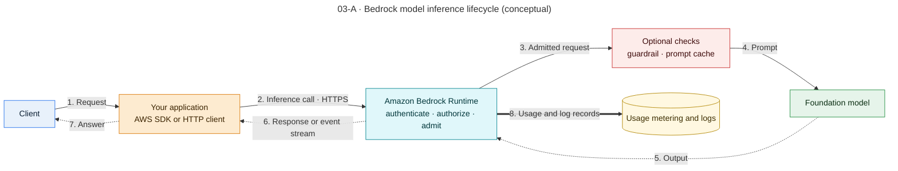
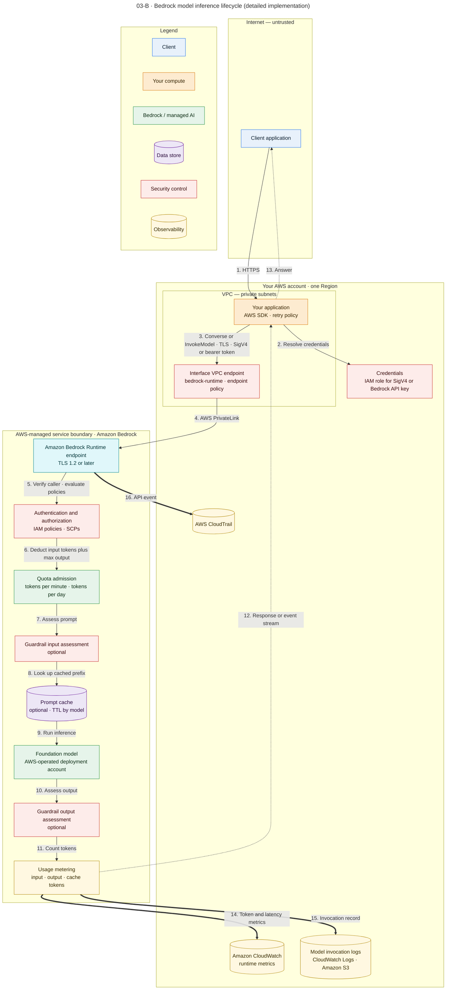
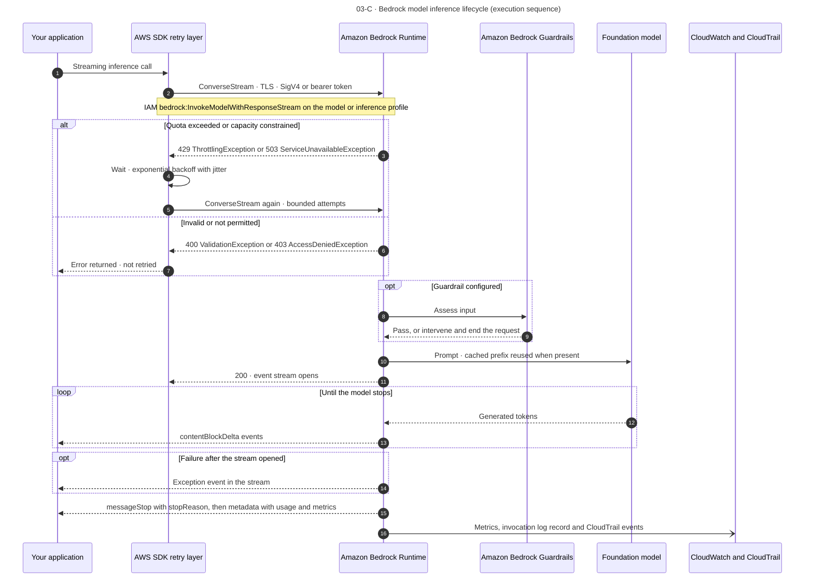

# Diagram 03 — Bedrock model inference lifecycle

> **Verified:** 2026-11-15 · **Type:** academy design, not an official AWS reference architecture · **Related chapters:** [The Converse API](../../01-amazon-bedrock/inference/01-converse-api.md) · [InvokeModel and streaming APIs](../../01-amazon-bedrock/inference/02-invokemodel-and-streaming.md) · [OpenAI- and Anthropic-compatible APIs](../../01-amazon-bedrock/inference/03-openai-and-anthropic-compatible-apis.md) · [Endpoints, APIs and authentication](../../01-amazon-bedrock/overview/02-endpoints-apis-and-authentication.md)

This set follows one on-demand inference request through Amazon Bedrock, from the SDK call in
your application to the response and the records it leaves behind. It answers the question
"what happens, in what order, and what can stop my request at each step?".

> [!NOTE]
> **Documented fact and our reading** — AWS documents each stage shown here: authentication
> with SigV4 or a Bedrock API key, IAM authorization, quota deduction at the start of a request,
> guardrail assessment of input and output, prompt caching, token usage reporting, CloudTrail
> events and model invocation logging. AWS does not publish the internal order of those stages.
> The order drawn is **our reading**, a conceptual model that matches the documented behavior.
> Sources: [Inference endpoints](https://docs.aws.amazon.com/bedrock/latest/userguide/endpoints.html), [How tokens are counted](https://docs.aws.amazon.com/bedrock/latest/userguide/quotas-token-burndown.html)

## A. Conceptual view

**What this shows** — Every inference API on `bedrock-runtime` follows the same path: the
request is authenticated, authorized and admitted against a quota; optional guardrail and
cache steps wrap the model; the response returns on the same connection; usage and log records
are written to your account. Bedrock keeps no conversation content between calls.

## B. Detailed implementation view

**Legend** — solid arrow: request or write · dashed arrow: response · thick arrow: asynchronous
record · cylinder: data at rest · nested boxes: trust and network boundaries · teal: endpoint.

### Component roles

| Component | Role in this architecture | Security control |
|:--|:--|:--|
| Your application | Builds the request, holds any conversation state, retries transient errors | IAM role; no long-lived keys |
| Credentials | SigV4 signing with role credentials, or a Bedrock API key sent as a bearer token | Short-term credentials; `bedrock:CallWithBearerToken` governs key use |
| Interface VPC endpoint | Private path to `bedrock-runtime` | Endpoint policy; security group |
| Amazon Bedrock Runtime endpoint | Terminates TLS and accepts the inference APIs | TLS 1.2 required, TLS 1.3 recommended |
| Authentication and authorization | Evaluates identity policies, SCPs and the endpoint policy for `bedrock:InvokeModel` or `bedrock:InvokeModelWithResponseStream` on the target | Least-privilege resource ARNs; `bedrock:InferenceProfileArn` condition |
| Quota admission | Deducts input tokens plus the requested maximum output tokens; throttles with HTTP 429 when a quota is exceeded | Per model, per Region, per account |
| Guardrail input and output assessment | Applies the guardrail named in the request (or one enforced by the organization) to text and `guardContent` | Guardrail policies; `bedrock:ApplyGuardrail` |
| Prompt cache | Reuses a previously processed prompt prefix when one is available | Entry lives on the server that processed the request; expires after the model's TTL |
| Foundation model | Generates the output | Runs in an AWS-operated account that the model provider cannot access |
| Usage metering | Produces the token counts in the response, CloudWatch metrics and the bill | — |
| Model invocation logs | Optional full request and response records | Same account and Region; encrypt with KMS; contains prompts |
| AWS CloudTrail | Records who called which model | Management events for Converse and InvokeModel families |

### Connections

| # | From → To | Protocol / operation | Direction of data | Auth |
|--:|:--|:--|:--|:--|
| 1 | Client → application | HTTPS | User input in | Your application's user authentication |
| 2 | Application → credentials | SDK credential provider | Credentials in | IAM role |
| 3 | Application → VPC endpoint | HTTPS · `Converse`, `ConverseStream`, `InvokeModel`, `InvokeModelWithResponseStream` | Prompt out | SigV4 signature or `Authorization: Bearer` API key |
| 4 | VPC endpoint → Bedrock Runtime | AWS PrivateLink | Prompt out | Endpoint policy |
| 5 | Endpoint → authorization | Internal | Request context | IAM evaluation |
| 6 | Authorization → quota | Internal | Token estimate | — |
| 7 | Quota → guardrail input | Internal, optional | Prompt | Guardrail policy |
| 8 | Guardrail → prompt cache | Internal, optional | Prompt prefix | — |
| 9 | Cache → model | Internal | Prompt | — |
| 10 | Model → guardrail output | Internal, optional | Output | Guardrail policy |
| 11 | Guardrail → metering | Internal | Token counts | — |
| 12 | Bedrock → application | Same HTTPS connection; JSON body or event stream | Output and usage in | — |
| 13 | Application → client | HTTPS | Answer out | — |
| 14 | Bedrock → CloudWatch | Service-published metrics | Metrics | — |
| 15 | Bedrock → log destination | CloudWatch Logs or S3 delivery | Prompt and output copies | Bedrock service principal, bucket or role policy |
| 16 | Bedrock → CloudTrail | Event | Caller, model, Region | — |

## C. Sequence view

**Happy path** — Steps 1–2 send the request. Steps 8–9 run the optional input guardrail.
Step 10 runs the model; step 11 opens the stream; steps 12–13 repeat until the model stops;
step 15 delivers the stop reason and then the usage. Step 16 writes the records. For a
non-streaming call (`Converse`, `InvokeModel`), steps 11–15 collapse into one HTTP response.

**Throttling and retry** — Steps 3–5. A 429 means the request was not admitted because a quota
was exceeded; a 503 means the service is short of capacity, which is not a quota problem. Both
are retried by the SDK with exponential backoff and jitter, up to the configured number of
attempts. `ModelNotReadyException` also uses 429 and is retried automatically.

**Non-retryable errors** — Steps 6–7. Validation, access-denied and not-found errors go
straight back to your code. Fix the request, the policy or the model ID.

**Mid-stream failure** — Step 14. After HTTP 200 the status code cannot change, so a failure
arrives as an exception event (`modelStreamErrorException`, `throttlingException`,
`serviceUnavailableException`, `internalServerException`, `validationException`). botocore
raises it while your code iterates. Your application has already shown partial output and must
decide whether to retry the whole call.

**Guardrail intervention** — When the input guardrail blocks, the model is not the source of
the reply: the response carries the guardrail's configured message and `stopReason`
`guardrail_intervened`.

## Variations

| Variation | What changes |
|:--|:--|
| `InvokeModel` family instead of Converse | The body is model-native; guardrail, service tier and request metadata travel as headers; stream events are `chunk` events holding provider JSON |
| OpenAI- or Anthropic-compatible API on `bedrock-runtime` | The call goes to `/openai/v1` or `/anthropic` routes; the Responses API also authorizes the account's default project and, with `store` `true`, writes a stored response |
| `bedrock-mantle` endpoint | IAM action is `bedrock-mantle:CreateInference`; no guardrail steps; no model invocation log record; separate input and output token quotas; a request can be briefly queued |
| Bedrock API key instead of SigV4 | Step 3 carries a bearer token; `bedrock:CallWithBearerToken` is evaluated as well |
| No VPC endpoint | Steps 3–4 become one hop to the public endpoint through a NAT gateway or the internet |
| Cross-Region inference profile | Step 9 runs in a destination Region; authorization covers the profile and the model ARNs; records stay in the source Region — see [diagram set 21](21-cross-region-inference.md) |
| Guardrail with streaming | `streamProcessingMode` `sync` finishes the assessment before chunks are returned; `async` returns chunks while the assessment continues |
| Prompt caching | Explicit checkpoints or implicit caching; a hit is never guaranteed; `usage` reports cache read and write tokens — see [diagram set 19](19-prompt-caching.md) |
| Service tier | `serviceTier` selects `priority`, `default`, `flex` or `reserved`; the tier used is echoed in the response |
| Asynchronous and bidirectional operations | `StartAsyncInvoke` returns an ARN and writes to S3; `InvokeModelWithBidirectionalStream` keeps a two-way stream open |

## Practical example

- Code: the working example in [The Converse API](../../01-amazon-bedrock/inference/01-converse-api.md#13-working-example)
  shows the retry configuration (`make_client`), the non-streaming path (`converse_turn`) and
  the stream handling (`stream_turn`). The chunk-level equivalent is in
  [InvokeModel and streaming APIs](../../01-amazon-bedrock/inference/02-invokemodel-and-streaming.md#13-working-example).
- Infrastructure: [Project A: basic Bedrock model inference](../../05-practical-projects/project-01-basic-inference/README.md)
  provisions the IAM role, logging configuration and endpoint drawn in view B; start with its README.
- Hands-on: [Lab 2: your first Converse call](../../labs/lab-02-first-converse-call.md).

## References

- [Inference endpoints supported by Amazon Bedrock](https://docs.aws.amazon.com/bedrock/latest/userguide/endpoints.html) — endpoints, authentication methods, IAM actions.
- [Converse](https://docs.aws.amazon.com/bedrock/latest/APIReference/API_runtime_Converse.html) and [ConverseStream](https://docs.aws.amazon.com/bedrock/latest/APIReference/API_runtime_ConverseStream.html) — errors, stream events, in-stream exceptions.
- [InvokeModel](https://docs.aws.amazon.com/bedrock/latest/APIReference/API_runtime_InvokeModel.html) — headers used by the Invoke family.
- [API keys](https://docs.aws.amazon.com/bedrock/latest/userguide/api-keys.html) — bearer-token authentication and its IAM controls.
- [Prerequisites for running model inference](https://docs.aws.amazon.com/bedrock/latest/userguide/inference-prereq.html) — IAM actions.
- [How tokens are counted in Amazon Bedrock](https://docs.aws.amazon.com/bedrock/latest/userguide/quotas-token-burndown.html) — quota deduction at the start and end of a request.
- [Scaling and throughput best practices](https://docs.aws.amazon.com/bedrock/latest/userguide/scaling-throughput-best-practices.html) and [Troubleshooting API error codes](https://docs.aws.amazon.com/bedrock/latest/userguide/troubleshooting-api-error-codes.html) — 429 versus 503, retry guidance.
- [Retry behavior](https://docs.aws.amazon.com/sdkref/latest/guide/feature-retry-behavior.html) — SDK retry modes and backoff.
- [Include a guardrail with the Converse API](https://docs.aws.amazon.com/bedrock/latest/userguide/guardrails-use-converse-api.html) — input and output assessment, `guardrail_intervened`.
- [Prompt caching](https://docs.aws.amazon.com/bedrock/latest/userguide/prompt-caching.html) — cache behavior and usage fields.
- [Monitor model invocation using CloudWatch Logs and Amazon S3](https://docs.aws.amazon.com/bedrock/latest/userguide/model-invocation-logging.html) — invocation log destinations and format.
- [Monitor Amazon Bedrock API calls using CloudTrail](https://docs.aws.amazon.com/bedrock/latest/userguide/logging-using-cloudtrail.html) — management and data events, stream-completion events.
- [Use interface VPC endpoints](https://docs.aws.amazon.com/bedrock/latest/userguide/vpc-interface-endpoints.html) — PrivateLink service names and endpoint policies.
- [Data protection](https://docs.aws.amazon.com/bedrock/latest/userguide/data-protection.html) — TLS requirement and model deployment accounts.
