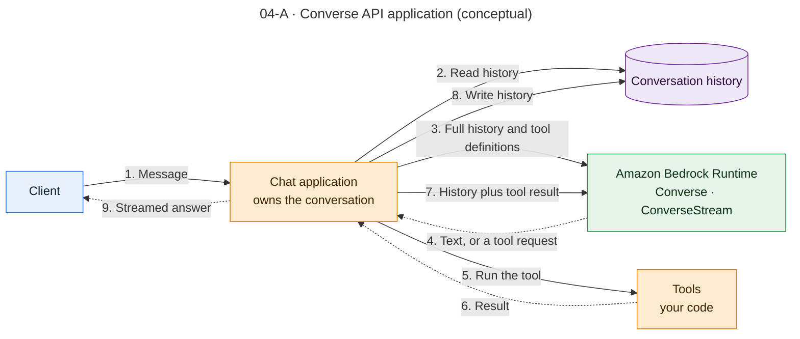
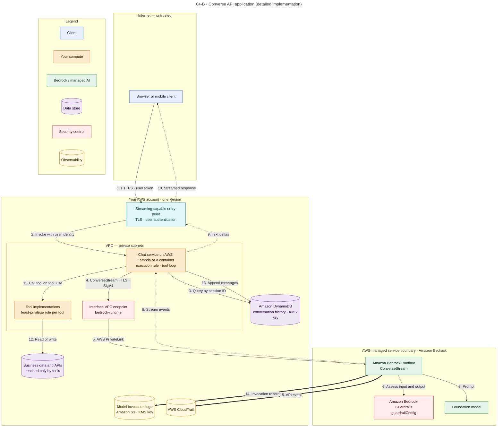
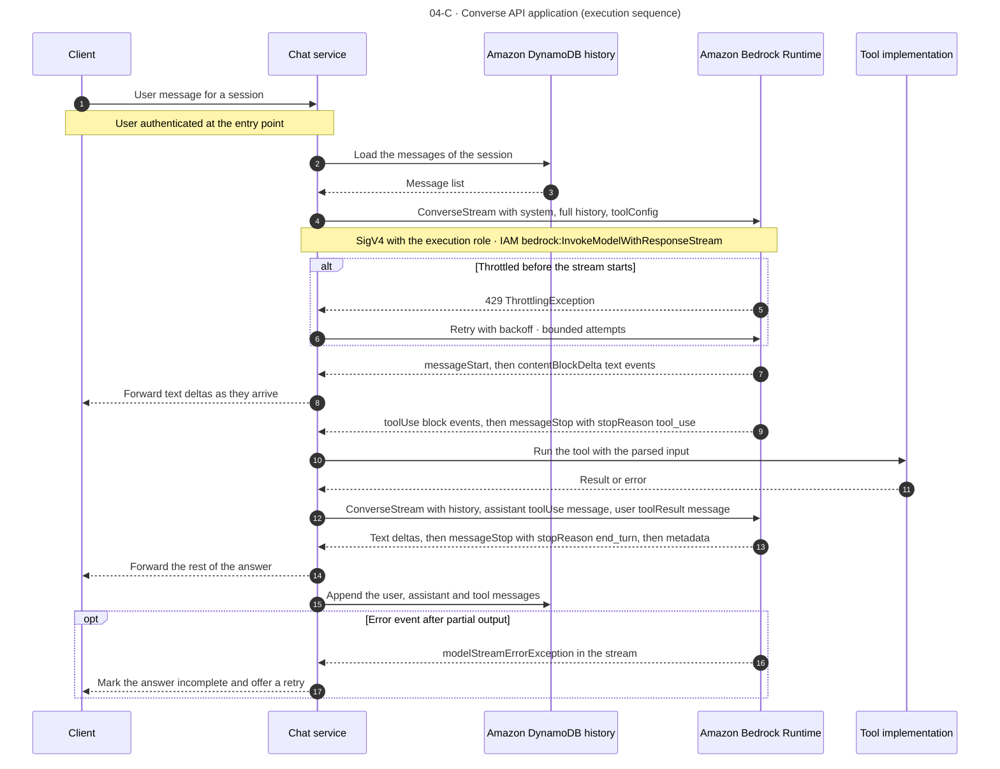

# Diagram 04 — Bedrock Converse API application architecture

> **Verified:** 2026-11-15 · **Type:** academy design, not an official AWS reference architecture · **Related chapters:** [The Converse API](../../01-amazon-bedrock/inference/01-converse-api.md) · [Agentic AI, tool calling and multi-agent architectures](../../00-foundations/generative-ai-fundamentals/06-agents-tool-calling-multi-agent.md) · [Pattern: serverless enterprise chatbot](../../03-architecture-patterns/serverless/README.md)

This set documents a chat application built directly on the Converse API: the application owns
the conversation history, runs the tool-use loop, and streams the answer to the client. It
answers the question "which parts are mine to build when I use Converse with tools?".

> [!NOTE]
> **Documented fact** — Amazon Bedrock does not store the text, images or documents you send
> to Converse, and you maintain context by including all messages in each request. The model
> never calls a tool itself: it returns a `toolUse` request and your code runs the tool.
> **Our reading:** the API is stateless, so history storage, session identity and the loop are
> application responsibilities.
> Sources: [Inference using Converse API](https://docs.aws.amazon.com/bedrock/latest/userguide/conversation-inference.html), [Use a tool to complete a model response](https://docs.aws.amazon.com/bedrock/latest/userguide/tool-use.html)

## A. Conceptual view

**What this shows** — Bedrock is a function of the messages you send it. The application reads
the history, sends all of it with the tool definitions, and reacts to the answer: either text
to show, or a request to run a tool and call again. Steps 4–7 repeat until the model stops
asking for tools.

## B. Detailed implementation view

**Legend** — solid arrow: request or write · dashed arrow: response · thick arrow: asynchronous
record · cylinder: data at rest · nested boxes: trust and network boundaries · teal: entry point.

### Component roles

| Component | Role in this architecture | Security control |
|:--|:--|:--|
| Entry point | Authenticates the user and relays a streamed response. Candidates are covered in [API Gateway, CloudFront and Application Load Balancer](../../02-related-aws-services/compute/04-api-gateway-cloudfront-alb.md) | TLS; user authentication; AWS WAF where supported |
| Chat service | Loads history, calls `ConverseStream`, forwards text deltas, runs the tool loop, saves history | Execution role limited to the model or inference profile ARN, the history table and the tool functions |
| Tool implementations | Do the real work the model asks for | A separate least-privilege role per tool; input validated against the tool's schema |
| Amazon DynamoDB table | Conversation history keyed by session — the state Bedrock does not keep | Encryption with a KMS key; item expiry; access only from the chat service |
| Business data and APIs | Systems that tools read or change | Reached by tools with the end user's entitlements, never by the model directly |
| Interface VPC endpoint | Private path to `bedrock-runtime` | Endpoint policy |
| Amazon Bedrock Runtime | Runs `ConverseStream`; returns typed stream events | IAM `bedrock:InvokeModelWithResponseStream` |
| Amazon Bedrock Guardrails | Assesses user text and model text | Does **not** assess tool results, tool definitions or tool-call arguments |
| Model invocation logs, CloudTrail | Audit and troubleshooting | Logs contain prompts and outputs: encrypt and restrict |

> [!IMPORTANT]
> **Status** — Whether a given entry-point service can relay a token stream, and with what
> limits, is **UNVERIFIED — REQUIRES DOCUMENTATION REVIEW** in this set: it was not checked on
> the verification date. Confirm it in the chapter linked above before choosing one. DynamoDB
> for history and Lambda or containers for compute are academy design choices.

### Connections

| # | From → To | Protocol / operation | Direction of data | Auth |
|--:|:--|:--|:--|:--|
| 1 | Client → entry point | HTTPS | User message in | User token |
| 2 | Entry point → chat service | Service integration | Message and user identity | IAM or the entry point's integration role |
| 3 | Chat service → DynamoDB | HTTPS · read items by session key | History in | Execution role |
| 4 | Chat service → VPC endpoint | HTTPS · `ConverseStream` | System prompt, full history, tool definitions out | SigV4 with the execution role |
| 5 | VPC endpoint → Bedrock Runtime | AWS PrivateLink | Same | Endpoint policy |
| 6 | Bedrock Runtime → Guardrails | Internal | Text and `guardContent` | `guardrailConfig` |
| 7 | Bedrock Runtime → model | Internal | Prompt | — |
| 8 | Bedrock Runtime → chat service | Event stream on the same connection | `messageStart`, `contentBlockDelta`, `messageStop`, `metadata` | — |
| 9–10 | Chat service → entry point → client | Streamed HTTP response | Text deltas out | — |
| 11 | Chat service → tool | In-process call or AWS Lambda invocation | `toolUse.input` | Tool role |
| 12 | Tool → business systems | The system's own protocol | Query or update | Tool role, user entitlements |
| 13 | Chat service → DynamoDB | HTTPS · write items | New messages out | Execution role |
| 14 | Bedrock → S3 | Log delivery | Prompt and output copies | Bedrock service principal and bucket policy |
| 15 | Bedrock → CloudTrail | Event | Caller and model | — |

## C. Sequence view

**Normal turn** — Steps 1–4: the service loads the history and sends all of it; nothing from
earlier turns exists on the Bedrock side. Steps 7–8: text is forwarded while it is generated.
Step 9: the model asks for a tool; the service assembles the `toolUse` block from
`contentBlockStart` (`toolUseId`, `name`) and the partial JSON in the deltas. Steps 10–12: the
service runs the tool and calls again with the assistant message and a `user` message holding a
`toolResult` with the same `toolUseId`. Steps 13–15: the final text streams, `metadata` carries
`usage`, and the service saves the turn.

**Failure paths**

- **Throttling (steps 5–6)** — A 429 before the stream opens is safe to retry with backoff. Keep
  attempts bounded so a user is not left waiting.
- **Tool failure (step 11)** — Return a `toolResult` with `status` `error` and a short message so
  the model can recover; do not drop the result.
- **Mid-stream error (steps 16–17)** — The client already has partial text. Mark it incomplete;
  do not silently restart and duplicate output. Do not save a half-finished assistant message as
  if it were complete.
- **Other stop reasons** — `max_tokens`: the answer is truncated. `guardrail_intervened`: show
  the guardrail's message. `model_context_window_exceeded`: the history is too long; trim or
  summarize before retrying (the exact semantics of this value are our reading).
- **Runaway loop** — Cap the number of tool rounds per turn.

## Variations

| Variation | What changes |
|:--|:--|
| `Converse` instead of `ConverseStream` | Steps 7–9 and 13 become single responses; simpler, but the user sees nothing until the model finishes |
| Model that rejects tools on `ConverseStream` | Some models accept tools only on `Converse`; call `Converse` for tool turns |
| Several tool requests in one message | The documented sample iterates over every `toolUse` block; return one `toolResult` per `toolUseId` in a single `user` message |
| Model reasoning enabled | `reasoningContent` blocks and their `signature` must be stored and sent back unmodified |
| Prompt caching | Add `cachePoint` after the stable prefix (system prompt, tool definitions, old turns); see [diagram set 19](19-prompt-caching.md) |
| Guardrail on the newest message only | Wrap that text in `guardContent`; once any `guardContent` block exists, only those blocks are assessed |
| Long conversations | The application must trim or summarize history; Bedrock does not do it for Converse |
| Cross-Region inference profile as `modelId` | Processing can move to another Region; see [diagram set 21](21-cross-region-inference.md) |
| Responses API instead of Converse | The service stores the conversation (`previous_response_id`); the history table becomes optional, and retention rules move to Bedrock |
| AgentCore harness instead of your own loop | The loop, session isolation and tool wiring are managed; see [AgentCore harness](../../01-amazon-bedrock/agentcore/03-agentcore-harness.md) |

## Practical example

- Code: the working example in [The Converse API](../../01-amazon-bedrock/inference/01-converse-api.md#13-working-example)
  implements the loop in view C — `converse_turn` (tool loop with caller-owned `messages`),
  `run_tool` (success and error results) and `stream_turn` (rebuilding the message from events).
- Infrastructure: [Project B: serverless chatbot with API Gateway and Lambda](../../05-practical-projects/project-02-serverless-chatbot/README.md)
  deploys an application of this shape; start with its README.
- Design context: [Pattern: serverless enterprise chatbot](../../03-architecture-patterns/serverless/README.md)
  and [diagram set 22](22-serverless-enterprise-chatbot.md).

## References

- [Inference using Converse API](https://docs.aws.amazon.com/bedrock/latest/userguide/conversation-inference.html) — statelessness, message structure, stream event order.
- [ConverseStream](https://docs.aws.amazon.com/bedrock/latest/APIReference/API_runtime_ConverseStream.html) — event types and in-stream exceptions.
- [Use a tool to complete a model response](https://docs.aws.amazon.com/bedrock/latest/userguide/tool-use.html) and [Client-side tool use](https://docs.aws.amazon.com/bedrock/latest/userguide/tool-use-client-side.html) — who runs the tool, the loop, tools with streaming.
- [ToolUseBlock](https://docs.aws.amazon.com/bedrock/latest/APIReference/API_runtime_ToolUseBlock.html), [ToolResultBlock](https://docs.aws.amazon.com/bedrock/latest/APIReference/API_runtime_ToolResultBlock.html), [ToolUseBlockStart](https://docs.aws.amazon.com/bedrock/latest/APIReference/API_runtime_ToolUseBlockStart.html), [ToolUseBlockDelta](https://docs.aws.amazon.com/bedrock/latest/APIReference/API_runtime_ToolUseBlockDelta.html) — tool-use types in requests and streams.
- [Include a guardrail with the Converse API](https://docs.aws.amazon.com/bedrock/latest/userguide/guardrails-use-converse-api.html) — what a guardrail does and does not assess with tools.
- [ReasoningContentBlock](https://docs.aws.amazon.com/bedrock/latest/APIReference/API_runtime_ReasoningContentBlock.html) — reasoning text and signature.
- [Use interface VPC endpoints](https://docs.aws.amazon.com/bedrock/latest/userguide/vpc-interface-endpoints.html) — private access to `bedrock-runtime`.
- [Monitor model invocation using CloudWatch Logs and Amazon S3](https://docs.aws.amazon.com/bedrock/latest/userguide/model-invocation-logging.html) — invocation logging.
- [Troubleshooting API error codes](https://docs.aws.amazon.com/bedrock/latest/userguide/troubleshooting-api-error-codes.html) — throttling and long-lived connection guidance.
