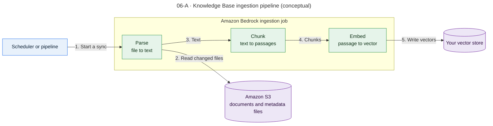
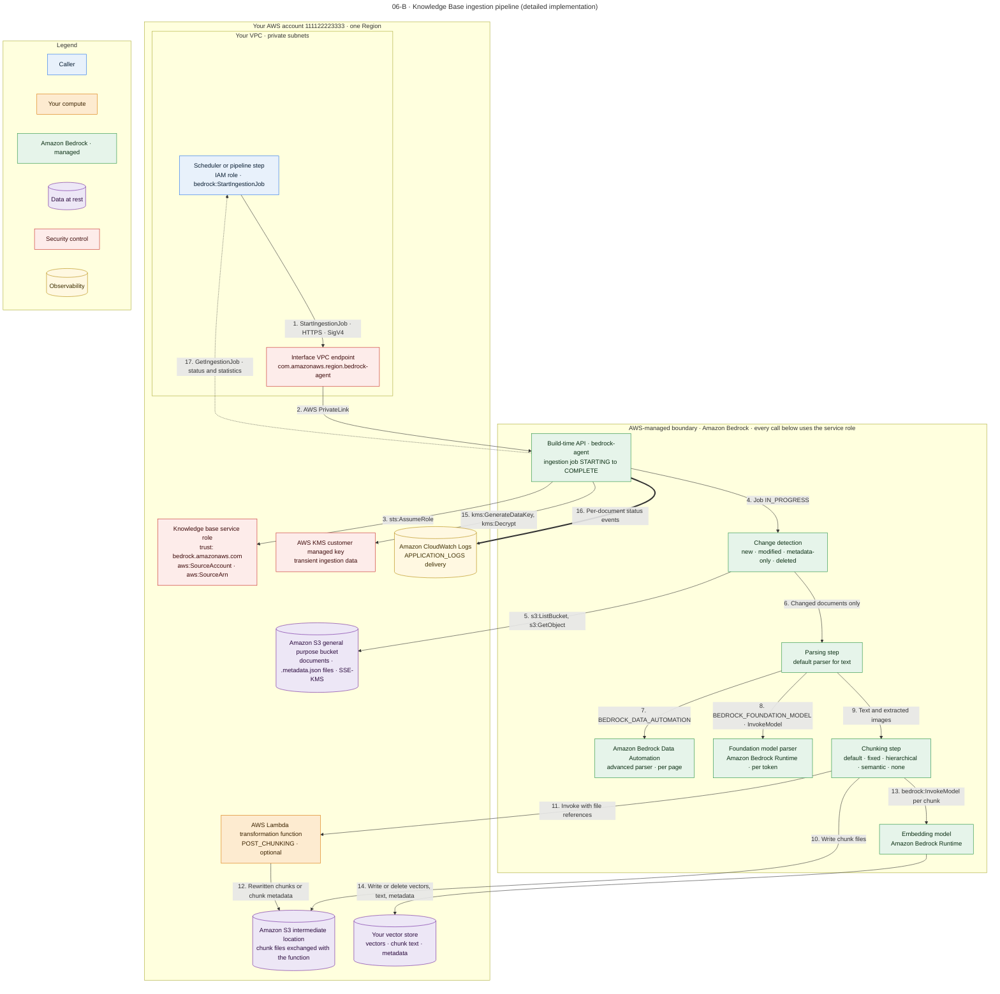
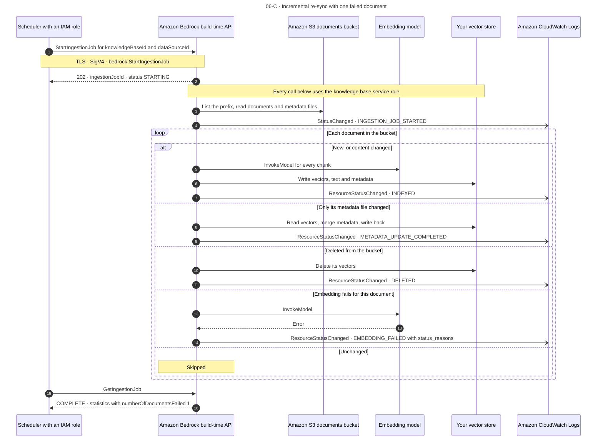

# Diagram 06 — Knowledge Base ingestion pipeline

> **Verified:** 2026-11-15 · **Type:** academy design, not an official AWS reference architecture · **Related chapters:** [Ingestion, parsing and chunking](../../01-amazon-bedrock/knowledge-bases/04-ingestion-parsing-chunking.md) · [Customer-managed knowledge bases and vector stores](../../01-amazon-bedrock/knowledge-bases/03-customer-managed-knowledge-bases.md) · [Managed Knowledge Base](../../01-amazon-bedrock/knowledge-bases/02-managed-knowledge-base.md) · [Structured data retrieval and GraphRAG](../../01-amazon-bedrock/knowledge-bases/06-structured-data-and-graphrag.md)

This set documents the write path of a **customer-managed vector knowledge base**: how documents in
Amazon S3 become vectors in a store you own. It answers three questions: **what happens between
`StartIngestionJob` and a searchable chunk, which identity performs each step, and how does a
failure show up?** AWS documents the stages ("parsing, chunking, generating embeddings, and
indexing"), the permissions and the job statuses, not how Bedrock schedules the work; boxes inside
the AWS-managed boundary are a conceptual model of that documented behaviour.

## A. Conceptual view

**What this shows** — a sync is a batch job you start. It reads only what changed since the last
sync, turns each file into text, cuts the text into chunks, embeds each chunk and writes the result
to the store your queries will search. Nothing is searchable until a sync has completed.

**Legend** — solid arrow: request or write · cylinder: data at rest · blue: caller · green: Amazon
Bedrock · purple: data.

## B. Detailed implementation view

**Legend** — solid arrow: request or write · dashed arrow: response · thick arrow: asynchronous log
delivery · cylinder: data at rest · nested boxes: your account, your VPC, and the AWS-managed
service boundary.

**What this shows** — the caller only starts and watches the job (1, 2, 17). Every read of your
documents and every write to your store is made by Bedrock with the **service role**, not with the
caller's identity (3). Edges 7, 8 and 10 to 12 exist only when you configure an advanced parser or a
transformation function; edge 16 only when you enable log delivery.

1. A scheduler or pipeline step calls `StartIngestionJob` for one data source; it returns at once with an `ingestionJobId`.
2. Through an interface endpoint the call never leaves AWS's network.
3. Bedrock assumes the knowledge base service role.
4. The job moves from `STARTING` to `IN_PROGRESS`.
5. It lists the bucket prefix and reads documents and their `.metadata.json` files.
6. Only new, modified and deleted documents go further (an incremental sync).
7. With `BEDROCK_DATA_AUTOMATION`, Data Automation parses figures, tables and images.
8. With `BEDROCK_FOUNDATION_MODEL`, a vision model parses them with a prompt you can edit. An advanced parser handles **every** PDF in the data source.
9. Text (and extracted images) go to the chunker.
10. With a transformation function, chunk files are written to your intermediate S3 location,
11. the function is invoked with references to them,
12. and writes back rewritten chunks or chunk-level metadata.
13. Each chunk is embedded.
14. Vectors, chunk text and metadata are written; vectors of deleted documents are removed.
15. Transient data is encrypted with your key when the data source sets `serverSideEncryptionConfiguration.kmsKeyArn`.
16. With log delivery enabled, each document's status changes arrive as events.
17. The caller polls `GetIngestionJob` until `COMPLETE`, `FAILED` or `STOPPED`.

### Component roles

| Component | Role in this architecture | Security control |
|:--|:--|:--|
| Scheduler or pipeline step | Starts and monitors jobs | `bedrock:StartIngestionJob`, `bedrock:GetIngestionJob` on the knowledge base ARN. Data source actions pass no role, so treat them as privileged |
| Interface VPC endpoint | Private path to `bedrock-agent` | Endpoint policy; security group |
| Knowledge base service role | The only identity used on your data | Trust policy with `aws:SourceAccount` and `aws:SourceArn`; scoped to bucket prefixes, model ARNs and the store |
| Amazon S3 documents bucket | Source documents and metadata files | Same Region as the knowledge base; general purpose bucket only; the role also needs `kms:Decrypt` on the bucket key if SSE-KMS |
| Parsing step | Default parser (text only, no charge), Data Automation (per page) or a foundation model (per token) | Strategy type fixed at data source creation |
| Chunking step | Splits text; strategy fixed at data source creation | Semantic chunking calls a foundation model |
| AWS Lambda transformation function | Your chunking or chunk-level metadata | Optional customer managed key for the intermediate files. The service-role permissions for invoking it and using the intermediate location are not on the role page read — **UNVERIFIED — REQUIRES DOCUMENTATION REVIEW** |
| Embedding model | Chunk to vector | `bedrock:InvokeModel` on the model ARN |
| Vector store | Vectors, chunk text, metadata | The store's own access policy (for example `s3vectors:PutVectors`, `aoss:APIAccessAll`) |
| AWS KMS key | Transient data during ingestion | Role needs `kms:GenerateDataKey`, `kms:Decrypt` |
| Amazon CloudWatch Logs | `APPLICATION_LOGS` per document | Enabling delivery requires `bedrock:AllowVendedLogDeliveryForResource` |

### Connections

| # | From → To | Protocol / operation | Direction of data | Auth |
|--:|:--|:--|:--|:--|
| 1–2 | Scheduler → endpoint → build-time API | HTTPS over AWS PrivateLink · `StartIngestionJob` | Job request in | SigV4, IAM, endpoint policy |
| 3 | Build-time API → service role | `sts:AssumeRole` | Credentials | Trust policy |
| 4 | Build-time API → change detection | Service-internal | Job state | — |
| 5 | Change detection → Amazon S3 | `s3:ListBucket`, `s3:GetObject` | Documents and metadata into the service | Service role |
| 6, 9 | Change detection → parsing → chunking | Service-internal | Text, images | — |
| 7 | Parsing → Bedrock Data Automation | Data Automation invocation | Files out, text back | Service role (`bedrock:InvokeDataAutomationAsync`) |
| 8 | Parsing → foundation model | `bedrock:InvokeModel` | Pages out, text back | Service role |
| 10–12 | Chunking ↔ intermediate S3 ↔ Lambda function | S3 objects, Lambda invocation with file references | Chunk files out and back | Service role; function policy |
| 13 | Chunking → embedding model | `bedrock:InvokeModel` | Chunk text out, vector back | Service role |
| 14 | Embedding → vector store | Store-specific write and delete | Vectors, text, metadata in | Service role |
| 15 | Build-time API → AWS KMS | `kms:GenerateDataKey`, `kms:Decrypt` | Data keys | Service role, key policy |
| 16 | Build-time API → CloudWatch Logs | Vended log delivery | Status events out | Delivery configured by you |
| 17 | Build-time API → scheduler | `GetIngestionJob` response | Status, statistics, `failureReasons` | SigV4 |

## C. Sequence view

**Steps 1–4 — start.** The job is asynchronous: the call returns HTTP 202 with status `STARTING`.
Only one job runs per data source and per knowledge base at a time; the start errors and quotas are
listed in [Ingestion, parsing and chunking](../../01-amazon-bedrock/knowledge-bases/04-ingestion-parsing-chunking.md).

**Steps 5–11 — the change set.** A re-sync is incremental: unchanged documents are skipped, and a
changed document is re-parsed, re-chunked, re-embedded and re-indexed **in full**. If only a
`.metadata.json` file changed, the content is not CSV and no transformation function is configured,
Bedrock merges the new metadata into the existing vectors **without calling the embedding model**.
CSV files are always re-ingested when their metadata changes.

**Steps 12–16 — a failed document.** One document failing does not fail the job: the job still
ends `COMPLETE`, and the failure shows only in `statistics.numberOfDocumentsFailed` and in the
document's `EMBEDDING_FAILED` event, whose `status_reasons` say why. **Our reading:** the failed
document is not in the index, so the next sync processes it again; the documentation does not say so
explicitly. Treat a non-zero failure count as a failed run.

**Other failure paths**

- The job itself ends `FAILED` with `failureReasons` — for example when the role cannot reach the store. Fix and start again.
- `RESOURCE_IGNORED` — the document was not processed; the reason is in `status_reasons`.
- A metadata file named `doc.metadata.json` for `doc.pdf` is ignored; it must be `doc.pdf.metadata.json`.
- `StopIngestionJob` moves the job to `STOPPING` then `STOPPED`; start again later to ingest the rest.
- After `COMPLETE`, new vectors can take a few minutes to become searchable in stores other than Amazon Aurora.

## Variations

| Variation | What changes |
|:--|:--|
| **Managed Knowledge Base** | The vector store, embedding model and parser move inside the AWS boundary: `SMART_PARSING`, a service-managed embedding model and managed storage. No intermediate bucket. A sync schedule (daily, weekly or monthly) can replace the scheduler, and a deletion protection threshold can skip a sync's delete phase. Its logs report `crawl_status`, `sync_status` and `index_status` per document. Full view: [diagram set 8](08-managed-knowledge-base.md) |
| **Direct ingestion (`IngestKnowledgeBaseDocuments`)** | Edges 1 and 5–6 are replaced by a call that carries the documents. Works for Amazon S3 and Custom data sources. A Custom data source never syncs. For an S3 data source, a directly ingested change is overwritten at the next sync unless you also write it to the bucket. Never run it at the same time as `StartIngestionJob` |
| **Custom transformation Lambda function** | With chunking strategy `NONE`, your function does the chunking. With a standard strategy, Bedrock writes pre-chunked files and your function adds chunk-level metadata, which overrides file-level metadata on collisions. Either way the metadata-only optimization no longer applies |
| Default parser only | Edges 7 and 8 disappear; parsing is text-only and free |
| Amazon Bedrock Data Automation parser | The knowledge base support page still calls it "supported in US West (Oregon)" and "in preview" |
| Amazon Nova Multimodal Embeddings | Audio and video skip text chunking; the embedding model segments them into 1–30 second pieces (default 5) |
| GraphRAG on Amazon Neptune Analytics | One extra model call per chunk extracts entities; the store is a Neptune Analytics graph; Amazon S3 is the only data source. See [Structured data retrieval and GraphRAG](../../01-amazon-bedrock/knowledge-bases/06-structured-data-and-graphrag.md) |
| Structured (SQL) knowledge base | The data source is `REDSHIFT_METADATA`: a sync ingests schema metadata only — no parsing, chunking or embedding — and knowledge base log delivery is not supported |
| Kendra GenAI index knowledge base | No Bedrock data source or sync: Amazon Kendra crawls and indexes; log delivery is not supported |
| OpenSearch Serverless index built with `nmslib` | Metadata files are ignored; recreate the index with `faiss` |
| No VPC endpoint | Edges 1 and 2 become one HTTPS call to the public Regional endpoint |

## Practical example

- [Ingestion, parsing and chunking](../../01-amazon-bedrock/knowledge-bases/04-ingestion-parsing-chunking.md), section 13 — validated Terraform for a data source with a foundation-model parser, hierarchical chunking and a transformation function, a metadata file, and a stub-tested sync script that fails on `numberOfDocumentsFailed`.
- [Customer-managed knowledge bases and vector stores](../../01-amazon-bedrock/knowledge-bases/03-customer-managed-knowledge-bases.md), section 13 — the bucket, Amazon S3 Vectors index, service role and knowledge base this pipeline writes into.
- [Project C: enterprise RAG with Knowledge Bases](../../05-practical-projects/project-03-enterprise-rag/README.md) — the full project.

## References

- [Sync your data with your knowledge base](https://docs.aws.amazon.com/bedrock/latest/userguide/kb-data-source-sync-ingest.html) — incremental sync, re-ingestion, the metadata-only optimization, CSV behaviour, the delay before data is searchable.
- [How content chunking works](https://docs.aws.amazon.com/bedrock/latest/userguide/kb-chunking-parsing.html) — strategies, tables and figures, multimodal chunking (edges 9–13).
- [Parsing options for your data source](https://docs.aws.amazon.com/bedrock/latest/userguide/kb-advanced-parsing.html) — the three parsers and how each is billed (edges 7–8).
- [Supported models and Regions for knowledge bases](https://docs.aws.amazon.com/bedrock/latest/userguide/knowledge-base-supported.html) — the Data Automation parser's preview status.
- [Use a custom transformation Lambda function](https://docs.aws.amazon.com/bedrock/latest/userguide/kb-custom-transformation.html) — input, output and file contracts (edges 10–12).
- [Ingest changes directly into a knowledge base](https://docs.aws.amazon.com/bedrock/latest/userguide/kb-direct-ingestion.html) — the direct ingestion variation.
- [Monitor knowledge bases using CloudWatch Logs](https://docs.aws.amazon.com/bedrock/latest/userguide/knowledge-bases-logging.html) — log types, document statuses, structured and Kendra exclusions (edge 16).
- [Observability for managed knowledge bases](https://docs.aws.amazon.com/bedrock/latest/userguide/kb-managed-observability.html) — the managed variation's log fields.
- [Create a service role for Knowledge Bases](https://docs.aws.amazon.com/bedrock/latest/userguide/kb-permissions.html) — trust policy, permission blocks including Data Automation, and why data source actions are privileged (edges 3, 5, 7).
- [Connect to Amazon S3 for your knowledge base](https://docs.aws.amazon.com/bedrock/latest/userguide/s3-data-source-connector.html) — same-Region, general purpose bucket requirement (edge 5).
- [Encryption of knowledge base resources](https://docs.aws.amazon.com/bedrock/latest/userguide/encryption-kb.html) — transient-data encryption (edge 15).
- [Interface VPC endpoints for Amazon Bedrock](https://docs.aws.amazon.com/bedrock/latest/userguide/vpc-interface-endpoints.html) — `bedrock-agent` service name (edges 1–2).
- [StartIngestionJob](https://docs.aws.amazon.com/bedrock/latest/APIReference/API_agent_StartIngestionJob.html) — request, HTTP 202 response, statistics.
- [Sync your structured data store](https://docs.aws.amazon.com/bedrock/latest/userguide/kb-data-source-structured-sync-ingest.html) and [GraphRAG](https://docs.aws.amazon.com/bedrock/latest/userguide/knowledge-base-build-graphs.html) — the structured and GraphRAG variations.
