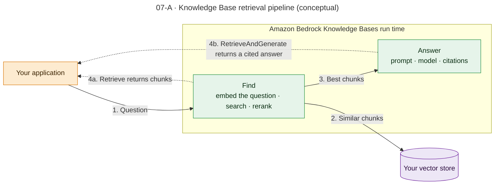
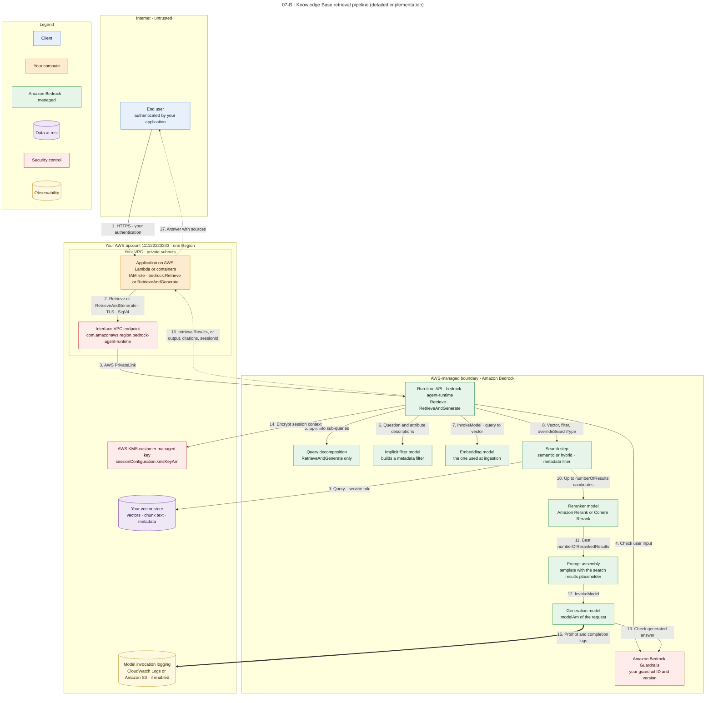
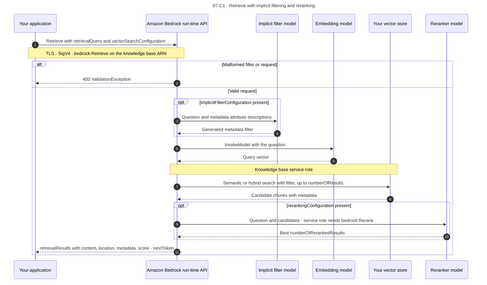
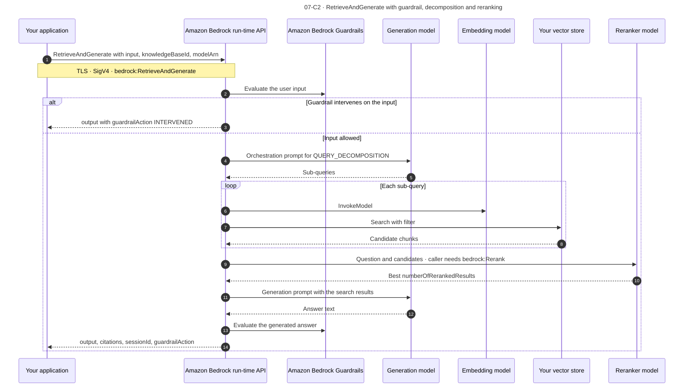

# Diagram 07 — Knowledge Base retrieval pipeline

> **Verified:** 2026-11-15 · **Type:** academy design, not an official AWS reference architecture · **Related chapters:** [Retrieval, reranking and metadata filtering](../../01-amazon-bedrock/knowledge-bases/05-retrieval-reranking-filtering.md) · [Customer-managed knowledge bases and vector stores](../../01-amazon-bedrock/knowledge-bases/03-customer-managed-knowledge-bases.md) · [Agentic retrieval with AgenticRetrieveStream](../../01-amazon-bedrock/agentic-retrieval/01-agentic-retrieval.md) · [Structured data retrieval and GraphRAG](../../01-amazon-bedrock/knowledge-bases/06-structured-data-and-graphrag.md)

This set documents the read path of a **customer-managed vector knowledge base**: a question goes in
and either ranked chunks (`Retrieve`) or a cited answer (`RetrieveAndGenerate`) comes out. It answers
**which optional stages a request can switch on, which identity calls each model and store, and
where a guardrail does and does not look**. Every stage is a request option — nothing is
provisioned. AWS documents the fields and their effect; the stage boxes inside the AWS-managed
boundary are a conceptual model of that behaviour, not Bedrock internals.

## A. Conceptual view

**What this shows** — two halves. "Find" is `Retrieve`: your application gets chunks and builds its
own prompt. "Answer" is what `RetrieveAndGenerate` adds: Bedrock builds the prompt, calls a model and
maps sentences back to sources.

**Legend** — solid arrow: request · dashed arrow: response · cylinder: data at rest · orange: your
compute · green: Amazon Bedrock · purple: data.

## B. Detailed implementation view

**Legend** — solid arrow: request · dashed arrow: response · thick arrow: asynchronous logging ·
cylinder: data at rest · nested boxes: the internet, your account, your VPC, and the AWS-managed
service boundary.

**What this shows** — one signed call fanning out to as many as five model calls and one store
query. `Retrieve` uses edges 1–3, 6–10 and 16 (reranked results return directly); `RetrieveAndGenerate`
can use all of them. The guardrail sits on the **question** and the **answer** only (4, 13) — never
on the chunks between them.

1. Your application authenticates the end user; Bedrock never sees that identity.
2. The application calls the run-time endpoint with its own IAM role.
3. Through an interface endpoint the call stays on AWS's network.
4. With `guardrailConfiguration`, the guardrail checks the user input.
5. With `QUERY_DECOMPOSITION`, a model splits the question into sub-queries.
6. With `implicitFilterConfiguration`, a model turns the question into a metadata filter.
7. The question (or each sub-query) is embedded with the knowledge base's embedding model.
8. The search step receives the vector, the filter and the search type.
9. The store is queried with the service role.
10. Up to `numberOfResults` candidates (up to five by default; the SDK model allows 1–100) go to the reranker, if configured.
11. The reranker keeps `numberOfRerankedResults`.
12. The chunks fill the prompt template, which must contain the search results placeholder; the model named in `modelArn` answers.
13. The guardrail checks the generated answer.
14. Conversation context for `sessionId` is encrypted with your key if you pass one.
15. **Our reading:** with model invocation logging enabled, the generation call is logged like any other invocation, retrieved chunks included; [chapter 5](../../01-amazon-bedrock/knowledge-bases/05-retrieval-reranking-filtering.md) notes that the default generation prompt appears in those logs.
16. The caller receives chunks, or text with `citations` and a `sessionId`.
17. Your application returns the answer and its sources.

### Component roles

| Component | Role in this architecture | Security control |
|:--|:--|:--|
| Application role | Calls the run-time API | `bedrock:Retrieve` on the knowledge base ARN; `bedrock:RetrieveAndGenerate` (documented on `*`) plus `bedrock:InvokeModel` on the generation model |
| Interface VPC endpoint | Private path to `bedrock-agent-runtime` | Endpoint policy; security group |
| Amazon Bedrock Guardrails | Screens input and generated output | "Not applied to the references retrieved from Knowledge Bases" |
| Query decomposition, implicit filter | Optional model calls before search | Each is one more model invocation per request |
| Embedding model | Query to vector | Must be the ingestion model |
| Search step | Semantic or hybrid search with a filter | The filter is a query option, not authorisation — derive it on the server |
| Vector store | Returns candidates | Reached with the knowledge base service role |
| Reranker model | Reorders candidates | `bedrock:Rerank` and `bedrock:InvokeModel`: on the **service role** for `Retrieve`, on the **caller** for `RetrieveAndGenerate` |
| Generation model | Writes the answer | Caller's `modelArn`; a cross-Region profile moves the prompt within its geography |
| AWS KMS key | Session context | Key policy allows `bedrock.amazonaws.com` `kms:GenerateDataKey`, `kms:Decrypt` |
| Model invocation logging | Audit of prompts and completions | Log destination access policy |

### Connections

| # | From → To | Protocol / operation | Direction of data | Auth |
|--:|:--|:--|:--|:--|
| 1 | End user → application | HTTPS | Question in | Your authentication |
| 2–3 | Application → endpoint → run-time API | HTTPS over AWS PrivateLink · `Retrieve` or `RetrieveAndGenerate` | Question and options in | SigV4, IAM, endpoint policy |
| 4, 13 | Run-time API → guardrail | Service-internal | Input and answer text | Guardrail ID and version |
| 5–7 | Run-time API → models | Model invocation | Question out, sub-queries, filter, vector back | Service-internal |
| 8–9 | Search step → vector store | Store-specific query | Candidates back | Service role |
| 10–11 | Search → reranker → prompt | Model invocation | Candidates, best chunks | Service role (`Retrieve`) or caller (`RetrieveAndGenerate`) |
| 12 | Prompt → generation model | Model invocation | Prompt out, answer back | Caller's permissions |
| 14 | Run-time API → AWS KMS | Data key operations | Session context | Key policy |
| 15 | Generation → logs | Vended logging | Prompt and completion | Logging configuration |
| 16–17 | Run-time API → application → user | HTTPS responses | Chunks or answer out | — |

## C. Sequence view

### C1. `Retrieve`

1. The caller needs only `bedrock:Retrieve`; reranking runs under the service role.
2. Fewer results than requested are normal: `numberOfResults` is a maximum, hierarchical chunking collapses child chunks into their parent, and chunks that share a page or table context are merged.
3. A larger page of results arrives through `nextToken`.
4. `Retrieve` also accepts a guardrail configuration; what it evaluates when nothing is generated is **UNVERIFIED — REQUIRES DOCUMENTATION REVIEW** (as in [chapter 5](../../01-amazon-bedrock/knowledge-bases/05-retrieval-reranking-filtering.md)).

### C2. `RetrieveAndGenerate`

1. The guardrail sees the input first. **Our reading:** when it intervenes, no retrieval happens; AWS documents only the `INTERVENED` value of `guardrailAction`.
2. Query decomposition splits the question once; with it, `numberOfRerankedResults` may be up to five times `numberOfResults`. For an iterating planner, see the managed variation.
3. The reranker permissions sit on the **caller** for this operation.
4. Each `citations` element pairs a span of the answer (`generatedResponsePart`) with the `retrievedReferences` that support it. Prompt-template placeholders, and how dropping one removes citations, are in [chapter 5](../../01-amazon-bedrock/knowledge-bases/05-retrieval-reranking-filtering.md).
5. Send the returned `sessionId` back to continue the conversation; you cannot choose it.

**Failure paths** — the error types in the SDK model for these operations are `ValidationException`,
`AccessDeniedException`, `ResourceNotFoundException`, `ConflictException`, `DependencyFailedException`
and `BadGatewayException` (a model or the store failed), `ServiceQuotaExceededException`,
`ThrottlingException` and `InternalServerException`. Their HTTP codes and retry advice are in
[chapter 5](../../01-amazon-bedrock/knowledge-bases/05-retrieval-reranking-filtering.md).

## Variations

| Variation | What changes |
|:--|:--|
| **Managed Knowledge Base** | `RetrieveAndGenerate` and `RetrieveAndGenerateStream` "cannot be used with managed knowledge bases". `Retrieve` takes `managedSearchConfiguration` instead of `vectorSearchConfiguration`; search is always hybrid; a managed reranker runs by default (`rerankingModelType` `MANAGED`, `CUSTOM` or `NONE`; managed reranking needs managed embedding); `startsWith` and `stringContains` filters are not supported; `userContext` applies document ACLs. The embedding model and the store move inside the AWS boundary. One-call RAG is **`AgenticRetrieveStream`** with `maxAgentIteration` 1, and with 2–5 a model plans sub-queries in a loop; a guardrail there goes in `policyConfiguration`. Full views: [diagram set 8](08-managed-knowledge-base.md) and [diagram set 9](09-agentic-retrieval.md) |
| **Semantic versus hybrid** | `overrideSearchType` `SEMANTIC` or `HYBRID` on edge 8. Hybrid works only on Amazon RDS (Aurora), OpenSearch Serverless and MongoDB stores with a filterable text field; elsewhere the query silently runs as semantic search (Amazon S3 Vectors is semantic only) |
| **Without reranking** | Edges 10–11 disappear; the store's ranking is final and `numberOfResults` is what the prompt receives |
| **With reranking** | Fetch more candidates than you keep (`numberOfResults` > `numberOfRerankedResults`); if `numberOfRerankedResults` is larger, you get `numberOfResults`. Rerank models are billed per query |
| `RetrieveAndGenerateStream` | Edge 16 becomes an event stream of `output`, `citation` and `guardrail` events (SDK model); read `generatedResponsePart` and `retrievedReferences` on citation events |
| No decomposition, no implicit filter | Edges 5 and 6 disappear; one embedding and one search per request |
| Structured (SQL) knowledge base | Edges 6–11 are replaced by SQL generation and a run against Amazon Redshift; filters, search type and reranking do not apply; only 10 results reach the answer — see [chapter 6](../../01-amazon-bedrock/knowledge-bases/06-structured-data-and-graphrag.md) |
| GraphRAG on Amazon Neptune Analytics | After edge 9, the graph is traversed from the matched chunks to linked chunks and entities; `in` and `notIn` filters are best supported there |
| Kendra GenAI index knowledge base | Edge 9 goes to the Kendra index; results carry `x-amz-kendra-*` fields |
| Multimodal query | `retrievalQuery.multimodalInputList` with one image; `RetrieveAndGenerate` is not supported for multimodal embedding models with S3 content buckets |
| No VPC endpoint | Edges 2 and 3 become one HTTPS call to the public Regional endpoint |

## Practical example

- [Retrieval, reranking and metadata filtering](../../01-amazon-bedrock/knowledge-bases/05-retrieval-reranking-filtering.md), section 13 — a stub-tested Python client that calls `Retrieve`, `RetrieveAndGenerate` (with filter, reranker, guardrail and query decomposition) and the standalone `Rerank` API.
- [Agentic retrieval with AgenticRetrieveStream](../../01-amazon-bedrock/agentic-retrieval/01-agentic-retrieval.md), section 13 — the managed variation.
- [Pattern: enterprise RAG](../../03-architecture-patterns/enterprise-rag/README.md) and [Project C](../../05-practical-projects/project-03-enterprise-rag/README.md) — where this pipeline sits in a complete design.

## References

- [Query a knowledge base and retrieve data](https://docs.aws.amazon.com/bedrock/latest/userguide/kb-test-retrieve.html) — `Retrieve` fields and results, managed knowledge base differences, reranking limits, multimodal queries, the guardrail statement.
- [Query a knowledge base and generate responses](https://docs.aws.amazon.com/bedrock/latest/userguide/kb-test-retrieve-generate.html) — `RetrieveAndGenerate`, citations, streaming.
- [Configure and customize queries and response generation](https://docs.aws.amazon.com/bedrock/latest/userguide/kb-test-config.html) — number of results, search type and hybrid-capable stores, filters, managed knowledge base filter limits.
- [Retrieving information from data sources](https://docs.aws.amazon.com/bedrock/latest/userguide/kb-how-retrieval.html) — the four query operations and how they relate.
- [Permissions for reranking](https://docs.aws.amazon.com/bedrock/latest/userguide/rerank-prereq.html) — who needs `bedrock:Rerank` in each workflow (edges 10–11).
- [Amazon Bedrock pricing](https://aws.amazon.com/bedrock/pricing/) — rerank models charged per query of up to 100 chunks.
- [API operations reference](../../references/bedrock-api-operations.md) — the SDK-derived operation names; field ranges and stream event names were read from the same botocore 1.44.3 model.
- [RetrieveAndGenerate](https://docs.aws.amazon.com/bedrock/latest/APIReference/API_agent-runtime_RetrieveAndGenerate.html) — request and response shapes, `guardrailAction`, `sessionId`, the managed knowledge base restriction.
- [AgenticRetrieveStream](https://docs.aws.amazon.com/bedrock/latest/APIReference/API_agent-runtime_AgenticRetrieveStream.html) — the managed variation's request and event stream.
- [Encryption of knowledge base resources](https://docs.aws.amazon.com/bedrock/latest/userguide/encryption-kb.html) — knowledge base retrieval encryption (edge 14).
- [Interface VPC endpoints for Amazon Bedrock](https://docs.aws.amazon.com/bedrock/latest/userguide/vpc-interface-endpoints.html) — `bedrock-agent-runtime` service name (edges 2–3).
- [Generate a query for structured data](https://docs.aws.amazon.com/bedrock/latest/userguide/knowledge-base-generate-query.html), [GraphRAG](https://docs.aws.amazon.com/bedrock/latest/userguide/knowledge-base-build-graphs.html) and [Query a Kendra GenAI index knowledge base](https://docs.aws.amazon.com/bedrock/latest/userguide/kb-test-kendra.html) — the structured, graph and Kendra variations.
