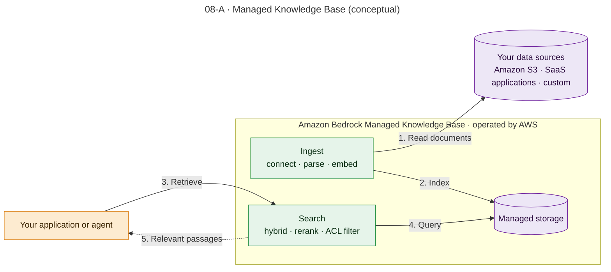
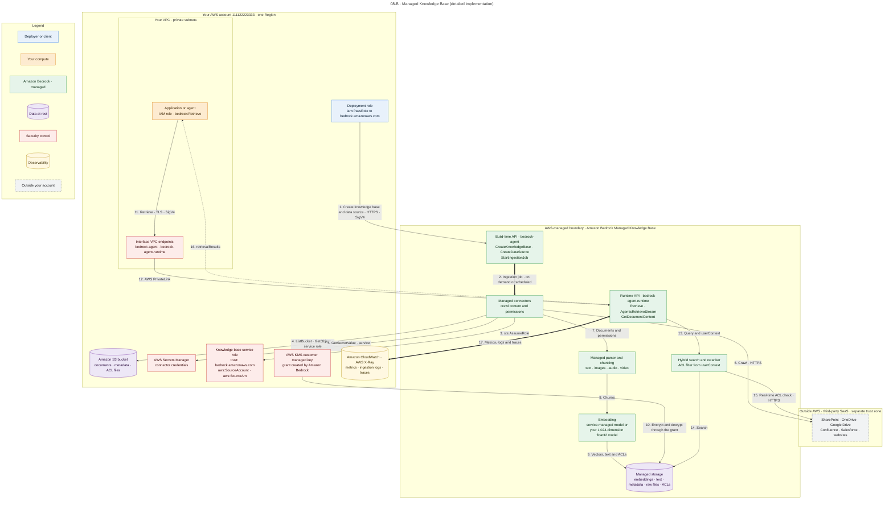
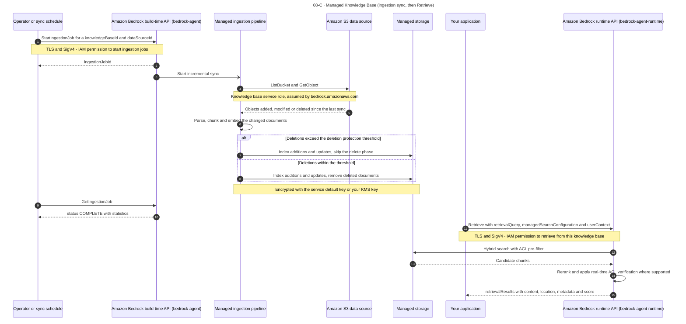

# Diagram 08 — Managed Knowledge Base architecture

> **Verified:** 2026-11-15 · **Type:** academy design, not an official AWS reference architecture · **Related chapters:** [Managed Knowledge Base](../../01-amazon-bedrock/knowledge-bases/02-managed-knowledge-base.md) · [Knowledge Bases overview: managed versus customer-managed](../../01-amazon-bedrock/knowledge-bases/01-knowledge-bases-overview.md) · [Agentic retrieval with AgenticRetrieveStream](../../01-amazon-bedrock/agentic-retrieval/01-agentic-retrieval.md)

This set documents an Amazon Bedrock Managed Knowledge Base: the knowledge base type in which
AWS operates connectors, parsing, embedding, storage, search and reranking. It answers one
question: **what stays in your account, what runs inside the AWS-managed boundary, and which
controls sit on each line between them?** AWS does not publish the internals of the managed
storage; boxes inside the managed boundary are a conceptual model of documented behaviour.

## A. Conceptual view

**What this shows** — you own two things, the sources and the caller. Everything in between is
one managed resource: it pulls documents in (1), builds and keeps an index (2), and answers
searches (3 to 5). There is no vector database for you to create, size or patch.

**Legend** — solid arrow: request or write · dashed arrow: response · cylinder: data at rest ·
orange: your compute · green: Amazon Bedrock · purple: data.

## B. Detailed implementation view

**Legend** — solid arrow: request or write · dashed arrow: response · thick arrow: asynchronous
job or telemetry · cylinder: data at rest · nested boxes: trust and network boundaries (third
party, your account, your VPC, AWS-managed service).

**What this shows** — three trust zones. The SaaS sources and your account are yours to secure;
the managed boundary is reachable only through the two Amazon Bedrock endpoints. Every line that
crosses into your account is authorised by a role you wrote: the service role for ingestion
(3 to 5), the caller's role for queries (11).

### Component roles

| Component | Role in this architecture | Security control |
|:--|:--|:--|
| Deployment role | Creates the knowledge base and data sources | `iam:PassRole` limited by `iam:PassedToService` = `bedrock.amazonaws.com` |
| Knowledge base service role | Identity that Amazon Bedrock assumes to read your sources | Trust policy with `aws:SourceAccount` and `aws:SourceArn`; least-privilege S3 and secret access |
| Amazon S3 bucket | Document source; also holds metadata and ACL files | Bucket policy; `aws:ResourceAccount` condition on the role; SSE |
| AWS Secrets Manager | Credentials for SaaS connectors | `secretsmanager:GetSecretValue` on named secrets only |
| AWS KMS customer managed key | Optional key for transient and stored data | Key policy for the creating identity via `bedrock.<region>.amazonaws.com`; grant retired on deletion |
| Managed connectors | Crawl content, and permissions when ACLs are enabled | Deletion protection threshold; sync schedule |
| Managed parser and chunking | Turn files, including media, into chunks | Media extraction enabled per data source |
| Embedding | Service-managed model, or your Bedrock model | Bring-your-own must be 1,024-dimension float32; type is immutable |
| Managed storage | Embeddings, text, metadata, raw files and ACLs | Encrypted; no direct customer access |
| Runtime API | `Retrieve`, `AgenticRetrieveStream`, `GetDocumentContent` | IAM on the knowledge base ARN; resource policy for other accounts |
| Hybrid search and reranker | Keyword plus semantic search, reranking, ACL filter | `userContext.userId`; fails closed; deny overrides allow |
| Interface VPC endpoints | Private path to both endpoints | Endpoint policy; security groups |
| Amazon CloudWatch and AWS X-Ray | Metrics, ingestion logs, `Retrieve` traces | `cloudwatch:PutMetricData` scoped to `AWS/Bedrock/KnowledgeBases` |

### Connections

| # | From → To | Protocol / operation | Direction of data | Auth |
|--:|:--|:--|:--|:--|
| 1 | Deployment role → Build-time API | HTTPS · `CreateKnowledgeBase`, `CreateDataSource` | Configuration in | SigV4, IAM |
| 2 | Build-time API → Managed connectors | `StartIngestionJob` or sync schedule | Job trigger | Service-internal |
| 3 | Managed connectors → Service role | `sts:AssumeRole` | Credentials out | Role trust policy |
| 4 | Managed connectors → Amazon S3 | `s3:ListBucket`, `s3:GetObject` | Documents into the service | Service role |
| 5 | Managed connectors → Secrets Manager | `secretsmanager:GetSecretValue` | Credentials into the service | Service role |
| 6 | Managed connectors → SaaS source | HTTPS | Documents and permissions into the service | Stored credentials |
| 7–9 | Connectors → Parser → Embedding → Storage | Service-internal | Chunks, vectors, ACLs | Service-internal |
| 10 | AWS KMS key → Managed storage | KMS grant | Data keys | Grant to Amazon Bedrock |
| 11–12 | Application → VPC endpoint → Runtime API | HTTPS over AWS PrivateLink · `Retrieve` | Query in | SigV4, IAM, endpoint policy |
| 13–14 | Runtime API → Search → Storage | Service-internal | Query, candidates | `userContext` ACL filter |
| 15 | Search → SaaS source | HTTPS | Access check | Stored credentials |
| 16 | Runtime API → Application | HTTPS response | Passages out | — |
| 17 | Runtime API → CloudWatch, X-Ray | Metrics, vended logs, traces | Telemetry out | Service role or caller identity |

## C. Sequence view

**Steps 1 to 11 — ingestion.** A sync starts on demand or on the data source's schedule. It is
incremental: only objects added, modified or deleted since the last sync are processed. The delete
phase is skipped when it would remove more than the deletion protection threshold. The job ends
with status `COMPLETE` and per-document statistics.

**Steps 12 to 16 — query.** `Retrieve` runs hybrid search, filters by the ingested ACLs for the
user in `userContext`, reranks and returns passages.

**Failure paths**

- The service role cannot read the bucket or the secret: the affected documents fail in the
  ingestion job; inspect the job statistics and the ingestion logs.
- A document in an ACL-enabled Amazon S3 source has no ACL entry: it is not ingested.
- `Retrieve` without `userContext`: ACL-enabled data sources return zero results.
- Real-time ACL verification fails or times out: the affected documents are withheld (fail closed).
- More than the per-knowledge-base request rate: HTTP 429 `ThrottlingException`.

## Variations

| Variation | What changes |
|:--|:--|
| Custom data source | No connector crawl and no sync: documents are pushed with `IngestKnowledgeBaseDocuments`. Edges 4 to 6 are replaced by your own ingestion code |
| Amazon S3 only | No Secrets Manager secret, no SaaS trust zone, no real-time ACL check (edge 15); ACLs come from files you provide |
| Bring-your-own embedding model | The embedding box invokes a Bedrock model in your account through the service role; the managed reranker is not available |
| Multimodal embedding model | An extra Amazon S3 multimodal storage bucket in your account, readable and writable by the service role |
| No customer managed key | The KMS node disappears; the service default key encrypts the data |
| Sync schedule | Edge 2 is triggered daily, weekly or monthly by the service instead of by `StartIngestionJob` |
| No VPC endpoints | Edges 11 and 12 become one HTTPS call to the public Regional endpoint |
| Agent access through AgentCore Gateway | The caller is a gateway with an IAM role; `Retrieve` and `AgenticRetrieveStream` are exposed as MCP tools |
| Cross-account consumer | A resource policy on the knowledge base allows `bedrock:Retrieve` and `bedrock:GetDocumentContent` for a role in another account |
| Agentic retrieval | The runtime runs a model-driven loop over the same storage — see [diagram set 9](09-agentic-retrieval.md) |
| AWS GovCloud (US-West) | Amazon S3 and Custom connectors only; no ACL filter; your own embedding model is required; no agentic retrieval; no Gateway target |

## Practical example

- [Managed Knowledge Base](../../01-amazon-bedrock/knowledge-bases/02-managed-knowledge-base.md),
  section 13 — validated Terraform for the service role, the knowledge base and an Amazon S3 data
  source, plus a `Retrieve` and `GetDocumentContent` call.
- [Project C: enterprise RAG with Knowledge Bases](../../05-practical-projects/project-03-enterprise-rag/README.md)
  — the full project built on this architecture.
- [Pattern: enterprise RAG](../../03-architecture-patterns/enterprise-rag/README.md) — where this
  component sits in a complete design.

## References

- [Build a managed knowledge base](https://docs.aws.amazon.com/bedrock/latest/userguide/kb-build-managed.html) — what AWS manages; the comparison with customer-managed.
- [Create a managed knowledge base](https://docs.aws.amazon.com/bedrock/latest/userguide/kb-managed-create.html) — embedding options, connectors, API shapes.
- [Connect a data source](https://docs.aws.amazon.com/bedrock/latest/userguide/kb-managed-connect-ds.html) — connector configuration, deletion protection, media extraction, sync schedule.
- [Sync a data source](https://docs.aws.amazon.com/bedrock/latest/userguide/kb-managed-sync.html) — incremental sync, job status, schedules.
- [Amazon S3 connector](https://docs.aws.amazon.com/bedrock/latest/userguide/kb-managed-ds-s3.html) and [Custom](https://docs.aws.amazon.com/bedrock/latest/userguide/kb-managed-ds-custom.html) — the two connectors drawn in the variations.
- [Access Control Lists awareness enablement](https://docs.aws.amazon.com/bedrock/latest/userguide/kb-managed-acl.html) and [ACL-aware retrieval](https://docs.aws.amazon.com/bedrock/latest/userguide/kb-test-retrieve-acl.html) — the two filter stages and fail-closed behaviour.
- [Create a service role for managed knowledge bases](https://docs.aws.amazon.com/bedrock/latest/userguide/kb-managed-permissions.html) — trust policy and permissions on edges 3 to 5.
- [Encryption of knowledge base resources](https://docs.aws.amazon.com/bedrock/latest/userguide/encryption-kb.html) — the KMS grant on edge 10.
- [Resource policies for managed knowledge bases](https://docs.aws.amazon.com/bedrock/latest/userguide/kb-managed-cross-account.html) — the cross-account variation.
- [Observability for managed knowledge bases](https://docs.aws.amazon.com/bedrock/latest/userguide/kb-managed-observability.html) — metrics, logs and traces on edge 17.
- [Query a knowledge base and retrieve data](https://docs.aws.amazon.com/bedrock/latest/userguide/kb-test-retrieve.html) and [Retrieve API reference](https://docs.aws.amazon.com/bedrock/latest/APIReference/API_agent-runtime_Retrieve.html) — hybrid search, reranking, request and response fields.
- [Connect to your knowledge base through AgentCore Gateway](https://docs.aws.amazon.com/bedrock/latest/userguide/kb-gateway-target.html) — the Gateway variation.
- [Interface VPC endpoints for Amazon Bedrock](https://docs.aws.amazon.com/bedrock/latest/userguide/vpc-interface-endpoints.html) — endpoint service names on edges 11 and 12.
- [Supported AWS Regions](https://docs.aws.amazon.com/bedrock/latest/userguide/kb-managed-regions.html) and [Service quotas](https://docs.aws.amazon.com/bedrock/latest/userguide/kb-managed-quotas.html) — the GovCloud variation and the request rate.
