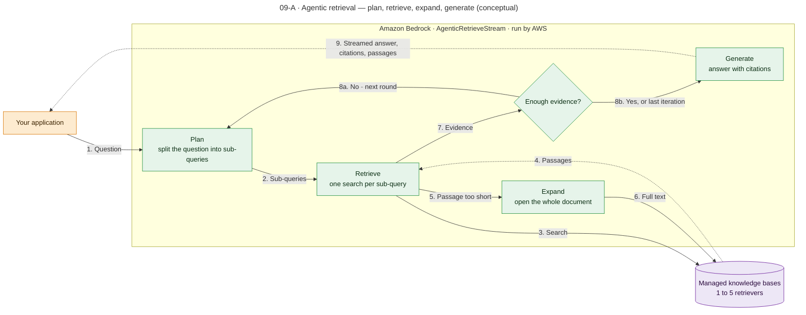
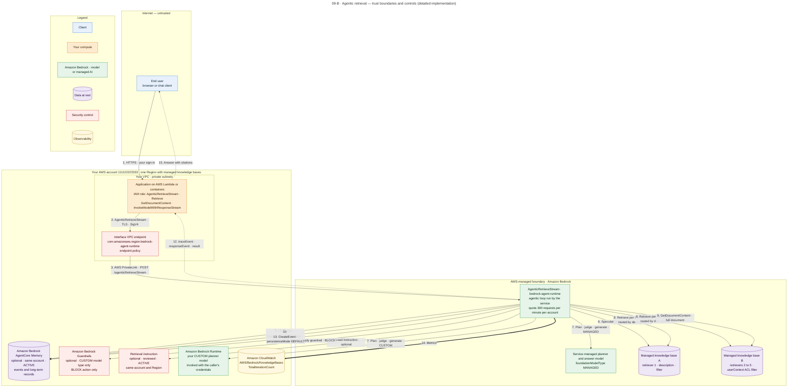
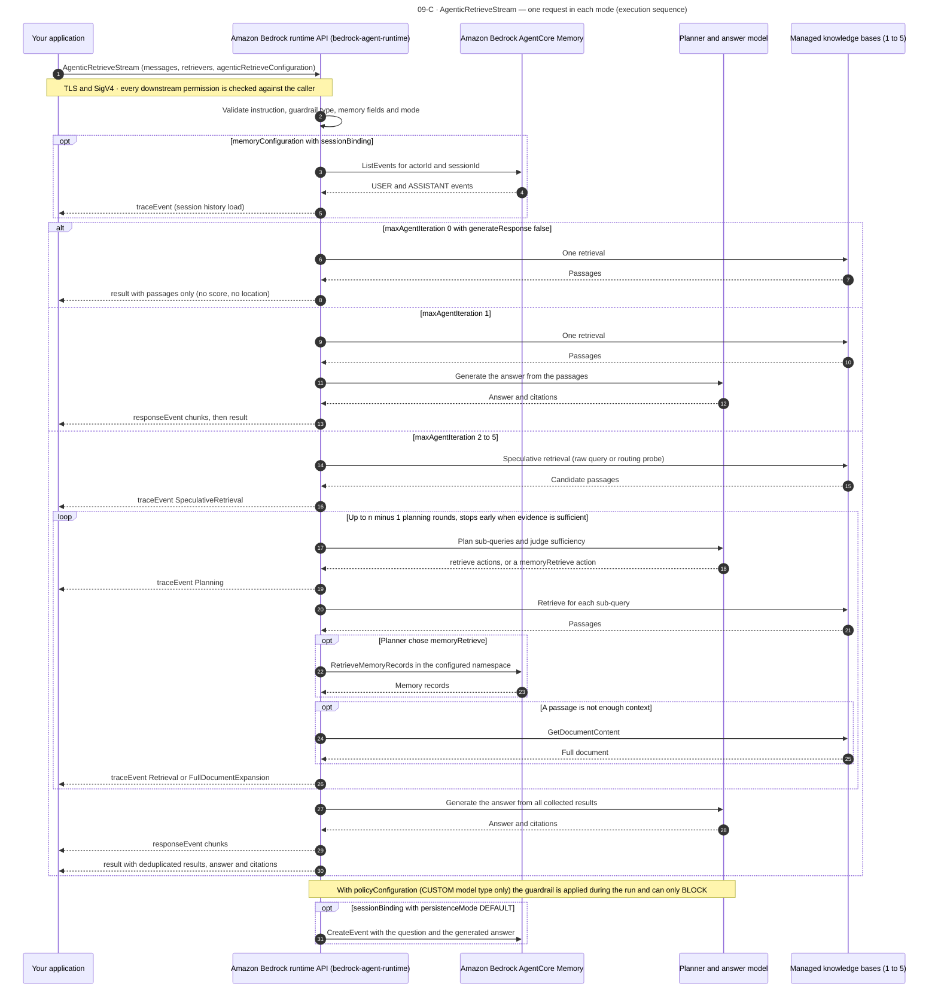

# Diagram 09 — Agentic retrieval architecture

> **Verified:** 2026-11-15 · **Type:** academy design, not an official AWS reference architecture · **Related chapters:** [Agentic retrieval with AgenticRetrieveStream](../../01-amazon-bedrock/agentic-retrieval/01-agentic-retrieval.md) · [Managed Knowledge Base](../../01-amazon-bedrock/knowledge-bases/02-managed-knowledge-base.md) · [AgentCore Memory](../../01-amazon-bedrock/agentcore/06-agentcore-memory.md) · [Amazon Bedrock Guardrails](../../01-amazon-bedrock/guardrails/01-guardrails.md)

This set documents agentic retrieval: one streaming call, `AgenticRetrieveStream`, in which Amazon
Bedrock plans sub-queries, retrieves from one to five managed knowledge bases, opens whole documents
when a passage is not enough, and streams back an answer with citations. It answers the question
**"what runs inside the service, what stays in my account, and how does one parameter,
`maxAgentIteration`, change the path?"** AWS documents the steps and the events, not the
implementation; boxes inside the managed boundary are a conceptual model of documented behaviour.

> [!IMPORTANT]
> **Status** — GA. Works **only with managed knowledge bases** and is **not available in AWS GovCloud
> (US-West)**. `maxAgentIteration` accepts 0 to 5 since the announcement of 2026-11-09: 0 is
> retrieval only, 1 is single-shot RAG, 2 to 5 is agentic.
> Sources: [Use agentic retrieval](https://docs.aws.amazon.com/bedrock/latest/userguide/kb-test-agentic-retrieve.html),
> [Supported AWS Regions](https://docs.aws.amazon.com/bedrock/latest/userguide/kb-managed-regions.html),
> [Single-shot and agentic retrieval](https://aws.amazon.com/blogs/machine-learning/single-shot-and-agentic-retrieval-with-amazon-bedrock-managed-knowledge-base/)

## A. Conceptual view

**What this shows** — the loop a researcher would follow, run by the service instead of by your
code. You send one question; Amazon Bedrock decides what to search, reads what comes back, looks
again if something is missing, and writes the answer. One **iteration** is one foundation model
call, and the last iteration is reserved for writing the answer, so `maxAgentIteration` *n* allows
up to *n* − 1 planning rounds (loop 2 → 8a). A first *speculative* retrieval runs before planning
and does not count as an iteration.

**Legend** — solid arrow: request · dashed arrow: response · cylinder: data at rest · diamond: the
model's sufficiency decision · orange: your compute · green: Amazon Bedrock · purple: data.

## B. Detailed implementation view

**Legend** — solid arrow: request or write · dashed arrow: streamed response · thick arrow:
telemetry · cylinder: data at rest · nested boxes: trust and network boundaries (internet, your
account, your VPC, AWS-managed service). Edges with the same number are alternatives or fan-out.

**What this shows** — three trust zones and one identity. The application's IAM role is the only
credential on the diagram: AWS documents that the *calling identity* needs every permission the run
uses (retrieval, document expansion, model invocation, memory, guardrail, instruction), so each
dashed box the loop touches is authorised against the caller, not against a service role. Memory,
the guardrail and the retrieval instruction are optional resources in your account; the knowledge
bases and the managed planner sit inside the AWS-managed boundary.

**Walkthrough**

1. The user signs in to your application; agentic retrieval never sees the user's credentials.
2. The application calls `AgenticRetrieveStream`, signed with its role.
3. Through the `bedrock-agent-runtime` interface endpoint the call reaches the service. Validation
   runs before any event is streamed.
4. With `retrievalInstructionConfiguration`, the instruction (a version or `DRAFT`) steers planning
   and the answer's persona, format and policy.
5. With `sessionBinding`, earlier `USER` and `ASSISTANT` events of that actor and session are
   restored; `messages` must then carry only the current question.
6. A speculative retrieval runs before planning: the raw query for one knowledge base, a routing
   probe when there are several.
7. The planner decomposes the question and, after each round, judges sufficiency. With `MANAGED`
   the service picks the model; with `CUSTOM` it calls your Amazon Bedrock (or `bedrock-mantle`)
   model with your credentials and quotas.
8. Sub-queries run against the retrievers the planner chose from their `description`.
9. When a passage is not enough, the whole document is fetched.
10. With `retrievalConfigs`, the planner may search long-term memory records in one namespace.
11. With `policyConfiguration`, the guardrail is applied during the run; only `BLOCK` works.
12. Trace events stream throughout; answer chunks and one `result` event close the stream.
13. With `persistenceMode` `DEFAULT`, the question and answer are written back as one event.
14. The service publishes metrics with the caller's credentials, including `TotalIterationCount`:
    how many iterations requests really used.
15. Your application renders the answer and maps each citation to its source passage.

### Component roles

| Component | Role in this architecture | Security control |
|:--|:--|:--|
| Application IAM role | The only identity in the run; every downstream call is authorised against it | `bedrock:AgenticRetrieveStream` (documented with `Resource: "*"`), `bedrock:Retrieve` and `bedrock:GetDocumentContent` scoped to knowledge base ARNs, `bedrock:InvokeModelWithResponseStream` |
| Interface VPC endpoint | Private path to `bedrock-agent-runtime` | Endpoint policy; security group; private DNS |
| `AgenticRetrieveStream` | Validates, runs the loop, streams events | IAM; quota of 300 requests per minute per account, HTTP 429 above it |
| Service-managed planner | Plans, judges sufficiency, writes the answer when `foundationModelType` is `MANAGED` | No guardrail possible with this type |
| Your `CUSTOM` model | Same job, a model you name by ARN (`BEDROCK_FOUNDATION_MODEL` or `MANTLE_FOUNDATION_MODEL`) | Invoked with the caller's credentials and quotas; required for a guardrail |
| Managed knowledge bases | One to five retrievers, each with a `description` used for routing | IAM per knowledge base ARN; `retrievalOverrides.filter`; `userContext.userId` for document ACLs |
| AgentCore Memory | Session history and long-term records | `bedrock-agentcore:GetMemory`, plus `ListEvents`, `RetrieveMemoryRecords`, `CreateEvent` only for the features used; `kms:Decrypt` for a customer managed key; actor, session and namespace are trusted as sent |
| Amazon Bedrock Guardrails | Blocks harmful input or output | `bedrock:GetGuardrail`, `bedrock:ApplyGuardrail`; `CUSTOM` model type only; no `ANONYMIZE` sensitive-information policies |
| Retrieval instruction | Steers decomposition and answer style; "isn't a guardrail" | `bedrock:GetRetrievalInstruction` on its ARN; Amazon Bedrock reviews content before it becomes `ACTIVE` |
| Amazon CloudWatch | `Invocations`, `ClientErrors`, `ServerErrors`, `Throttles` and, for this operation only, `TotalIterationCount` (dimension `Operation`) | Published with the caller's credentials through a forward access session, so the caller needs `cloudwatch:PutMetricData` for `AWS/Bedrock/KnowledgeBases`; best effort |

### Connections

| # | From → To | Protocol / operation | Direction of data | Auth |
|--:|:--|:--|:--|:--|
| 1 | User → application | HTTPS | Question in | Your application's authentication |
| 2–3 | Application → endpoint → service | HTTPS over AWS PrivateLink · `AgenticRetrieveStream` | Messages, retrievers, configuration in | SigV4, IAM, endpoint policy |
| 4 | Service → retrieval instruction | Service-internal read | Instruction text in | Caller's `bedrock:GetRetrievalInstruction` |
| 5 | Service → AgentCore Memory | `ListEvents` | Session history in | Caller's `bedrock-agentcore:ListEvents` |
| 6, 8 | Service → knowledge bases | `Retrieve` | Queries out, passages in | Caller's `bedrock:Retrieve` |
| 7 | Service → planner model | Model invocation (streamed) | Prompts out, plans and answer in | Service-managed (`MANAGED`) or caller's `bedrock:InvokeModelWithResponseStream` (`CUSTOM`) |
| 9 | Service → knowledge base | `GetDocumentContent` | Full document in | Caller's `bedrock:GetDocumentContent` |
| 10 | Service → AgentCore Memory | `RetrieveMemoryRecords` | Records in | Caller's `bedrock-agentcore:RetrieveMemoryRecords` |
| 11 | Service → guardrail | Guardrail evaluation | Content out, verdict in | Caller's `bedrock:ApplyGuardrail` |
| 12 | Service → application | Event stream on the same HTTPS connection | Trace events, answer chunks, result | — |
| 13 | Service → AgentCore Memory | `CreateEvent` | Question and answer written | Caller's `bedrock-agentcore:CreateEvent` |
| 14 | Service → CloudWatch | `PutMetricData` | Telemetry out | Caller's credentials (forward access session) |
| 15 | Application → user | HTTPS | Answer out | Your application |

## C. Sequence view

**Steps 1 to 5** — validation and session restore. A retrieval instruction that is missing or not
`ACTIVE`, a guardrail with the `MANAGED` model type, a guardrail whose sensitive-information policy
uses `ANONYMIZE`, a `memoryConfiguration` with only a `memoryId`, and `sessionBinding` together with
earlier turns in `messages` all fail before the first event is streamed.

**Steps 6 to 13** — the two cheap modes. At 0 no model is called; `generateResponse` must be sent as
`false` (it defaults to `true`, and `true` returns a 4xx error). At 1 there is one retrieval and one
answer-generation call, with no planning trace events.

**Steps 14 to 30** — agentic mode. The speculative retrieval gives the first planning call evidence
to work with. Each planning round is one model call plus its retrievals; the planner can stop early.
On a new session, long-term memory can instead be searched during the speculative retrieval, in which
case no `memoryRetrieve` action appears. A chunk found by several sub-queries appears once in
`results`, and citations index into that array. **Step 31** persists the exchange only when
`persistenceMode` is `DEFAULT`, which requires a generated answer.

**Failure paths**

- Exceptions arrive as events in the stream: `validationException` and
  `serviceQuotaExceededException` (400), `accessDeniedException` (403), `resourceNotFoundException`
  (404), `conflictException` (409), `dependencyFailedException` (424), `throttlingException` (429),
  `internalServerException` (500), `badGatewayException` (502).
- A missing memory, guardrail or instruction permission on the caller's role is an access denial,
  even though the request itself was authorised.
- Lowering `maxAgentIteration` "may cause the agent to stop earlier, potentially reducing accuracy
  for complex queries".

## Variations

| Variation | What changes in the diagram |
|:--|:--|
| `maxAgentIteration` 0 | No planner (edge 7 disappears), no answer; one retrieval; passages arrive without `score` or `location`. Use when the caller wants source text |
| `maxAgentIteration` 1 | Single-shot RAG and the managed knowledge base's replacement for `RetrieveAndGenerate`: one retrieval, one model call (edge 7 once), no planning trace events |
| `maxAgentIteration` 2 to 5 | The full loop: up to *n* − 1 planning rounds. AWS suggests 3 for a single knowledge base and 4 to 5 for several knowledge bases or comparative questions |
| `maxAgentIteration` omitted | Default value **UNVERIFIED — REQUIRES DOCUMENTATION REVIEW** (the API reference gives only a minimum of 0; the user guide and quotas page give no default) |
| Several retrievers | Up to 5 managed knowledge bases; the speculative retrieval becomes a routing probe and the planner routes by each retriever's `description`. All three modes accept several knowledge bases |
| `foundationModelType` `CUSTOM` | Edge 7 goes to your model: an Amazon Bedrock model ARN, or a `bedrock-mantle` model with a `projectId`. The model runs under your quotas and is billed at its own price |
| Guardrail | Edge 11 exists only with `CUSTOM`; only `BLOCK` works; masking and anonymizing policies are rejected |
| AgentCore Memory, short-term only | `sessionBinding` without `retrievalConfigs`: edges 5 and 13 only |
| AgentCore Memory, long-term only | `retrievalConfigs` without `sessionBinding`: edge 10 only; at most one entry with up to 5 metadata filters |
| `persistenceMode` `NONE` | Edge 13 disappears; the session is read but not extended |
| `generateResponse` false | No `responseEvent` and no `generatedResponse`; the result carries passages only |
| Retrieval instruction | Edge 4 exists; the first Planning trace event names the applied instruction and version |
| Reranking | `rerankingModelType` `MANAGED` (default for managed embeddings), `CUSTOM` (a Bedrock reranking model ARN, invoked with your credentials) or `NONE` (default for your own embedding model) |
| Document-level ACLs | `userContext.userId` filters each retrieval to what the user may read; derive it on the server |
| Agent access through AgentCore Gateway | The caller is an agent: a Managed Knowledge Base gateway target exposes `AgenticRetrieveStream` and `Retrieve` as MCP tools, with the gateway service role (`GATEWAY_IAM_ROLE`) as the identity on edges 2 to 13 |
| No VPC endpoint | Edges 2 and 3 become one HTTPS call to the public Regional endpoint |
| Customer-managed knowledge base | Not supported. Use `Retrieve` or `RetrieveAndGenerate` — see [diagram set 7](07-knowledge-base-retrieval-pipeline.md) |
| AWS GovCloud (US-West) | Not available, nor is the AgentCore Gateway knowledge base target |

> [!TIP]
> **Academy recommendation** — Choose the mode per request in your application (for example 1 for
> lookups, 3 to 5 for comparisons), always send `maxAgentIteration` explicitly, and log trace events
> so you can audit what the planner searched. This is our design guidance, not an official AWS
> reference architecture.

## Practical example

- [Agentic retrieval with AgenticRetrieveStream](../../01-amazon-bedrock/agentic-retrieval/01-agentic-retrieval.md#13-working-example),
  section 13 — a Python request builder for all three modes, an event-stream consumer and a citation
  mapper, plus the documented IAM policy in section 8.
- [AgentCore Memory](../../01-amazon-bedrock/agentcore/06-agentcore-memory.md) — creating the memory
  resource and strategies that edges 5, 10 and 13 use.
- [Project C: enterprise RAG with Knowledge Bases](../../05-practical-projects/project-03-enterprise-rag/README.md)
  and [Pattern: enterprise RAG](../../03-architecture-patterns/enterprise-rag/README.md) — where this
  call sits in a complete design.
- [Diagram set 8](08-managed-knowledge-base.md) — the managed knowledge base underneath;
  [diagram set 15](15-agentcore-memory.md) — the memory resource.

## References

- [Use agentic retrieval to query a knowledge base](https://docs.aws.amazon.com/bedrock/latest/userguide/kb-test-agentic-retrieve.html) — the six-step process, request fields, memory, retrieval instructions, required permissions, considerations.
- [AgenticRetrieveStream API reference](https://docs.aws.amazon.com/bedrock/latest/APIReference/API_agent-runtime_AgenticRetrieveStream.html) — `POST /agenticRetrieveStream`, request and response syntax, exception events.
- [AgenticRetrieveConfiguration](https://docs.aws.amazon.com/bedrock/latest/APIReference/API_agent-runtime_AgenticRetrieveConfiguration.html) — `foundationModelType`, `maxAgentIteration` minimum, reranking defaults.
- [AgenticRetrieveBedrockGuardrailConfiguration](https://docs.aws.amazon.com/bedrock/latest/APIReference/API_agent-runtime_AgenticRetrieveBedrockGuardrailConfiguration.html) — guardrail ID and version on edge 11.
- [Single-shot and agentic retrieval with Amazon Bedrock Managed Knowledge Base](https://aws.amazon.com/blogs/machine-learning/single-shot-and-agentic-retrieval-with-amazon-bedrock-managed-knowledge-base/) (2026-11-09) — `maxAgentIteration` 0 to 5, iteration counting, speculative retrieval.
- [Agentic retrieval for Amazon Bedrock Managed Knowledge Base](https://aws.amazon.com/blogs/machine-learning/agentic-retrieval-for-amazon-bedrock-managed-knowledge-base/) (2026-07-23) — trace steps, deduplication, suggested iteration values.
- [Observability for managed knowledge bases](https://docs.aws.amazon.com/bedrock/latest/userguide/kb-managed-observability.html) — `TotalIterationCount` and the forward access session on edge 14.
- [Service quotas for managed knowledge bases](https://docs.aws.amazon.com/bedrock/latest/userguide/kb-managed-quotas.html) — 300 requests per minute per account, 10,000 query characters.
- [Supported AWS Regions](https://docs.aws.amazon.com/bedrock/latest/userguide/kb-managed-regions.html) — the GovCloud exclusion.
- [Build a managed knowledge base](https://docs.aws.amazon.com/bedrock/latest/userguide/kb-build-managed.html) — agentic retrieval and Gateway integration are managed-only.
- [Connect to your knowledge base through AgentCore Gateway](https://docs.aws.amazon.com/bedrock/latest/userguide/kb-gateway-target.html) — the Gateway variation and its IAM-only outbound authentication.
- [Interface VPC endpoints for Amazon Bedrock](https://docs.aws.amazon.com/bedrock/latest/userguide/vpc-interface-endpoints.html) — `com.amazonaws.region.bedrock-agent-runtime` on edges 2 and 3.
- [Generated API reference](../../references/bedrock-api-operations.md) — operation names in the connections table.
