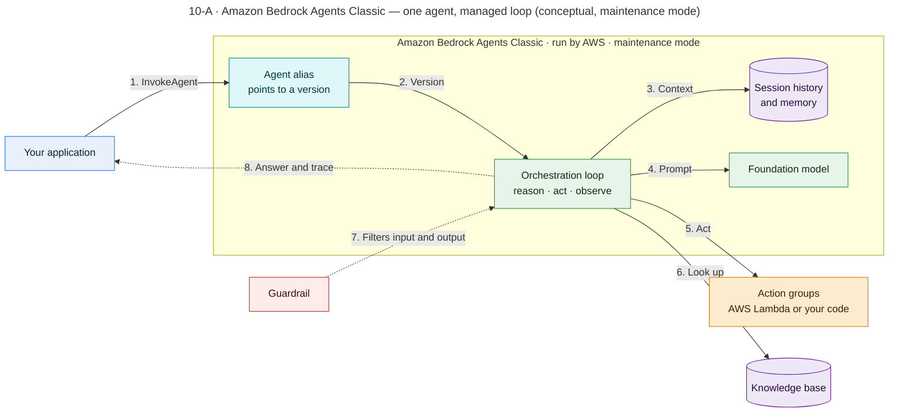
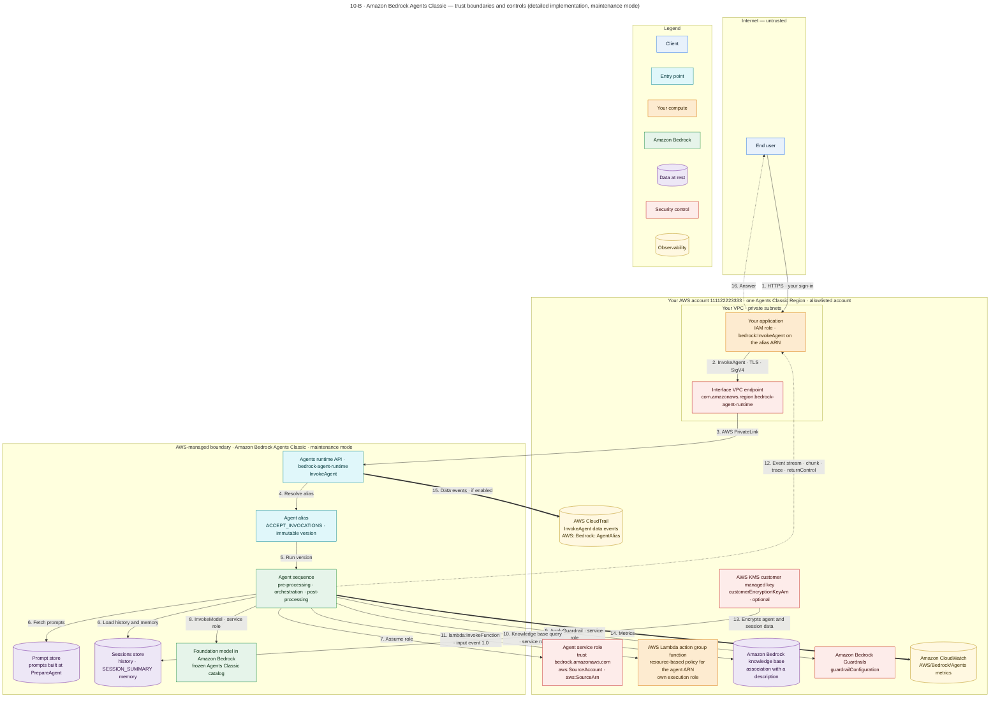
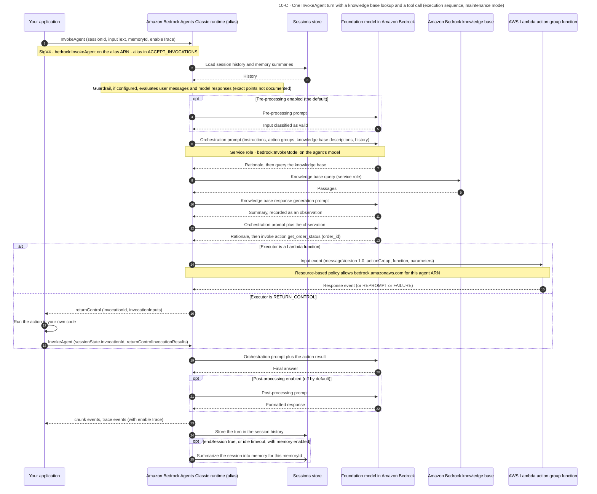

# Diagram 10 — Bedrock Agents (Classic) architecture

> **Verified:** 2026-11-15 · **Type:** academy design, not an official AWS reference architecture · **Related chapters:** [Amazon Bedrock Agents Classic](../../01-amazon-bedrock/agents/01-agents-classic.md) · [Multi-agent collaboration](../../01-amazon-bedrock/agents/02-multi-agent-collaboration.md) · [Agents Classic versus AgentCore, and migrating](../../01-amazon-bedrock/agents/03-agents-classic-vs-agentcore.md)

> [!IMPORTANT]
> **Status — maintenance mode. Do not build new agents on this architecture.** Amazon Bedrock
> Agents (launched November 2023) is now **Amazon Bedrock Agents Classic** and has been closed to
> new customers since **2026-07-30**. An account with no Agents activity in the previous 12 months
> receives `AccessDeniedException` (HTTP 403) on `CreateAgent` and `InvokeInlineAgent`, with no
> exception process. Existing agents keep working and every other API stays available, but no new
> features are planned and the model catalog is **frozen** as of 2026-07-30. AWS has announced no
> end-of-life date and no migration deadline, and recommends Amazon Bedrock AgentCore, with the
> managed **harness** as the closest equivalent.
> Source: [Amazon Bedrock Agents Classic maintenance mode](https://docs.aws.amazon.com/bedrock/latest/userguide/agents-classic-maintenance-mode.html)

This set documents an inherited Agents Classic agent: an alias your application invokes, a managed
orchestration loop that calls a foundation model, action groups fulfilled by AWS Lambda or by your
own code (return of control), associated knowledge bases, an optional guardrail, session memory, and
the service role through which the agent acts. It answers the question **"when my application calls
`InvokeAgent`, what happens, and on whose authority?"** — the knowledge you need to operate the agent
safely and to plan its move. The "after" picture is in
[Agents Classic versus AgentCore](../../01-amazon-bedrock/agents/03-agents-classic-vs-agentcore.md#architecture-diagram).

## A. Conceptual view

**What this shows** — you configure the parts (instructions, tools, knowledge bases, guardrail);
AWS runs the loop. The application only knows the alias. Each pass through the loop is one model
call that decides whether to call a tool, look something up, ask the user, or answer.

**Legend** — solid arrow: request · dashed arrow: response or control · cylinder: data at rest ·
blue: caller · teal: entry point · green: Amazon Bedrock · orange: your compute · red: security
control.

## B. Detailed implementation view

**Legend** — solid arrow: request or write · dashed arrow: response · thick arrow: telemetry ·
cylinder: data at rest · nested boxes: trust and network boundaries (internet, your account, your
VPC, AWS-managed service).

**What this shows** — two IAM boundaries. The **caller** needs only `bedrock:InvokeAgent` on the
alias ARN. Everything the agent then does — model calls, knowledge base queries, guardrail checks —
runs under the **agent service role**, and Lambda functions are reached through their own
resource-based policies. The agent itself never runs in your VPC: it reaches your resources through
AWS service endpoints. AWS documents a prompt store and a sessions store; everything else about the
service internals is undocumented, so the managed boundary is a conceptual model.

**Walkthrough**

1. The user signs in to your application.
2. The application calls `InvokeAgent` on an alias with a `sessionId`, signed with its own role.
3. The call reaches `bedrock-agent-runtime`, here through an interface endpoint.
4. The alias must be in `ACCEPT_INVOCATIONS`; `REJECT_INVOCATIONS` pauses the agent without IAM changes.
5. The alias resolves to an immutable numbered version (the test alias `TSTALIASID` resolves to `DRAFT`).
6. The agent fetches the prompts assembled when it was prepared, and the session's history; with
   memory enabled and a `memoryId`, earlier session summaries are loaded too.
7. Amazon Bedrock assumes the agent service role.
8. Every step of the sequence is a model invocation under that role.
9. A configured guardrail filters user input and model responses.
10. If the model chooses a knowledge base, the agent queries it with the service role.
11. If the model chooses an action whose executor is a Lambda function, Bedrock invokes it; the
    function's resource-based policy must allow `bedrock.amazonaws.com` for this agent's ARN.
12. Results stream back as `chunk` and `trace` events, or, for return of control, as a
    `returnControl` event that ends the turn.
13. Agent and session data are encrypted with an AWS owned key, or with your customer managed key.
14. Runtime metrics go to CloudWatch (the role needs `cloudwatch:PutMetricData` for the namespace).
15. `InvokeAgent` is a CloudTrail **data event**: logged only if you add an event selector.
16. The application returns the answer.

### Component roles

| Component | Role in this architecture | Security control |
|:--|:--|:--|
| Application IAM role | Invokes the alias | `bedrock:InvokeAgent` on the alias ARN only |
| Interface VPC endpoint | Private path to `bedrock-agent-runtime` | Endpoint policy; security group |
| Agent alias | Stable name the application calls; points to one version | Pause with `aliasInvocationState`; roll back by repointing |
| Agent version | Immutable snapshot of instructions, action groups, knowledge base associations, prompts | Created at alias creation or `UpdateAgentAlias` without `routingConfiguration` |
| Agent sequence | Pre-processing (on), orchestration loop, post-processing (off by default) | Optional custom orchestration Lambda replaces the loop |
| Prompt store | Prompts built by `PrepareAgent` from base templates, instructions, action and knowledge base descriptions | Advanced prompts may override each template and its parser |
| Sessions store | Conversation history per `sessionId`; memory summaries per `memoryId` | Idle session TTL 60–5,400 s; memory retention 1–365 days; KMS encryption |
| Agent service role | The agent's identity for models, schemas, knowledge bases and guardrails | Trust policy with `aws:SourceAccount` and `aws:SourceArn`; least-privilege model, knowledge base and guardrail ARNs |
| Foundation model | Reasoning at every step | Frozen catalog; `bedrock:InvokeModel` (plus `InvokeModelWithResponseStream` for streaming) on the service role |
| AWS Lambda function | Fulfils an action group | Resource-based policy scoped to the agent ARN; its execution role is the real limit on what the action can do |
| Knowledge base | Extra context for answers; the association `description` tells the model when to use it | `bedrock:Retrieve` on the knowledge base ARN in the service role |
| Amazon Bedrock Guardrails | Filters user messages and model responses | `bedrock:ApplyGuardrail` on the guardrail ARN in the service role |
| AWS KMS key | Optional customer managed key for agent resources | Key policy; agents created before 2025-01-22 follow a different procedure |
| Amazon CloudWatch, AWS CloudTrail | Metrics (`InvocationCount`, `ModelInvocationThrottles`, token counts); `InvokeAgent` audit | Data event selector for `AWS::Bedrock::AgentAlias`; traces contain prompts and are returned to the caller, not logged for you |

### Connections

| # | From → To | Protocol / operation | Direction of data | Auth |
|--:|:--|:--|:--|:--|
| 1 | User → application | HTTPS | Message in | Your application |
| 2–3 | Application → endpoint → Agents runtime | HTTPS over AWS PrivateLink · `InvokeAgent` (`POST /agents/{agentId}/agentAliases/{agentAliasId}/sessions/{sessionId}/text`) | `inputText`, `sessionState`, `memoryId` in | SigV4, `bedrock:InvokeAgent`, endpoint policy |
| 4–5 | Runtime → alias → version | Service-internal | — | Alias invocation state |
| 6 | Sequence → prompt store, sessions store | Service-internal | Prompts and history in | Service-internal |
| 7 | Sequence → service role | `sts:AssumeRole` | Credentials | Trust policy |
| 8 | Sequence → foundation model | Model invocation | Prompt out, rationale and action in | Service role |
| 9 | Sequence → guardrail | `ApplyGuardrail` | Content out, verdict in | Service role |
| 10 | Sequence → knowledge base | Knowledge base query | Query out, passages in | Service role |
| 11 | Sequence → Lambda | `lambda:InvokeFunction`, synchronous | Input event out, response event in | Lambda resource-based policy for `bedrock.amazonaws.com` |
| 12 | Runtime → application | Event stream on the same connection | `chunk`, `trace`, `returnControl`, exception events | — |
| 13 | AWS KMS → sessions store | Encryption | Data keys | Key policy |
| 14 | Agent → CloudWatch | Metrics, namespace `AWS/Bedrock/Agents` | Telemetry out | Service role with `cloudwatch:PutMetricData` |
| 15 | Runtime → CloudTrail | Data events | Audit out | Trail event selector |
| 16 | Application → user | HTTPS | Answer out | Your application |

> [!WARNING]
> **UNVERIFIED — REQUIRES DOCUMENTATION REVIEW** — whether a **Managed Knowledge Base** can be
> associated with an Agents Classic agent. The association pages and the managed knowledge base
> comparison table read on 2026-11-15 do not say; the documented service-role policy grants
> `bedrock:Retrieve` and `bedrock:RetrieveAndGenerate`, and managed knowledge bases do not support
> `RetrieveAndGenerate`. Inherited agents normally use customer-managed knowledge bases.

## C. Sequence view

One turn in which the model first looks something up in a knowledge base and then calls a tool.

**Steps 1 to 3** — authorisation and context. The caller is authorised on the alias, not on the
model or the tools; history is keyed by `sessionId`, memory by `memoryId`. A missing `memoryId`
means the turn is not stored in cross-session memory.

**Steps 4 to 13** — the orchestration loop. A *turn* is one `InvokeAgent` call; an *iteration* is one
model call plus an optional action, knowledge base query or question to the user. Here the turn
takes at least three orchestration iterations plus pre-processing and knowledge base response
generation — five or more model calls for one question, which is why an agent turn costs several
times a plain `Converse` call.

**Steps 14 to 18** — the action. A Lambda executor is invoked synchronously. With return of control
the turn **ends** at step 16; your application runs the action and starts a new `InvokeAgent` with
the same `invocationId` and action group, and `inputText` is ignored on that call.

**Steps 19 to 25** — the answer streams as `chunk` events; with `enableTrace`, each step's
`PreProcessingTrace`, `OrchestrationTrace`, `PostProcessingTrace`, `GuardrailTrace` or
`FailureTrace` arrives in the same stream. Memory summarization runs asynchronously after the
session ends.

**Failure paths**

- Account not allowlisted: `CreateAgent` returns HTTP 403 ("Bedrock Agents is in Maintenance Mode …"),
  so this architecture cannot be created there at all.
- Errors surface inside the event stream: `throttlingException` (429),
  `serviceQuotaExceededException`, `dependencyFailedException` (424, for example a failing Lambda
  function or a function-details action returning `FAILURE`), `modelNotReadyException`,
  `accessDeniedException` (403), `validationException`.
- A missing Lambda resource-based policy or a service role without
  `bedrock:InvokeModelWithResponseStream` (when streaming is on) fails mid-turn, not at the
  `InvokeAgent` call.
- An alias set to `REJECT_INVOCATIONS` rejects the call at step 1.

## Variations

| Variation | What changes in the diagram |
|:--|:--|
| Return of control | Edge 11 disappears; edge 12 carries `returnControl` and your application runs the action, then calls `InvokeAgent` again (alt branch in view C) |
| Built-in `AMAZON.UserInput` | The agent asks the user for missing parameters instead of calling a tool; no executor |
| Built-in `AMAZON.CodeInterpreter` | A sandboxed code execution step inside the managed boundary; files from Amazon S3 need extra `s3:GetObject*` permissions on the service role |
| Custom orchestration (`orchestrationType` `CUSTOM_ORCHESTRATION`) | A Lambda function you own (`customOrchestration.executor`) replaces the orchestration loop in the managed boundary. Migration then needs code on AgentCore Runtime, not the harness |
| Advanced prompts | Overridden templates and parser Lambda functions per step; `promptCreationMode` and `parserMode` show `OVERRIDDEN` in the trace |
| Pre- or post-processing toggled | Steps 4–5 or 21–22 of view C appear or disappear |
| Memory disabled | No `memoryId`; the sessions store keeps history for one session until the idle TTL |
| Streaming (`streamingConfigurations`) | `streamFinalResponse` and `applyGuardrailInterval` change how edge 12 delivers the answer; streaming needs `bedrock:InvokeModelWithResponseStream` |
| Test alias `TSTALIASID` | Edge 5 resolves to `DRAFT`, so every unprepared or prepared draft edit reaches callers. Never use it in production |
| Provisioned Throughput on the alias | Edge 8 goes to a provisioned model through the alias's routing configuration |
| Inline agent (`InvokeInlineAgent`) | No alias, version or prompt store: the whole configuration arrives with each request. Existing users only |
| Supervisor and collaborators | The orchestration calls other agents' aliases — see [diagram set 11](11-multi-agent-collaboration.md) |
| No VPC endpoint | Edges 2 and 3 become one HTTPS call to the public Regional endpoint |
| Migration to AgentCore | Alias → harness endpoint, loop → harness, action groups → AgentCore Gateway targets, sessions → AgentCore Memory; see [diagram set 12](12-agentcore-architecture.md) |

> [!TIP]
> **Academy recommendation** — For an inherited agent: point production at a named alias, turn on
> confirmation for actions that change data, enable the `AWS::Bedrock::AgentAlias` data event
> selector, and treat traces as sensitive. Then start the inventory step of the migration plan.
> This is our design guidance, not an official AWS reference architecture.

## Practical example

- [Amazon Bedrock Agents Classic](../../01-amazon-bedrock/agents/01-agents-classic.md#13-working-example),
  section 13 — validated Terraform for an **existing** agent (service role, action group, Lambda
  permission, knowledge base association, alias) and a Python client that handles return of control.
- [Agents Classic versus AgentCore, and migrating](../../01-amazon-bedrock/agents/03-agents-classic-vs-agentcore.md#example)
  — a read-only inventory script and Terraform `import` blocks to bring a console-created agent
  under management before it is retired.
- [Project D: agentic application on AgentCore](../../05-practical-projects/project-04-agentic-ai/README.md)
  — the replacement architecture for new work.

## References

- [Amazon Bedrock Agents Classic maintenance mode](https://docs.aws.amazon.com/bedrock/latest/userguide/agents-classic-maintenance-mode.html) — status, HTTP 403 behaviour, frozen catalog, capability mapping, FAQ.
- [How Amazon Bedrock Agents works](https://docs.aws.amazon.com/bedrock/latest/userguide/agents-how.html) — build time and runtime, the agent sequence, prompt store and sessions store.
- [InvokeAgent API reference](https://docs.aws.amazon.com/bedrock/latest/APIReference/API_agent-runtime_InvokeAgent.html) — request path and fields, `sessionState`, `streamingConfigurations`, error events.
- [Return control to the agent developer](https://docs.aws.amazon.com/bedrock/latest/userguide/agents-returncontrol.html) — the return-of-control branch.
- [Augment response generation with a knowledge base](https://docs.aws.amazon.com/bedrock/latest/userguide/agents-kb-add.html) — the association `description`.
- [Associate a guardrail with your agent](https://docs.aws.amazon.com/bedrock/latest/userguide/agents-guardrail.html) — guardrails on user messages and model responses.
- [Retain conversational context using memory](https://docs.aws.amazon.com/bedrock/latest/userguide/agents-memory.html) — `memoryId`, summarization after the session ends, retention.
- [CreateAgent API reference](https://docs.aws.amazon.com/bedrock/latest/APIReference/API_agent_CreateAgent.html) — `idleSessionTTLInSeconds` range, `memoryConfiguration`, `guardrailConfiguration`, `orchestrationType`, `customerEncryptionKeyArn`.
- [Deploy an agent](https://docs.aws.amazon.com/bedrock/latest/userguide/deploy-agent.html) — `DRAFT`, `TSTALIASID`, versions, aliases, pausing.
- [Create a service role for Amazon Bedrock Agents](https://docs.aws.amazon.com/bedrock/latest/userguide/agents-permissions.html) — trust policy, permissions and the Lambda resource-based policy.
- [Track the agent's reasoning using trace](https://docs.aws.amazon.com/bedrock/latest/userguide/trace-events.html) — trace types.
- [Monitor Amazon Bedrock Agents using CloudWatch metrics](https://docs.aws.amazon.com/bedrock/latest/userguide/monitoring-agents-cw-metrics.html) — metrics and the `PutMetricData` permission on edge 14.
- [Monitor Amazon Bedrock API calls using CloudTrail](https://docs.aws.amazon.com/bedrock/latest/userguide/logging-using-cloudtrail.html) — `InvokeAgent` as a data event on edge 15.
- [Interface VPC endpoints for Amazon Bedrock](https://docs.aws.amazon.com/bedrock/latest/userguide/vpc-interface-endpoints.html) — the `bedrock-agent-runtime` endpoint on edges 2 and 3.
- [Generated API reference](../../references/bedrock-api-operations.md) — operation names used in this set.
