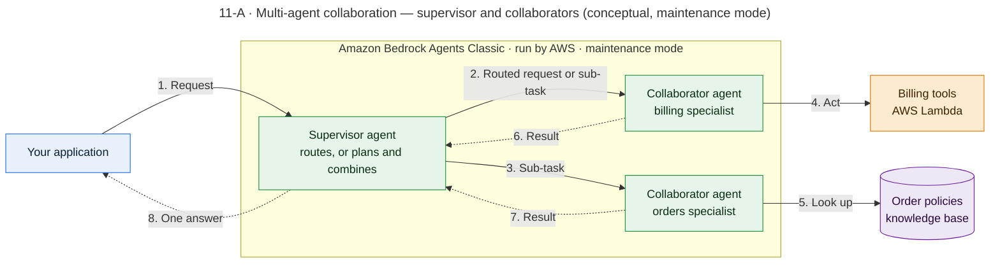
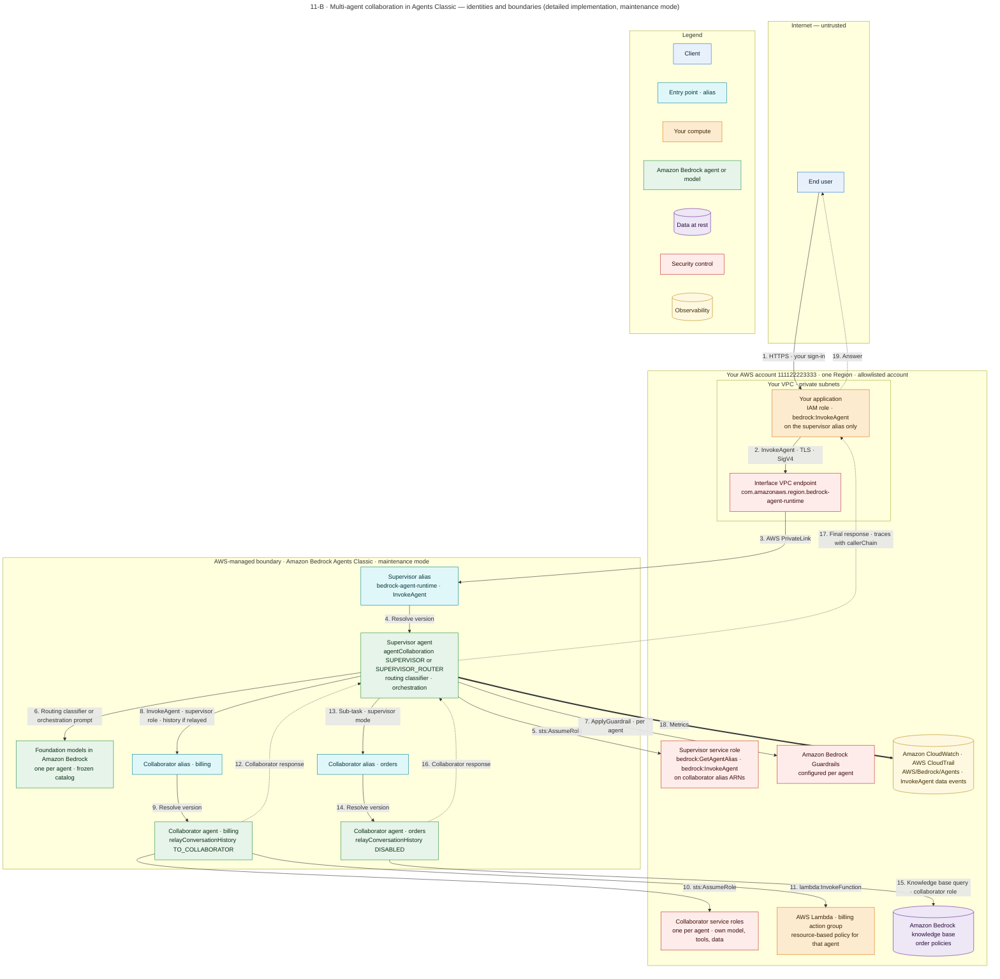
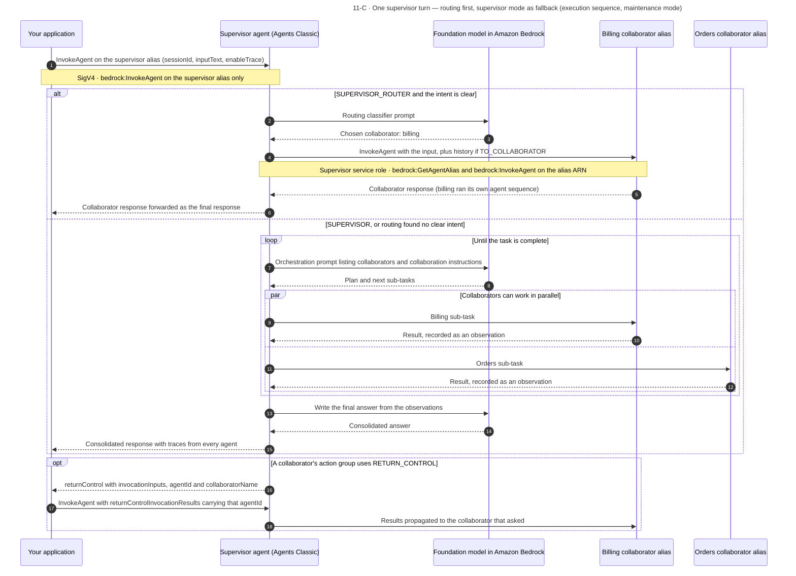
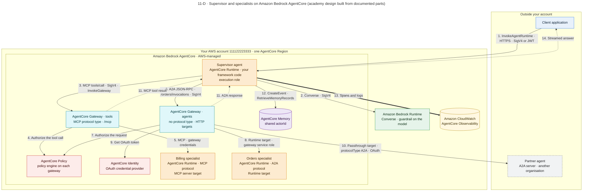

# Diagram 11 — Multi-agent collaboration architecture

> **Verified:** 2026-11-15 · **Type:** academy design, not an official AWS reference architecture · **Related chapters:** [Multi-agent collaboration](../../01-amazon-bedrock/agents/02-multi-agent-collaboration.md) · [Amazon Bedrock Agents Classic](../../01-amazon-bedrock/agents/01-agents-classic.md) · [Agents Classic versus AgentCore, and migrating](../../01-amazon-bedrock/agents/03-agents-classic-vs-agentcore.md) · [AgentCore Gateway](../../01-amazon-bedrock/agentcore/04-agentcore-gateway.md)

> [!IMPORTANT]
> **Status — maintenance mode.** Multi-agent collaboration is a feature of **Amazon Bedrock Agents
> Classic**, closed to new customers since **2026-07-30**. Supervisors and collaborators are ordinary
> agents, so an account without Agents activity in the previous 12 months gets HTTP 403 on
> `CreateAgent` and `InvokeInlineAgent` and cannot build a new team. Existing teams keep working with
> no new features. AWS rates the AgentCore equivalent as **"Limited. The supervisor pattern is
> possible by exposing agents as MCP tools (agent-as-tool). Routing mode multi-agent is not
> straightforward today. Full multi-agent collaboration requires custom framework code."**
> Source: [Amazon Bedrock Agents Classic maintenance mode](https://docs.aws.amazon.com/bedrock/latest/userguide/agents-classic-maintenance-mode.html)

This set documents an inherited team of Agents Classic agents — one **supervisor** that the
application invokes and several **collaborators**, each a complete agent — and, in the Variations
section, an AgentCore-based equivalent for new work. It answers two questions: **"how does one request travel through a team of
agents, and with whose permissions?"** and **"which parts of that can AgentCore reproduce today, and
which parts must I design?"**

## A. Conceptual view

**What this shows** — a front-desk coordinator and specialists. The application talks only to the
supervisor. In **supervisor** mode (`SUPERVISOR`) the supervisor breaks the task down, asks one or
more specialists, and writes the answer itself. In **routing** mode (`SUPERVISOR_ROUTER`) it sends a
simple request straight to one specialist, whose answer becomes the final response; for complex
requests or unclear intent it falls back to supervisor mode.

**Legend** — solid arrow: request · dashed arrow: response · cylinder: data at rest · green: agents
run by Amazon Bedrock · orange: your compute.

## B. Detailed implementation view

**Legend** — solid arrow: request or role assumption · dashed arrow: response · thick arrow:
telemetry · cylinder: data at rest · nested boxes: trust and network boundaries.

**What this shows** — a hierarchy inside one Region, with three kinds of identity. The application
can invoke only the supervisor's alias. The **supervisor's service role** is what allows delegation:
it needs `bedrock:GetAgentAlias` and `bedrock:InvokeAgent` on each collaborator alias ARN. Each
**collaborator** then acts under its **own** service role, so the billing specialist cannot read the
order knowledge base unless its role allows it. Collaborators communicate inside the service; no
network path in your VPC is involved.

**Walkthrough**

- **1–3.** The application calls `InvokeAgent` on the supervisor's alias, here through an interface endpoint.
- **4.** The alias resolves to an immutable supervisor version, which holds the collaborator associations.
- **5.** Amazon Bedrock assumes the supervisor's service role.
- **6.** In routing mode one routing-classifier prompt picks a collaborator; in supervisor mode the
  orchestration prompt lists the collaborators and their collaboration instructions.
- **7.** Each agent has its own guardrail configuration. **Our reading:** the supervisor's guardrail
  does not filter what a collaborator writes as the final response in routing mode.
- **8.** The supervisor invokes a collaborator **alias**. With `TO_COLLABORATOR`, the full session
  history goes with it; `sessionAttributes` passed to the supervisor are forwarded to all collaborators.
- **9–11.** The collaborator resolves its own version, assumes its own service role and runs its own
  agent sequence, here calling its action group.
- **12.** Its answer returns to the supervisor — as an observation in supervisor mode, as the final
  response in routing mode.
- **13–16.** In supervisor mode the supervisor may call further collaborators, in sequence or in
  parallel; the orders collaborator queries its knowledge base under its own role and answers.
- **17.** One response stream reaches the application; trace events from every agent carry
  `collaboratorName` and a `callerChain` of the alias ARNs that forwarded the request.
- **18–19.** Metrics go to `AWS/Bedrock/Agents`; `InvokeAgent` is a CloudTrail data event. The
  application returns the answer.

### Component roles

| Component | Role in this architecture | Security control |
|:--|:--|:--|
| Application IAM role | Invokes the supervisor only | `bedrock:InvokeAgent` on the supervisor alias ARN; collaborators need no permission from the caller |
| Supervisor alias and version | Entry point; the version fixes which collaborator aliases are used | Collaborators are associated on the supervisor's `DRAFT`, then prepared and versioned |
| Supervisor agent | Routes (`SUPERVISOR_ROUTER`) or plans and consolidates (`SUPERVISOR`) | Its own guardrail; `collaborationInstruction` (1–4,000 characters) per collaborator |
| Supervisor service role | Lets the supervisor call collaborators | `bedrock:GetAgentAlias` and `bedrock:InvokeAgent` scoped to `agent-alias/<agent-id>/<alias-id>` ARNs |
| Collaborator aliases | Stable references used by the supervisor | A collaborator change reaches the team only when its alias is repointed |
| Collaborator agents | Complete agents with their own model, action groups, knowledge bases, guardrail | Their own service roles — least privilege per specialist |
| Collaborator service roles | Identity for each specialist's model, knowledge base and guardrail calls | Trust policy with `aws:SourceAccount` and `aws:SourceArn` |
| AWS Lambda function | One collaborator's action group | Resource-based policy for `bedrock.amazonaws.com` scoped to that collaborator's agent ARN |
| Knowledge base | One collaborator's data | `bedrock:Retrieve` on that collaborator's role only |
| Amazon Bedrock Guardrails | Content filtering, configured agent by agent | `bedrock:ApplyGuardrail` on each agent's role |
| Amazon CloudWatch, AWS CloudTrail | Metrics per alias and model; `InvokeAgent` audit | Data event selector for `AWS::Bedrock::AgentAlias`; traces contain every agent's prompts |

### Connections

| # | From → To | Protocol / operation | Direction of data | Auth |
|--:|:--|:--|:--|:--|
| 1 | User → application | HTTPS | Message in | Your application |
| 2–3 | Application → endpoint → supervisor alias | HTTPS over AWS PrivateLink · `InvokeAgent` | `inputText`, `sessionState` in | SigV4, `bedrock:InvokeAgent`, endpoint policy |
| 4, 9, 14 | Alias → version | Service-internal | — | Alias invocation state |
| 5, 10 | Agent → its service role | `sts:AssumeRole` | Credentials | Trust policy |
| 6 | Supervisor → model | Model invocation | Routing or orchestration prompt out, decision in | Supervisor role |
| 7 | Agent → guardrail | `ApplyGuardrail` | Content out, verdict in | Each agent's role |
| 8, 13 | Supervisor → collaborator alias | `InvokeAgent`, inside the service | Request or sub-task, optional history, session attributes | Supervisor role: `bedrock:GetAgentAlias`, `bedrock:InvokeAgent` |
| 11 | Billing collaborator → Lambda | `lambda:InvokeFunction` | Input event out, response in | Lambda resource-based policy |
| 12, 16 | Collaborator → supervisor | Collaborator response | Result in | — |
| 15 | Orders collaborator → knowledge base | Knowledge base query | Query out, passages in | Orders collaborator role |
| 17 | Supervisor → application | Event stream | `chunk`, `trace`, `returnControl` | — |
| 18 | Agents → CloudWatch | Metrics | Telemetry out | Service roles with `cloudwatch:PutMetricData` |
| 19 | Application → user | HTTPS | Answer out | Your application |

## C. Sequence view

**Steps 1 to 6 — routing.** One routing-classifier model call (`RoutingClassifierTrace` in the trace)
picks a collaborator; the collaborator's answer is the final response. AWS states that routing
reduces latency.

**Steps 7 to 15 — supervisor mode.** Each sub-task costs at least one supervisor model call plus the
collaborator's own iterations. The `par` block shows what the documentation allows (collaborators
"work in parallel"); whether a given turn runs in parallel is the model's decision.

**Steps 16 to 18 — return of control through a supervisor.** The caller sends the result to the
**supervisor**, with the `agentId` the response named, and the supervisor propagates it to the right
collaborator.

**Failure paths**

- A supervisor role without `bedrock:InvokeAgent` on a collaborator alias fails at step 4 or 9,
  during delegation — not when the application calls — so single-agent tests can pass.
- A collaborator alias that still points to an old version: the team behaves as before the change.
- Exceptions from any agent surface in the supervisor's event stream: `throttlingException`,
  `dependencyFailedException`, `accessDeniedException`, `validationException` and others.
- More than the allowed number of collaborators: the user guide says "a maximum of 10 collaborator
  agents … at this time", while the GA announcement mentions "increased collaborator and step count
  limits" — check Service Quotas in your account.

## Variations

### Within Agents Classic

| Variation | What changes in the diagram |
|:--|:--|
| `SUPERVISOR` only | Step 6 is always an orchestration prompt; the supervisor writes every final answer |
| `SUPERVISOR_ROUTER` | Simple requests take one classifier call and one collaborator; complex ones fall back to supervisor mode |
| `relayConversationHistory` `TO_COLLABORATOR` | The whole session (user input and supervisor responses of every turn) goes with edge 8 or 13 to that collaborator — more tokens, more data exposure |
| Payload referencing | The supervisor refers to a payload instead of repeating it, reducing tokens on edges 8 and 13 |
| Inline supervisor (`InvokeInlineAgent`) | No supervisor alias: the supervisor and its collaborators are defined in the request. Existing inline-agent users only |
| Collaborator that is itself a supervisor | `callerChain` implies chains of agents; the supported depth is **UNVERIFIED — REQUIRES DOCUMENTATION REVIEW** (not stated on the multi-agent pages read) |
| Collaborator with return of control | Edge 17 carries `returnControl` with `agentId` and `collaboratorName` (view C, last block) |

### AgentCore-based equivalent

For new multi-agent work, AWS points to AgentCore. The diagram below is **the academy's design**,
assembled from documented building blocks; each line of the table after it says which part is
documented and which part is ours.

| Legend | Meaning |
|:--|:--|
| Solid / dashed / thick arrow | Request · response · telemetry |
| Teal | AgentCore Gateway entry points |
| Orange | Agents you run on AgentCore Runtime |
| Red | Security controls |
| Grey dashed node | Outside your AWS account |

**What this shows** — the supervisor is your own code on AgentCore Runtime. It reaches one
specialist **as a tool** (agent-as-tool: the specialist is an MCP server behind a tools gateway) and
another **as a peer agent** (A2A, proxied by an agents gateway), and it can reach an agent in another
organisation through a passthrough target. The two gateways are an academy choice: Runtime and
passthrough targets cannot be added to a gateway with the MCP protocol type, and separate gateways
keep different trust levels apart. Nothing in this picture relays history, references payloads or
builds a `callerChain` for you.

**Walkthrough**

1. The client invokes the supervisor (`InvokeAgentRuntime`; a harness supervisor would use `InvokeHarness`).
2. The supervisor calls its model with the execution role.
3. To use the billing specialist as a tool, it calls the tools gateway over MCP, signed with SigV4.
4. A policy engine attached to the gateway authorizes the call.
5. The gateway calls the specialist's MCP endpoint on Runtime with its own credentials.
6. To talk to the orders specialist as an agent, the supervisor sends A2A JSON-RPC to the agents
   gateway, addressing the target by path.
7. The agents gateway authorizes the request; for A2A and MCP protocols a default schema is applied
   so policy and guardrail features work.
8. The gateway forwards to the Runtime target with its service role, without protocol translation.
9. For an external agent, the gateway fetches an OAuth token from AgentCore Identity.
10. The passthrough target forwards the A2A request to the partner's endpoint.
11. Results return to the supervisor, which decides the next step — the loop is your code.
12. Context shared between agents lives in AgentCore Memory, keyed by the same `actorId`.
13. Each agent's spans and logs go to Amazon CloudWatch.
14. The supervisor streams the answer to the client.

> [!WARNING]
> **Source conflict (edge 5)** — the MCP server targets page lists AgentCore Runtime among the
> services compatible with IAM (SigV4) outbound authorization; the Gateway VPC egress page states
> that only no authorization and OAuth client credentials are supported from Gateway to Runtime.
> Test SigV4 in your account, or configure OAuth client credentials, before relying on either.
> Sources: [MCP servers targets](https://docs.aws.amazon.com/bedrock-agentcore/latest/devguide/gateway-target-MCPservers.html),
> [Gateway VPC egress](https://docs.aws.amazon.com/bedrock-agentcore/latest/devguide/gateway-vpc-egress.html)

#### What is documented and what is the academy's design

| Agents Classic element | AgentCore-based equivalent | Documented by AWS | Academy design |
|:--|:--|:--|:--|
| Supervisor in `SUPERVISOR` mode | Supervisor agent on Runtime (code), or a harness for simple cases | "The supervisor pattern is possible by exposing agents as MCP tools"; the harness "supports an agent-as-tool pattern for simpler multi-agent use cases"; Runtime hosts "multi-agent collaboration and supervisor patterns" as code | The supervisor's prompt, loop and stop conditions |
| `SUPERVISOR_ROUTER` | A router you write on Runtime | "Routing mode multi-agent is not straightforward today" — no managed counterpart | Classify, then forward to one specialist, with a fallback to supervisor mode |
| Collaborator reached as a tool | Specialist hosted as an MCP server on Runtime, behind a gateway **MCP server target** | MCP server targets; Runtime listed as SigV4-compatible (see the source conflict above); tools appear as `<target>___<tool>` | One specialist per target; one coarse tool per specialist |
| Collaborator reached as an agent | Specialist hosted as an **A2A server** on Runtime, behind a gateway **Runtime target** | A2A on Runtime: port 9000, JSON-RPC, Agent Card at `/.well-known/agent-card.json`, SigV4 or OAuth 2.0. Runtime targets: proxy without aggregation, path `/{targetName}/invocations`, outbound IAM, caller IAM, OAuth or token passthrough; not on MCP-protocol gateways | Separate tools and agents gateways |
| Collaborator outside your account | **HTTP passthrough target** with `protocolType` `A2A` | Documented, with an OAuth credential provider from AgentCore Identity | Which partners may be reached |
| Supervisor role with `bedrock:InvokeAgent` on aliases | Supervisor execution role with `bedrock-agentcore:InvokeGateway`; gateway role with `bedrock-agentcore:InvokeAgentRuntime` on the specialist; specialist restricted to gateway traffic | `InvokeGateway` for IAM-authorized gateways; the gateway role permission and restricting a runtime to its gateway are on the Runtime targets page | One gateway role per trust level |
| Guardrail per agent | Guardrail on each model, plus AgentCore Policy on each gateway | "Guardrails configured on the Bedrock model still apply"; agent-level enforcement "through AgentCore gateway policies" | Which policies apply to which specialist |
| `relayConversationHistory`, payload referencing, forwarded `sessionAttributes` | Context passed by your framework; shared AgentCore Memory | Memory supports sharing memory stores across agents; no managed relay is listed in the official comparison | What each specialist may see, and under which `actorId` and namespace |
| One trace with `callerChain` | Spans per agent in AgentCore Observability | Observability traces each agent's workflow in an OpenTelemetry-compatible format | Propagating a correlation identifier across agents |
| Delegation to a helper inside one agent | Harness built-in `subagent` tool | "The child is not a separately configured harness" | Not a replacement for separately owned specialists |
| Finding collaborators | AWS Agent Registry | A governed catalog of MCP servers, agents (A2A agent cards), skills and custom resources, with hybrid search and an MCP endpoint | Using it at design time or at run time |
| A harness as supervisor calling an A2A agent | — | Harness tool types are MCP servers, gateways, Browser, Code Interpreter and inline functions | **Our reading:** a harness reaches other agents only as MCP tools; A2A through an HTTP target needs your own code on Runtime |

> [!TIP]
> **Academy recommendation** — Start new multi-agent systems with agent-as-tool behind one tools
> gateway, and add A2A peers only when a specialist must keep its own conversation or belongs to
> another team. Budget for re-implementing routing, history relay and trace correlation; none of them
> is managed today. This is our design guidance, not an official AWS reference architecture.

## Practical example

- [Multi-agent collaboration](../../01-amazon-bedrock/agents/02-multi-agent-collaboration.md#13-working-example),
  section 13 — validated Terraform for an **existing** supervisor and collaborator, and a Python
  function that reads `collaboratorName`, `callerChain` and delegation steps from the trace.
- [Agents Classic versus AgentCore, and migrating](../../01-amazon-bedrock/agents/03-agents-classic-vs-agentcore.md)
  — the inventory script records each agent's collaboration mode and collaborators before a move.
- [AgentCore Gateway](../../01-amazon-bedrock/agentcore/04-agentcore-gateway.md#13-working-example)
  — validated Terraform for a gateway and a target, the starting point for view D.
- [Project D: agentic application on AgentCore](../../05-practical-projects/project-04-agentic-ai/README.md)
  and [Agent orchestration patterns](../../09-advanced-topics/07-agent-orchestration-patterns.md) —
  where these patterns are built and compared.
- [Diagram set 10](10-bedrock-agents-classic.md) (one agent in detail) and
  [diagram set 14](14-agentcore-gateway-and-identity.md) (Gateway and Identity flows).

## References

- [Amazon Bedrock Agents Classic maintenance mode](https://docs.aws.amazon.com/bedrock/latest/userguide/agents-classic-maintenance-mode.html) — status, the "Limited" rating, code-defined agents for supervisor patterns, guardrail FAQ.
- [Use multi-agent collaboration with Amazon Bedrock Agents](https://docs.aws.amazon.com/bedrock/latest/userguide/agents-multi-agent-collaboration.html) — supervisor and collaborator roles, parallel work, per-agent guardrails.
- [Create multi-agent collaboration](https://docs.aws.amazon.com/bedrock/latest/userguide/create-multi-agent-collaboration.html) — the two modes, history sharing, the 10-collaborator sentence.
- [AssociateAgentCollaborator](https://docs.aws.amazon.com/bedrock/latest/APIReference/API_agent_AssociateAgentCollaborator.html) — `agentDescriptor.aliasArn`, `collaborationInstruction`, `relayConversationHistory`, `DRAFT` only.
- [Amazon Bedrock announces general availability of multi-agent collaboration](https://aws.amazon.com/blogs/machine-learning/amazon-bedrock-announces-general-availability-of-multi-agent-collaboration/) — routing fallback, payload referencing, increased limits.
- [Create a service role for Amazon Bedrock Agents](https://docs.aws.amazon.com/bedrock/latest/userguide/agents-permissions.html) — the collaborator invocation policy on edge 8.
- [Track the agent's reasoning using trace](https://docs.aws.amazon.com/bedrock/latest/userguide/trace-events.html) — `collaboratorName`, `callerChain`, `RoutingClassifierTrace`.
- [Return control to the agent developer](https://docs.aws.amazon.com/bedrock/latest/userguide/agents-returncontrol.html) — return of control through a supervisor.
- [Control agent session context](https://docs.aws.amazon.com/bedrock/latest/userguide/agents-session-state.html) and [SessionState](https://docs.aws.amazon.com/bedrock/latest/APIReference/API_agent-runtime_SessionState.html) — `conversationHistory` and forwarded `sessionAttributes`.
- [Core concepts for AgentCore Gateway](https://docs.aws.amazon.com/bedrock-agentcore/latest/devguide/gateway-core-concepts.html) — MCP, HTTP and inference targets.
- [AgentCore Runtime targets](https://docs.aws.amazon.com/bedrock-agentcore/latest/devguide/gateway-target-http-runtime.html) and [HTTP passthrough targets](https://docs.aws.amazon.com/bedrock-agentcore/latest/devguide/gateway-target-http-passthrough.html) — edges 6 to 10 of view D.
- [MCP servers targets](https://docs.aws.amazon.com/bedrock-agentcore/latest/devguide/gateway-target-MCPservers.html) and [Gateway VPC egress](https://docs.aws.amazon.com/bedrock-agentcore/latest/devguide/gateway-vpc-egress.html) — edge 5 and its source conflict.
- [Deploy A2A servers in AgentCore Runtime](https://docs.aws.amazon.com/bedrock-agentcore/latest/devguide/runtime-a2a.html) — the A2A specialist.
- [Set up inbound authorization for your gateway](https://docs.aws.amazon.com/bedrock-agentcore/latest/devguide/gateway-inbound-auth.html) — `bedrock-agentcore:InvokeGateway` on edges 3 and 6.
- [AgentCore overview](https://docs.aws.amazon.com/bedrock-agentcore/latest/devguide/what-is-bedrock-agentcore.html) — Runtime support for multi-agent workloads and A2A, memory shared across agents, Observability.
- [AWS Agent Registry](https://docs.aws.amazon.com/bedrock-agentcore/latest/devguide/registry.html) — the discovery row of the table.
- [AgentCore harness tools](https://docs.aws.amazon.com/bedrock-agentcore/latest/devguide/harness-tools.html) — harness tool types and the `subagent` tool.
- [Generated API reference](../../references/bedrock-api-operations.md) — operation names used in this set.
