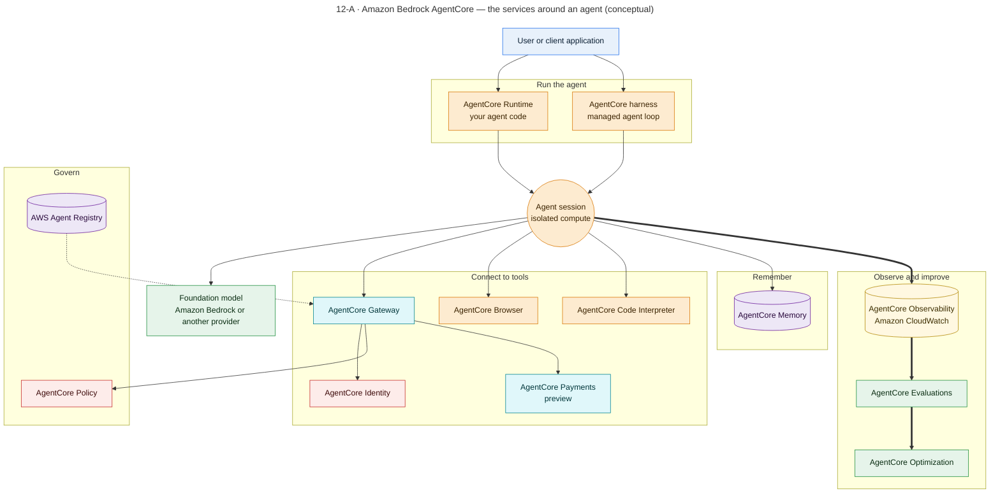
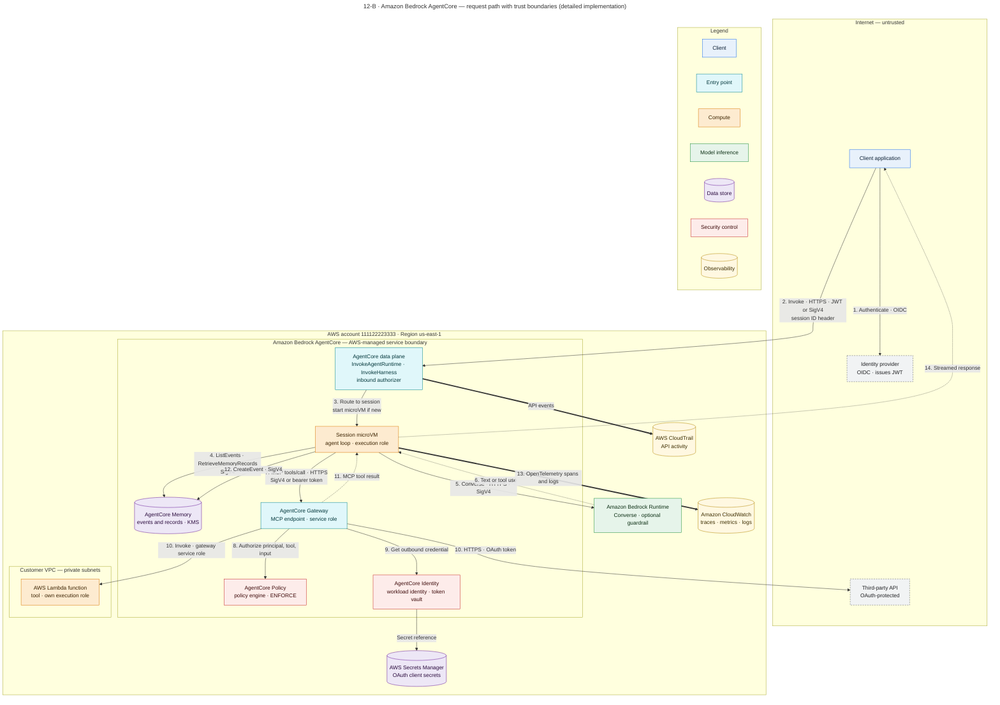
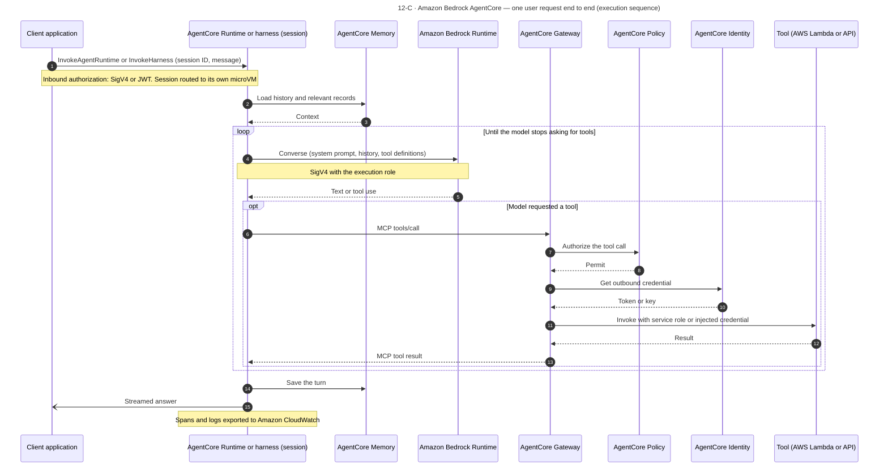

# Diagram 12 — Amazon Bedrock AgentCore architecture

> **Verified:** 2026-11-15 · **Type:** academy design, not an official AWS reference architecture · **Related chapters:** [AgentCore overview](../../01-amazon-bedrock/agentcore/01-agentcore-overview.md) · [AgentCore Runtime](../../01-amazon-bedrock/agentcore/02-agentcore-runtime.md) · [AgentCore harness](../../01-amazon-bedrock/agentcore/03-agentcore-harness.md) · [AgentCore Gateway](../../01-amazon-bedrock/agentcore/04-agentcore-gateway.md)

This set documents how the Amazon Bedrock AgentCore services fit around one agent. It answers the question "when a user sends one message, which AgentCore service does what, in which order, and with whose credentials?" The diagrams are the academy's own; they use no AWS logos and describe the customer-visible architecture only.

## A. Conceptual view

Thirteen services, grouped by the job they do for an agent.

**What this shows** — The agent session is in the middle. Runtime and the harness are two ways to get one: with Runtime you bring the loop as code, with the harness you declare it. Everything else is something the session uses (model, tools, memory), something that constrains it (Identity, Policy), or something that watches and improves it (Observability, Evaluations, Optimization). Registry is a catalogue from which tools and agents are discovered; Payments lets an agent pay for a paid tool. Each service can be used without the others. The dashed arrow is discovery, thick arrows are telemetry.

## B. Detailed implementation view

One request through Runtime or the harness, a model on Amazon Bedrock, and a tool behind Gateway.

**Legend** — solid arrow: request or write · dashed arrow: response · thick arrow: asynchronous telemetry · cylinder: data at rest · grey dashed node: outside your AWS account · nested boxes: trust and network boundaries.

**What this shows** — Three trust boundaries. The internet side holds the caller, its identity provider and any third-party API. The AgentCore boundary is operated by AWS: you configure it but do not see its hosts. Your own resources — the tool function in your VPC, your secrets, your telemetry — stay in your account. The session never holds tool credentials: it asks the Gateway, and the Gateway asks Identity.

**Walkthrough**

1. The user authenticates with the identity provider and receives a token (JWT inbound authorization only).
2. The client invokes the agent over HTTPS with a bearer token or a SigV4 signature, and a session ID.
3. The data plane authorizes the caller and routes to the session's microVM, starting one for a new session.
4. The agent loads conversation history and relevant long-term records.
5. The agent calls the model with the execution role's credentials.
6. The model answers with text or a tool request.
7. For a tool request, the agent calls the Gateway's MCP endpoint.
8. The policy engine decides whether this principal may call this tool with this input.
9. The Gateway obtains the credential the target needs.
10. The Gateway invokes the target: a Lambda function with its service role, or a third-party API with an OAuth token.
11. The tool result returns to the agent, which usually calls the model again (steps 5–11 repeat).
12. The agent writes the turn to Memory.
13. Spans and logs are exported to CloudWatch.
14. The answer streams back to the client.

### Component roles

| Component | Role in this architecture | Security control |
|:--|:--|:--|
| Client application | Sends user messages, keeps the mapping of users to session IDs | Your application's authentication |
| Identity provider | Issues JWTs for inbound authorization | OIDC discovery URL, allowed audiences and clients on the authorizer |
| AgentCore data plane | Receives `InvokeAgentRuntime` or `InvokeHarness`, authorizes, routes | IAM (SigV4) or JWT authorizer; interface VPC endpoint available |
| Session microVM | Runs the agent loop for one session | Dedicated microVM per session; IAM execution role |
| AgentCore Memory | Short-term events and long-term records | IAM; encryption with AWS KMS |
| Amazon Bedrock Runtime | Model inference | IAM on the execution role; optional guardrail |
| AgentCore Gateway | One MCP endpoint in front of tools | Inbound authorizer; service role as the upper bound of access |
| AgentCore Policy | Deterministic decision on each tool call | Policy engine in `LOG_ONLY` or `ENFORCE` mode |
| AgentCore Identity | Workload identity; OAuth tokens and API keys for targets | Token vault; secrets in AWS Secrets Manager |
| AWS Lambda function | Implements a tool | Its own execution role; reachable only through the gateway role |
| Third-party API | External tool | OAuth token or API key injected by the Gateway |
| Amazon CloudWatch, AWS CloudTrail | Traces, metrics, logs; API activity | Log group policies, retention, encryption |

### Connections

| # | From → To | Protocol / operation | Direction of data | Auth |
|--:|:--|:--|:--|:--|
| 1 | Client → identity provider | HTTPS · OIDC | Credentials in, token out | Provider's own |
| 2 | Client → AgentCore data plane | HTTPS · `InvokeAgentRuntime` or `InvokeHarness` | Prompt in | SigV4 or JWT bearer token |
| 3 | Data plane → session | Internal routing by session ID | Prompt in | Service-internal |
| 4 | Session → Memory | HTTPS · `ListEvents`, `RetrieveMemoryRecords` | Context out of Memory | SigV4, execution role |
| 5–6 | Session ↔ Amazon Bedrock Runtime | HTTPS · `Converse` | Prompt in, completion out | SigV4, execution role |
| 7 | Session → Gateway | HTTPS · MCP `tools/call` | Tool arguments in | SigV4 (`InvokeGateway`) or bearer token |
| 8 | Gateway → Policy | Policy evaluation | Principal, tool, input | Service-internal |
| 9 | Gateway → Identity | `GetResourceOauth2Token` or `GetResourceApiKey` | Credential out | Gateway service role, workload identity |
| 10 | Gateway → Lambda function / third-party API | Lambda `Invoke` / HTTPS | Tool arguments in, result out | Gateway service role / OAuth token or API key |
| 11 | Gateway → session | MCP result | Tool result out | — |
| 12 | Session → Memory | HTTPS · `CreateEvent` | Turn written | SigV4, execution role |
| 13 | Session → CloudWatch | OpenTelemetry export | Telemetry out | Execution role |
| 14 | Session → client | Response stream (JSON, SSE or event stream) | Answer out | Same connection as 2 |

## C. Sequence view

**Steps and failure paths**

- **1.** A failed authorization ends here: 403 for SigV4, 401 with a `WWW-Authenticate` header for a missing JWT. Throttling returns 429.
- **2–3.** Memory is optional; without it the agent has only what is still in the session.
- **4–5.** Model errors (throttling, access denied on the model) surface in your agent code or, for the harness, in the event stream. Each loop iteration is another model call and another set of input tokens.
- **6–13.** If the policy engine forbids the call in `ENFORCE` mode, steps 9–12 do not happen and the agent receives a denial it can report. If a rate limit is exceeded, the Gateway throttles before policy evaluation. A tool error returns as a tool result; the model decides what to do next.
- **14–15.** The answer streams while the loop runs. For the harness, the last event carries the stop reason, including the limits `max_iterations_exceeded` and `timeout_exceeded`.

## Variations

| Variation | What changes |
|:--|:--|
| Harness instead of your own code | The loop in the session is AgentCore's; you call `InvokeHarness`; Memory is managed by default; model, tools and limits are configuration |
| JWT instead of SigV4 inbound | Step 1 of view B is needed; the client calls the HTTPS API directly, not through the AWS SDK; user identity can flow to user-scoped tool credentials |
| Model outside Amazon Bedrock | Edge 5 goes to an external provider with an API key from AgentCore Identity, or through a Gateway inference target |
| Tools without a Gateway | The agent calls a remote MCP server or an in-process tool directly; steps 8–9 (Policy, Identity) do not apply |
| Built-in tools | Browser and Code Interpreter sessions are started from the agent with the execution role; no Gateway hop |
| VPC mode | The session's outbound traffic leaves through network interfaces in your subnets; add VPC endpoints or a NAT gateway |
| Private callers | Edge 2 uses the `bedrock-agentcore` interface endpoint; edge 7 can use the `bedrock-agentcore.gateway` endpoint |
| Policy in `LOG_ONLY` | Decisions are recorded but not enforced |
| Runtime on Instances | The session is an Amazon EC2 managed instance in your account, VPC only, up to 14 days |
| Agent hosted outside AgentCore | Replace the session with your own compute; Gateway, Identity, Memory and Observability can still be used |
| Region | Not every service is in every AgentCore Region; the harness and Memory are in 16 of 22 |

## Practical example

- [Project D: agentic application on AgentCore](../../05-practical-projects/project-04-agentic-ai/README.md) implements this architecture; start with its README and then the Terraform root and the agent source.
- The validated Terraform fragments for each box are in the chapters: [Runtime](../../01-amazon-bedrock/agentcore/02-agentcore-runtime.md#13-working-example), [harness](../../01-amazon-bedrock/agentcore/03-agentcore-harness.md#13-working-example) and [Gateway](../../01-amazon-bedrock/agentcore/04-agentcore-gateway.md#13-working-example).
- Zoom in with [diagram set 13](13-agentcore-runtime-and-tool-execution.md) (Runtime and tool execution), [set 14](14-agentcore-gateway-and-identity.md) (Gateway and Identity), [set 15](15-agentcore-memory.md) (Memory) and [set 16](16-agentcore-observability.md) (observability).

## References

- [What is Amazon Bedrock AgentCore?](https://docs.aws.amazon.com/bedrock-agentcore/latest/devguide/what-is-bedrock-agentcore.html) — the thirteen services drawn in view A.
- [Host agent or tools with AgentCore Runtime](https://docs.aws.amazon.com/bedrock-agentcore/latest/devguide/agents-tools-runtime.html) — session isolation in a dedicated microVM.
- [Use isolated sessions for agents](https://docs.aws.amazon.com/bedrock-agentcore/latest/devguide/runtime-sessions.html) — session routing by session ID.
- [AgentCore harness](https://docs.aws.amazon.com/bedrock-agentcore/latest/devguide/harness.html) — the managed loop variant.
- [Core concepts for AgentCore Gateway](https://docs.aws.amazon.com/bedrock-agentcore/latest/devguide/gateway-core-concepts.html) — gateway, targets, authorizer, credential providers.
- [Set up outbound authorization for your gateway](https://docs.aws.amazon.com/bedrock-agentcore/latest/devguide/gateway-outbound-auth.html) — the Identity calls on edge 9.
- [Policy in Amazon Bedrock AgentCore](https://docs.aws.amazon.com/bedrock-agentcore/latest/devguide/policy.html) — interception of tool calls at the Gateway.
- [IAM permissions for AgentCore Runtime](https://docs.aws.amazon.com/bedrock-agentcore/latest/devguide/runtime-permissions.html) — the execution role used on edges 4, 5, 12 and 13.
- [Use interface VPC endpoints (AWS PrivateLink)](https://docs.aws.amazon.com/bedrock-agentcore/latest/devguide/vpc-interface-endpoints.html) — private caller paths.
- [Supported AWS Regions](https://docs.aws.amazon.com/bedrock-agentcore/latest/devguide/agentcore-regions.html) — the Region variation.
- [Generated API reference](../../references/bedrock-api-operations.md) — operation names used in the connections table.
