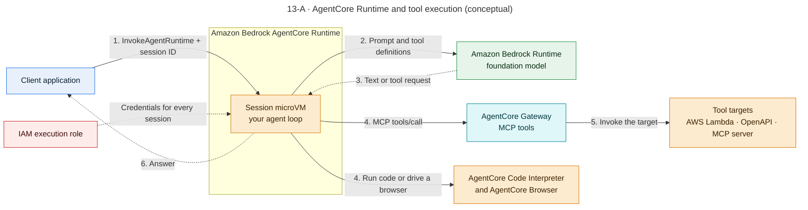
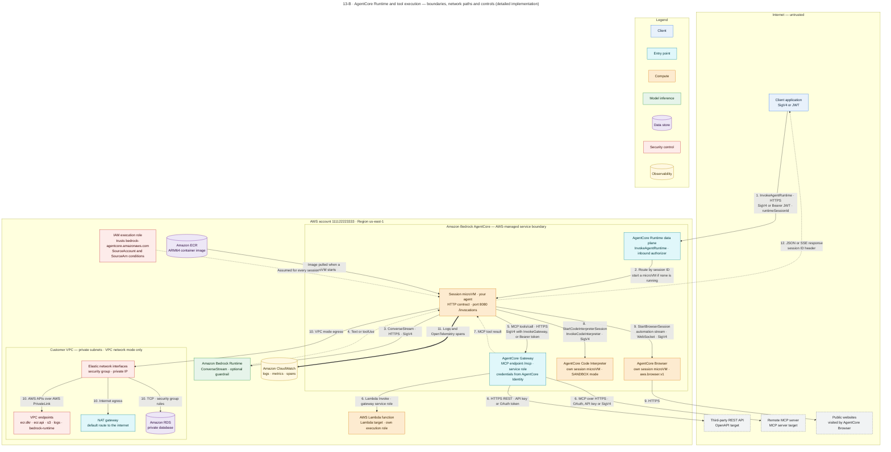
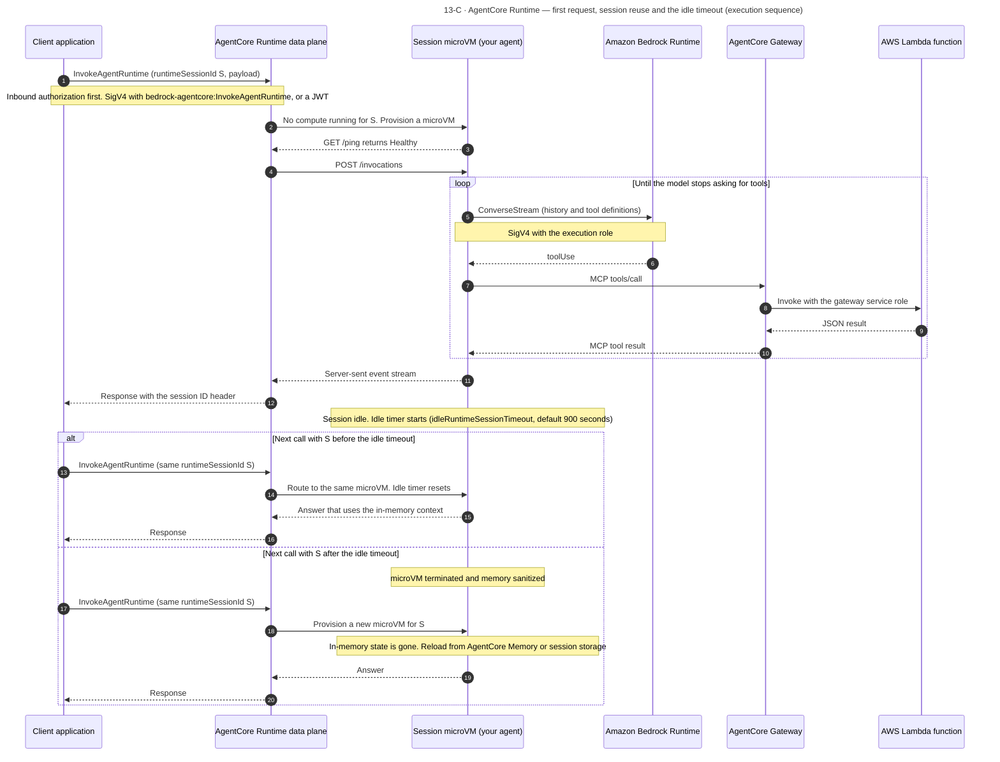

# Diagram 13 — AgentCore Runtime and tool execution

> **Verified:** 2026-11-15 · **Type:** academy design, not an official AWS reference architecture · **Related chapters:** [AgentCore Runtime](../../01-amazon-bedrock/agentcore/02-agentcore-runtime.md) · [AgentCore harness](../../01-amazon-bedrock/agentcore/03-agentcore-harness.md) · [AgentCore Gateway](../../01-amazon-bedrock/agentcore/04-agentcore-gateway.md) · [AgentCore Browser and Code Interpreter](../../01-amazon-bedrock/agentcore/08-agentcore-browser-and-code-interpreter.md)

This set zooms into the "run the agent" half of [diagram set 12](12-agentcore-architecture.md). It answers the question "when a client calls my agent on AgentCore Runtime and the model asks for a tool, what runs where, with which identity, over which network path, and what happens to the session afterwards?" Identity flows for the tools are drawn separately in [diagram set 14](14-agentcore-gateway-and-identity.md).

> [!NOTE]
> **Documented fact** — "Each session in AgentCore Runtime receives its own dedicated microVM with isolated compute, memory, and filesystem resources ... After session completion, the entire microVM is terminated and memory is sanitized." The same isolation applies to Code Interpreter and Browser sessions, each in its own dedicated microVM.
> Source: [Use isolated sessions for agents](https://docs.aws.amazon.com/bedrock-agentcore/latest/devguide/runtime-sessions.html), [Code Interpreter session management](https://docs.aws.amazon.com/bedrock-agentcore/latest/devguide/code-interpreter-session-characteristics.html)

## A. Conceptual view

One conversation, one microVM, and three ways to reach a tool.

**What this shows** — Your agent code runs inside a microVM that belongs to one session. The code asks a model what to do, and when the model asks for a tool it either calls AgentCore Gateway (one MCP endpoint in front of Lambda functions, APIs and MCP servers) or starts a built-in tool session. Every call the agent makes to AWS is signed with the runtime's execution role. Both edges numbered 4 are alternatives.

## B. Detailed implementation view

A container agent on microVMs with the HTTP protocol, a gateway with three target types, both built-in tools, and the optional VPC network mode.

**Legend** — solid arrow: request or write · dashed arrow: response or role assumption · thick arrow: asynchronous telemetry · cylinder: data at rest · grey dashed node: outside your AWS account · nested boxes: trust and network boundaries.

**What this shows** — Three trust zones and one optional network zone. The AgentCore boundary is operated by AWS: the data plane, your session microVM, the gateway and the built-in tool sessions all live there, and you see them only through their APIs. Your account holds what you own — the execution role, the image, the Lambda tool, the telemetry — and, in VPC mode, the network interfaces through which the session reaches your private resources. Tool credentials never enter the session for gateway targets: the gateway presents its service role or a credential from AgentCore Identity.

**Walkthrough**

1. The client calls `InvokeAgentRuntime` with the runtime ARN, an optional endpoint `qualifier` and a `runtimeSessionId` of at least 33 characters. The data plane authorizes the caller (SigV4 or JWT, never both on one runtime) before any compute is touched.
2. The data plane routes by session ID. A new or stopped session gets a fresh microVM; on platform version V1 it pulls the image with the execution role, on V2 it restores a prepared snapshot. A running session is reused.
3. Your agent loop calls the model with the execution role's credentials. Any framework or none; the model can also be outside Amazon Bedrock if your code calls it.
4. The model returns text or a tool request.
5. For a gateway tool, the agent sends an MCP `tools/call` to the gateway URL. An IAM-authorized gateway needs `bedrock-agentcore:InvokeGateway` on the execution role; a JWT-authorized gateway needs a bearer token.
6. The gateway invokes the target: a Lambda function with its service role (the only outbound option for Lambda targets), a REST API described by an OpenAPI schema, or a remote MCP server, with an API key, an OAuth token or SigV4.
7. The result returns as an MCP tool result; the loop calls the model again (steps 3–7 repeat).
8. For calculations or data analysis, the agent starts a Code Interpreter session and sends code to it. The sandbox runs in its own microVM, not in the agent's.
9. For web tasks, the agent starts a Browser session and drives it over the WebSocket automation stream; the browser reaches public websites.
10. In VPC network mode, the session's outbound traffic leaves through network interfaces in your subnets: private resources are reached under security group rules, AWS APIs through VPC endpoints, and the internet only through a NAT gateway. This includes edges 3, 5 and the image pull.
11. Logs and spans are exported to CloudWatch with the execution role.
12. The response returns as JSON or a server-sent event stream with the session ID header; the client must send that ID back to stay on the same microVM.

### Component roles

| Component | Role in this architecture | Security control |
|:--|:--|:--|
| Client application | Owns the mapping from users to session IDs and sends every turn | Its own authentication; SigV4 or a JWT from your identity provider |
| AgentCore Runtime data plane | Authorizes `InvokeAgentRuntime`, resolves the endpoint and version, routes by session ID | IAM or JWT authorizer; resource-based policy; interface endpoint `bedrock-agentcore` |
| Session microVM | Runs your agent code for one session; HTTP contract on port 8080 (`/invocations`, `/ping`) | Dedicated CPU, memory and filesystem; terminated and sanitized at the end |
| IAM execution role | Identity of your code: image pull, logs, traces, model calls, gateway and tool calls | Trust policy with `aws:SourceAccount` and `aws:SourceArn`; least-privilege permissions |
| Amazon ECR | Holds the ARM64 image | Repository policy; pull scoped to the repository ARN |
| Amazon Bedrock Runtime | Model inference | IAM on the execution role; optional guardrail |
| AgentCore Gateway | One MCP endpoint in front of the tools; outbound credentials | Inbound authorizer; service role as upper bound; optional AgentCore Policy |
| AWS Lambda function | A tool behind a Lambda target | Its own execution role; invoked only through the gateway service role |
| Third-party REST API, remote MCP server | External tools | OAuth token or API key held by AgentCore Identity, injected by the gateway |
| AgentCore Code Interpreter | Sandbox for code the model writes (Python, JavaScript, TypeScript) | Own microVM per session; network mode `SANDBOX`, `PUBLIC` or `VPC`; its own execution role for AWS access |
| AgentCore Browser | Managed browser driven by the agent | Own microVM per session; network mode `PUBLIC` or `VPC`; optional session recording to your S3 bucket |
| Elastic network interfaces | VPC-mode egress from sessions and tools | Created by `AWSServiceRoleForBedrockAgentCoreNetwork`; security groups; private subnets in supported Availability Zone IDs |
| VPC endpoints, NAT gateway | Private path to AWS APIs; controlled path to the internet | Endpoint policies; route tables |
| Amazon CloudWatch | Logs, metrics, spans | Log group retention and encryption |

### Connections

| # | From → To | Protocol / operation | Direction of data | Auth |
|--:|:--|:--|:--|:--|
| 1 | Client → Runtime data plane | HTTPS · `InvokeAgentRuntime` (`POST /runtimes/{agentRuntimeArn}/invocations`) | Payload in (up to 100 MB) | SigV4 or JWT bearer token |
| 2 | Data plane → session microVM | Internal routing by `runtimeSessionId`; `POST /invocations` to your container | Payload in | Service-internal |
| — | Amazon ECR → session | Image pull at microVM start | Image layers in | Execution role |
| 3–4 | Session ↔ Amazon Bedrock Runtime | HTTPS · `ConverseStream` or `Converse` | Prompt out, completion in | SigV4, execution role |
| 5 | Session → AgentCore Gateway | HTTPS · MCP JSON-RPC `tools/call` at `/mcp` | Tool arguments out | SigV4 (`bedrock-agentcore:InvokeGateway`) or bearer token |
| 6 | Gateway → Lambda / REST API / MCP server | Lambda invoke / HTTPS REST / MCP over HTTPS | Arguments out, result in | Gateway service role / API key or OAuth token / OAuth, API key or SigV4 |
| 7 | Gateway → session | MCP tool result | Result in (payload up to 6 MB) | Same connection as 5 |
| 8 | Session → Code Interpreter | HTTPS · `StartCodeInterpreterSession`, `InvokeCodeInterpreter` (streamed result) | Code out, output in | SigV4, execution role |
| 9 | Session → Browser → websites | HTTPS · `StartBrowserSession`, then WebSocket automation stream; browser → HTTPS | Actions out, page content in | SigV4, execution role |
| 10 | Session → VPC resources | TCP through network interfaces | Both directions | Security groups; the resource's own auth |
| 11 | Session → CloudWatch | OpenTelemetry export, CloudWatch Logs | Telemetry out | Execution role |
| 12 | Session → client | JSON or server-sent events; session ID header | Answer out | Same connection as 1 |

## C. Sequence view

One request on a new session, a reused session, and a session that went past its idle timeout.

**Steps and failure paths**

- **1.** A failed SigV4 check returns 403; a JWT runtime answers a missing token with 401 and a `WWW-Authenticate` header. Throttling returns 429 `ThrottlingException`. Session creation shares one account-level rate (25 new sessions per second by default, per the [quotas page](https://docs.aws.amazon.com/bedrock-agentcore/latest/devguide/bedrock-agentcore-limits.html)).
- **2–4.** While a session is being provisioned or torn down, a second operation on it gets a retryable 409 `RetryableConflictException`; retry with short exponential backoff. A container that fails the health check is stopped. If your container returns 4xx or 5xx, the caller sees 424 `RuntimeClientError`.
- **5–10.** Each loop iteration is another model call and another set of input tokens. A tool error comes back as a tool result and the model decides what to do; a policy denial at the gateway does the same (see [set 14](14-agentcore-gateway-and-identity.md)).
- **11–12.** Return the session ID on the next call, or the next turn lands on a new microVM without context.
- **13–16.** The idle timer resets on every invocation. The maximum lifetime timer (`maxLifetime`, default 28,800 seconds) starts when the microVM is created and does not reset. A background task keeps the session active only if `/ping` reports `HealthyBusy`.
- **17–20.** The session ID stays valid until the runtime is deleted; only the compute is replaced. The new microVM uses the code version current when it is created — existing sessions keep the version they started with. Termination can take up to 15 seconds.

> [!TIP]
> **Academy recommendation** — Treat the microVM as a cache, not a store. Write anything a user would miss after a coffee break to AgentCore Memory or to configured session storage, and choose the idle timeout from your users' think time and your cost tolerance, not from the default.
> This is our design guidance, not an official AWS reference architecture.

> [!CAUTION]
> **Cost or security hazard** — AgentCore does not check that a user owns a session ID. If your backend lets a client choose an arbitrary `runtimeSessionId`, one user can land in another user's microVM and its in-memory context. Generate session IDs on the server and map them to authenticated users.

## Variations

| Variation | What changes |
|:--|:--|
| **Instances** instead of microVMs | The session is an Amazon EC2 managed instance in **your** account, launched from a capacity provider; VPC networking only; `x86_64` or `arm64`; GPU instance families; sessions up to 14 days, with lifecycle values up to 1,209,600 seconds; Amazon EBS volumes survive session stops. Two runtimes that share a capacity provider and are invoked with the same session ID run on the same instance and share its filesystem. The compute type cannot be changed after creation |
| **Direct code deployment** (`.zip`) instead of a container | Amazon ECR is replaced by a `.zip` package (Python; Node.js) of at most 250 MB. AWS patches the language runtime automatically; with a container image AWS patches only the kernel and you rebuild the image. In VPC mode the S3 gateway endpoint policy must allow the AgentCore code artifact bucket instead of the ECR layer bucket |
| **Container image** details | ARM64 only, listening on `0.0.0.0`; up to 2 GB compressed on V1, 10 GB on V2. The code-deploy page quotes a lower new-session rate for containers than for zip packages; the quotas page gives one shared rate |
| **Harness** instead of your own framework code | The client calls `InvokeHarness`, which needs both `bedrock-agentcore:InvokeHarness` and `bedrock-agentcore:InvokeAgentRuntime` on the harness ARN. The loop in the microVM is AgentCore's, powered by Strands Agents; model, tools (`agentcore_gateway`, `remote_mcp`, `agentcore_code_interpreter`, `agentcore_browser`, `inline_function`) and limits are configuration. What it cannot do is listed in the [harness chapter](../../01-amazon-bedrock/agentcore/03-agentcore-harness.md#4-when-not-to-use-it) |
| **MCP** protocol | The runtime hosts an MCP server: port 8000, path `/mcp`, JSON-RPC; the session header is `Mcp-Session-Id`. The runtime can itself sit behind a gateway |
| **A2A** protocol | Port 9000, path `/`, JSON-RPC 2.0; other agents discover it through its Agent Card (`GetAgentCard`) |
| **AG-UI** and WebSocket | Port 8080: `/invocations` for server-sent events, `/ws` for WebSocket. WebSocket is a path of the HTTP and AG-UI contracts, not a separate protocol |
| `PUBLIC` network mode | No network interfaces in your VPC; edge 10 disappears and the session reaches the internet directly |
| Platform version **V2** | Sessions start by restoring a snapshot that AgentCore prepared before any session existed; session context keys `aws:AgentCoreRuntimeSourceSid` and `aws:AgentCoreRuntimeSourceArn` let one role policy scope each session; create SDK clients inside the handler |
| JWT inbound authorization | Edge 1 is a plain HTTPS request with `Authorization: Bearer` (the AWS SDK cannot send it); Runtime passes a workload access token to your code for user-scoped credentials |
| Gateway in front of the runtime | The runtime becomes an HTTP target. A resource-based policy can allow `InvokeAgentRuntime` only for the gateway's role, so callers cannot bypass the gateway |
| Built-in tool network modes | Code Interpreter `SANDBOX`, `PUBLIC` or `VPC`; Browser `PUBLIC` or `VPC`. A VPC-mode browser needs a NAT gateway to reach websites |

Sources for the variations: [Instances](https://docs.aws.amazon.com/bedrock-agentcore/latest/devguide/runtime-instances-how-it-works.html), [direct code deployment](https://docs.aws.amazon.com/bedrock-agentcore/latest/devguide/runtime-get-started-code-deploy.html), [service contract](https://docs.aws.amazon.com/bedrock-agentcore/latest/devguide/runtime-service-contract.html), [AgentCore harness](https://docs.aws.amazon.com/bedrock-agentcore/latest/devguide/harness.html), [harness security](https://docs.aws.amazon.com/bedrock-agentcore/latest/devguide/harness-security.html), [VPC configuration](https://docs.aws.amazon.com/bedrock-agentcore/latest/devguide/agentcore-vpc.html), [Inbound Auth and Outbound Auth](https://docs.aws.amazon.com/bedrock-agentcore/latest/devguide/runtime-oauth.html). The CPU dimension is not billed during I/O wait, but the session is billable until its microVM terminates; see the [Runtime pricing dimensions](../../01-amazon-bedrock/agentcore/02-agentcore-runtime.md#10-pricing-dimensions).

## Practical example

- [Project D: agentic application on AgentCore](../../05-practical-projects/project-04-agentic-ai/README.md) implements this architecture end to end; read its README, then the Terraform root and the agent source.
- The validated Terraform for the runtime, its execution role and a pinned endpoint is in the [Runtime working example](../../01-amazon-bedrock/agentcore/02-agentcore-runtime.md#13-working-example); the gateway with a Lambda target and the Lambda handler are in the [Gateway working example](../../01-amazon-bedrock/agentcore/04-agentcore-gateway.md#13-working-example).
- The reusable [agentcore-runtime Terraform module](../../04-infrastructure-as-code/terraform/modules/agentcore-runtime/README.md) packages the runtime, role and endpoint.
- For private networking around edge 10, see [Private connectivity for Bedrock](../../02-related-aws-services/networking/01-private-connectivity-for-bedrock.md).

## References

- [Host agent or tools with AgentCore Runtime](https://docs.aws.amazon.com/bedrock-agentcore/latest/devguide/agents-tools-runtime.html) — session isolation, compute types, CPU billing during I/O wait.
- [microVMs](https://docs.aws.amazon.com/bedrock-agentcore/latest/devguide/runtime-how-it-works.html) — versions, endpoints, sessions, platform versions V1 and V2.
- [Use isolated sessions for agents](https://docs.aws.amazon.com/bedrock-agentcore/latest/devguide/runtime-sessions.html) — session states, session headers, 409 conflicts, session context keys.
- [Configure lifecycle settings](https://docs.aws.amazon.com/bedrock-agentcore/latest/devguide/runtime-lifecycle-settings.html) — `idleRuntimeSessionTimeout`, `maxLifetime`, timer reset and the code version per microVM.
- [Understand the AgentCore Runtime service contract](https://docs.aws.amazon.com/bedrock-agentcore/latest/devguide/runtime-service-contract.html) — HTTP, MCP, A2A and AG-UI ports and paths.
- [Instances](https://docs.aws.amazon.com/bedrock-agentcore/latest/devguide/runtime-instances-how-it-works.html) — capacity providers and the compute type comparison.
- [Direct code deployment](https://docs.aws.amazon.com/bedrock-agentcore/latest/devguide/runtime-get-started-code-deploy.html) — zip versus container, patching responsibility.
- [IAM permissions for AgentCore Runtime](https://docs.aws.amazon.com/bedrock-agentcore/latest/devguide/runtime-permissions.html) — the execution role on edges 3, 5, 8, 9 and 11.
- [Inbound Auth and Outbound Auth](https://docs.aws.amazon.com/bedrock-agentcore/latest/devguide/runtime-oauth.html) — SigV4 or JWT, and restricting a runtime to its gateway.
- [Configure AgentCore Runtime and tools for VPC](https://docs.aws.amazon.com/bedrock-agentcore/latest/devguide/agentcore-vpc.html) — network interfaces, endpoints, NAT, Availability Zones (edge 10).
- [Core concepts for AgentCore Gateway](https://docs.aws.amazon.com/bedrock-agentcore/latest/devguide/gateway-core-concepts.html) and [AWS Lambda function targets](https://docs.aws.amazon.com/bedrock-agentcore/latest/devguide/gateway-add-target-lambda.html) — target types and the Lambda event format (edge 6).
- [Set up outbound authorization for your gateway](https://docs.aws.amazon.com/bedrock-agentcore/latest/devguide/gateway-outbound-auth.html) — outbound methods per target type.
- [AgentCore Code Interpreter](https://docs.aws.amazon.com/bedrock-agentcore/latest/devguide/code-interpreter-tool.html) and its [resource and session management](https://docs.aws.amazon.com/bedrock-agentcore/latest/devguide/code-interpreter-resource-session-management.html) — sandbox sessions (edge 8).
- [AgentCore Browser](https://docs.aws.amazon.com/bedrock-agentcore/latest/devguide/browser-tool.html) and its [fundamentals](https://docs.aws.amazon.com/bedrock-agentcore/latest/devguide/browser-resource-session-management.html) — `aws.browser.v1`, automation stream, session limits (edge 9).
- [AgentCore harness](https://docs.aws.amazon.com/bedrock-agentcore/latest/devguide/harness.html) and [Security and access controls](https://docs.aws.amazon.com/bedrock-agentcore/latest/devguide/harness-security.html) — the managed-loop variation and its two-action IAM model.
- [Quotas for Amazon Bedrock AgentCore](https://docs.aws.amazon.com/bedrock-agentcore/latest/devguide/bedrock-agentcore-limits.html) — session creation rate and payload limits.
- [Generated API reference](../../references/bedrock-api-operations.md) — operation names used in the connections table.
