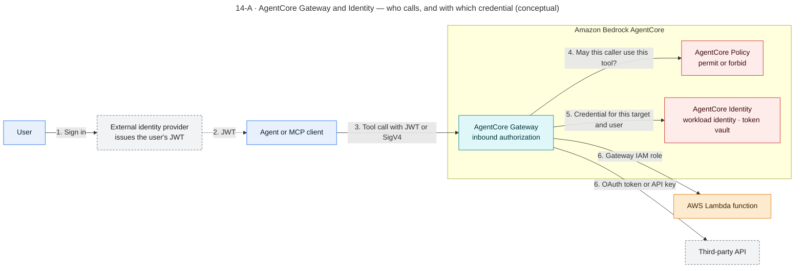
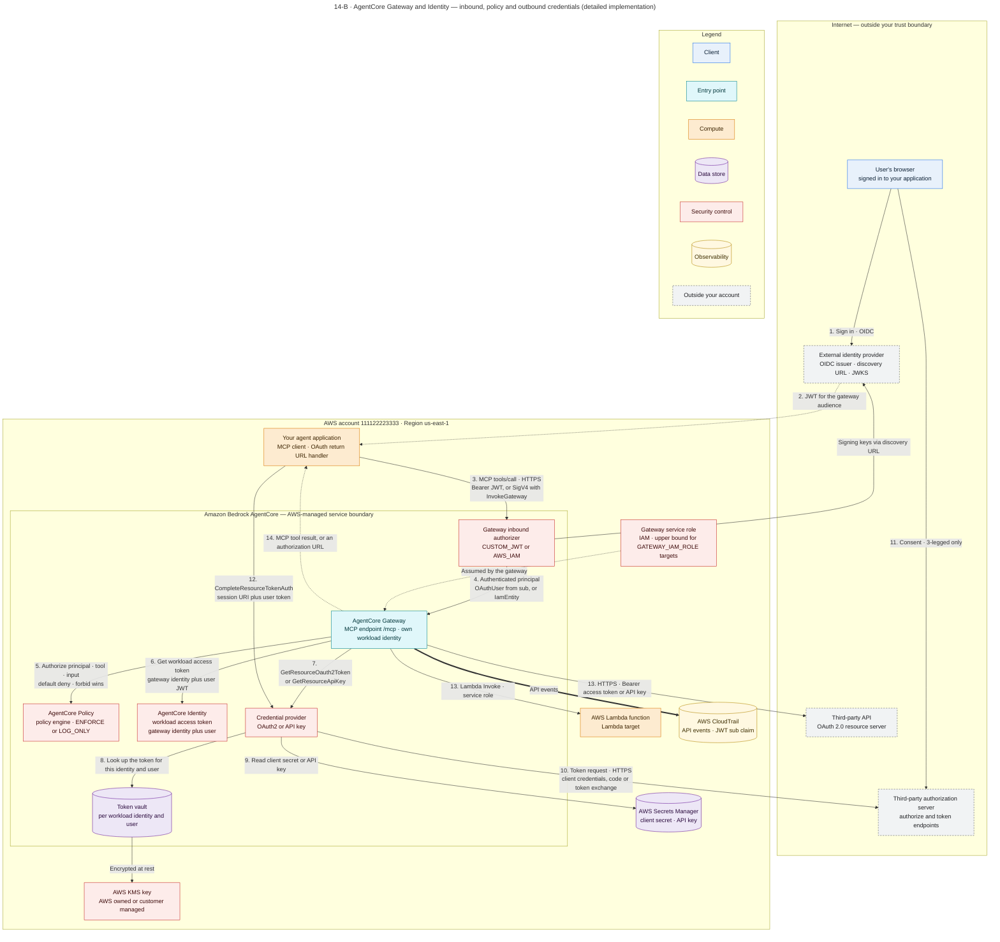
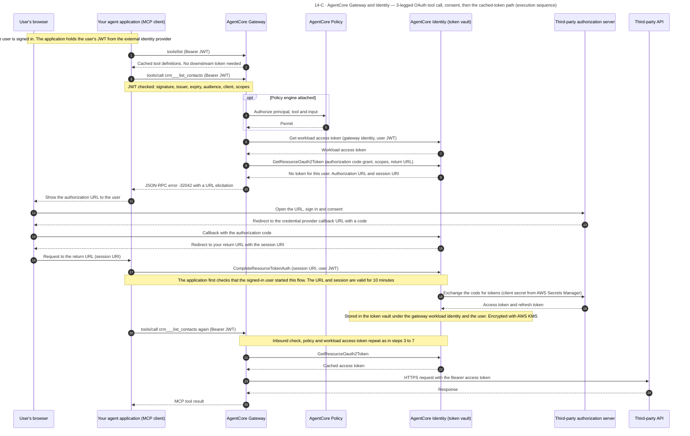

# Diagram 14 — AgentCore Gateway and Identity

> **Verified:** 2026-11-15 · **Type:** academy design, not an official AWS reference architecture · **Related chapters:** [AgentCore Gateway](../../01-amazon-bedrock/agentcore/04-agentcore-gateway.md) · [AgentCore Identity](../../01-amazon-bedrock/agentcore/05-agentcore-identity.md) · [AgentCore Policy](../../01-amazon-bedrock/agentcore/09-agentcore-policy.md) · [Identity, least privilege and IAM isolation for agents](../../06-security-governance/02-identity-and-least-privilege.md)

This set zooms into the "connect to tools" half of [diagram set 12](12-agentcore-architecture.md). It answers three questions about one tool call: who is the caller (inbound authorization), may that caller use this tool with these arguments (Policy), and which credential does the gateway present to the tool on the caller's behalf (outbound authorization through AgentCore Identity)? The compute side — the session that makes the call — is in [diagram set 13](13-agentcore-runtime-and-tool-execution.md).

> [!NOTE]
> **Documented fact** — The token vault is "a secure storage system for OAuth 2.0 tokens, API keys, and other credentials" which "ensures credentials can only be accessed by the specific agent and user combination that originally obtained them." By default it is encrypted with an AWS owned key; you can configure a customer managed key.
> Source: [AgentCore Identity terminology](https://docs.aws.amazon.com/bedrock-agentcore/latest/devguide/identity-terminology.html), [Identity data encryption](https://docs.aws.amazon.com/bedrock-agentcore/latest/devguide/identity-data-encryption.html)

## A. Conceptual view

Two checks on the way in, one credential on the way out.

**What this shows** — The agent never holds a tool credential. It proves who is calling (a JWT from your identity provider, or an IAM signature), the gateway asks Policy whether the call is allowed, and then asks Identity for the credential that the target expects. AWS targets such as Lambda functions are called with the gateway's own IAM role; third-party APIs get an OAuth token or an API key from the token vault.

## B. Detailed implementation view

A gateway with JWT inbound authorization, an attached policy engine, one OAuth-protected third-party API (an OpenAPI or MCP server target) and one Lambda target.

**Legend** — solid arrow: request · dashed arrow: response or role assumption · thick arrow: asynchronous audit events · cylinder: data at rest · grey dashed node: outside your AWS account · nested boxes: trust boundaries.

**What this shows** — Everything that issues or accepts a user's identity outside AWS — the identity provider, the third-party authorization server and API, the user's browser — is outside your trust boundary. Inside AgentCore, the gateway is the only component the agent talks to; Policy and Identity are consulted by the gateway, not by the agent. Secrets sit in AWS Secrets Manager and tokens in the vault; neither reaches the agent application. The drawing shows the cached-token path in numeric order; the first 3-legged call takes a detour through edges 14, 11 and 12, drawn step by step in view C.

**Walkthrough**

1. The user signs in to your application through your identity provider.
2. Your application receives a JWT whose audience, client and scopes match the gateway's authorizer configuration.
3. The agent calls the gateway's MCP endpoint with the JWT as a bearer token. An IAM-authorized gateway instead requires a SigV4 signature from a principal with `bedrock-agentcore:InvokeGateway`. The authorizer validates the JWT against the keys published at the discovery URL.
4. The gateway now knows the principal: `AgentCore::OAuthUser` built from the `sub` claim for JWT, or `AgentCore::IamEntity` for IAM.
5. If a policy engine is attached, it evaluates the principal, the tool (as the Cedar action) and the tool input. Default deny, forbid wins; in `LOG_ONLY` mode the decision is only recorded.
6. For an OAuth or API key target, the gateway obtains a workload access token that binds its own workload identity to the user.
7. With that token, the gateway asks the target's credential provider for a credential.
8. The provider looks in the token vault for a credential stored for this workload identity and user.
9. When it must talk to the authorization server, it uses the client secret held in Secrets Manager.
10. It runs the configured grant: client credentials (2-legged), authorization code (3-legged) or token exchange (on-behalf-of).
11. In a 3-legged flow with no stored token, the user consents in the browser.
12. Your application completes session binding with `CompleteResourceTokenAuth`.
13. The gateway calls the target: the third-party API with the injected token or key, or the Lambda function with the gateway service role (Lambda targets support no other outbound method).
14. The result returns to the agent — or, on a first 3-legged call, an authorization URL instead of a result.

### Component roles

| Component | Role in this architecture | Security control |
|:--|:--|:--|
| External identity provider | Authenticates users and issues the JWT the gateway accepts | Discovery URL, allowed audiences, clients, scopes and custom claims on the authorizer; optional private endpoint |
| Your agent application | MCP client; hosts the HTTPS return URL that completes 3-legged session binding | Must verify that the signed-in user is the one who started the flow; IAM permission for `CompleteResourceTokenAuth` |
| Gateway inbound authorizer | Decides who may call the gateway | `CUSTOM_JWT` or `AWS_IAM`; `AUTHENTICATE_ONLY` and `NONE` make no authorization decision |
| AgentCore Gateway | Single MCP endpoint; asks Policy and Identity, then calls the target | Own workload identity, created automatically; service role |
| AgentCore Policy | Deterministic check point on every tool call | Cedar or Dogwood policies; default deny, forbid wins; `LOG_ONLY` or `ENFORCE` |
| AgentCore Identity — workload access token | AWS-signed token carrying the gateway's workload identity and the user's identity | Accepted only by AgentCore services, never by external APIs |
| Credential provider | One per downstream application: OAuth2 client configuration or an API key | IAM on `token-vault/default/oauth2credentialprovider/NAME` or `apikeycredentialprovider/NAME` |
| Token vault | Stores OAuth tokens (including refresh tokens) and API keys per workload identity and user | Encrypted with an AWS owned key or a single-Region symmetric customer managed key (`SetTokenVaultCMK`) |
| AWS Secrets Manager | Holds client secrets and API keys of credential providers | `secretsmanager:GetSecretValue` scoped to the provider's secret |
| Gateway service role | Identity for `GATEWAY_IAM_ROLE` targets such as Lambda | Shared by every such target, so its permissions are the upper bound for any authorized caller |
| Third-party authorization server and API | Issue and accept the user-delegated or machine token | Their own scopes and policies; the redirect URI must be the provider's callback URL |
| AWS CloudTrail | Records AgentCore API activity | With JWT inbound, the token's subject is logged: keep personal data out of `sub` |

### Connections

| # | From → To | Protocol / operation | Direction of data | Auth |
|--:|:--|:--|:--|:--|
| 1–2 | Browser → identity provider → application | HTTPS · OIDC | Credentials in, JWT out | The provider's own |
| 3 | Application → gateway | HTTPS · MCP JSON-RPC `tools/call` at `/mcp` | Tool arguments in | Bearer JWT, or SigV4 with `bedrock-agentcore:InvokeGateway` |
| 4 | Authorizer → gateway | Internal | Principal and claims | Service-internal |
| 5 | Gateway → Policy | Policy evaluation | Principal, tool, input; decision out | Service-internal |
| 6 | Gateway → Identity | Workload access token request | Gateway identity and user in, token out | Gateway service role (`bedrock-agentcore:GetWorkloadAccessToken` on its workload identity) |
| 7 | Gateway → credential provider | `GetResourceOauth2Token` or `GetResourceApiKey` | Token or key, or an authorization URL and session URI | Workload access token plus the gateway role's IAM permissions |
| 8 | Provider → token vault | Internal | Stored credential | Keyed by workload identity and user |
| 9 | Provider → Secrets Manager | `GetSecretValue` | Client secret or API key | IAM on the secret ARN |
| 10 | Provider → authorization server | HTTPS · OAuth 2.0 token endpoint | Code, client credentials or subject token out; access and refresh tokens in | Client authentication (secret or Private Key JWT) |
| 11 | Browser → authorization server | HTTPS · authorization endpoint | Consent | The user's sign-in at the provider |
| 12 | Application → Identity | HTTPS · `CompleteResourceTokenAuth` | Session URI and user identifier | IAM (SigV4) |
| 13 | Gateway → third-party API / Lambda function | HTTPS with `Authorization` header or key / Lambda invoke | Arguments out, result in | OAuth token or API key / gateway service role |
| 14 | Gateway → application | MCP result, or JSON-RPC error with an authorization URL | Result or URL out | Same connection as 3 |

## C. Sequence view

A 3-legged OAuth tool call: the first call needs the user's consent, the next call uses the cached token.

**Steps and failure paths**

- **1–2.** `tools/list` returns cached definitions, so a user can browse every tool without connecting every account. Consent is triggered only by `tools/call`.
- **3.** A missing or invalid JWT returns 401 with a `WWW-Authenticate` header carrying `resource_metadata` and `scope`; a valid token without the required scopes returns 403 with `error="insufficient_scope"`. MCP-compliant clients use them to discover the authorization server and the scopes they need.
- **4–5.** In `ENFORCE` mode a forbid ends the call here; the agent receives a denial. Gateway rate limits, if configured, also apply, but they fail open, so they are not a security control ([rate limits](https://docs.aws.amazon.com/bedrock-agentcore/latest/devguide/gateway-rate-limits.html)).
- **8–10.** The authorization URL travels as an MCP URL elicitation (error code `-32042` in the AWS example). The 3-legged option requires a gateway created with MCP version `2025-11-25` or later. On version `2026-07-28` and later the client declares its elicitation capability in each request's `_meta`; if it does not, the gateway returns `-32021`.
- **11–17.** If the user does not finish within 10 minutes, the URL and session expire and the next call starts again. `CompleteResourceTokenAuth` must present the same user identifier — the inbound token or user ID — that produced the workload access token; if someone else opened a forwarded URL, the binding fails and no token is stored.
- **18–19.** Only after session binding succeeds does Identity redeem the code. The code never passes through your application or the agent.
- **20–25.** Later calls take this path with no user interaction. Refresh tokens are used automatically when the access token expires. AgentCore cannot see a revocation at the provider: set `forceAuthentication` to `true` in the `_meta` field of `tools/call` to discard the stored token and get a new authorization URL.

> [!CAUTION]
> **Cost or security hazard** — Session binding is only as strong as your return URL handler. Read the user's identity from your application's own authenticated session (for example its session cookie), never from a query parameter or the request body, before you call `CompleteResourceTokenAuth`. Otherwise a forwarded authorization URL can attach one user's third-party account to another user.

> [!TIP]
> **Academy recommendation** — Use one gateway per trust level, attach a policy engine in `LOG_ONLY` first and switch to `ENFORCE` once the decision logs look right, and prefer on-behalf-of token exchange over the authorization code grant when the downstream API trusts the same identity provider: the user is never asked twice.
> This is our design guidance, not an official AWS reference architecture.

## Variations

| Variation | What changes |
|:--|:--|
| IAM (`AWS_IAM`) inbound instead of JWT | Edges 1–2 disappear; the caller signs with SigV4 and needs `bedrock-agentcore:InvokeGateway` on the gateway ARN; the Policy principal is `AgentCore::IamEntity`. The 3-legged walkthrough above uses JWT inbound, as the AWS examples do, and the consent portal requires it. For agents on the harness, AWS states that user-scoped tokens and on-behalf-of exchange need JWT inbound ([harness security](https://docs.aws.amazon.com/bedrock-agentcore/latest/devguide/harness-security.html)) |
| `AUTHENTICATE_ONLY` or `NONE` inbound | The gateway makes no authorization decision (`AUTHENTICATE_ONLY` still verifies SigV4). Enforce authorization in a policy engine, an interceptor Lambda function or the target; `NONE` is for public gateways with their own protections |
| 2-legged OAuth (client credentials) | Target `grantType` `CLIENT_CREDENTIALS`. No consent: steps 9–17 of view C disappear. When no token is cached, Identity obtains one with the client credentials grant; the token represents the agent, not the user |
| On-behalf-of token exchange | Target `grantType` `TOKEN_EXCHANGE`. Identity exchanges the inbound user token (RFC 8693 token exchange or RFC 7523 JWT authorization grant) for a downstream token that carries both identities. No consent prompt. MCP server and OpenAPI targets |
| API key | Credential provider of type API key; `GetResourceApiKey`; no authorization server (edges 10–12 disappear). The key is placed in a header or query parameter with an optional prefix |
| Gateway service role only | Always for Lambda targets; optional for Smithy, API Gateway, OpenAPI and MCP server targets. No Identity call: edges 6–12 disappear. The role is shared by every such target, so scope it tightly |
| Token passthrough or caller IAM credentials | For AgentCore Runtime HTTP targets: the inbound bearer token is forwarded unchanged (requires JWT or `NONE` inbound), or the gateway signs the request with the caller's own IAM identity (caller IAM credentials, through FAS) |
| Consent portal | An AWS-hosted page replaces your return URL handler: it attaches to one JWT-authorized gateway, signs users in to the same OIDC issuer and lists every authorization-code target as a connection. The target's `defaultReturnUrl` must be `<portalUrl>/connect/callback`. Users can connect before the first tool call |
| Customer managed key for the vault | `SetTokenVaultCMK` with the ARN (not alias) of a single-Region symmetric key; the token vault ARN is in the encryption context |
| Private identity provider | The JWT authorizer reaches discovery, token and JWKS endpoints through a `privateEndpoint` (Amazon VPC Lattice), using the service-linked role `AWSServiceRoleForBedrockAgentCoreIdentity` |
| Agent calls the API itself, without a gateway | The agent on AgentCore Runtime receives a workload access token and calls `GetResourceOauth2Token` with `oauth2Flow` `USER_FEDERATION`; policy enforcement at the gateway does not apply. See the [Identity chapter](../../01-amazon-bedrock/agentcore/05-agentcore-identity.md#6-request-and-response-lifecycle) |

Sources for the variations: [inbound authorization](https://docs.aws.amazon.com/bedrock-agentcore/latest/devguide/gateway-inbound-auth.html), [outbound authorization](https://docs.aws.amazon.com/bedrock-agentcore/latest/devguide/gateway-outbound-auth.html), [on-behalf-of token exchange](https://docs.aws.amazon.com/bedrock-agentcore/latest/devguide/on-behalf-of-token-exchange.html), [consent portal](https://docs.aws.amazon.com/bedrock-agentcore/latest/devguide/identity-consent-portal.html) and its [target configuration](https://docs.aws.amazon.com/bedrock-agentcore/latest/devguide/identity-configure-consent-portal-target.html), [Identity data encryption](https://docs.aws.amazon.com/bedrock-agentcore/latest/devguide/identity-data-encryption.html), [Policy core concepts](https://docs.aws.amazon.com/bedrock-agentcore/latest/devguide/policy-core-concepts.html).

## Practical example

- [Project D: agentic application on AgentCore](../../05-practical-projects/project-04-agentic-ai/README.md) wires an agent to a gateway with JWT inbound authorization; read its README and the gateway part of its Terraform root.
- The validated Terraform for a JWT-authorized gateway with a Lambda target is the [Gateway working example](../../01-amazon-bedrock/agentcore/04-agentcore-gateway.md#13-working-example). The workload identity, OAuth2 and API key credential providers, the optional vault key and a least-privilege IAM policy are the [Identity working example](../../01-amazon-bedrock/agentcore/05-agentcore-identity.md#13-working-example).
- To threat-model this flow, use [Lab 6: threat-model an agent](../../labs/lab-06-threat-model-an-agent.md).

## References

- [Set up inbound authorization for your gateway](https://docs.aws.amazon.com/bedrock-agentcore/latest/devguide/gateway-inbound-auth.html) — JWT, IAM and offloaded types; 401 and 403 challenges; CloudTrail logging of `sub`; private identity providers (edges 1–4).
- [Set up outbound authorization for your gateway](https://docs.aws.amazon.com/bedrock-agentcore/latest/devguide/gateway-outbound-auth.html) — methods per target type and the gateway role's Identity permissions (edges 6–9, 13).
- [Core concepts for AgentCore Gateway](https://docs.aws.amazon.com/bedrock-agentcore/latest/devguide/gateway-core-concepts.html) — authorizer and credential providers.
- [Example: authorization code grant when invoking a gateway](https://docs.aws.amazon.com/bedrock-agentcore/latest/devguide/gateway-using-auth-ex-3lo.html) — `defaultReturnUrl`, `returnUrl` and `forceAuthentication` in `_meta`.
- [MCP server targets](https://docs.aws.amazon.com/bedrock-agentcore/latest/devguide/gateway-target-MCPservers.html) — 3-legged OAuth with MCP server targets and URL session binding.
- [Use elicitation with your AgentCore gateway](https://docs.aws.amazon.com/bedrock-agentcore/latest/devguide/gateway-mcp-elicitation.html) — URL elicitation and the `-32021` error.
- [Connecting MCP servers to AgentCore Gateway using Authorization Code flow](https://aws.amazon.com/blogs/machine-learning/connecting-mcp-servers-to-amazon-bedrock-agentcore-gateway-using-authorization-code-flow/) — AWS blog; the step-by-step tool invocation flow and the `-32042` response used in view C.
- [OAuth 2.0 authorization URL session binding](https://docs.aws.amazon.com/bedrock-agentcore/latest/devguide/oauth2-authorization-url-session-binding.html) — `CompleteResourceTokenAuth`, the 10-minute validity, what the handler must check.
- [Supported authentication patterns](https://docs.aws.amazon.com/bedrock-agentcore/latest/devguide/common-use-cases.html) and [On-behalf-of token exchange](https://docs.aws.amazon.com/bedrock-agentcore/latest/devguide/on-behalf-of-token-exchange.html) — the three OAuth patterns.
- [AgentCore Identity terminology](https://docs.aws.amazon.com/bedrock-agentcore/latest/devguide/identity-terminology.html) — workload identity, token vault, consent portal.
- [Obtain OAuth 2.0 access token](https://docs.aws.amazon.com/bedrock-agentcore/latest/devguide/identity-authentication.html) — automatic refresh-token use, and why a revoked token needs `forceAuthentication` (steps 20–25).
- [Add rate limits to a gateway](https://docs.aws.amazon.com/bedrock-agentcore/latest/devguide/gateway-rate-limits.html) — fail-open behaviour.
- [Identity data encryption](https://docs.aws.amazon.com/bedrock-agentcore/latest/devguide/identity-data-encryption.html) — token vault keys.
- [Configure a consent portal](https://docs.aws.amazon.com/bedrock-agentcore/latest/devguide/identity-consent-portal.html) and [configure a consent portal target](https://docs.aws.amazon.com/bedrock-agentcore/latest/devguide/identity-configure-consent-portal-target.html) — the hosted alternative to your return URL handler.
- [Policy in Amazon Bedrock AgentCore](https://docs.aws.amazon.com/bedrock-agentcore/latest/devguide/policy.html) and [Policy core concepts](https://docs.aws.amazon.com/bedrock-agentcore/latest/devguide/policy-core-concepts.html) — interception at the gateway, principal types, default deny and forbid wins (edge 5).
- [Inbound Auth and Outbound Auth for AgentCore Runtime](https://docs.aws.amazon.com/bedrock-agentcore/latest/devguide/runtime-oauth.html) — the agent-side variation and the user-ID header.
- [Quotas for Amazon Bedrock AgentCore](https://docs.aws.amazon.com/bedrock-agentcore/latest/devguide/bedrock-agentcore-limits.html) — 200 TPS for token operations, 100 TPS for `CompleteResourceTokenAuth`, 50 OAuth2 and 50 API key providers per account.
- [Generated API reference](../../references/bedrock-api-operations.md) — operation names used in the connections table.
