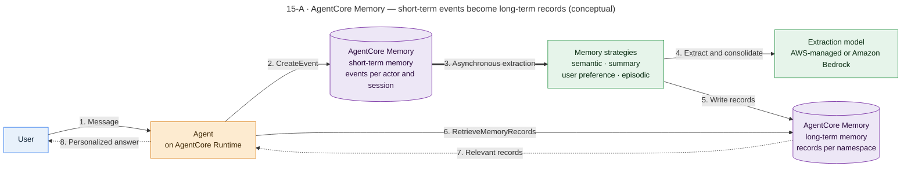
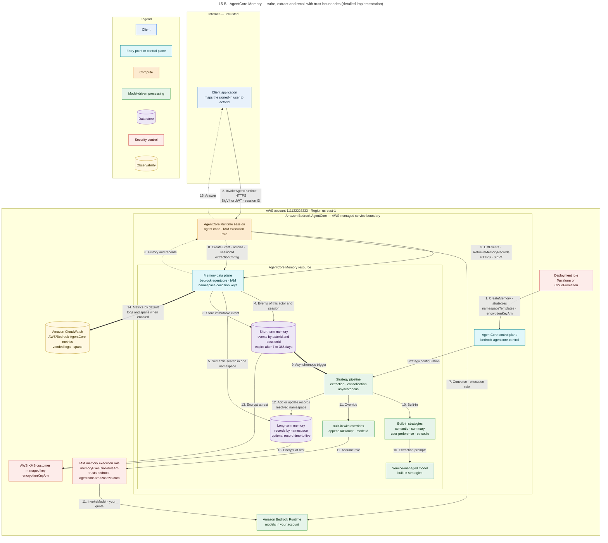
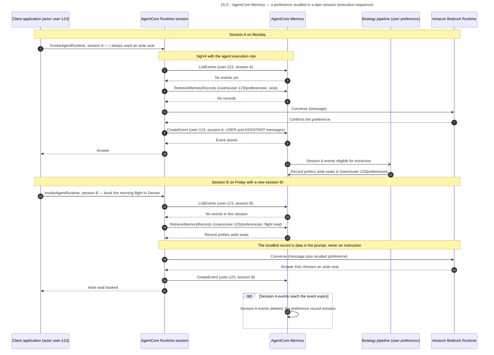
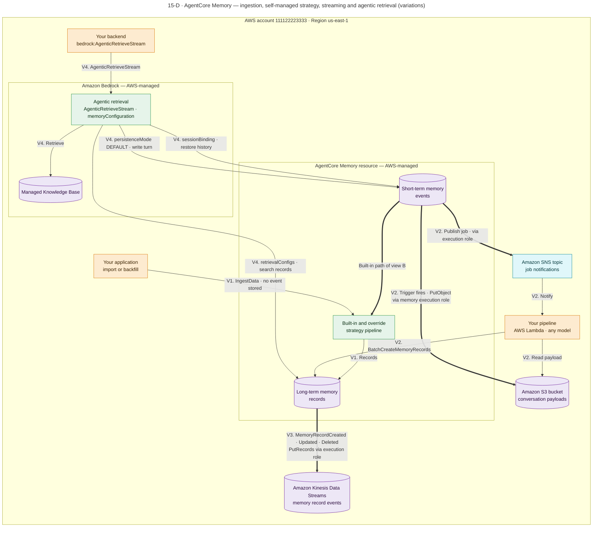

# Diagram 15 — AgentCore Memory architecture

> **Verified:** 2026-11-15 · **Type:** academy design, not an official AWS reference architecture · **Related chapters:** [AgentCore Memory](../../01-amazon-bedrock/agentcore/06-agentcore-memory.md) · [AgentCore Runtime](../../01-amazon-bedrock/agentcore/02-agentcore-runtime.md) · [Agentic retrieval with AgenticRetrieveStream](../../01-amazon-bedrock/agentic-retrieval/01-agentic-retrieval.md) · [Diagram 12 — AgentCore architecture](12-agentcore-architecture.md)

This set documents Amazon Bedrock AgentCore Memory: how a conversation turn becomes a short-term **event**, how memory **strategies** turn events into long-term **memory records** in the background, and how an agent finds those records again in a later session. It answers the question "what does the agent write, what does AgentCore write for it, and which control keeps one user's memories away from another's?" AWS does not publish the internals of the memory store or the extraction pipeline; boxes inside the AgentCore boundary are a conceptual model of documented behaviour.

## A. Conceptual view

The two kinds of memory and the asynchronous step between them.

**What this shows** — The agent writes only one thing, the event (2), and reads two things: events of the current session and records from any session (6). Everything between the two stores (3–5) is configured, not called: AgentCore runs each strategy on new events in the background, so `CreateEvent` returns before anything is extracted. The thick arrow marks that asynchronous step.

## B. Detailed implementation view

One memory resource used by an agent on AgentCore Runtime, with built-in strategies and one built-in-with-overrides strategy.

**Legend** — solid arrow: request or write · dashed arrow: response · thick arrow: asynchronous processing or telemetry · cylinder: data at rest · nested boxes: trust boundaries (internet, your account, the AWS-managed AgentCore boundary, one memory resource).

**What this shows** — Three principals touch the memory and each has its own IAM identity: the deployment role creates the resource, the agent's execution role reads and writes events and records, and — only for override strategies — AgentCore assumes your memory execution role to call a model in your account. Isolation between users is not a separate store per user: it is the `actorId` on each event, the namespace template on each strategy, and IAM conditions on the namespace.

**Walkthrough**

1. The deployment pipeline creates the memory with its strategies, namespace templates such as `/users/{actorId}/preferences/`, an event expiry and, optionally, a customer managed key.
2. The client invokes the agent; your backend decides which `actorId` and session the request belongs to.
3. Before calling the model, the agent asks Memory for context.
4. `ListEvents` returns this actor's events for this session — the transcript so far.
5. `RetrieveMemoryRecords` runs a semantic search (`searchCriteria` with `searchQuery` and `topK`) in one resolved `namespace`, or across a `namespacePath`.
6. Events and records return to the agent and go into the prompt.
7. The agent calls the model with its own execution role.
8. The agent stores the turn as one event. Custom namespace variables, if the templates use any, travel in `extractionConfig.namespaceVariables`.
9. New events make the session eligible for long-term processing, in the background.
10. A built-in strategy extracts and consolidates with a model that the service manages.
11. An override strategy uses your instructions and your chosen Amazon Bedrock model; AgentCore assumes the memory execution role, and the model usage is billed to, and throttled in, your account.
12. Records are written under the namespace with `{actorId}`, `{sessionId}` and `{memoryStrategyId}` replaced by real values; consolidation merges them with existing records.
13. Events and records are encrypted at rest — with an AWS owned key by default, or with your customer managed key.
14. Memory publishes metrics to CloudWatch by default; application logs and spans appear once you configure log delivery and tracing for the memory.
15. The answer returns to the client.

### Component roles

| Component | Role in this architecture | Security control |
|:--|:--|:--|
| Client application | Authenticates the user and maps the user to a stable `actorId` and a session | Your application's authentication; never let the model choose the actor |
| Deployment role | Creates and updates the memory and its strategies (`CreateMemory`, `UpdateMemory`) | Keep control-plane actions out of the agent's role |
| AgentCore Runtime session | Runs the agent loop; reads context, calls the model, writes events | IAM execution role scoped to the memory ARN and its data-plane actions |
| Memory data plane | Serves `CreateEvent`, `ListEvents`, `RetrieveMemoryRecords` and the other event and record operations | IAM; condition keys `bedrock-agentcore:namespace` and `bedrock-agentcore:namespacePath` |
| Short-term memory | Immutable, timestamped events per actor and session | Expiry set by `eventExpiryDuration` (7–365 days); event metadata is **not** encrypted with your customer managed key |
| Strategy pipeline | Runs each strategy's extraction and consolidation after events arrive | Configured, not called; failed jobs go to a per-memory queue |
| Built-in strategies | `SemanticMemoryStrategy`, `SummaryMemoryStrategy`, `UserPreferenceMemoryStrategy`, `EpisodicStrategy` | Up to six strategies per memory |
| Built-in with overrides | Same pipeline and output schema, your prompt instructions and Amazon Bedrock model | Memory execution role; your Bedrock quotas |
| Long-term memory | Records filed under resolved namespaces; searched by meaning | Namespace design plus IAM conditions; optional record time-to-live |
| AWS KMS key | Encrypts events and records when you supply `encryptionKeyArn` | Key policy; callers of agentic retrieval also need `kms:Decrypt` |
| Amazon CloudWatch | Metrics (`Invocations`, `Errors`, `Throttles`, `FailedExtraction` and others), extraction and consolidation logs, spans | Log group access; logs may contain conversation content |

### Connections

| # | From → To | Protocol / operation | Direction of data | Auth |
|--:|:--|:--|:--|:--|
| 1 | Deployment role → AgentCore control plane | HTTPS · `CreateMemory` (or Terraform `aws_bedrockagentcore_memory` and `aws_bedrockagentcore_memory_strategy`) | Configuration in | SigV4, deployment role |
| 2 | Client → AgentCore Runtime | HTTPS · `InvokeAgentRuntime` | Prompt in | SigV4 or JWT |
| 3–6 | Agent → Memory data plane → stores | HTTPS · `ListEvents`, `RetrieveMemoryRecords` | Context out of Memory | SigV4, execution role |
| 7 | Agent → Amazon Bedrock Runtime | HTTPS · `Converse` | Prompt in, completion out | SigV4, execution role |
| 8 | Agent → Memory data plane | HTTPS · `CreateEvent` | Turn written | SigV4, execution role |
| 9 | Short-term → strategy pipeline | Internal, asynchronous | Events to extraction | Service-internal |
| 10 | Pipeline → service-managed model | Internal | Extraction and consolidation prompts | Service-internal |
| 11 | Pipeline → Amazon Bedrock Runtime | `InvokeModel` in your account | Prompts out, extracted memories back | Memory execution role |
| 12 | Pipeline → long-term memory | Internal | Records written or updated | Service-internal |
| 13 | Stores → AWS KMS | Encryption at rest | Data keys | Key policy |
| 14 | Memory → Amazon CloudWatch | Vended metrics, log delivery, spans | Telemetry out | Log delivery configuration |
| 15 | Agent → client | Response stream | Answer out | Same connection as 2 |

## C. Sequence view

The same user in two sessions. A preference stated on Monday is recalled on Friday, in a new session with a new session ID, because it was extracted into the user's preference namespace.

**Steps and failure paths**

- **1–5.** On the first turn there is nothing to load; both reads return empty, which is not an error.
- **6–10.** The turn is stored as **one** event with both messages (step 8). A `CreateEvent` is rejected if it carries more than 100 messages, a message over 100 KB or more than 10 MB in total. Throttling is per account (200 per second by default) and per actor and session (5 per second with conversational payloads), so a chatty client can be throttled even when the account is quiet.
- **11–12.** Extraction is asynchronous and has no documented completion time; do not expect the record during session A. If a template uses a custom namespace variable that the event did not supply, extraction for that strategy is skipped while `CreateEvent` still succeeds (metric `NamespaceResolutionFailure`). If extraction fails — for example the 150,000 tokens per minute extraction quota for built-in strategies, or a throttled or denied model call for an override — the job moves to a failed-job queue: list it with `ListMemoryExtractionJobs`, fix the cause and re-drive it with `StartMemoryExtractionJob`, and alarm on `FailedExtraction`.
- **13–17.** A new session ID means `ListEvents` is empty; the preference comes only from long-term memory. If the namespace passed at read time does not equal the resolved template — a missing leading or trailing slash is the usual cause — retrieval returns nothing.
- **18–21.** The agent uses the record and stores the new turn.
- **22.** Events expire after `eventExpiryDuration`; long-term records stay until deleted or until a per-strategy time-to-live removes them.

> [!TIP]
> **Academy recommendation** — Treat recalled records as untrusted input: anything a user or tool said can be extracted and replayed into a later prompt. Derive `actorId` and the namespace from the verified identity on the server, never from the request body or model output. See [Prompt injection, untrusted tool output and retrieval poisoning](../../06-security-governance/04-prompt-injection-and-untrusted-content.md).
> This is our design guidance, not an official AWS reference architecture.

## Variations

The other ways content enters and leaves a memory. The built-in path of view B is the thick arrow in the middle.

**Legend** — same conventions as view B; edges are numbered by variation (V1–V4) rather than by time.

| Variation | What changes |
|:--|:--|
| **V1. `IngestData` instead of `CreateEvent`** | Content (conversational or JSON) goes straight to extraction; no short-term event is stored, so `ListEvents`, `GetEvent` and `ListSessions` cannot return it. It fans out to built-in and override strategies, **not** to self-managed strategies. Its own quotas: 10 requests per second per account and 100 KB per request |
| **Built-in with overrides** (view B, step 11) | Same pipeline and output schema; you replace the instructions (`appendToPrompt`) and pick the Amazon Bedrock model. Summary allows consolidation overrides only; episodic also allows reflection. Requires `memoryExecutionRoleArn`; model usage is charged to your account |
| **V2. Self-managed strategy** (`customMemoryStrategy` with `selfManagedConfiguration`) | Steps 10–12 of view B are replaced by your pipeline. A trigger (message count, token count or idle-session time) makes AgentCore write the conversation to your Amazon S3 bucket and publish a job to your Amazon SNS topic; your compute extracts with any model and writes records back with `BatchCreateMemoryRecords`, `BatchUpdateMemoryRecords` or `BatchDeleteMemoryRecords` |
| **V3. Memory record streaming** | Set `streamDeliveryResources` on the memory: AgentCore publishes `MemoryRecordCreated`, `MemoryRecordUpdated` and `MemoryRecordDeleted` to your Amazon Kinesis Data Streams stream, as `METADATA_ONLY` or `FULL_CONTENT`. Requires a memory execution role; delivery health is in `StreamPublishingSuccess` and `StreamPublishingFailure` |
| **V4. Agentic retrieval with `memoryConfiguration`** | Amazon Bedrock, not your agent, calls Memory. `sessionBinding` (`actorId`, `sessionId`) restores `USER` and `ASSISTANT` events; `retrievalConfigs` (at most one, by `namespace` or `namespacePath`) lets the retrieval agent search records; `persistenceMode` `DEFAULT` writes question and answer back as one event, `NONE` leaves the session unchanged. A `memoryId` alone is not valid. The memory must be `ACTIVE` and in the same account as the managed knowledge base |
| No strategy on the memory | Short-term only: steps 9–12 never happen and `RetrieveMemoryRecords` is always empty |
| `extractionMode` `SKIP` on an event | The event is stored in short-term memory but excluded from long-term extraction |
| Custom namespace variables | Declare up to five lowercase keys in `namespaceKeys`; supply values on each event in `extractionConfig.namespaceVariables` (for example a tenant) |
| Agent outside AgentCore Runtime | Replace the Runtime session with your own compute; the data-plane calls and the IAM controls are unchanged |
| Private network path | Callers in a VPC reach edges 3 and 8 through the `com.amazonaws.REGION.bedrock-agentcore` interface endpoint and edge 1 through `com.amazonaws.REGION.bedrock-agentcore-control`; an endpoint policy can limit the memory actions and ARNs. See [Private connectivity for Bedrock](../../02-related-aws-services/networking/01-private-connectivity-for-bedrock.md) |
| Region | Memory is available in 16 of the 22 AgentCore Regions; not in US West (N. California), Europe (Milan), Europe (Spain), Asia Pacific (Malaysia), Asia Pacific (Hyderabad) or Asia Pacific (Thailand) |

## Practical example

- [AgentCore Memory](../../01-amazon-bedrock/agentcore/06-agentcore-memory.md#13-working-example), section 13 — validated Terraform for a memory with a user-preference and a summary strategy (the namespaces used in view C), plus the `CreateEvent`, `ListEvents` and `RetrieveMemoryRecords` calls of view B with a local stub.
- [Project D: agentic application on AgentCore](../../05-practical-projects/project-04-agentic-ai/README.md) — the agent that uses this memory; start with its README and then the Terraform root.
- [Agentic retrieval with AgenticRetrieveStream](../../01-amazon-bedrock/agentic-retrieval/01-agentic-retrieval.md) — variation V4 from the caller's side.
- Zoom out with [diagram set 12](12-agentcore-architecture.md); the telemetry this memory emits is drawn in [diagram set 16](16-agentcore-observability.md).

## References

- [Memory types](https://docs.aws.amazon.com/bedrock-agentcore/latest/devguide/memory-types.html) — events and event metadata, asynchronous extraction and consolidation, semantic retrieval (views A, B, C).
- [Memory terminology](https://docs.aws.amazon.com/bedrock-agentcore/latest/devguide/memory-terminology.html) and [Memory organization](https://docs.aws.amazon.com/bedrock-agentcore/latest/devguide/memory-organization.html) — memory, strategy, namespace, record, actor, session, event.
- [Specify long-term memory organization with namespaces](https://docs.aws.amazon.com/bedrock-agentcore/latest/devguide/specify-long-term-memory-organization.html) — namespace format, custom variables, IAM condition keys, `NamespaceResolutionFailure`.
- [Memory strategies](https://docs.aws.amazon.com/bedrock-agentcore/latest/devguide/memory-strategies.html) and [Configure built-in strategies](https://docs.aws.amazon.com/bedrock-agentcore/latest/devguide/long-term-configuring-built-in-strategies.html) — the three strategy classes, the four built-in names, record time-to-live.
- [Customize a built-in strategy](https://docs.aws.amazon.com/bedrock-agentcore/latest/devguide/memory-custom-strategy.html) — overrides, steps you can override, memory execution role (step 11).
- [Self-managed strategy](https://docs.aws.amazon.com/bedrock-agentcore/latest/devguide/memory-self-managed-strategies.html) — triggers, Amazon S3 and Amazon SNS delivery, batch operations (V2).
- [Ingest content into long-term memory](https://docs.aws.amazon.com/bedrock-agentcore/latest/devguide/long-term-ingest-data.html) — `IngestData` (V1).
- [Memory record streaming](https://docs.aws.amazon.com/bedrock-agentcore/latest/devguide/memory-record-streaming.html) — Kinesis delivery, event types, stream metrics (V3).
- [Redrive failed ingestions](https://docs.aws.amazon.com/bedrock-agentcore/latest/devguide/long-term-redrive.html) — failed-job queue, failure reason codes, `FailedExtraction`.
- [CreateEvent API reference](https://docs.aws.amazon.com/bedrock-agentcore/latest/APIReference/API_CreateEvent.html) — `extractionConfig`, `extractionMode`, error codes.
- [Use agentic retrieval to query a knowledge base](https://docs.aws.amazon.com/bedrock/latest/userguide/kb-test-agentic-retrieve.html) and [AgenticRetrieveMemoryConfiguration](https://docs.aws.amazon.com/bedrock/latest/APIReference/API_agent-runtime_AgenticRetrieveMemoryConfiguration.html) — `memoryConfiguration` (V4).
- [Data encryption](https://docs.aws.amazon.com/bedrock-agentcore/latest/devguide/data-encryption.html) — customer managed keys for memories (step 13).
- [AgentCore generated memory observability data](https://docs.aws.amazon.com/bedrock-agentcore/latest/devguide/observability-memory-metrics.html) — metrics, spans and extraction logs (step 14).
- [Quotas for Amazon Bedrock AgentCore](https://docs.aws.amazon.com/bedrock-agentcore/latest/devguide/bedrock-agentcore-limits.html) — event, ingestion, retrieval and extraction quotas quoted in view C.
- [Use interface VPC endpoints (AWS PrivateLink)](https://docs.aws.amazon.com/bedrock-agentcore/latest/devguide/vpc-interface-endpoints.html) — data-plane and control-plane endpoint names and memory endpoint policies (private-path variation).
- [Supported AWS Regions](https://docs.aws.amazon.com/bedrock-agentcore/latest/devguide/agentcore-regions.html) — the Region variation.
- [Generated API reference](../../references/bedrock-api-operations.md) — operation names used in the connections table.
