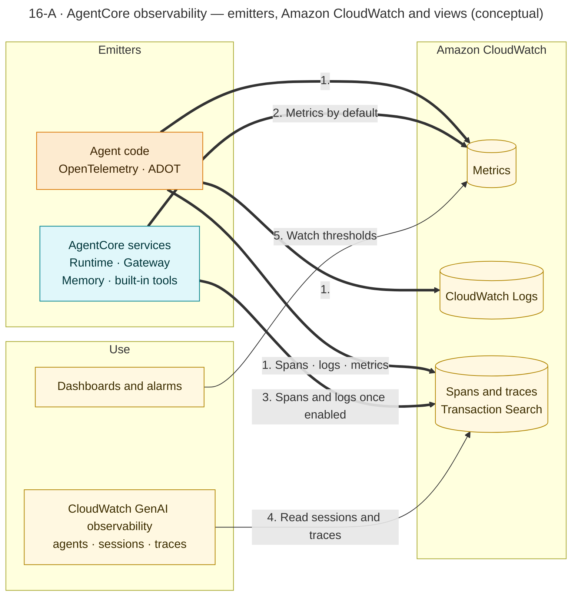
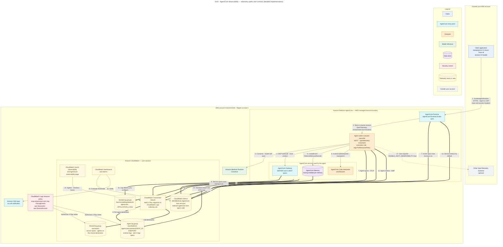
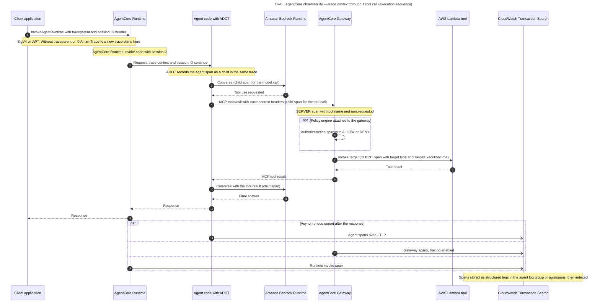
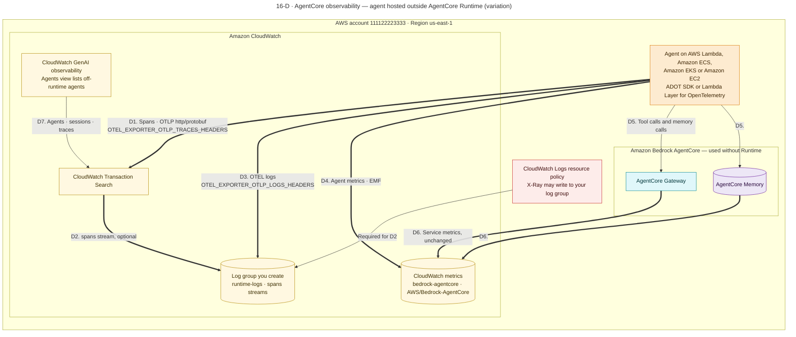

# Diagram 16 — AgentCore observability architecture

> **Verified:** 2026-11-15 · **Type:** academy design, not an official AWS reference architecture · **Related chapters:** [AgentCore Observability](../../01-amazon-bedrock/agentcore/07-agentcore-observability.md) · [AgentCore Runtime](../../01-amazon-bedrock/agentcore/02-agentcore-runtime.md) · [AgentCore Gateway](../../01-amazon-bedrock/agentcore/04-agentcore-gateway.md) · [Diagram 12 — AgentCore architecture](12-agentcore-architecture.md)

This set documents where the telemetry of an Amazon Bedrock AgentCore agent comes from and where it lands: your agent code instrumented with OpenTelemetry through the AWS Distro for OpenTelemetry (ADOT), and the AgentCore services — Runtime, Gateway, Memory and the built-in tools — all writing metrics, logs and spans into Amazon CloudWatch in your account. It answers "which signal is on by default, which must I switch on, and how does one trace stay connected across a tool call?" There is no separate observability service to call: everything is CloudWatch, CloudWatch Logs and AWS X-Ray configuration.

## A. Conceptual view

Two kinds of emitter, one destination, two ways to use what lands there.

**What this shows** — Only the service metrics (2) arrive without any work on your side. Agent-level traces (1) need the ADOT SDK in the agent and CloudWatch Transaction Search switched on once per account and Region; service spans and service logs (3) need tracing or log delivery enabled on each resource. The views (4) and alarms (5) only read what the first three arrows wrote. Thick arrows are asynchronous telemetry: none of it sits in the request path.

## B. Detailed implementation view

An agent on AgentCore Runtime that calls a model, a Gateway tool, Memory and Code Interpreter, with every telemetry path and the controls on it.

**Legend** — solid arrow: request or query · thick arrow: asynchronous telemetry · dashed arrow: optional path · cylinder: data at rest · grey dashed node: outside your AWS account · nested boxes: trust boundaries. Arrows 8 and 13 leave the "AgentCore services" box because each of the three services emits them.

**What this shows** — The request path (1–6) carries trace context; the telemetry paths (7–13) never block it. Spans take a detour through CloudWatch Transaction Search, which is AWS X-Ray configured to store spans as structured logs: X-Ray, not your agent, writes them into a log group, which is why a CloudWatch Logs resource policy must allow `xray.amazonaws.com`. For agents created in a supported Region since that Region gained the per-agent destination, an agent's spans land by default in its **own** log group, next to its standard output and OTEL logs, so access and encryption can be scoped per agent; service spans and older agents use the shared `aws/spans` group.

**Walkthrough**

1. The client invokes the agent and may send a W3C `traceparent` (with `tracestate` and `baggage`) or an X-Ray `X-Amzn-Trace-Id`, plus `X-Amzn-Bedrock-AgentCore-Runtime-Session-Id`.
2. Runtime starts or resumes the session and sets the OpenTelemetry environment for the agent process; it also adds resource attributes that identify the agent, endpoint and Region.
3. The ADOT instrumentation records the model call as a span.
4. The tool call to the Gateway is a span, and the trace context travels with the request (view C).
5. Memory calls are recorded as client spans by the agent's instrumentation; Memory's own `CreateEvent`, `ListEvents` and `RetrieveMemoryRecords` spans appear once tracing is enabled on the memory.
6. Built-in tool calls accept `X-Amzn-Trace-Id` and `traceparent` headers.
7. The agent exports its spans over OTLP; Runtime adds the `AgentCore.Runtime.Invoke` span (operation `InvokeAgentRuntime`) once tracing is enabled on the agent.
8. Gateway, Memory and built-in tools emit their own spans once tracing is enabled on each resource; policy decisions appear as `AuthorizeAction` spans when gateway tracing is on.
9. X-Ray stores spans as structured logs: in the agent's `spans` stream, or in `aws/spans`.
10. Standard output goes to the `[runtime-logs]` stream and ADOT structured logs to `otel-rt-logs`.
11. Memory and Gateway application logs arrive only after you configure a log delivery (CloudWatch Logs, Amazon S3 or Amazon Data Firehose).
12. Metrics created by the instrumentation arrive in the `bedrock-agentcore` namespace in Embedded Metric Format.
13. Every service publishes its own metrics to `AWS/Bedrock-AgentCore`, batched each minute, without any setup.
14. The CloudWatch GenAI observability page and the AgentCore observability page show agents, sessions, traces and spans built from this data.
15. Alarms evaluate metrics.
16. An alarm notifies your on-call channel.
17. Optionally, with `DISABLE_ADOT_OBSERVABILITY=true`, Runtime stops injecting its ADOT configuration and you export to a backend of your choice.

### Component roles

| Component | Role in this architecture | Security control |
|:--|:--|:--|
| Client application | Starts or continues the trace; sends the session ID | Put no personal data in `baggage` (academy recommendation) |
| AgentCore Runtime | Hosts the agent; emits the invoke span, service metrics, application and usage logs | Whoever can call `UpdateAgentRuntime` sets environment variables, including stage labels and the ADOT switches |
| Agent code with ADOT | `aws-opentelemetry-distro>=0.18.0`, started with `opentelemetry-instrument`; emits spans, OTEL logs and EMF metrics | Execution role needs `logs:PutResourcePolicy` for the per-agent span destination; no secrets in `OTEL_RESOURCE_ATTRIBUTES` |
| AgentCore Gateway | Emits a `kind:SERVER` span per MCP call and a `kind:CLIENT` span per target call; metrics such as `SystemErrors` and `TargetExecutionTime` | Its application logs include request and response bodies; gateway CloudWatch logs are not encrypted by default |
| AgentCore Memory | Metrics by default; spans and extraction or consolidation logs once enabled | Logs can contain conversation content |
| AgentCore Code Interpreter and Browser | Metrics by default; spans in `aws/spans`; application and usage logs once enabled | Code Interpreter application logs carry request and response payloads |
| Amazon Bedrock Runtime | The model call that the agent's instrumentation records | — |
| CloudWatch Transaction Search | X-Ray trace segments sent to CloudWatch Logs; an indexing rule sets the sampled percentage | One-time setup per account and Region |
| Agent log group | Standard output, OTEL logs and, by default for new agents, spans of one agent | Access control and encryption scoped to one agent |
| `aws/spans` log group | Service spans and spans of agents on the shared destination | Shared by all agents: coarse access control |
| Vended log groups | Memory and Gateway `APPLICATION_LOGS` under `/aws/vendedlogs/` | Retention and access per log group |
| CloudWatch metrics | Service metrics in `AWS/Bedrock-AgentCore`; agent metrics in `bedrock-agentcore` | — |
| GenAI observability, dashboards, alarms, Amazon SNS | Views, thresholds and notification | IAM on CloudWatch read actions |
| CloudWatch Logs resource policy | Lets X-Ray write spans into log groups | Scoped with `aws:SourceArn` and `aws:SourceAccount` |
| Other OpenTelemetry backend | Optional destination you operate or buy | Outside your account: decide what leaves it |

### Connections

| # | From → To | Protocol / operation | Direction of data | Auth |
|--:|:--|:--|:--|:--|
| 1 | Client → AgentCore Runtime | HTTPS · `InvokeAgentRuntime` with trace and session headers | Request and trace context in | SigV4 or JWT |
| 2 | Runtime → agent | Session start; environment variables | Configuration in | Service-internal |
| 3 | Agent → Amazon Bedrock Runtime | HTTPS · `Converse` | Prompt in, completion out | SigV4, execution role |
| 4 | Agent → AgentCore Gateway | HTTPS · MCP `tools/call` with trace headers | Tool call in | SigV4 or bearer token |
| 5 | Agent → AgentCore Memory | HTTPS · `CreateEvent`, `RetrieveMemoryRecords` | Turn written, context read | SigV4, execution role |
| 6 | Agent → Code Interpreter | HTTPS · `InvokeCodeInterpreter` with trace headers | Code in, output out | SigV4, execution role |
| 7–8 | Agent, Runtime, services → Transaction Search | OTLP (`http/protobuf`) and service span delivery | Spans out | Execution role; service-internal |
| 9 | X-Ray → log groups | `PutLogEvents` | Spans stored | CloudWatch Logs resource policy |
| 10 | Agent → agent log group | Standard output; OTLP logs | Logs out | Runtime-managed |
| 11 | Memory, Gateway → vended log groups | CloudWatch Logs delivery (`PutDeliverySource`, `PutDeliveryDestination`, `CreateDelivery`) | Logs out | Delivery configuration |
| 12–13 | Agent, services → CloudWatch metrics | EMF; vended service metrics | Metrics out | Execution role; service-internal |
| 14 | Views → Transaction Search and metrics | Console queries | Read | Your IAM identity |
| 15–16 | Alarms → metrics → Amazon SNS | Alarm evaluation; `Publish` | Notification out | Topic policy |
| 17 | Agent → other backend | Your OTLP exporter | Telemetry out of AWS | Credentials you manage |

## C. Sequence view

How one trace stays connected from the client, through the model call and a Gateway tool call, to the stored spans.

**Steps and failure paths**

- **1–2.** If the client sends no trace header, the trace starts at Runtime and cannot be joined to the client's own trace. If the session ID header is missing or changes every turn, the Sessions view shows each turn as a separate session.
- **3–4.** The agent's spans exist only if the process was started with `opentelemetry-instrument` and the ADOT package is installed; otherwise the trace holds only the Runtime invoke span.
- **5–9.** The Gateway records a `kind:SERVER` span for the call (5) and, when it invokes a target, a `kind:CLIENT` span (7). If the policy engine denies the call (6), the target is not invoked and the gateway writes no request or response log record; the decision is in `DenyDecisions` and the `AuthorizeAction` span. Gateway application log lines carry `trace_id` and `span_id`, which is how you join a failed span to the log line that explains it.
- **7–8.** The CLIENT span measures the target from the Gateway's side. Whether the Lambda function's own spans join the same trace is **UNVERIFIED — REQUIRES DOCUMENTATION REVIEW**: AWS documents that AgentCore propagates trace context to downstream services, but we found no page that names the header a Lambda target receives. Gateway header propagation cannot forward `X-Amzn-` headers; it can forward an allowlisted correlation header such as `x-correlation-id`.
- **10–13.** The model sees the tool result and answers; the response returns to the client.
- **14–16.** Export is asynchronous. Missing traces with metrics present mean Transaction Search is off or trace segments are not sent to CloudWatch Logs; spans still landing in `aws/spans` after opting in to the agent log group mean ADOT older than 0.18.0 or a missing `logs:PutResourcePolicy`.

## Variations

The agent hosted outside AgentCore Runtime — on AWS Lambda, containers or Amazon EC2 — still reports into the same CloudWatch views.

**What this shows** — Without Runtime nobody sets the OpenTelemetry environment for you. You create the log group, set `AGENT_OBSERVABILITY_ENABLED=true` and the `OTEL_*` variables that name it (D1, D3), and put the session ID into OpenTelemetry baggage as `session.id`, because there is no Runtime session header. Services the agent uses keep emitting exactly as in view B (D6).

| Variation | What changes |
|:--|:--|
| **Agent outside Runtime** (view D) | Steps 1–2 and the Runtime invoke span disappear. On AWS Lambda, add the Lambda Layer for OpenTelemetry and set `AWS_LAMBDA_EXEC_WRAPPER=/opt/otel-instrument` (the documented variable list adds `OTEL_LOGS_EXPORTER=otlp`, `OTEL_METRICS_EXPORTER=awsemf` and `OTEL_AWS_APPLICATION_SIGNALS_ENABLED=false` for the layer); elsewhere, the ADOT SDK and `opentelemetry-instrument`. Sending spans to your own log group (D2) needs the CloudWatch Logs resource policy and ADOT 0.18.0 or later. `AWS_GENAI_CONTENT_EXTRACTION_OPT_OUT=true` keeps model payloads and tool request and response data on spans |
| **Shared span destination** | Agents created before their Region supported the per-agent destination write spans to `aws/spans`. `UNIFIED_TRACES_DESTINATION_ENABLED=true` opts an agent in, `false` opts it out; spans already delivered do not move |
| **Other OpenTelemetry backend** | Documented for agents on Runtime: `DISABLE_ADOT_OBSERVABILITY=true` removes Runtime's ADOT environment variables and the agent's OpenTelemetry configuration is entirely yours (edge 17). If you keep AgentCore observability on and also export to another OpenTelemetry-compatible tool, that tool receives the merged resource attributes. **Our reading:** service metrics (edge 13) are published by the services, so they still arrive in CloudWatch |
| **Custom resource attributes** | `OTEL_RESOURCE_ATTRIBUTES` and `OTEL_SERVICE_NAME` on the runtime are merged with Runtime's attributes and also appear on the `AgentCore.Runtime.Invoke` span, from 2026-11-16; before that date your value replaces Runtime's. Merged values over 4,096 bytes are not merged |
| **Memory and gateway tracing** | Enabled per resource in the console, or with a CloudWatch Logs delivery source of type `TRACES` and an `XRAY` delivery destination; Transaction Search must be on first |
| **Log destination** | Vended logs (edge 11) can go to Amazon S3 or Amazon Data Firehose instead of CloudWatch Logs |
| **Cross-account monitoring** | A CloudWatch Observability Access Manager sink in a monitoring account and a link in each source account, sharing at least Metrics and Logs; the AgentCore observability console in the monitoring account then shows linked accounts. Same Region only |
| **Audit** | AWS CloudTrail, not this telemetry, records API activity; AgentCore documents CloudTrail coverage for Gateway and AWS Agent Registry |
| **Source conflict** | The gateway observability page says gateway metrics are not shown on the CloudWatch GenAI observability page; the summary page lists Gateway data there. Look for gateway metrics under `AWS/Bedrock-AgentCore` in CloudWatch metrics either way |
| **Region** | AgentCore Observability is listed in all 22 AgentCore Regions |

## Practical example

- [AgentCore Observability](../../01-amazon-bedrock/agentcore/07-agentcore-observability.md#13-working-example), section 13 — validated Terraform for Transaction Search (resource policy, trace segment destination, indexing rule), gateway log delivery (edge 11) and a `SystemErrors` alarm (edges 15–16), plus the ADOT start command and the off-Runtime environment variables of view D.
- [Project D: agentic application on AgentCore](../../05-practical-projects/project-04-agentic-ai/README.md) — the agent whose telemetry this set draws.
- [AWS X-Ray, OpenTelemetry and ADOT](../../02-related-aws-services/observability/02-xray-opentelemetry-adot.md) and [Observability and tracing for GenAI](../../09-advanced-topics/12-observability-and-tracing.md) — background on the instrumentation; [Production monitoring and incident response](../../08-cost-performance-and-reliability/08-monitoring-and-incident-response.md) — what to do when an alarm fires.
- Zoom out with [diagram set 12](12-agentcore-architecture.md); the Memory signals are explained in [diagram set 15](15-agentcore-memory.md).

## References

- [Observability, audit logging, and tracing for your agents](https://docs.aws.amazon.com/bedrock-agentcore/latest/devguide/observability.html) — OTEL-compatible telemetry stored in CloudWatch; CloudTrail coverage.
- [Add observability to your AgentCore resources](https://docs.aws.amazon.com/bedrock-agentcore/latest/devguide/observability-configure.html) — Transaction Search, per-agent span destination, resource attributes, ADOT inside and outside Runtime, log and trace delivery, trace headers, other platforms (views B, C, D).
- [Understand observability for agentic resources](https://docs.aws.amazon.com/bedrock-agentcore/latest/devguide/observability-telemetry.html) — sessions, traces and spans.
- [AgentCore generated observability data](https://docs.aws.amazon.com/bedrock-agentcore/latest/devguide/observability-service-provided.html) — which signals each resource type emits by default.
- [Runtime](https://docs.aws.amazon.com/bedrock-agentcore/latest/devguide/observability-runtime-metrics.html), [Gateway](https://docs.aws.amazon.com/bedrock-agentcore/latest/devguide/observability-gateway-metrics.html), [Memory](https://docs.aws.amazon.com/bedrock-agentcore/latest/devguide/observability-memory-metrics.html), [built-in tools](https://docs.aws.amazon.com/bedrock-agentcore/latest/devguide/observability-tool-metrics.html) and [Policy](https://docs.aws.amazon.com/bedrock-agentcore/latest/devguide/observability-policy-metrics.html) observability data — metrics, spans and logs per service (edges 7–13, view C).
- [View observability data for your AgentCore agents](https://docs.aws.amazon.com/bedrock-agentcore/latest/devguide/observability-view.html) — log group and stream names, metric namespaces, console views.
- [Generative AI observability](https://docs.aws.amazon.com/AmazonCloudWatch/latest/monitoring/GenAI-observability.html) and [View observability data in CloudWatch](https://docs.aws.amazon.com/AmazonCloudWatch/latest/monitoring/view-observability-data-cloudwatch.html) — the CloudWatch views on edge 14, including off-runtime agents.
- [Amazon Bedrock AgentCore and AWS X-Ray](https://docs.aws.amazon.com/xray/latest/devguide/xray-services-agentcore.html) — trace context propagation to downstream services, `X-Amzn-Trace-Id`.
- [Header propagation with Gateway](https://docs.aws.amazon.com/bedrock-agentcore/latest/devguide/gateway-headers.html) — allowlisted headers to targets and the `X-Amzn-` restriction (view C).
- [Monitor AgentCore resources across accounts](https://docs.aws.amazon.com/bedrock-agentcore/latest/devguide/observability-cross-account.html) — the cross-account variation.
- [Data encryption](https://docs.aws.amazon.com/bedrock-agentcore/latest/devguide/data-encryption.html) — gateway CloudWatch logs are not encrypted by default.
- [Supported AWS Regions](https://docs.aws.amazon.com/bedrock-agentcore/latest/devguide/agentcore-regions.html) — the Region variation.
- [Generated API reference](../../references/bedrock-api-operations.md) — AgentCore operation names in the connections table.
