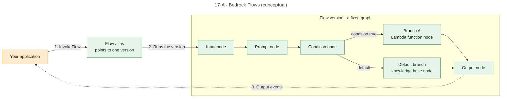
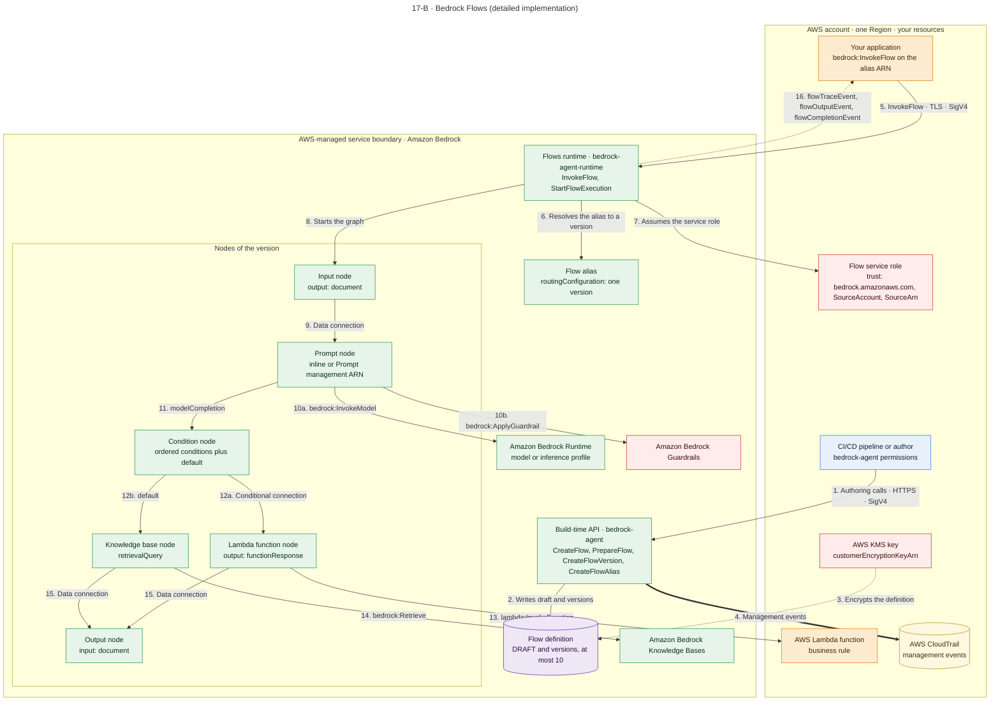
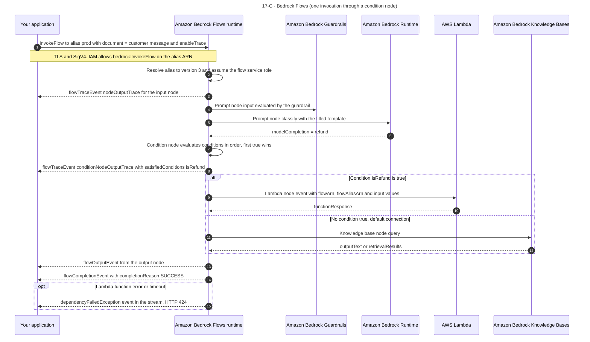

# Diagram 17 — Bedrock Flows architecture

> **Verified:** 2026-11-15 · **Type:** academy design, not an official AWS reference architecture · **Related chapters:** [Amazon Bedrock Flows](../../01-amazon-bedrock/flows/01-bedrock-flows.md) · [Prompt management](../../01-amazon-bedrock/prompt-management/01-prompt-management.md) · [Choosing between RAG, agents, flows and plain inference](../../09-advanced-topics/14-choosing-rag-agents-flows.md)

This set documents how a versioned flow is authored, deployed behind an alias and executed, and
which identity each node uses when it calls a model, a knowledge base, a guardrail or a Lambda
function. It answers the question "what runs where, with whose permissions, when my application
calls `InvokeFlow`?".

> [!NOTE]
> **Documented fact** — A flow starts at one input node and ends at one or more output nodes. You
> deploy it by creating an immutable version and an alias that points to it, and applications call
> the alias with `InvokeFlow`. Nodes call other resources with the flow's service role, which trusts
> `bedrock.amazonaws.com`.
> Sources: [Node types](https://docs.aws.amazon.com/bedrock/latest/userguide/flows-nodes.html),
> [Deploy a flow](https://docs.aws.amazon.com/bedrock/latest/userguide/flows-deploy.html),
> [Flows service role](https://docs.aws.amazon.com/bedrock/latest/userguide/flows-permissions.html)

## A. Conceptual view

**What this shows** — The application never calls the nodes. It calls an alias; Bedrock runs the
version's graph from the input node, follows data and conditional connections, and streams back what
the output node received. Changing the logic means a new version and an alias update, not an
application deployment.

## B. Detailed implementation view

| Legend | Meaning |
|:--|:--|
| Solid arrow | Request, call or data passed between nodes |
| Dashed arrow | Response stream or key use |
| Thick arrow | Asynchronous record |
| Cylinder | Data at rest |
| Blue / orange / green / purple / red / yellow | Client · your compute · Bedrock · data · security control · observability |
| Nested boxes | Your account versus the AWS-managed service; the nodes of one version |

### Component roles

| Component | Role in this architecture | Security control |
|:--|:--|:--|
| CI/CD pipeline | Creates and updates the flow, prepares it, cuts versions, moves the alias | IAM permissions on `bedrock-agent` actions; CloudTrail |
| Your application | Calls the alias; never the draft | `bedrock:InvokeFlow` on the alias ARN only |
| Flow definition | `DRAFT` plus immutable numbered versions (quota: 10 per flow) | Optional customer managed key |
| Flow alias | Maps a stable identifier to one version; holds node concurrency settings | Rollback is one `UpdateFlowAlias` |
| Flows runtime | Executes the graph, validates node input types, streams events | TLS; IAM evaluation of the caller |
| Flow service role | Identity of every node call | Trust policy with `aws:SourceAccount` and `aws:SourceArn`; one statement per node resource |
| Prompt node | Fills the template and calls the model; can apply a guardrail | `bedrock:InvokeModel`; `bedrock:RenderPrompt` for managed prompts; `bedrock:ApplyGuardrail` |
| Condition node | Chooses the outgoing connection; first true condition wins; `default` otherwise | — |
| Lambda function node | Business logic; receives `flowArn`, `flowAliasArn` and resolved inputs | `lambda:InvokeFunction` on the function |
| Knowledge base node | Retrieves, or retrieves and generates if a model is set | `bedrock:Retrieve` on the knowledge base |
| AWS CloudTrail | Records authoring calls | Evidence of who changed the flow |

### Connections

| # | From → To | Protocol / operation | Direction of data | Auth |
|--:|:--|:--|:--|:--|
| 1 | Pipeline → build-time API | HTTPS · `CreateFlow`, `UpdateFlow`, `PrepareFlow`, `CreateFlowVersion`, `CreateFlowAlias`, `UpdateFlowAlias` | Definition in | SigV4, pipeline role |
| 2 | Build-time API → definition store | Internal | Definition stored | — |
| 3 | KMS key → definition | Envelope encryption | Data key | Key policy |
| 4 | Bedrock → CloudTrail | Management events | Who, what, when | — |
| 5 | Application → runtime | HTTPS · `InvokeFlow` (event stream) | One input in | SigV4, application role |
| 6 | Runtime → alias | Internal | Version number | — |
| 7 | Runtime → service role | Role assumption by the service principal | Temporary credentials | Trust policy |
| 8–9 | Runtime → input node → prompt node | Internal; expression `$.data` selects the value | Typed value | — |
| 10a | Prompt node → model | Model inference | Prompt out, completion in | Service role |
| 10b | Prompt node → guardrail | Guardrail evaluation | Text checked | Service role |
| 11 | Prompt node → condition node | Data connection `modelCompletion` → named input | String | — |
| 12 | Condition node → next node | Conditional connection | Same value | — |
| 13 | Lambda node → function | Lambda invocation | Input event out, response in | Service role (flows created after 2024-11-22) |
| 14 | Knowledge base node → knowledge base | Retrieve, or RetrieveAndGenerate with a model | Query out, results in | Service role |
| 15 | Branch → output node | Data connection | Final value | — |
| 16 | Runtime → application | Same HTTPS stream | Trace, output and completion events | — |

## C. Sequence view

One invocation that a prompt node classifies and a condition node routes. Values are illustrative.

**Steps** — 1–2: the call names the alias, never a node; authorization covers only the alias. 3: the
runtime picks the version and takes the service role's credentials for every node call. 4: with
`enableTrace`, each node input and output is echoed as a trace event. 5–7: the prompt node applies
its guardrail (if configured) and calls the model. 8–9: conditions are evaluated in order; the trace
names the satisfied condition, which is the cheapest way to debug routing. 10–13: exactly one branch
runs here; a missing `default` connection is a validation error (`MissingDefaultCondition`). 14–15:
the output node's value and the completion reason close the stream.

**Failure paths**

- **Access denied inside the flow** — the caller was authorized but the service role lacks the node's
  permission. **Our reading:** it surfaces as an `accessDeniedException` event in the stream (one of
  the documented stream events), after the call itself returned 200.
- **Throttling** — `throttlingException` (429) from a node's dependency, typically model tokens per
  minute. Retry the whole invocation with backoff.
- **Agent node needs input** (preview) — `flowMultiTurnInputRequestEvent`, then `completionReason`
  `INPUT_REQUIRED`; call again with the same `executionId`.

## Variations

| Variation | What changes in the diagram |
|:--|:--|
| Flow execution (preview) | Step 5 becomes `StartFlowExecution`, which returns an `executionArn`; the app polls `GetFlowExecution` and reads `ListFlowExecutionEvents`. Runs up to 24 hours, five minutes per node; inline code nodes are not supported |
| Prompt from Prompt management | The prompt node holds a `promptArn`; the service role adds `bedrock:RenderPrompt` on that prompt |
| Knowledge base node without `modelId` | Returns `retrievalResults` (array); no guardrail applies — guardrails apply only with `RetrieveAndGenerate` |
| Iterator and collector | An iterator before the prompt node sends array items one at a time; a collector re-assembles them. Each item adds node transitions |
| DoWhile loop | API node types `Loop`, `LoopInput` and `LoopController`; `maxIterations` default 10. Not in Terraform 6.73.0 |
| Inline code node (preview) | Replaces the Lambda node for small Python transformations; runs isolated without internet access |
| Agent node | Calls an Agents Classic alias with `bedrock:InvokeAgent`; available to existing Agents Classic customers only |
| Cross-Region inference profile in a node | Box `model` can process in another Region of the profile; the role needs the profile and destination model ARNs |
| Private resources | The Lambda function attaches to your VPC; the application reaches `bedrock-agent-runtime` through an interface endpoint |
| Concurrency | The alias's `concurrencyConfiguration` (`Automatic` or `Manual`, 1–100) lets independent nodes run in parallel |

## Practical example

- Code: the [working example in Amazon Bedrock Flows](../../01-amazon-bedrock/flows/01-bedrock-flows.md#13-working-example)
  — a Terraform input → prompt → output flow with its service role, and a Python client for
  `InvokeFlow` and flow executions. Add a condition node and a Lambda node to reach view B.
- The routing decision itself (Flows, Step Functions or an agent) is discussed in
  [Choosing between RAG, agents, flows and plain inference](../../09-advanced-topics/14-choosing-rag-agents-flows.md).

## References

- [Node types for your flow](https://docs.aws.amazon.com/bedrock/latest/userguide/flows-nodes.html) — nodes, inputs and outputs, condition rules, Lambda event, inline code.
- [Deploy a flow using versions and aliases](https://docs.aws.amazon.com/bedrock/latest/userguide/flows-deploy.html) — `DRAFT`, `TSTALIASID`, versions, aliases.
- [CreateFlowAlias](https://docs.aws.amazon.com/bedrock/latest/APIReference/API_agent_CreateFlowAlias.html) — routing and concurrency configuration.
- [Create a service role for Amazon Bedrock Flows](https://docs.aws.amazon.com/bedrock/latest/userguide/flows-permissions.html) — trust policy, per-node permissions.
- [InvokeFlow](https://docs.aws.amazon.com/bedrock/latest/APIReference/API_agent-runtime_InvokeFlow.html) — event stream and in-stream errors.
- [Track each step in your flow by viewing its trace](https://docs.aws.amazon.com/bedrock/latest/userguide/flows-trace.html) — trace events, condition results.
- [Run Amazon Bedrock flows asynchronously](https://docs.aws.amazon.com/bedrock/latest/userguide/flows-create-async.html) — flow executions.
- [Converse with an Amazon Bedrock flow](https://docs.aws.amazon.com/bedrock/latest/userguide/flows-multi-turn-invocation.html) — multi-turn events.
- [Amazon Bedrock endpoints and quotas](https://docs.aws.amazon.com/general/latest/gr/bedrock.html) — versions per flow and node quotas.
- [Interface VPC endpoints for Amazon Bedrock](https://docs.aws.amazon.com/bedrock/latest/userguide/vpc-interface-endpoints.html) — `bedrock-agent` and `bedrock-agent-runtime`.
