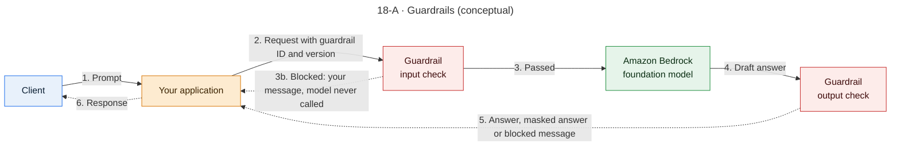
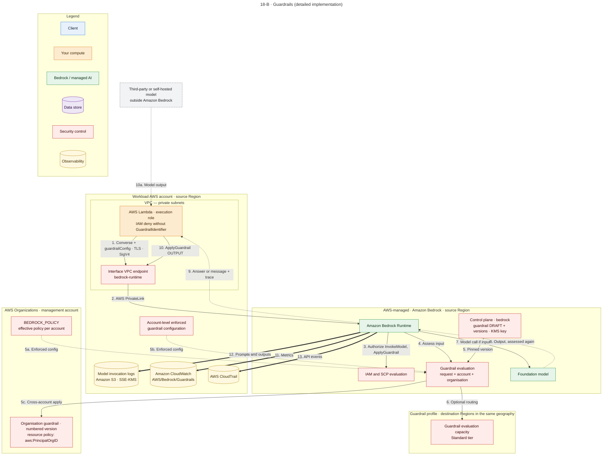
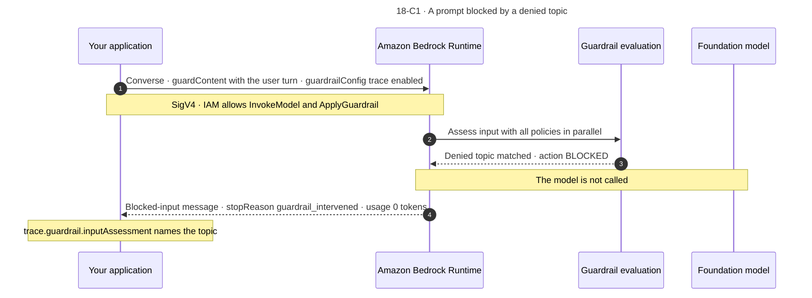
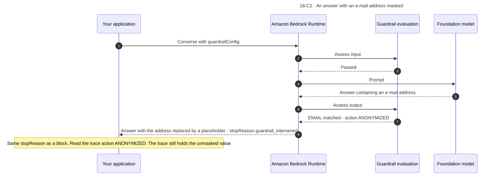
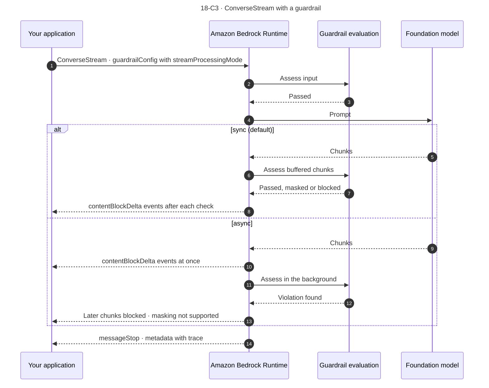

# Diagram 18 — Guardrails architecture

> **Verified:** 2026-11-15 · **Type:** academy design, not an official AWS reference architecture · **Related chapters:** [Amazon Bedrock Guardrails](../../01-amazon-bedrock/guardrails/01-guardrails.md) · [Automated Reasoning checks and guardrail enforcement](../../01-amazon-bedrock/guardrails/02-automated-reasoning-and-enforcement.md) · [Prompt injection, untrusted tool output and retrieval poisoning](../../06-security-governance/04-prompt-injection-and-untrusted-content.md) · [Governance at scale: Organizations, SCPs and guardrail enforcement](../../06-security-governance/06-governance-at-scale.md)

This set documents where an Amazon Bedrock guardrail sits in a request, which controls decide that
it runs, and where its results go. It answers the question "what checks my prompt and my answer,
who can switch that off, and what do I see afterwards?".

> [!NOTE]
> **Documented fact** — With a guardrail on `InvokeModel`, `InvokeModelWithResponseStream`,
> `Converse` or `ConverseStream`, the input is evaluated first, "in parallel for each configured
> policy"; if it is blocked, "the foundation model inference is discarded". Otherwise the response is
> evaluated and either returned unchanged, masked, or replaced with the blocked message.
> Source: [How Amazon Bedrock Guardrails works](https://docs.aws.amazon.com/bedrock/latest/userguide/guardrails-how.html)

## A. Conceptual view

**What this shows** — A guardrail is two checkpoints around one model call. The first can stop
the request before the model runs; the second can rewrite or replace what the model produced. Your
application receives either the answer, an answer with sensitive values replaced by placeholders,
or the message you configured for blocked content.

## B. Detailed implementation view

**Legend** — solid arrow: request or write · dashed arrow: response, configuration read or data
handed over · thick arrow: asynchronous record · cylinder: data at rest · dashed grey box: outside
your AWS account · nested boxes: trust and network boundaries.

### Component roles

| Component | Role in this architecture | Security control |
|:--|:--|:--|
| AWS Lambda function | Calls `Converse` with `guardrailConfig`; checks third-party output with `ApplyGuardrail` | Execution role: `bedrock:InvokeModel`, `bedrock:ApplyGuardrail` on guardrail and profile ARNs, explicit deny without the approved `bedrock:GuardrailIdentifier` |
| Interface VPC endpoint | Private path to `bedrock-runtime` | Endpoint policy; security group |
| Control plane | Holds the guardrail's `DRAFT` and up to 20 numbered versions | IAM on `bedrock:CreateGuardrail`, `bedrock:UpdateGuardrail`; optional customer managed KMS key |
| Amazon Bedrock Runtime | Evaluates guardrails around the model call and runs `ApplyGuardrail` | TLS; SigV4 |
| IAM and SCP evaluation | Decides whether the call may run and with which guardrail | `bedrock:GuardrailIdentifier` in identity policies and SCPs |
| Guardrail evaluation | Runs all configured policies of every applicable guardrail; the effect is their union | Content, topics, words, PII, contextual grounding; Automated Reasoning only in request guardrails |
| Account-level enforced configuration | Applies one numbered guardrail to every inference call in the account and Region | `bedrock:PutEnforcedGuardrailConfiguration` (protect with an SCP) |
| BEDROCK_POLICY and organisation guardrail | Applies the management account's guardrail to member accounts | Resource policies on the guardrail and on each destination-Region profile |
| Guardrail profile destinations | Extra evaluation capacity for the Standard tier, inside one geography | `bedrock:ApplyGuardrail` on the profile ARN in each destination Region |
| Model invocation logs | Full request and response records | Contain blocked content in plain text; masking does not apply; KMS and narrow access |
| CloudWatch, CloudTrail | Guardrail metrics; API events | `InvocationsIntervened`, `InvocationThrottles`, `FindingCounts`; `ApplyGuardrail` as data events |

### Connections

| # | From → To | Protocol / operation | Direction of data | Auth |
|--:|:--|:--|:--|:--|
| 1 | Function → VPC endpoint | HTTPS · `Converse` with `guardrailConfig` (ID, version, `trace`) | Prompt out | SigV4 with the execution role |
| 2 | VPC endpoint → Runtime | AWS PrivateLink | Prompt out | Endpoint policy |
| 3 | Runtime → IAM and SCP | Authorization of `bedrock:InvokeModel` and `bedrock:ApplyGuardrail` | Request context | IAM, SCP |
| 4 | Runtime → evaluation | Input assessment (only `guardContent` blocks, if any) | Prompt | Service-internal |
| 5 | Control plane → evaluation | The pinned guardrail version | Configuration | — |
| 5a, 5b | Enforced configurations → evaluation | Effective organisation policy; account setting | Configuration | — |
| 5c | Evaluation → organisation guardrail | Cross-account `ApplyGuardrail` | Prompt | Resource policy on guardrail and profiles |
| 6 | Evaluation → destination Regions | Cross-Region guardrail inference, encrypted on Amazon's network | Prompt or output | `bedrock:ApplyGuardrail` on profile ARNs |
| 7–8 | Runtime ↔ model | Model invocation, then output assessment | Prompt, output | Service-internal |
| 9 | Runtime → function | Same HTTPS connection | Answer, masked answer or blocked message; `stopReason`; trace | — |
| 10 | Function → Runtime | `ApplyGuardrail` with `source` = `OUTPUT` | Third-party output | `bedrock:ApplyGuardrail` only |
| 11–13 | Runtime → CloudWatch, S3, CloudTrail | Metrics, log delivery, events | Counts; full text; API metadata | Service principals, bucket and key policies |

## C. Sequence view

### C1. Blocked input

Steps 1–2: the input is assessed before anything else. Step 3: one blocking policy is enough. Step 4:
you are charged for the guardrail evaluation only; the documented example shows zero token usage.
Failure paths: `AccessDeniedException` if the role lacks `bedrock:ApplyGuardrail` or uses a guardrail
other than the one its IAM deny allows; `ValidationException` for a malformed `guardrailConfig`.

### C2. Masked output

Steps 1–5: the input passes and the model answers. Steps 6–7: the sensitive-information policy
masks rather than blocks. Step 8: your application gets a usable answer; only the trace (with the
original value in `match` and `modelOutput`) shows that masking happened, so do not log it.

### C3. Streaming response

Steps 1–4: as in C1 and C2. Steps 5–8 (sync): chunks are buffered and scanned before release, which
adds latency but checks every chunk. Steps 9–13 (async): chunks arrive immediately and "may contain
inappropriate content until guardrails scan completes"; once a violation is found, later chunks are
blocked, and sensitive information cannot be masked. Step 14: the trace arrives in the `metadata`
event. Errors after the HTTP 200 arrive as stream events.

## Variations

| Variation | What changes in the diagram |
|:--|:--|
| `InvokeModel` / `InvokeModelWithResponseStream` | Guardrail in `X-Amzn-Bedrock-GuardrailIdentifier` and `-GuardrailVersion` headers; selective evaluation through input tags with a per-request `tagSuffix`; async streaming via `amazon-bedrock-guardrailConfig` `streamProcessingMode` `ASYNCHRONOUS` |
| OpenAI-compatible APIs on `bedrock-runtime` | Same headers (through `extra_headers` in the OpenAI SDK). No guardrail box at all on `bedrock-mantle` |
| `ApplyGuardrail` only | Remove the foundation model; the function sends text or images with `source` `INPUT` or `OUTPUT` and receives `action`, `outputs`, `assessments`. Works for any model, including ones outside AWS |
| `InvokeGuardrailChecks` | No guardrail resource, no control plane, no enforcement: checks are listed inline and return detect-only scores |
| Classic tier, no profile | Remove the destination-Region box; English, French and Spanish only |
| Standard tier | Destination-Region box required; add IAM on every destination profile ARN |
| No enforcement | Remove the organisation box and the account-level configuration; only the request guardrail runs |
| Enforced, `SELECTIVE` guarding | Caller tags decide what is evaluated on input (system: tagged only; messages: everything if untagged); `COMPREHENSIVE` evaluates all |
| Automated Reasoning | Only in a request guardrail; findings in the trace or `ApplyGuardrail` assessments; detect only; not with streaming |
| Agents Classic, knowledge bases, Flows | The feature applies the guardrail from its own `guardrailConfiguration`; a role restricted by `bedrock:GuardrailIdentifier` must not call these |
| Agentic retrieval | Guardrail in `policyConfiguration`; `CUSTOM` model type only; `BLOCK` actions only |
| Tool use | `toolResult`, tool definitions and `toolUse.input` bypass the guardrail; add `ApplyGuardrail` or `InvokeGuardrailChecks` on tool output |

## Practical example

- Code: the working examples in [Amazon Bedrock Guardrails](../../01-amazon-bedrock/guardrails/01-guardrails.md#13-working-example)
  (Standard-tier guardrail and version in Terraform; `Converse` and `ApplyGuardrail` in Python) and
  [Automated Reasoning checks and guardrail enforcement](../../01-amazon-bedrock/guardrails/02-automated-reasoning-and-enforcement.md#13-working-example)
  (resource policies, enforced configurations, `BEDROCK_POLICY`, SCP, Automated Reasoning).
- IAM for the Lambda role in view B: [Module: bedrock-invocation-role](../../04-infrastructure-as-code/terraform/modules/bedrock-invocation-role/README.md)
  (`required_guardrail_arn_pattern` input).
- Private network path: [diagram set 24](24-secure-private-enterprise-bedrock.md) and
  [Project E: secure private enterprise GenAI](../../05-practical-projects/project-05-private-genai/README.md).
- Organisation-wide setup: [Project F: multi-account enterprise GenAI platform](../../05-practical-projects/project-06-multi-account-platform/README.md).

## References

- [How Amazon Bedrock Guardrails works](https://docs.aws.amazon.com/bedrock/latest/userguide/guardrails-how.html) — evaluation order, charging, supported models.
- [Include a guardrail with the Converse API](https://docs.aws.amazon.com/bedrock/latest/userguide/guardrails-use-converse-api.html) — `guardContent`, tool coverage, blocked and masked responses, trace.
- [Configure streaming response behavior](https://docs.aws.amazon.com/bedrock/latest/userguide/guardrails-streaming.html) — sync and async modes.
- [Apply tags to user input](https://docs.aws.amazon.com/bedrock/latest/userguide/guardrails-tagging.html) — input tags on `InvokeModel`.
- [Use the ApplyGuardrail API](https://docs.aws.amazon.com/bedrock/latest/userguide/guardrails-use-independent-api.html) — standalone evaluation for any model.
- [InvokeGuardrailChecks](https://docs.aws.amazon.com/bedrock/latest/userguide/guardrails-use-invoke-guardrail-checks.html) — resourceless, detect-only checks.
- [Safeguard tiers](https://docs.aws.amazon.com/bedrock/latest/userguide/guardrails-tiers.html) and [Supported Regions for cross-Region guardrail inference](https://docs.aws.amazon.com/bedrock/latest/userguide/guardrails-cross-region-support.html) — tiers and guardrail profiles.
- [Enforce the use of specific guardrails](https://docs.aws.amazon.com/bedrock/latest/userguide/guardrails-permissions-id.html) — `bedrock:GuardrailIdentifier`.
- [Guardrails enforcements](https://docs.aws.amazon.com/bedrock/latest/userguide/guardrails-enforcements.html) and [Resource-based policies for guardrails](https://docs.aws.amazon.com/bedrock/latest/userguide/guardrails-resource-based-policies.html) — account and organisation enforcement.
- [Use cases for guardrails](https://docs.aws.amazon.com/bedrock/latest/userguide/guardrails-use.html) — agents, knowledge bases, flows.
- [Sensitive information filters](https://docs.aws.amazon.com/bedrock/latest/userguide/guardrails-sensitive-filters.html) — masking and what it does not cover.
- [Monitor guardrails with CloudWatch](https://docs.aws.amazon.com/bedrock/latest/userguide/monitoring-guardrails-cw-metrics.html) — metrics namespace and dimensions.
- [Responses API](https://docs.aws.amazon.com/bedrock/latest/userguide/inference-responses-api.html) — guardrail headers on `bedrock-runtime`.
