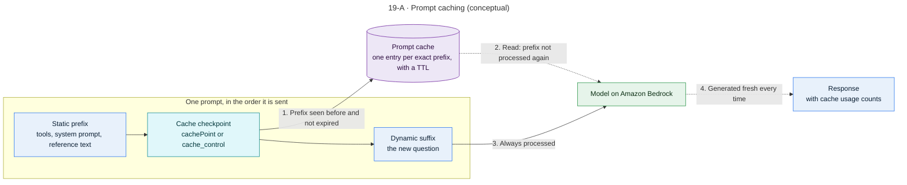
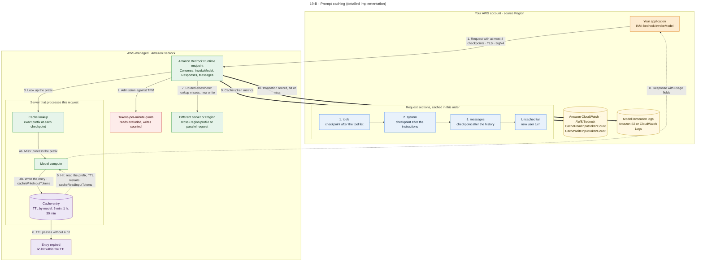
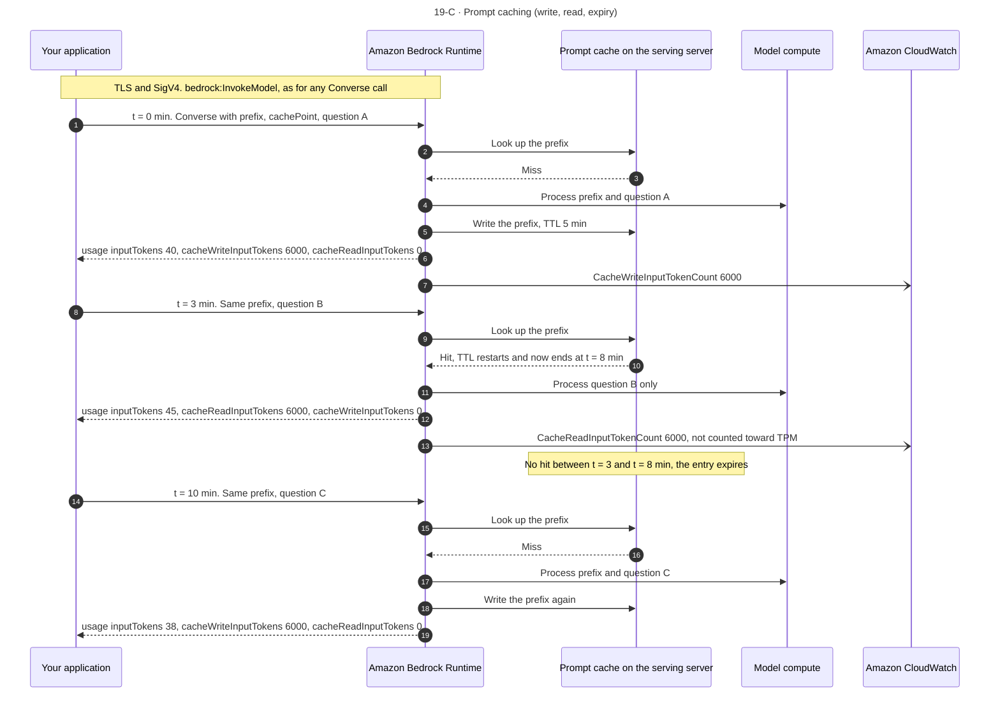

# Diagram 19 — Prompt caching architecture

> **Verified:** 2026-11-15 · **Type:** academy design, not an official AWS reference architecture · **Related chapters:** [Prompt caching](../../01-amazon-bedrock/prompt-caching/01-prompt-caching.md) · [Latency and token economics](../../00-foundations/generative-ai-fundamentals/08-latency-and-token-economics.md) · [Caching strategies](../../08-cost-performance-and-reliability/04-caching-strategies.md)

This set documents how Amazon Bedrock reuses the processed **beginning** of a prompt across requests:
where the cache checkpoints sit, how a request finds or creates a cache entry, when the entry expires,
and where the reads and writes become visible. It answers the question "why was this call a cache
write, and the next one a read?".

> [!NOTE]
> **Documented fact** — A cache checkpoint marks "the contiguous subsection of your prompt that you
> want to cache". The cache has a time to live that "resets with each successful cache hit". "A cache
> entry is stored on the server that processed the request", so a request served by another server,
> "such as one in another Region", writes a new entry instead of reading one.
> Source: [Prompt caching](https://docs.aws.amazon.com/bedrock/latest/userguide/prompt-caching.html)

## A. Conceptual view

**What this shows** — Caching splits a prompt into what stays identical (the prefix, before the
checkpoint) and what changes (the suffix). Only the prefix can come from the cache; the suffix and
the output are always computed. The response is never cached. Ordering the prompt is therefore the
whole design decision.

## B. Detailed implementation view

AWS documents the markers, the matching rules, the TTLs, the usage fields and the metrics. The inside
of the cache — its form, encryption and isolation — is not documented; the right-hand boxes are a
conceptual model.

| Legend | Meaning |
|:--|:--|
| Solid arrow | Request, processing or write |
| Dashed arrow | Response or cache read |
| Thick arrow | Asynchronous metrics and logs |
| Cylinder | Stored data (the cache entry is transient) |
| Blue / orange / green / purple / red / yellow | Prompt content · your compute · Bedrock · data · control · observability |
| Nested boxes | Your account; the AWS-managed service; one processing server |

### Component roles

| Component | Role in this architecture | Security control |
|:--|:--|:--|
| Your application | Orders the prompt (static first) and places checkpoints | Normal inference permissions; caching needs no extra action |
| `tools`, `system`, `messages` | Cached in this order; "modifying `tools` invalidates the `system` and `messages` caches" | Keep per-user data after the last checkpoint |
| Uncached tail | The part after the last checkpoint; processed on every call | — |
| Amazon Bedrock Runtime | Accepts the call, applies quotas, reports usage | TLS, SigV4, IAM |
| Tokens-per-minute quota | Cache reads "don't count toward your TPM quota"; writes do | Quota relief on hits |
| Cache lookup | Exact prefix match up to a checkpoint; Claude also checks earlier block boundaries, "about 20 content blocks" back | — |
| Cache entry | Lives on the processing server for the TTL; each hit restarts it | Form, encryption and isolation not documented |
| Model compute | Processes the uncached part and generates; never returns a cached answer | — |
| Amazon CloudWatch | `CacheReadInputTokenCount`, `CacheWriteInputTokenCount` in `AWS/Bedrock` | Alarm on the read-to-write ratio |
| Model invocation logs | Records requests whether or not they hit | Logs hold prompts: KMS and narrow access |

### Connections

| # | From → To | Protocol / operation | Direction of data | Auth |
|--:|:--|:--|:--|:--|
| 1 | Application → runtime | HTTPS · `Converse`, `ConverseStream`, `InvokeModel`, `InvokeModelWithResponseStream`, Responses, Chat Completions, Messages | Prompt with checkpoints out | SigV4 (or a Bedrock API key) |
| 2 | Runtime → quota | Internal admission | Token estimate | — |
| 3 | Runtime → lookup | Internal | Prefix up to each checkpoint | — |
| 4a–4b | Lookup → compute → entry | Internal; billed at the cache-write rate | Prefix processed and stored | — |
| 5 | Entry → compute | Internal; billed at the cache-read rate | Cached prefix reused | — |
| 6 | Entry → expired | Time | — | — |
| 7 | Runtime → other server or Region | Cross-Region routing or concurrent identical requests | New write instead of a read | — |
| 8 | Compute → application | Same HTTPS response | Output and usage counters | — |
| 9 | Bedrock → CloudWatch | Metrics | Cache token counts | — |
| 10 | Bedrock → logs | Invocation logging (if enabled) | Full request and response | Log destination policy |

## C. Sequence view

Three Converse calls with the same 6,000-token prefix on a model with a 5-minute TTL. The token
numbers are illustrative; the fields are the documented Converse usage fields.

**Steps** — 1–7, first call: the prefix is processed in full and written; total input is
`inputTokens + cacheReadInputTokens + cacheWriteInputTokens` = 6,040, and the write is billed at the
cache-write rate. 8–13, second call within the TTL: the prefix is read, only 45 tokens are processed,
and the hit restarts the TTL. 14–20, after expiry: the call behaves like the first one.

**Failure and surprise paths**

- **Prefix below the model's minimum** — no error; both cache counters stay at zero.
- **Changed prefix** — a timestamp or user name before the checkpoint makes every call a write.
- **Another server answers** — with a cross-Region profile, or when identical requests are sent
  before the first has started responding, the call writes again instead of reading.
- **`ttl` on a 5-minute-only model** — "can result in a `ValidationException`".

## Variations

How the marker, the TTL and the counters change by API and model family (from the table on the prompt
caching page, read on 2026-11-15; check the row for your exact model).

| Variation | What changes in the diagram |
|:--|:--|
| Converse / ConverseStream, Anthropic Claude or Amazon Nova | Checkpoint = `{"cachePoint": {"type": "default"}}` block in `tools`, `system` or message `content`; optional `"ttl": "1h"` on models that support it. Usage: `cacheReadInputTokens`, `cacheWriteInputTokens`, `cacheDetails[]` |
| Converse, Claude automatic caching | No checkpoint box: `additionalModelRequestFields={"cache_control": {"type": "ephemeral"}}`; Claude places the checkpoint on the last cacheable block and moves it forward. Uses one of the four slots |
| InvokeModel or the Anthropic Messages API, Claude | Checkpoint = `"cache_control": {"type": "ephemeral"}` on a content block, optional `"ttl": "1h"`; or one top-level `cache_control`. Counters come in the provider's usage object |
| InvokeModel, Amazon Nova | Checkpoint = `"cachePoint": {"type": "default"}` on a content item |
| Responses API, OpenAI GPT-5.6 and later | Checkpoint = `"prompt_cache_breakpoint": {"mode": "explicit"}`; `prompt_cache_options.mode` `implicit` (default, adds an automatic breakpoint) or `explicit`. Up to 4 cache writes; 30-minute minimum TTL. Usage: `input_tokens_details.cached_tokens` and `cache_write_tokens`, both **included** in `input_tokens`. Converse has no explicit caching for these models |
| OpenAI GPT-5.5 and earlier | Implicit only: no checkpoint box; prefixes of 1,024 tokens or more |
| Amazon Nova implicit caching | Happens on all text prompts but "isn't reported in the cache usage fields and isn't billed as cache reads": no counters at step 8–9 |
| Model family limits | Claude: 5 min or 1 h TTL, minimum 512, 1,024 or 4,096 tokens per checkpoint, 4 checkpoints, fields `system`, `messages`, `tools`. OpenAI GPT-5.6+: 30 min, 1,024. Nova: 5 min, 1K minimum, at most 20K cached tokens, fields `system`, `messages` |
| Mixed TTLs (Claude) | A 1-hour entry "must appear before any 5-minute cache entries" — the longer-TTL checkpoint sits earlier in the request |
| Cross-Region inference profile | Box `other` becomes common: each Region keeps its own entries; "at times of high demand, these optimizations may lead to increased cache writes" |
| Prompt management or Flows | The checkpoint lives in the stored prompt: `cache_point` blocks in the template (`aws_bedrockagent_prompt` needs the `CHAT` template; the inline prompt of `aws_bedrockagent_flow` accepts them too) |
| Batch inference | Not supported — no cache path at all |
| `bedrock-mantle` endpoint | The Responses API with OpenAI models is also served there. **Our reading:** the markers are Responses API request fields and stay the same; the caching page does not discuss mantle separately |

## Practical example

- Code: the [working example in Prompt caching](../../01-amazon-bedrock/prompt-caching/01-prompt-caching.md#13-working-example)
  sends two Converse calls with one checkpoint and classifies each as `write`, `hit` or `none` from the
  usage fields — the first two calls of view C.
- Response and retrieval caches, which this set does not cover, are in
  [Caching strategies](../../08-cost-performance-and-reliability/04-caching-strategies.md).

## References

- [Prompt caching for faster model inference](https://docs.aws.amazon.com/bedrock/latest/userguide/prompt-caching.html) — types, the model table, markers per API, ordering, lookback, TTL, server and Region behaviour, billing.
- [Amazon Bedrock now supports 1-hour duration for prompt caching](https://aws.amazon.com/about-aws/whats-new/2026/01/amazon-bedrock-one-hour-duration-prompt-caching/) — the 1-hour TTL.
- [CachePointBlock](https://docs.aws.amazon.com/bedrock/latest/APIReference/API_runtime_CachePointBlock.html) — `type` and `ttl` values.
- [TokenUsage](https://docs.aws.amazon.com/bedrock/latest/APIReference/API_runtime_TokenUsage.html) and [CacheDetail](https://docs.aws.amazon.com/bedrock/latest/APIReference/API_runtime_CacheDetail.html) — Converse usage fields.
- [Monitor bedrock-runtime inference using CloudWatch metrics](https://docs.aws.amazon.com/bedrock/latest/userguide/monitoring-runtime-metrics.html) — cache token metrics and TPM.
- [Route model inference requests across AWS Regions](https://docs.aws.amazon.com/bedrock/latest/userguide/cross-region-inference.html) — why a profile changes the serving Region.
- [Amazon Bedrock pricing](https://aws.amazon.com/bedrock/pricing/) — cache read and cache write rates.
