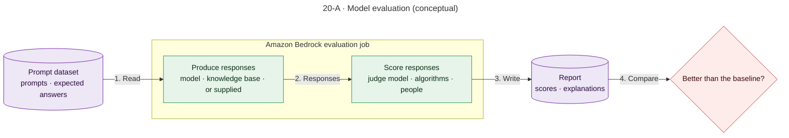
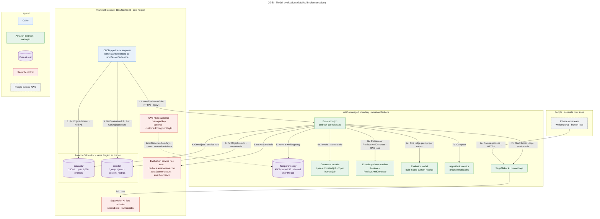
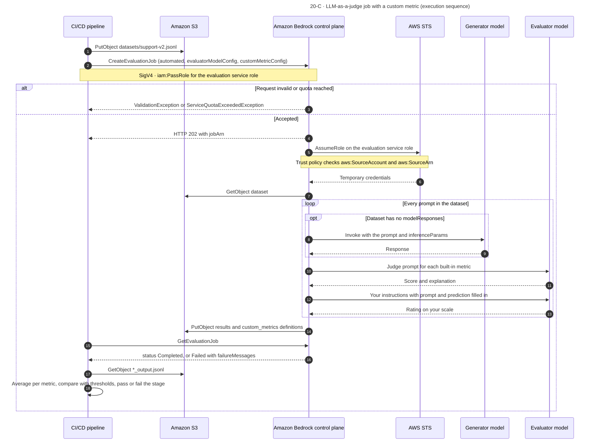

# Diagram 20 — Model evaluation architecture

> **Verified:** 2026-11-15 · **Type:** academy design, not an official AWS reference architecture · **Related chapters:** [Model and RAG evaluation](../../01-amazon-bedrock/model-evaluation/01-model-evaluation.md) · [Model evaluation and model selection](../../00-foundations/generative-ai-fundamentals/07-model-evaluation-and-selection.md) · [Model lifecycle and selection](../../01-amazon-bedrock/foundation-models/02-model-lifecycle-and-selection.md) · [AgentCore Evaluations and Optimization](../../01-amazon-bedrock/agentcore/10-agentcore-evaluations-and-optimization.md)

This set documents an Amazon Bedrock evaluation job: a prompt dataset in Amazon S3 goes in, responses
are produced (by a model, a knowledge base, or taken from the dataset), something scores them (an
evaluator model, algorithms or people), and a report comes back to S3. It answers one question: **which
identities, data stores and models does one job touch, and where does each control sit?** AWS documents
the inputs, roles and outputs; boxes inside the managed boundary are a conceptual model.

## A. Conceptual view

**What this shows** — every job type has the same two stages. What changes between job types is who
produces the responses (1–2) and who scores them (3). The decision (4) is yours: the job reports, it
does not approve a release.

**Legend** — solid arrow: data flow · cylinder: data at rest · diamond: your decision · green: Amazon
Bedrock.

## B. Detailed implementation view

**Legend** — solid arrow: request or write · dashed arrow: key use · cylinder: data at rest · nested
boxes: trust boundaries (people, your account, the S3 bucket, the AWS-managed service).

**What this shows** — all job types at once; a real job uses one path at 6 and one at 7. Every line
from the managed boundary into your account uses the **evaluation service role**, so its trust policy
and permissions are the main control. Only the caller's own identity is used at 1, 2 and 9.

### Component roles

| Component | Role in this architecture | Security control |
|:--|:--|:--|
| CI/CD pipeline or engineer | Uploads the dataset, creates the job, reads the results | `bedrock:CreateEvaluationJob`; `iam:PassRole` only for named roles, `iam:PassedToService` = `bedrock.amazonaws.com` |
| `datasets/` prefix | Prompt dataset: `prompt`, `referenceResponse`, `category`; or `conversationTurns` for RAG; optional supplied responses | Read-only for the service role; same Region as the job |
| `results/` prefix | Per-record results and custom-metric definitions | Write for the service role; CORS rule only for console-created human jobs |
| Evaluation service role | Identity Bedrock uses for S3, models, knowledge base, human loops | Trust limited to `evaluation-job/*` in this account and Region |
| AWS KMS key | Optional key for the job's temporary data | Key policy for `bedrock.amazonaws.com` with `kms:EncryptionContext:evaluationJobArn`; same actions for the creating identity |
| Temporary copy | Working data while the job runs | AWS-owned bucket, encrypted, deleted after the job |
| Generator models | Produce responses; skipped when responses are supplied | Invoke rights on the service role |
| Knowledge base runtime | Retrieval or retrieval plus generation for RAG jobs | `bedrock:Retrieve`, `bedrock:RetrieveAndGenerate` on one knowledge base |
| Evaluator model | Scores built-in and custom metrics, with explanations | Chosen from the supported-judge list; invoke rights on the service role |
| Algorithmic metrics | Accuracy, robustness, toxicity for programmatic jobs | — |
| SageMaker AI human loop and flow definition | Distribute tasks to the work team | `sagemaker:StartHumanLoop` and related actions; separate flow-definition role |
| Private work team | People who rate responses | You choose who; workers may see toxic content |

### Connections

| # | From → To | Protocol / operation | Direction of data | Auth |
|--:|:--|:--|:--|:--|
| 1 | Caller → S3 `datasets/` | HTTPS · `PutObject` | Dataset in | Caller's IAM identity |
| 2 | Caller → Evaluation job | HTTPS · `CreateEvaluationJob` | Configuration in | SigV4, IAM, `iam:PassRole` |
| 3 | Job → Service role | `sts:AssumeRole` | Credentials | Trust policy conditions |
| 4 | Job → S3 `datasets/` | `GetObject` | Dataset into the service | Service role |
| 5 | Job → Temporary copy | Service-internal | Working data | AWS owned key or your KMS key |
| 6a | Job → Generator models | Model invocation | Prompts out, responses in | Service role |
| 6b | Job → Knowledge base runtime | `Retrieve` or `RetrieveAndGenerate` | Queries out, passages and answers in | Service role |
| 7a | Job → Evaluator model | Model invocation, one judge prompt per metric | Prompt, response, ground truth out; score and explanation in | Service role |
| 7b | Job → Algorithmic metrics | Service-internal | Scores | — |
| 7c–7e | Job → Human loop → Work team | `StartHumanLoop`; worker portal over HTTPS | Tasks out, ratings in | Service role; flow-definition role; work-team sign-in |
| 8 | Job → S3 `results/` | `PutObject` | Results out | Service role |
| 9 | Caller → Job, S3 | `GetEvaluationJob`, `GetObject` | Status and results to the caller | Caller's IAM identity |

## C. Sequence view

**Steps 1–4** — the dataset is uploaded before the job exists. Creation is either refused (3: validation,
quota, conflict, not-found, access-denied or throttling) or accepted with HTTP 202 and a `jobArn` (4).

**Steps 5–7** — Amazon Bedrock assumes the service role and reads the dataset with it, not with the
pipeline's identity. The trust policy's `aws:SourceArn` condition (`evaluation-job/*`) stops other
Bedrock features from using the same role.

**Steps 8–13** — the generator is called only when the dataset carries no `modelResponses`. Each
built-in metric has its own published judge prompt; a custom metric uses your instructions, and the
rating scale you defined is added as structured-output instructions. Built-in and custom metrics may
use different evaluator models.

**Steps 14–18** — results are written under `<output>/<job-name>/<job-uuid>/`. The pipeline polls until
a terminal status, then computes its own gate. **Our reading:** a service-role failure to reach S3, a
model or the key shows up at step 16 as a failed job with `failureMessages`, not at step 3.

## Variations

| Variation | What changes in the diagram |
|:--|:--|
| Programmatic (automatic) job | No evaluator model; path 7b. A built-in dataset (`Builtin.BoolQ` and others) can replace the S3 dataset. Metrics `Builtin.Accuracy`, `Builtin.Robustness`, `Builtin.Toxicity` |
| LLM-as-a-judge job | Paths 6a and 7a — view C. One generator, one evaluator for built-in metrics, optionally a second for custom metrics |
| Bring your own responses (model) | Path 6a disappears. Each dataset line carries `modelResponses`; `precomputedInferenceSource` names the `inferenceSourceIdentifier` |
| Human job | Path 7a becomes 7c–7e. Up to two generators, two roles, a flow definition with `AWS/Bedrock/Evaluation` as the request source, $0.21 per completed task |
| RAG, retrieve only | Path 6b with `Retrieve`; metrics `Builtin.ContextRelevance`, `Builtin.ContextCoverage`; the role needs `bedrock:Retrieve` on the knowledge base |
| RAG, retrieve and generate | Path 6b with `RetrieveAndGenerate` and a generator `modelArn`; citation metrics become available |
| Bring your own RAG responses | Path 6b disappears. Lines carry `output` with `knowledgeBaseIdentifier` and the retrieved passages; `precomputedRagSourceConfig` |
| Managed Knowledge Base | Whether path 6b works is **UNVERIFIED — REQUIRES DOCUMENTATION REVIEW**; supplying your own responses avoids the question (see the chapter) |
| Cross-Region inference profile as generator or judge | Inference at 6a or 7a can run in other Regions the profile routes to |
| No customer managed key | The dashed key line becomes an AWS owned key |
| Agents instead of single responses | Not this architecture — AgentCore Evaluations scores traces ([AgentCore Evaluations and Optimization](../../01-amazon-bedrock/agentcore/10-agentcore-evaluations-and-optimization.md)) |

## Practical example

[Model and RAG evaluation, section 13](../../01-amazon-bedrock/model-evaluation/01-model-evaluation.md#13-working-example)
implements view B's judge path with Terraform: `aws_s3_object` for the dataset (step 1),
`aws_iam_role` with a trust policy scoped to `evaluation-job/*` (step 3), and `aws_bedrock_evaluation_job`
with a built-in and a custom metric (steps 2 and 6a–8). Its Python helper implements step 9 as a
pipeline gate.

## References

- [Evaluate the performance of Amazon Bedrock resources](https://docs.aws.amazon.com/bedrock/latest/userguide/evaluation.html) — job types (view A).
- [CreateEvaluationJob API reference](https://docs.aws.amazon.com/bedrock/latest/APIReference/API_CreateEvaluationJob.html) — request, HTTP 202 response and errors (steps 2–4 of view C).
- [Evaluate model performance using another LLM as a judge](https://docs.aws.amazon.com/bedrock/latest/userguide/evaluation-judge.html) — generator and evaluator models, supplied responses.
- [Create a prompt for a custom metric](https://docs.aws.amazon.com/bedrock/latest/userguide/model-evaluation-custom-metrics-prompt-formats.html) — instructions, variables, rating scale.
- [Evaluate the performance of RAG sources](https://docs.aws.amazon.com/bedrock/latest/userguide/evaluation-kb.html) — retrieve-only and retrieve-and-generate (path 6b).
- [Create a human-based model evaluation job](https://docs.aws.amazon.com/bedrock/latest/userguide/model-evaluation-jobs-management-create-human.html) — flow definition and work team (paths 7c–7e).
- [Service role for judge jobs](https://docs.aws.amazon.com/bedrock/latest/userguide/judge-service-roles.html), [for RAG jobs](https://docs.aws.amazon.com/bedrock/latest/userguide/rag-eval-service-roles.html) and [for human jobs](https://docs.aws.amazon.com/bedrock/latest/userguide/model-eval-service-roles.html) — trust policy and permissions.
- [Data management and encryption](https://docs.aws.amazon.com/bedrock/latest/userguide/evaluation-data-management.html) and [KMS key policy](https://docs.aws.amazon.com/bedrock/latest/userguide/model-evaluation-security-kms.html) — temporary copy and key use (step 5).
- [Required CORS permissions](https://docs.aws.amazon.com/bedrock/latest/userguide/model-evaluation-security-cors.html) — worker portal access to the output bucket.
- [Results in Amazon S3](https://docs.aws.amazon.com/bedrock/latest/userguide/model-evaluation-report-s3.html) — output layout (step 8).
- [Automatic job prerequisites](https://docs.aws.amazon.com/bedrock/latest/userguide/model-evaluation-type-automatic.html) — same-Region bucket.
- [Amazon Bedrock pricing](https://aws.amazon.com/bedrock/pricing/) — human task price.
