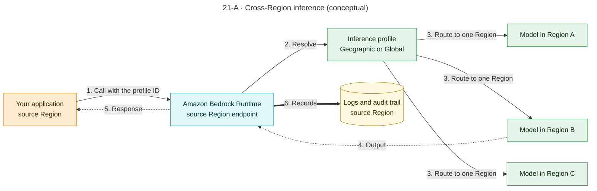
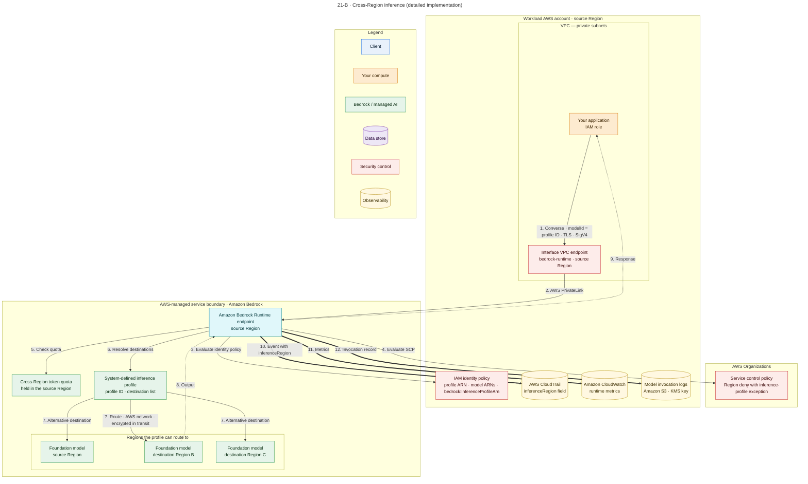
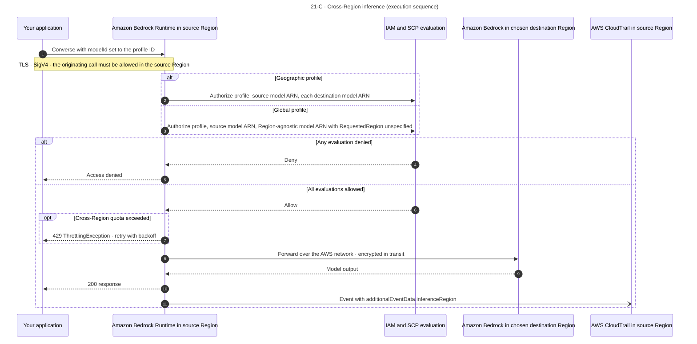

# Diagram 21 — Cross-Region inference architecture

> **Verified:** 2026-11-15 · **Type:** academy design, not an official AWS reference architecture · **Related chapters:** [Cross-Region inference: Geo and Global profiles](../../01-amazon-bedrock/inference/04-cross-region-inference.md) · [Cross-Region considerations and data residency](../../09-advanced-topics/11-cross-region-and-data-residency.md) · [Governance at scale: Organizations, SCPs and guardrail enforcement](../../06-security-governance/06-governance-at-scale.md)

This set documents how a request made in one Region is processed in another through an
inference profile, and where the control points are. It answers the question "which policies
must allow the routing, what leaves my Region, and where do I see it afterwards?".

> [!NOTE]
> **Documented fact** — You call the source Region; Bedrock routes the request to one of the
> destination Regions in the profile over the AWS network, encrypted in transit. CloudTrail logs
> the request in the source Region, with the processing Region in
> `additionalEventData.inferenceRegion`. AWS does not publish the routing algorithm.
> Source: [Cross-Region inference](https://docs.aws.amazon.com/bedrock/latest/userguide/cross-region-inference.html)

## A. Conceptual view

**What this shows** — The application changes one thing: the model identifier becomes a profile
ID. Bedrock chooses one Region from the profile for each request. The answer returns through
the Region you called, and the records of the call stay there.

## B. Detailed implementation view

**Legend** — solid arrow: request or write · dashed arrow: response · thick arrow: asynchronous
record · cylinder: data at rest · nested boxes: trust and network boundaries · teal: endpoint.

### Component roles

| Component | Role in this architecture | Security control |
|:--|:--|:--|
| Your application | Calls the source-Region endpoint with a profile ID or ARN as the model | IAM role |
| Interface VPC endpoint | Private path to `bedrock-runtime` in the source Region; none is needed in destination Regions (our reading) | Endpoint policy |
| IAM identity policy | Must allow the profile ARN, the model ARN in the source Region, and the model ARN in every destination Region (Geographic) or the Region-agnostic model ARN (Global) | `bedrock:InferenceProfileArn` on the model statement limits the models to use through the profile |
| Service control policy | Organization-wide Region restriction that the routing must pass | Allow all destination Regions or `unspecified`, or exempt calls that carry `bedrock:InferenceProfileArn` |
| Amazon Bedrock Runtime endpoint | Accepts the call; returns the response | TLS; the originating call must be allowed in the source Region |
| Cross-Region token quota | Admission control for traffic through the profile | Viewed and raised in the source Region |
| System-defined inference profile | Names the model and the destination Regions; the list can differ by source Region | Read with `GetInferenceProfile`; created and maintained by AWS |
| Foundation model in each Region | Processes the request in the chosen Region | AWS-operated; can be in an opt-in Region you have not enabled |
| AWS CloudTrail | Records the request in the source Region with `additionalEventData.inferenceRegion` | Evidence for residency audits |
| Amazon CloudWatch, invocation logs | Metrics and optional full records, in the source Region | Logs contain prompts: KMS and narrow access |

### Connections

| # | From → To | Protocol / operation | Direction of data | Auth |
|--:|:--|:--|:--|:--|
| 1 | Application → VPC endpoint | HTTPS · `Converse`, `InvokeModel` and their streaming variants | Prompt out | SigV4 with the application role |
| 2 | VPC endpoint → Bedrock Runtime | AWS PrivateLink | Prompt out | Endpoint policy |
| 3 | Endpoint → identity policy | Authorization evaluation for profile and model resources | Request context | IAM |
| 4 | Endpoint → SCP | Authorization evaluation, same resources | Request context | AWS Organizations |
| 5 | Endpoint → quota | Internal | Token estimate | — |
| 6 | Endpoint → profile | Internal | Profile ID | — |
| 7 | Profile → model in one Region | AWS network, encrypted in transit, never the public internet | Prompt out of the source Region | Service-internal |
| 8 | Model → endpoint | AWS network | Output back to the source Region | Service-internal |
| 9 | Endpoint → application | Same HTTPS connection | Output in | — |
| 10 | Bedrock → CloudTrail | Event in the source Region | Caller, profile, processing Region | — |
| 11 | Bedrock → CloudWatch | Metrics in the source Region | Token counts, latency | — |
| 12 | Bedrock → S3 | Log delivery in the source Region | Prompt and output copies | Bedrock service principal and bucket policy |

## C. Sequence view

**Steps** — 1: the call names a profile. 2 or 3: Bedrock evaluates authorization for several
resources; which ones depends on the profile type. 4–5: one denied evaluation fails the whole
request — for example a Region-deny SCP that blocks a single destination Region, or an identity
policy that lists the profile but not the models. 6: all evaluations pass. 7: the cross-Region
quota of the source Region is exceeded; retry with backoff. 8–9: the request is processed in the
Region Bedrock chose. 10: the response returns. 11: CloudTrail records the processing Region.

**Failure paths**

- **Access denied with correct-looking IAM** — Check the SCPs. A blocked destination fails the
  request even when other Regions are allowed.
- **Global calls denied by a Region allowlist** — The Region-agnostic evaluation carries
  `aws:RequestedRegion` = `unspecified`, which an allowlist does not contain. Add `unspecified`
  or a profile exception.
- **Capacity (HTTP 503)** — A profile widens the pool; it does not guarantee capacity. Keep
  retries and an application-level fallback.

## Variations

| Variation | What changes in the diagram |
|:--|:--|
| **Geographic profile** (`us.`, `eu.`, and other geography prefixes) | The "dest" box holds Regions inside one geography; the list never changes for a profile. IAM lists every destination model ARN. The SCP allows each destination Region or exempts the profile. Standard price based on the source Region. Quota: cross-Region tokens per minute |
| **Global profile** (`global.`) | The "dest" box is every supported commercial Region and can grow. IAM adds `arn:aws:bedrock:::foundation-model/…` conditioned on `aws:RequestedRegion` = `unspecified`. The SCP allows `unspecified` or exempts the profile. About 10% lower token price. Quota: Global cross-Region tokens per minute |
| **Single Region** (no profile) | No profile node and no "dest" box: `modelId` is a model ID and processing stays in the source Region. IAM is one model ARN; a plain Region allowlist is enough. Quota: on-demand tokens per minute. Not offered for every model |
| Application inference profile over a system profile | The profile node becomes an `application-inference-profile` ARN that copies a system profile; adds tags for cost tracking — see [Application inference profiles](../../01-amazon-bedrock/inference/05-application-inference-profiles.md) |
| Responses API with `store` `true` | Add a data store in the Region that processed the request; with a Global profile it can be any commercial Region |
| Batch inference with a profile | The call is `CreateModelInvocationJob`; output is written to an S3 bucket in the source Region |
| Models with abuse-detection retention | Add retained inputs and outputs in the destination Region |
| Prompt caching | A cache entry lives where the request was processed; routing to another Region causes a new cache write |
| AWS Control Tower | The SCP is a managed control: extend the Region-deny control or deploy a custom SCP instead of editing it by hand |

## Practical example

- Code: the working example in [Cross-Region inference: Geo and Global profiles](../../01-amazon-bedrock/inference/04-cross-region-inference.md#13-working-example)
  — `describe_profile` lists a profile's destination Regions, `geo_policy` derives the identity
  policy drawn in view B, and the JSON block after it is a Region-deny SCP with a profile exception.
- Organization-level setup: [Project F: multi-account enterprise GenAI platform](../../05-practical-projects/project-06-multi-account-platform/README.md)
  is where SCPs and cross-account roles are provisioned; start with its README.
- Residency design: [Cross-Region considerations and data residency](../../09-advanced-topics/11-cross-region-and-data-residency.md).

## References

- [Route model inference requests across AWS Regions with cross-Region inference](https://docs.aws.amazon.com/bedrock/latest/userguide/cross-region-inference.html) — profile types, network path, CloudTrail field, pricing basis.
- [Geographic cross-Region inference](https://docs.aws.amazon.com/bedrock/latest/userguide/geographic-cross-region-inference.html) — IAM resources, SCP requirements, authorization evaluation.
- [Global cross-Region inference](https://docs.aws.amazon.com/bedrock/latest/userguide/global-cross-region-inference.html) — Global model ARN, `unspecified`, quotas, Control Tower guidance.
- [Supported Regions and models for inference profiles](https://docs.aws.amazon.com/bedrock/latest/userguide/inference-profiles-support.html) — source and destination Regions, opt-in Regions, verifying destinations.
- [Prerequisites for inference profiles](https://docs.aws.amazon.com/bedrock/latest/userguide/inference-profiles-prereq.html) — policy examples.
- [GetInferenceProfile](https://docs.aws.amazon.com/bedrock/latest/APIReference/API_GetInferenceProfile.html) — reading a profile's models.
- [Quotas for the bedrock-runtime endpoint](https://docs.aws.amazon.com/bedrock/latest/userguide/quotas-runtime.html) — cross-Region and on-demand quotas.
- [Amazon Bedrock abuse detection](https://docs.aws.amazon.com/bedrock/latest/userguide/abuse-detection.html) — retention in destination Regions.
- [Use interface VPC endpoints](https://docs.aws.amazon.com/bedrock/latest/userguide/vpc-interface-endpoints.html) — private access in the source Region.
- [Monitor Amazon Bedrock API calls using CloudTrail](https://docs.aws.amazon.com/bedrock/latest/userguide/logging-using-cloudtrail.html) — CloudTrail integration.
- [Enable Amazon Bedrock cross-Region inference in multi-account environments](https://aws.amazon.com/blogs/machine-learning/enable-amazon-bedrock-cross-region-inference-in-multi-account-environments/) — AWS blog: SCP exception and Control Tower patterns.
