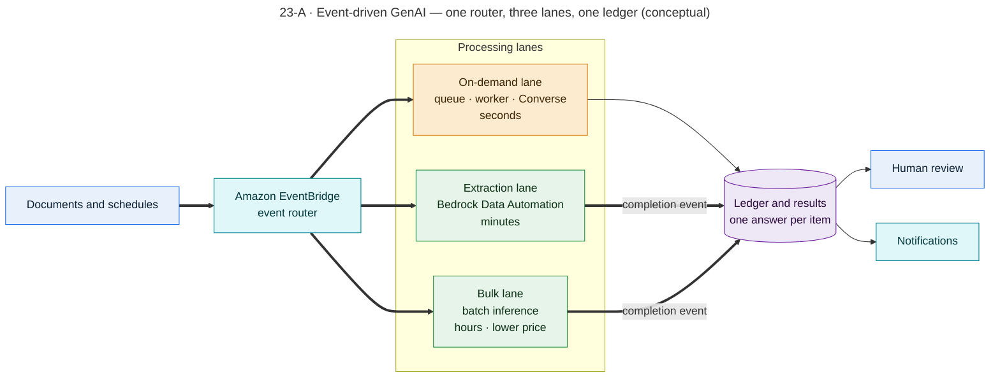
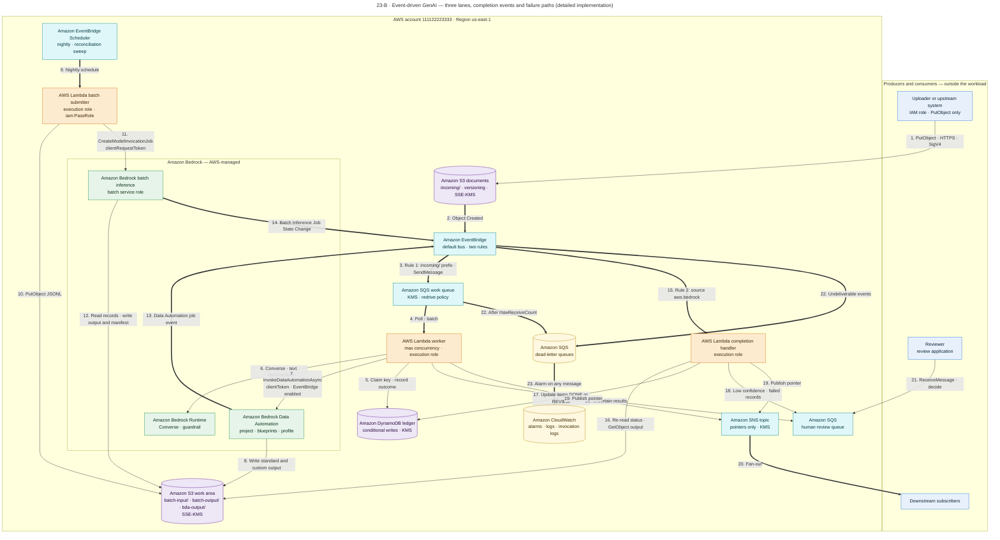
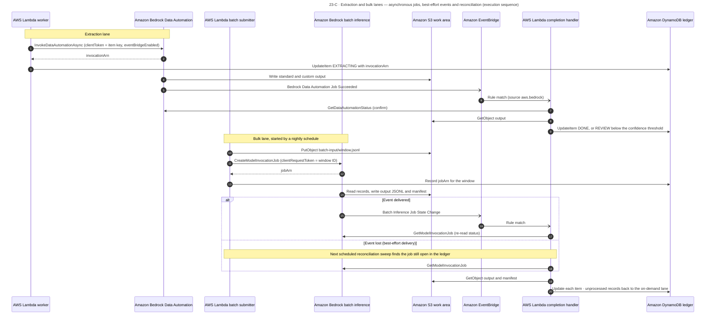

# Diagram 23 — Event-driven GenAI architecture

> **Verified:** 2026-11-15 · **Type:** academy design, not an official AWS reference architecture · **Related chapters:** [Pattern: event-driven generative AI](../../03-architecture-patterns/event-driven/README.md) · [EventBridge, SQS and SNS with Bedrock](../../02-related-aws-services/messaging/01-eventbridge-sqs-sns.md) · [AWS Step Functions with Bedrock](../../02-related-aws-services/messaging/02-step-functions.md) · [Batch inference](../../01-amazon-bedrock/inference/08-batch-inference.md) · [Amazon Bedrock Data Automation](../../01-amazon-bedrock/data-automation/01-bedrock-data-automation.md)

This set documents an event-driven document-processing system on Amazon Bedrock with three lanes: an **on-demand lane** (queue, worker, `Converse`) for answers within seconds, an **extraction lane** (Amazon Bedrock Data Automation) for scanned forms and media, and a **bulk lane** (batch inference) for work that can wait hours at a lower price. It answers the question "how do work items reach the right Bedrock engine, how do asynchronous jobs report back, and where does each failure end up?" The [pattern chapter](../../03-architecture-patterns/event-driven/README.md) zooms into the on-demand lane, its idempotency ledger and its validated code; this set shows all three lanes and their completion paths. The diagrams use no AWS logos and describe customer-visible behaviour only.

## A. Conceptual view

**What this shows** — Events decide which lane a work item takes; nothing calls a model directly from a producer. The on-demand lane answers synchronously inside a worker. The other two lanes start a job and learn about its end from an EventBridge event. All three record their outcome in one ledger, which drives review and notification. Thick arrows are asynchronous events.

## B. Detailed implementation view

**Legend** — solid arrow: request or write · dashed arrow: response (none drawn; every response returns on the same connection) · thick arrow: asynchronous event · cylinder: data at rest (yellow for failure and telemetry stores) · teal: entry points and messaging · orange: your compute · green: Amazon Bedrock · blue: people and systems outside the workload · nested boxes: account and AWS-managed boundaries. Security controls are labelled on the nodes; private networking is a [variation](#variations).

**What this shows** — One bus, two rules. Rule 1 turns new documents into queued work for the worker, which either answers with `Converse` or hands scanned and media files to Data Automation. A schedule, not an event, drives the bulk lane: the submitter collects deferrable items into JSONL and starts a batch job. Both asynchronous engines report back through rule 2 to one completion handler, which re-reads status before trusting the event. Every lane ends in the same ledger, review queue and topic.

**Walkthrough**

1. An uploader writes a document under `incoming/`.
2. S3 publishes `Object Created` to the default bus.
3. Rule 1 matches the prefix and sends the event to the work queue.
4. The worker polls with bounded concurrency.
5. It claims an idempotency key (and later records the outcome).
6. Text that needs judgement goes to `Converse`, with a guardrail.
7. Scanned forms, images, audio and video go to Data Automation with `clientToken` set to the key and EventBridge notifications enabled.
8. Data Automation writes its output to the work area.
9. Once a night, Scheduler invokes the batch submitter (and, separately, a reconciliation sweep).
10. The submitter writes the deferrable items as JSONL records.
11. It starts a batch job with `clientRequestToken` set to the batch window, so a retried submit does not start a second job.
12. Bedrock reads the records with the batch service role and writes output plus `manifest.json.out`.
13. Data Automation emits job events (created, succeeded, failed with client or service error).
14. Batch inference emits `Batch Inference Job State Change`.
15. Rule 2 (`source` `aws.bedrock`) invokes the completion handler.
16. The handler re-reads the job status and fetches the output.
17. It updates each item in the ledger.
18. Uncertain results — from the worker or the handler — go to the review queue.
19. Accepted results are announced as pointers.
20. Subscribers receive them.
21. Reviewers decide queued items.
22. Messages that keep failing, and events EventBridge cannot deliver, land in dead-letter queues.
23. Any message in a dead-letter queue raises an alarm.

### Component roles

| Component | Role in this architecture | Security control |
|:--|:--|:--|
| Amazon S3 documents bucket | Landing zone; versioned so every version is distinct work | Bucket policy, SSE-KMS, Block Public Access |
| Amazon EventBridge (default bus) | Routes S3 events to the queue and Bedrock job events to the handler | Event patterns; queue policies with `aws:SourceArn`; rule dead-letter queues |
| Amazon SQS work queue | Buffers bursts; retries | KMS (key policy allows `events.amazonaws.com`); redrive policy |
| AWS Lambda worker | On-demand lane; routes to Data Automation | Maximum concurrency; role limited to named models, project and profile |
| Amazon EventBridge Scheduler | Starts the bulk lane and the reconciliation sweep | Scheduler execution role |
| AWS Lambda batch submitter | Builds JSONL, starts batch jobs | `iam:PassRole` only for the batch service role |
| Amazon Bedrock Runtime | Synchronous inference | Guardrail; IAM on model ARNs |
| Amazon Bedrock Data Automation | Extraction with confidence scores | Profile ARNs in IAM; customer managed key optional |
| Amazon Bedrock batch inference | Bulk inference at batch prices | Batch service role scoped to the work-area prefixes |
| AWS Lambda completion handler | Trusts no event blindly: re-reads status, then updates the ledger | Read-only Bedrock permissions plus the ledger |
| Amazon DynamoDB ledger | Idempotency keys, job ARNs, outcomes | Conditional writes; KMS; point-in-time recovery |
| Amazon S3 work area | JSONL in and out, Data Automation output, results | SSE-KMS; lifecycle expiry |
| Human review queue, Amazon SNS | People decide; systems are told | Separate reviewer role; topic policy; pointers only |
| Dead-letter queues, Amazon CloudWatch | Visible failure | Alarms; retention longer than the source queues |

### Connections

| # | From → To | Protocol / operation | Direction of data | Auth |
|--:|:--|:--|:--|:--|
| 1 | Uploader → S3 | HTTPS · `PutObject` | Document in | Uploader's IAM role |
| 2 | S3 → EventBridge | S3 event notification to EventBridge | Metadata: bucket, key, ETag, version | Enabled on the bucket |
| 3 | EventBridge → SQS | Rule target · `SendMessage` | Event in | Queue policy, `aws:SourceArn` = rule ARN |
| 4 | SQS → worker | Lambda event source mapping | Batch of events | Execution role (`sqs:ReceiveMessage`, `sqs:DeleteMessage`) |
| 5, 17 | Worker, handler → DynamoDB | `PutItem` (conditional), `UpdateItem` | Keys and outcomes | Execution roles |
| 6 | Worker → Bedrock Runtime | HTTPS · `Converse` | Prompt out, completion back | SigV4, execution role |
| 7 | Worker → Data Automation | HTTPS · `InvokeDataAutomationAsync` | S3 URIs out, `invocationArn` back | SigV4; project, blueprint and profile ARNs |
| 8 | Data Automation → S3 | Service writes output | Extracted JSON | The caller's S3 permissions, per the academy's reading in the [Data Automation chapter](../../01-amazon-bedrock/data-automation/01-bedrock-data-automation.md#6-request-and-response-lifecycle) — Data Automation has no service role field |
| 9 | Scheduler → submitter | Schedule target | Window ID | Scheduler execution role |
| 10 | Submitter → S3 | `PutObject` | JSONL records | Execution role |
| 11 | Submitter → batch inference | HTTPS · `CreateModelInvocationJob` | Job parameters out, `jobArn` back | SigV4; `iam:PassRole` |
| 12 | Batch inference ↔ S3 | Service reads and writes | Records in, output and manifest out | Batch service role |
| 13–14 | Bedrock → EventBridge | Service events, `source` `aws.bedrock`, best effort | Job ID, status, locations — no content | None to configure |
| 15 | EventBridge → handler | Rule target · Lambda invoke | Event in | Lambda resource policy or target role |
| 16 | Handler → Bedrock, S3 | `GetModelInvocationJob`, `GetDataAutomationStatus`, `GetObject` | Status and output in | Execution role |
| 18–19 | Worker, handler → SQS, SNS | `SendMessage`, `Publish` | Pointers out | Queue and topic policies |
| 20–21 | SNS → subscribers; reviewer → SQS | Subscriptions; `ReceiveMessage` | Pointers | Subscriber and reviewer roles |
| 22 | SQS, EventBridge → dead-letter queues | Redrive; rule DLQ | Failed messages and events | Queue policies |
| 23 | Dead-letter queues → CloudWatch | `ApproximateNumberOfMessagesVisible` alarm | Metric | — |

## C. Sequence view

The on-demand lane is sequenced in the [pattern chapter](../../03-architecture-patterns/event-driven/README.md#c-sequence-view). This view follows the two asynchronous lanes, including an event that never arrives.

**Steps and failure paths**

- **1–3.** `InvokeDataAutomationAsync` returns an `invocationArn` at once; the item's state moves to `EXTRACTING`. `clientToken` is marked as the operation's idempotency token in the AWS SDK model, so use the item key for it.
- **4–9.** The event is a trigger, not the record of truth: the handler confirms status before acting. A `ClientError` status means the file or request is wrong (route to review); a `ServiceError` can be retried ([Data Automation chapter](../../01-amazon-bedrock/data-automation/01-bedrock-data-automation.md)).
- **10–15.** Batch jobs validate, wait for capacity and run; on-demand traffic has priority and completion is not guaranteed. For `clientRequestToken` the SDK model states: "If this token matches a previous request, Amazon Bedrock ignores the request, but does not return an error" — so a retried submit does not create a second job.
- **16–19.** Bedrock emits its events on a best-effort basis, so the design has two paths to the same status call. The sweep and the event can both fire; ledger updates are conditional, so the second one changes nothing.
- **20–21.** A `PartiallyCompleted` or `Expired` job leaves records without output; they go back to the on-demand lane or into the next window. Records with an `error` object go to review.

## Variations

| Variation | What changes in the diagram |
|:--|:--|
| **Private networking** | The worker, submitter and handler move into private subnets; interface endpoints for `bedrock-runtime`, `bedrock`, `bedrock-data-automation-runtime`, SQS and SNS; gateway endpoints for S3 and DynamoDB. See [Private connectivity for Bedrock](../../02-related-aws-services/networking/01-private-connectivity-for-bedrock.md) |
| **AWS Step Functions instead of Lambda workers** | Edge 4 starts a workflow; claim, call, validate and store become states with declarative retries; review becomes a `.waitForTaskToken` task (Standard workflows only). See [AWS Step Functions with Bedrock](../../02-related-aws-services/messaging/02-step-functions.md) |
| **Backfill with a Distributed Map** | Replaces the bulk lane when you need a deadline or per-item logic; pays on-demand prices and shares the on-demand quota |
| **Batch job orchestrated by Step Functions** | The submitter is a Standard workflow that waits on a task token released by the `Batch Inference Job State Change` event |
| **Flex service tier** instead of the bulk lane | The worker calls `Converse` with `serviceTier`; see [Service tiers](../../01-amazon-bedrock/inference/06-service-tiers.md) for model support |
| **Knowledge base as the destination** | Rule 1 starts ingestion instead of inference; see [Ingestion, parsing and chunking](../../01-amazon-bedrock/knowledge-bases/04-ingestion-parsing-chunking.md). Ingestion jobs have no EventBridge event; poll or use application logs |
| **Agent per item** | Items needing tools run an AgentCore harness inside a workflow; see [Pattern: agentic AI](../../03-architecture-patterns/agentic-ai/README.md) |
| **FIFO ordering** | Work queue becomes FIFO with a message group per entity; worker concurrency ≤ number of groups; EventBridge rule DLQs must stay standard queues |
| **Multi-Region data residency** | Data Automation and cross-Region inference profiles can process in other Regions of the geography; see [Cross-Region considerations](../../09-advanced-topics/11-cross-region-and-data-residency.md) |

## Practical example

- [Pattern: event-driven generative AI — Example](../../03-architecture-patterns/event-driven/README.md#example) — validated Terraform for the on-demand lane (EventBridge rule, queues and policies, event source mapping, ledger, topic, alarms) and a mock-tested Python worker, plus how to assemble the rest from Projects B and C and the module catalog.
- [Batch inference](../../01-amazon-bedrock/inference/08-batch-inference.md#13-working-example) — a validated batch job and its service role (bulk lane, edges 10–12).
- [Amazon Bedrock Data Automation](../../01-amazon-bedrock/data-automation/01-bedrock-data-automation.md#13-working-example) — a validated project and blueprint (extraction lane, edges 7–8).
- [EventBridge, SQS and SNS with Bedrock](../../02-related-aws-services/messaging/01-eventbridge-sqs-sns.md#example) — rules for Bedrock job events (edges 13–15).

## References

- [Using EventBridge (Amazon S3)](https://docs.aws.amazon.com/AmazonS3/latest/userguide/EventBridge.html) and [EventBridge event message structure](https://docs.aws.amazon.com/AmazonS3/latest/userguide/ev-events.html) — edge 2 and the event fields.
- [Using resource-based policies for Amazon EventBridge](https://docs.aws.amazon.com/eventbridge/latest/userguide/eb-use-resource-based.html) and [Using dead-letter queues in EventBridge](https://docs.aws.amazon.com/eventbridge/latest/userguide/eb-rule-dlq.html) — edges 3 and 22; rule DLQs are standard queues only.
- [Amazon SQS key management](https://docs.aws.amazon.com/AWSSimpleQueueService/latest/SQSDeveloperGuide/sqs-key-management.html) — the key-policy statement for `events.amazonaws.com`.
- [Using dead-letter queues in Amazon SQS](https://docs.aws.amazon.com/AWSSimpleQueueService/latest/SQSDeveloperGuide/sqs-dead-letter-queues.html) — redrive and retention.
- [Configuring scaling behavior for SQS event source mappings](https://docs.aws.amazon.com/lambda/latest/dg/services-sqs-scaling.html) and [Creating and configuring an SQS event source mapping](https://docs.aws.amazon.com/lambda/latest/dg/services-sqs-configure.html) — edge 4: maximum concurrency, FIFO limits, visibility timeout.
- [Monitor bedrock-runtime inference using CloudWatch metrics](https://docs.aws.amazon.com/bedrock/latest/userguide/monitoring-runtime-metrics.html) — edge 6: throttling reserves input tokens plus `max_tokens`.
- [Using the Bedrock Data Automation API](https://docs.aws.amazon.com/bedrock/latest/userguide/bda-using-api.html) — edge 7: `clientToken`, `notificationConfiguration`, output location.
- [Process multiple prompts with batch inference](https://docs.aws.amazon.com/bedrock/latest/userguide/batch-inference.html) and [Capacity and Performance](https://docs.aws.amazon.com/bedrock/latest/userguide/capacity-limits-cost-optimization.html) — edges 10–12: restrictions, priority of on-demand traffic, best-effort completion, timeout.
- [Amazon Bedrock events (EventBridge reference)](https://docs.aws.amazon.com/eventbridge/latest/ref/events-ref-bedrock.html) and [Monitor job state changes using EventBridge](https://docs.aws.amazon.com/bedrock/latest/userguide/monitoring-eventbridge.html) — edges 13–15: the six service events, best-effort delivery, no charge to receive them.
- [Discover service integration patterns in Step Functions](https://docs.aws.amazon.com/step-functions/latest/dg/connect-to-resource.html) — the Step Functions variations: task tokens, Standard versus Express.
- [Guidance for Accelerated Intelligent Document Processing on AWS](https://docs.aws.amazon.com/solutions/accelerated-intelligent-document-processing-on-aws/) — AWS's own guidance for a related design.
- [Generated API reference](../../references/bedrock-api-operations.md) — operation names and the `clientToken` / `clientRequestToken` fields.
