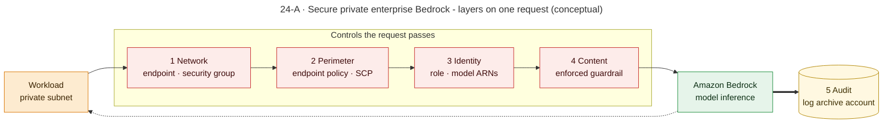
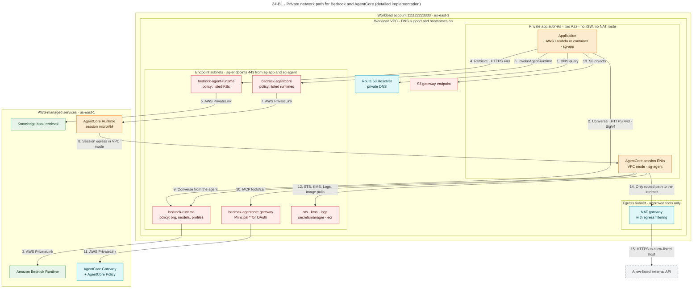
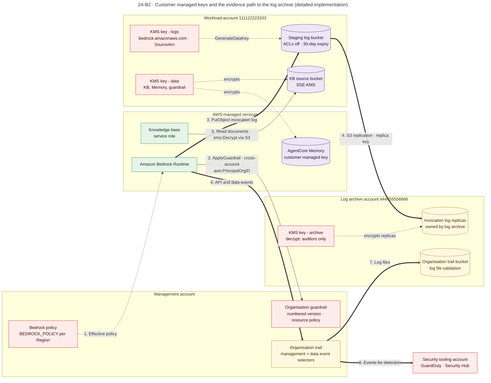
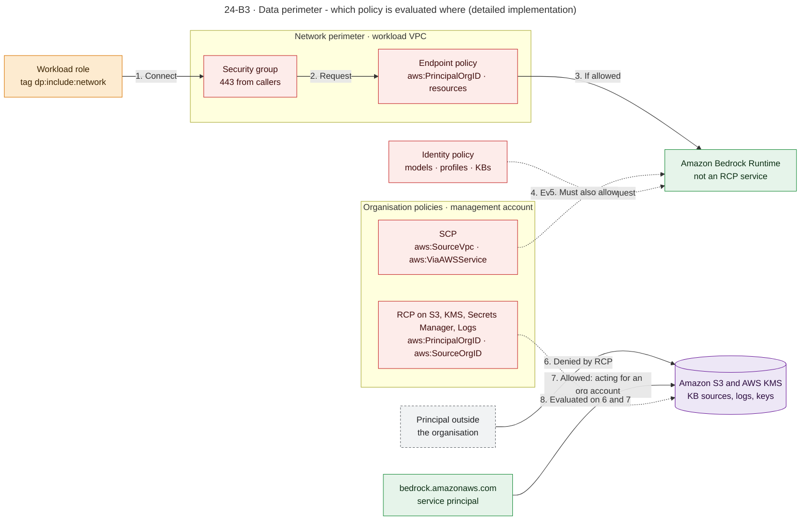
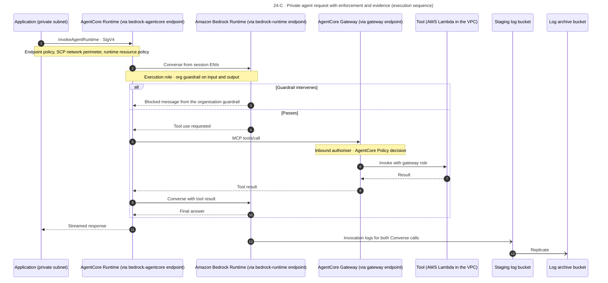

# Diagram 24 — Secure private enterprise Bedrock architecture

> **Verified:** 2026-11-15 · **Type:** academy design, not an official AWS reference architecture · **Related chapters:** [Pattern: secure private enterprise Bedrock](../../03-architecture-patterns/private-enterprise/README.md) · [Private connectivity for Bedrock](../../02-related-aws-services/networking/01-private-connectivity-for-bedrock.md) · [VPC endpoints and AWS PrivateLink](../../00-foundations/networking/03-vpc-endpoints-and-privatelink.md) · [AWS CloudTrail for Bedrock](../../02-related-aws-services/security/05-cloudtrail-for-bedrock.md) · [Automated Reasoning checks and guardrail enforcement](../../01-amazon-bedrock/guardrails/02-automated-reasoning-and-enforcement.md)

This set documents a Bedrock and AgentCore workload that has no internet route, reaches every service through interface endpoints, encrypts with customer managed keys, keeps its evidence in a separate log archive account and sits inside an organisation data perimeter. It answers the question "for each request, which network path does it take, which policies are evaluated where, and where does the evidence end up?" — and it marks the paths that cannot be made private. The diagrams are the academy's own and use no AWS logos.

## A. Conceptual view

The five layers a request crosses, after [ADR-015](../../ARCHITECTURE-DECISIONS.md#adr-015-security-controls-are-layered-and-none-is-trusted-alone).

**What this shows** — A private design is not one control. The network layer decides how the request travels, the perimeter decides whether it may travel at all, identity decides what it may touch, the guardrail decides what content may pass, and audit records what happened in an account the workload cannot alter. Each layer still lets something through on its own; together they cover each other's gaps.

## B. Detailed implementation view

Three views, split to stay readable: **B1** the network path, **B2** keys and evidence, **B3** where each perimeter policy is evaluated.

### B1. Network path for inference, retrieval and agents

**Legend** — solid arrow: request (responses return on the same connection and are omitted) · red: enforcement point · grey dashed: outside AWS · nested boxes: account, VPC and subnet boundaries.

**What this shows** — Every call the workload or its agent makes goes through an endpoint in the endpoint subnets. The application subnets have no route to the internet; the only internet path belongs to one egress subnet and only the agent's VPC-mode ENIs route to it, for tools that cannot be private. AgentCore Runtime runs its session inside AWS but sends its outbound traffic through ENIs in your subnets, which is why it needs the same endpoints as your own code.

### B2. Keys, logs and evidence

**Legend** — solid: request · dashed: policy or key applied · thick: asynchronous delivery · cylinder: data at rest · red: security control.

**What this shows** — Content evidence (invocation logs) and API evidence (CloudTrail) take different routes to the same log archive account. Bedrock can only write invocation logs inside the workload account, so replication carries them out; CloudTrail's organisation trail delivers directly. Keys are split by purpose so that each key policy names one service and one job, and the archive key can decrypt for auditors only.

### B3. Where each perimeter policy is evaluated

**Legend** — solid: request · dashed: policy evaluated on the request · red: policy · grey dashed: outside the organisation.

**What this shows** — The IAM data-perimeter model in one picture: endpoint policies protect the **network** side (who and what may pass through your endpoints), SCPs protect the **identity** side (your roles may only call from your networks), RCPs protect **resources** against outside principals. Amazon Bedrock is not on the RCP service list, so the resource-side protection applies to the S3 buckets and KMS keys around it, not to model invocation itself ([RCPs](https://docs.aws.amazon.com/organizations/latest/userguide/orgs_manage_policies_rcps.html), [data perimeters](https://docs.aws.amazon.com/IAM/latest/UserGuide/access_policies_data-perimeters.html)).

### Component roles

| Component | Role in this architecture | Security control |
|:--|:--|:--|
| Application (Lambda or container) | Calls Bedrock, knowledge bases and agents | Execution role with model and profile ARNs; principal tag for the perimeter |
| AgentCore session ENIs | Outbound traffic of a VPC-mode agent session | Security group `sg-agent`; routes |
| Route 53 Resolver | Resolves standard service hostnames to endpoint addresses | Private DNS on each endpoint; `api.aws` names for mantle and Agent Registry need their own endpoints |
| Interface endpoints (Bedrock, AgentCore, supporting services) | Private path into each service | Endpoint policy; security group |
| S3 gateway endpoint | Private path to Amazon S3 | Endpoint policy |
| Egress subnet with NAT gateway | The only internet path, for tools that need it | Route tables; egress filtering; separate subnet |
| Bedrock policy and organisation guardrail | Guardrail applied to every inference call | Numbered version; resource policy with `aws:PrincipalOrgID` |
| KMS keys (logs, data, archive) | Encryption at rest under keys you control | Key policies with `aws:SourceAccount`, `aws:SourceArn`; split by purpose |
| Staging log bucket | Where Bedrock must deliver invocation logs | Bucket policy for the service principal; ACLs disabled; short lifecycle |
| Log archive account | Authoritative invocation logs and trails | Separate account; replicas owned by it; auditor-only decrypt |
| SCP and RCP | Organisation-wide perimeter | Tested in a policy staging OU first |
| Security tooling account | Detection on top of the evidence | GuardDuty, Security Hub AI Security Best Practices controls |

### Connections

**B1 — network path**

| # | From → To | Protocol / operation | Direction of data | Auth |
|--:|:--|:--|:--|:--|
| 1 | Application → Resolver | DNS | Hostname out, private IPs back | — |
| 2–3 | Application → `bedrock-runtime` endpoint → Bedrock Runtime | HTTPS 443 · `Converse` | Prompt out, completion back | SigV4; endpoint policy; SCP |
| 4–5 | Application → `bedrock-agent-runtime` endpoint → retrieval | HTTPS 443 · `Retrieve` or `AgenticRetrieveStream` | Query out, chunks back | SigV4; endpoint policy lists KBs |
| 6–7 | Application → `bedrock-agentcore` endpoint → Runtime | HTTPS 443 · `InvokeAgentRuntime` | Payload out, stream back | SigV4 or OAuth (`Principal: "*"`) |
| 8 | Runtime session → session ENIs | VPC-mode egress | All outbound traffic of the session | Runtime execution role |
| 9 | Session → `bedrock-runtime` endpoint | HTTPS 443 · `Converse` | Prompt out, completion back | Execution role |
| 10–11 | Session → gateway endpoint → AgentCore Gateway | HTTPS 443 · MCP `tools/call` | Tool arguments out, result back | SigV4 or bearer token; AgentCore Policy |
| 12 | Session → supporting endpoints | HTTPS 443 | Credentials, keys, logs, image layers | Execution role |
| 13 | Application → S3 gateway endpoint | HTTPS | Objects | Role; bucket policy; RCP |
| 14–15 | Session ENIs → NAT gateway → external API | HTTPS | Tool call out, result back | Outbound credential from AgentCore Identity |

**B2 — keys and evidence**

| # | From → To | Protocol / operation | Direction of data | Auth |
|--:|:--|:--|:--|:--|
| 1 | Bedrock policy → Bedrock Runtime | Effective policy per account and Region | Configuration | Organizations |
| 2 | Bedrock Runtime → organisation guardrail | `ApplyGuardrail` (internal, cross-account) | Content assessed | Guardrail and profile resource policies; caller needs `bedrock:ApplyGuardrail` |
| 3 | Bedrock Runtime → staging bucket | `PutObject` | Log objects in | `bedrock.amazonaws.com`, `aws:SourceAccount`, `aws:SourceArn` |
| 4 | Staging bucket → log archive | S3 replication | Log objects across accounts, one way | Replication role; destination bucket and key policies |
| 5 | Knowledge base → source bucket | `GetObject` with SSE-KMS | Documents into the knowledge base | KB service role; `kms:ViaService` S3 |
| 6–7 | Bedrock → CloudTrail → trail bucket | Event delivery | API and data events | Organisation trail |
| 8 | CloudTrail → security tooling | Event analysis | Findings | Delegated administrator |

## C. Sequence view

An agent request in VPC mode, with the evidence it leaves behind.

**Steps and failure paths**

- **1.** Three policies can deny before the agent starts: the endpoint policy (an OAuth caller needs a `Principal: "*"` statement), the SCP network perimeter and, for cross-account callers, the runtime and endpoint resource policies.
- **2.** The session's outbound call uses the `bedrock-runtime` endpoint from its ENIs. Without that endpoint and without NAT, it times out — the most common VPC-mode failure.
- **3.** A guardrail block ends the turn with the organisation's message; it is recorded as a guardrail data event.
- **4–10.** The tool loop. If AgentCore Policy forbids the call at step 5 in enforce mode, step 6 never happens and the agent receives a denial it can report.
- **11.** The answer streams back over the connection opened in step 1.
- **12–13.** Logging is asynchronous. Every model call in the loop produces its own invocation log; replication failure is silent unless you alarm on it.

## Variations

| Variation | What changes in the diagrams |
|:--|:--|
| Endpoints centralised in a shared network account | B1's endpoint subnets move to a hub VPC reached over AWS Transit Gateway; private hosted zones are shared; the SCP's `aws:SourceVpc` lists the hub VPC (**our reading** of the key's definition) |
| No agents | Drop `acEni`, `epAc`, `epGw`, the egress subnet and edges 6–15 in B1 |
| No tool needs the internet | Delete the egress subnet: B1 has no internet path at all |
| On-premises callers | Add Route 53 Resolver inbound endpoints and Direct Connect or VPN in front of B1 |
| CloudWatch Logs as invocation-log destination | B2 edge 3 goes to a log group; centralise with CloudWatch cross-account features instead of S3 replication |
| Geo cross-Region profile | B1 edge 3 continues to another Region of the geography on the AWS network; CloudTrail still records in the source Region with `inferenceRegion` |
| Global profile | Denied by the organisation SCP in this design |
| Customer-managed knowledge base with a vector store | Add the vector store and its access path (for example an OpenSearch Serverless network policy) to B1 and its key to B2 |
| `bedrock-mantle` features required | Add a `bedrock-mantle` endpoint and accept that invocation logging and guardrails do not cover those calls; outside this design |
| FIPS | Use the `bedrock-fips` and `bedrock-runtime-fips` endpoint services where offered |

## Practical example

- [Project E: secure private enterprise GenAI](../../05-practical-projects/project-05-private-genai/README.md) (planned) implements this set; start with its README, then the network, endpoints and logging roots.
- The validated Terraform for B2's logging path and the SCP and RCP for B3 are in [Pattern: secure private enterprise Bedrock](../../03-architecture-patterns/private-enterprise/README.md#example).
- The endpoint and security-group Terraform for B1 is in [Private connectivity for Bedrock](../../02-related-aws-services/networking/01-private-connectivity-for-bedrock.md#example); the organisation guardrail Terraform is in [guardrail enforcement](../../01-amazon-bedrock/guardrails/02-automated-reasoning-and-enforcement.md).
- Planned modules: [`bedrock-private-endpoints`](../../04-infrastructure-as-code/terraform/modules/bedrock-private-endpoints/README.md) and [`bedrock-invocation-logging`](../../04-infrastructure-as-code/terraform/modules/bedrock-invocation-logging/README.md).
- Zoom out with [diagram set 25](25-multi-account-aws.md) (the accounts around this one) and [diagram set 30](30-enterprise-end-to-end-genai-reference.md) (the full enterprise reference).

## References

- [Use interface VPC endpoints with Amazon Bedrock](https://docs.aws.amazon.com/bedrock/latest/userguide/vpc-interface-endpoints.html) — the five Bedrock endpoint services, FIPS variants, private DNS names, endpoint policies (B1 edges 2–5).
- [Use interface VPC endpoints with AgentCore](https://docs.aws.amazon.com/bedrock-agentcore/latest/devguide/vpc-interface-endpoints.html) — the three AgentCore endpoints and the OAuth `Principal: "*"` rule (B1 edges 6–11).
- [Monitor model invocation using CloudWatch Logs and Amazon S3](https://docs.aws.amazon.com/bedrock/latest/userguide/model-invocation-logging.html) — same-account destinations, runtime-only coverage, bucket and key policies (B2 edge 3).
- [Configuring replication for buckets in different accounts](https://docs.aws.amazon.com/AmazonS3/latest/userguide/replication-walkthrough-2.html) — cross-account replication with SSE-KMS and replica ownership (B2 edge 4).
- [Guardrails enforcements](https://docs.aws.amazon.com/bedrock/latest/userguide/guardrails-enforcements.html) and [Amazon Bedrock policies](https://docs.aws.amazon.com/organizations/latest/userguide/orgs_manage_policies_bedrock.html) — organisation guardrail (B2 edges 1–2).
- [Establish permissions guardrails using data perimeters](https://docs.aws.amazon.com/IAM/latest/UserGuide/access_policies_data-perimeters.html) — perimeter objectives and condition keys (B3).
- [Resource control policies](https://docs.aws.amazon.com/organizations/latest/userguide/orgs_manage_policies_rcps.html) — RCP service list, which excludes Amazon Bedrock (B3).
- [Resource-based policies for AgentCore](https://docs.aws.amazon.com/bedrock-agentcore/latest/devguide/resource-based-policies.html) — runtime and gateway resource policies, `aws:SourceVpc` conditions for OAuth callers (C step 1).
- [Cross-Region inference](https://docs.aws.amazon.com/bedrock/latest/userguide/cross-region-inference.html) — AWS-network routing and source-Region CloudTrail records (Variations).
- [AWS SRA for AI](https://docs.aws.amazon.com/prescriptive-guidance/latest/security-reference-architecture-generative-ai/gen-ai-sra.html) — AWS's own guidance on securing generative AI in a multi-account environment.
