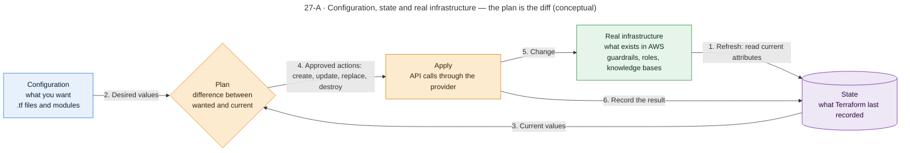
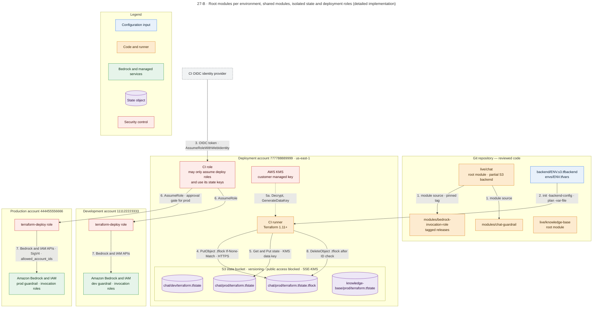
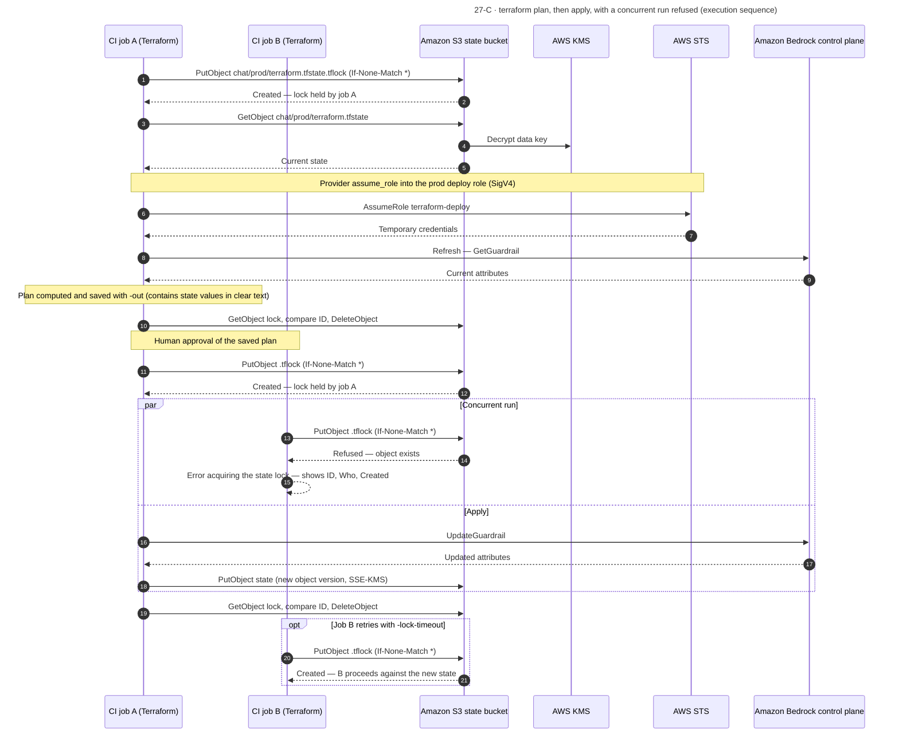

# Diagram 27 — Terraform state and module architecture

> **Verified:** 2026-11-15 · **Type:** academy design, not an official AWS reference architecture · **Related chapters:** [Providers, resources and data sources](../../04-infrastructure-as-code/terraform/01-providers-resources-data-sources.md) · [Modules](../../04-infrastructure-as-code/terraform/03-modules.md) · [State, remote backends and state locking](../../04-infrastructure-as-code/terraform/04-state-backends-locking.md) · [Workspaces and environment strategies](../../04-infrastructure-as-code/terraform/05-environments-and-workspaces.md)

This set documents how the academy organises Terraform for a Bedrock platform: shared modules composed by small root modules, one S3 state object per component and environment with S3 native locking, and a pipeline that reaches each environment account through its own deployment role. It answers "where does Terraform keep its memory, who can change it, and what stops two runs or two environments from colliding?"

> [!NOTE]
> **Documented fact** — The S3 backend stores state at the configured `key` and, with `use_lockfile = true`, locks it with a `<key>.tflock` object; DynamoDB-based locking is deprecated. HashiCorp highly recommends bucket versioning. With `kms_key_id`, state and lock objects are encrypted with that key.
> Source: [S3 backend](https://developer.hashicorp.com/terraform/language/backend/s3)

## A. Conceptual view

**What this shows** — Terraform keeps three views of the world. Before planning it refreshes state from the real objects, then compares that with the configuration; the plan is the list of actions that would make reality match the code. Apply performs them and writes the outcome back to state. Drift is a difference between real infrastructure and state that the refresh reveals ([`terraform plan`](https://developer.hashicorp.com/terraform/cli/commands/plan), [State](https://developer.hashicorp.com/terraform/language/state)).

## B. Detailed implementation view

**Legend** — solid arrow: request or write · dashed arrow: key material returned · cylinder: S3 object · nested boxes: accounts, the repository and the bucket · dashed grey: outside your AWS accounts. Account IDs are documentation placeholders. The `chat/dev` lock and the `knowledge-base` runs follow the same pattern and are not drawn.

### Component roles

| Component | Role in this architecture | Security control |
|:--|:--|:--|
| `modules/*` | Reusable building blocks with no provider blocks, tested with mock providers | Code review; secure defaults; versions pinned by Git tag |
| Root modules (`live/chat`, `live/knowledge-base`) | One per component; compose modules; own the provider and the partial backend | `allowed_account_ids`; validation tying role ARN to account |
| `backend/ENV.s3.tfbackend`, `envs/ENV.tfvars` | Per-environment state location and inputs | No credentials in either file |
| CI OIDC identity provider | Issues short-lived tokens to pipeline jobs | Trust policy conditions on repository and branch ([ADR-014](../../ARCHITECTURE-DECISIONS.md#adr-014-pipelines-use-oidc-and-pin-actions-by-commit-sha)) |
| CI role | Reads and writes state keys; assumes deploy roles | Least privilege per the S3 backend permission list |
| AWS KMS key | Encrypts state and lock objects | Key policy limits use to the CI role and break-glass roles |
| S3 state bucket | One object per component and environment, plus transient `.tflock` objects | Versioning, Block Public Access, SSE-KMS |
| `terraform-deploy` role per account | Creates guardrails, roles and other resources in one account | Trust only the CI role; production behind an approval |
| Amazon Bedrock and IAM | The managed objects | Guardrail enforcement through the invocation-role module |

### Connections

| # | From → To | Protocol / operation | Direction of data | Auth |
|--:|:--|:--|:--|:--|
| 1 | Root module → modules | `terraform init` resolves `source` (local path or Git tag) | Code in | Git credentials |
| 2 | Environment files → runner | `init -reconfigure -backend-config=…`, `plan -var-file=…` | Configuration in | — |
| 3 | OIDC provider → CI role | `AssumeRoleWithWebIdentity` | Short-lived credentials | OIDC token, trust policy |
| 4 | Runner → lock object | `PutObject` with `If-None-Match: *` | Lock info JSON out | SigV4, CI role |
| 5 | Runner ↔ state object | `GetObject`, `PutObject` (new version) | State in and out | SigV4, CI role; KMS key policy |
| 6 | CI role → deploy role | `AssumeRole` | Credentials for one account | Deploy role trust policy |
| 7 | Deploy role → Bedrock, IAM | e.g. `CreateGuardrail`, `CreateGuardrailVersion`, IAM role APIs | Resource attributes back | SigV4; provider refuses other accounts |
| 8 | Runner → lock object | `GetObject`, compare ID, `DeleteObject` | Lock removed | SigV4, CI role |

The lock mechanics in rows 4 and 8 come from the Terraform 1.17.2 source ([S3 backend client](https://raw.githubusercontent.com/hashicorp/terraform/v1.17.2/internal/backend/remote-state/s3/client.go)); the permissions from the [S3 backend](https://developer.hashicorp.com/terraform/language/backend/s3) page.

## C. Sequence view

**Steps** — 1–2: job A takes the lock with a conditional write (`plan` holds a lock unless `-lock=false`). 3–5: it reads the state; S3 decrypts it with the KMS key. 6–7: the provider assumes the deployment role. 8–9: refresh reads the real guardrail; the plan is then saved with `-out` — plan files hold sensitive values in clear text ([`terraform plan`](https://developer.hashicorp.com/terraform/cli/commands/plan)). 10: the lock is released after planning. 11–12: after approval, apply takes the lock again. 13–15: job B's conditional write is refused and Terraform stops with "Error acquiring the state lock", printing the holder's lock information. 16–18: job A applies and writes a new state version. 19: job A releases the lock. 20–21: job B, retrying with `-lock-timeout`, gets the lock and plans against the new state.

**Failure paths**

- **Job A's runner dies after step 12** — The `.tflock` object stays; every later run fails at the lock. After confirming job A is gone, its owner runs `terraform force-unlock <LOCK_ID>` ([`force-unlock`](https://developer.hashicorp.com/terraform/cli/commands/force-unlock)).
- **Access denied at step 1 but not at step 3** — The role lacks permissions on the `.tflock` object.
- **Saved plan applied after another run changed state** — Terraform stops with "Saved plan is stale" because the state serial changed ([local backend source, v1.17.2](https://raw.githubusercontent.com/hashicorp/terraform/v1.17.2/internal/backend/local/backend_apply.go)); plan again. Since 1.15 a plan made in one workspace cannot be applied in another ([1.15 changelog](https://raw.githubusercontent.com/hashicorp/terraform/v1.15/CHANGELOG.md)).
- **`-lock=false`** — Skips steps 1–2, 10, 11–12 and 19; job B would not be refused and both could write state.

## Variations

| Variation | What changes in the diagram |
|:--|:--|
| **CLI workspaces** instead of separate keys | B: one root module and one backend; objects at `env:/dev/chat/terraform.tfstate`, `env:/prod/…` (or your `workspace_key_prefix`). One identity reaches every workspace, so the per-account deploy roles lose their meaning unless chosen per workspace — HashiCorp says workspaces are not for deployments that need separate credentials ([Workspaces](https://developer.hashicorp.com/terraform/language/state/workspaces)) |
| **HCP Terraform** workspaces | B: the deployment account's bucket and KMS key disappear; each HCP Terraform workspace holds its own state versions, locks during runs, and encrypts state at rest. Remote runs override any `backend` block ([Manage workspace state](https://developer.hashicorp.com/terraform/cloud-docs/workspaces/state)) |
| **Terraform Stacks** (HCP Terraform only) | B: root modules become `component` blocks in `.tfcomponent.hcl`; environments become `deployment` blocks in `.tfdeploy.hcl`, each with isolated state; OIDC through `identity_token` ([Stacks](https://developer.hashicorp.com/terraform/language/stacks)) |
| **DynamoDB locking (deprecated)** | B and C: a DynamoDB table with a `LockID` string partition key holds the lock item instead of the `.tflock` object; the CI role needs `dynamodb:DescribeTable`, `GetItem`, `PutItem`, `DeleteItem`. With both configured during migration, Terraform takes the S3 lock first, then the DynamoDB lock ([S3 backend](https://developer.hashicorp.com/terraform/language/backend/s3), [S3 backend client source](https://raw.githubusercontent.com/hashicorp/terraform/v1.17.2/internal/backend/remote-state/s3/client.go)) |
| State bucket in each workload account | B: no shared deployment-account bucket; the CI role needs state access in every account; the deploy role can be used for state too (the S3 backend's own `assume_role` block) |
| Provider alias per Region instead of `region` | B: the guardrail module call is repeated per Region with a `providers` map; `for_each` over Regions is not possible ([Modules](../../04-infrastructure-as-code/terraform/03-modules.md)) |

## Practical example

- Code for view B, validated and mock-tested: the chat root module with `assume_role` and per-environment files in [Workspaces and environment strategies](../../04-infrastructure-as-code/terraform/05-environments-and-workspaces.md#example), the state access policy in [State, remote backends and state locking](../../04-infrastructure-as-code/terraform/04-state-backends-locking.md#example), and the module composition in [Modules](../../04-infrastructure-as-code/terraform/03-modules.md#example).
- The reusable module used throughout: [`bedrock-invocation-role`](../../04-infrastructure-as-code/terraform/modules/bedrock-invocation-role/README.md); the catalogue and module standard: [Reusable Terraform modules](../../04-infrastructure-as-code/terraform/modules/README.md).
- Four environments with isolated state: [`maintenance/environments`](../../04-infrastructure-as-code/maintenance/environments/README.md); promotion workflow: [Environments, isolation and controlled promotion](../../04-infrastructure-as-code/maintenance/03-environments-and-promotion.md).
- The pipeline around it: [Diagram 26 — CI/CD and IaC deployment architecture](26-cicd-and-iac-deployment.md).

## References

- [S3 backend](https://developer.hashicorp.com/terraform/language/backend/s3) — state key, `use_lockfile`, `.tflock` permissions, KMS permissions, versioning, workspaces, DynamoDB deprecation, multi-account guidance.
- [State](https://developer.hashicorp.com/terraform/language/state) — what state is for and how it is refreshed.
- [State locking](https://developer.hashicorp.com/terraform/language/state/locking) and [`terraform force-unlock`](https://developer.hashicorp.com/terraform/cli/commands/force-unlock) — automatic locking and manual unlock.
- [`terraform plan`](https://developer.hashicorp.com/terraform/cli/commands/plan) — refresh, saved plans, `-lock`, `-lock-timeout`, plan file sensitivity.
- [Backend block configuration](https://developer.hashicorp.com/terraform/language/backend) — partial configuration with `-backend-config`.
- [Providers within modules](https://developer.hashicorp.com/terraform/language/modules/develop/providers) — no provider blocks in shared modules.
- [Workspaces](https://developer.hashicorp.com/terraform/language/state/workspaces) and [Manage workspaces](https://developer.hashicorp.com/terraform/cli/workspaces) — CLI workspaces and their limits.
- [Manage workspace state in HCP Terraform](https://developer.hashicorp.com/terraform/cloud-docs/workspaces/state) and [Stacks overview](https://developer.hashicorp.com/terraform/language/stacks) — the HCP Terraform variations.
- [AWS provider configuration](https://registry.terraform.io/providers/hashicorp/aws/latest/docs) — `assume_role`, `allowed_account_ids`.
- Terraform v1.17.2 source: [S3 backend client](https://raw.githubusercontent.com/hashicorp/terraform/v1.17.2/internal/backend/remote-state/s3/client.go) — conditional `PutObject`, lock ID check, double locking order.
- [How to prevent object overwrites with conditional writes](https://docs.aws.amazon.com/AmazonS3/latest/userguide/conditional-writes.html) — Amazon S3 `If-None-Match`.
