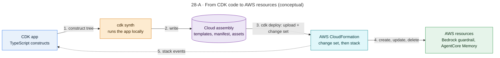
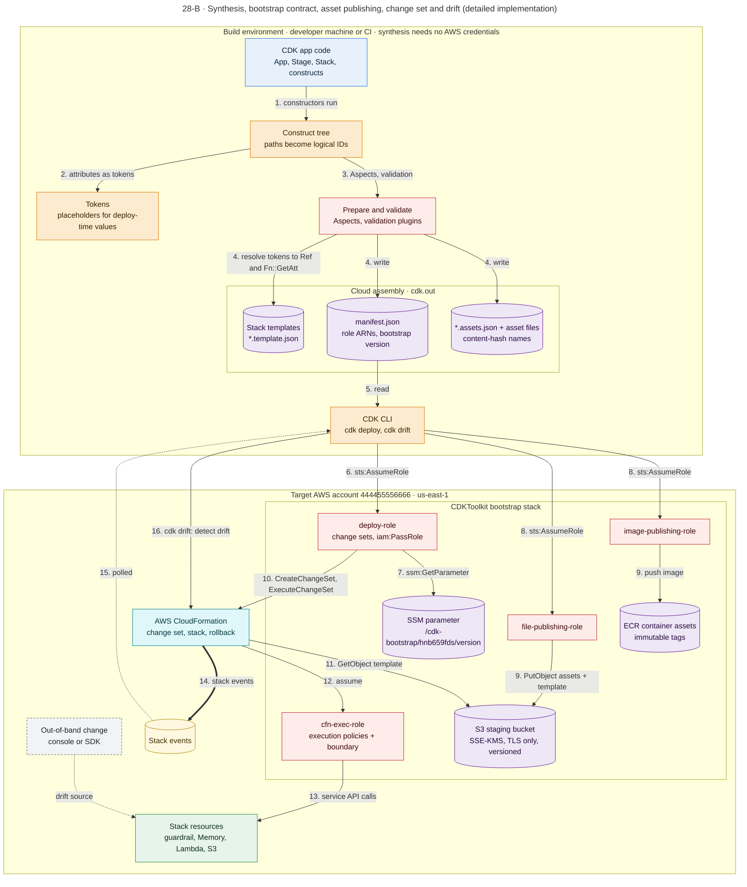
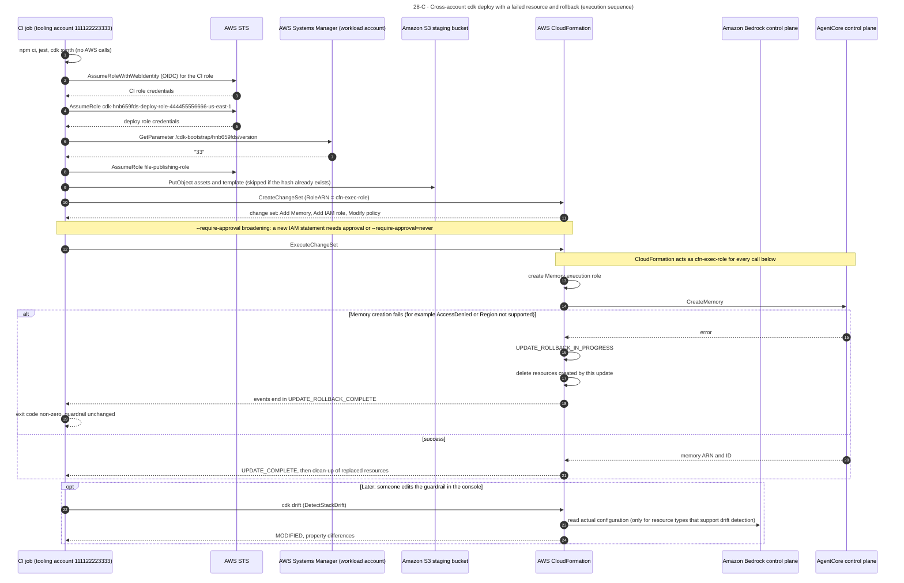

# Diagram 28 — AWS CDK and CloudFormation synthesis architecture

> **Verified:** 2026-11-15 · **Type:** academy design, not an official AWS reference architecture · **Related chapters:** [Synthesis and CloudFormation templates](../../04-infrastructure-as-code/aws-cdk/03-synthesis-and-cloudformation.md) · [Bootstrap and deployment](../../04-infrastructure-as-code/aws-cdk/06-bootstrap-and-deployment.md) · [Testing CDK applications](../../04-infrastructure-as-code/aws-cdk/07-testing.md) · [CDK coverage for Amazon Bedrock](../../04-infrastructure-as-code/aws-cdk/09-cdk-for-bedrock.md) · [Change sets and drift detection](../../04-infrastructure-as-code/cloudformation/04-change-sets-and-drift.md)

This set documents what happens between a line of CDK code such as `new bedrock.CfnGuardrail(...)` and a guardrail that exists in an AWS account: synthesis into a cloud assembly, the bootstrap resources and roles in the target account, asset publishing, the change set that CloudFormation executes as the execution role, stack events, rollback and drift. It answers "which identity does what, where are the artifacts, and what happens when a resource fails?". Role and bucket names are those of the default bootstrap template (qualifier `hnb659fds`) in CDK CLI 2.1148.1.

> [!NOTE]
> **Documented fact** — By the time CloudFormation starts deploying, the CDK app has already finished running and exited; it cannot react to deployment events, and values unknown at synthesis time (such as a generated guardrail ID) appear in the app only as tokens. During deployment the identity assumes the deploy role and passes the CloudFormation execution role, and assumes the file and image publishing roles to upload assets.
> Source: [Deploy AWS CDK applications](https://docs.aws.amazon.com/cdk/v2/guide/deploy.html)

## A. Conceptual view

**What this shows** — The CDK is a compiler, not a deployment engine. It turns code into CloudFormation templates plus files; CloudFormation, a service in your account, does the deployment and keeps the stack's state. Everything you know about CloudFormation (change sets, rollback, drift, hooks) applies unchanged.

## B. Detailed implementation view

**Legend** — solid arrow: request or write · dashed arrow: response, polling, or an out-of-band change · thick arrow: asynchronous event stream · cylinder: data at rest · red: IAM roles and policy checks · grey dashed: outside the IaC process · nested boxes: build environment, target account, bootstrap stack, cloud assembly.

### Component roles

| Component | Role in this architecture | Security control |
|:--|:--|:--|
| Construct tree | In-memory model of the app; each construct path determines a CloudFormation logical ID | Construct IDs are part of a library's contract ([chapter 8](../../04-infrastructure-as-code/aws-cdk/08-construct-libraries.md)) |
| Tokens | Stand-ins for values known only at deployment, rendered as `Ref` / `Fn::GetAtt` | Prevents secrets or IDs being hard-coded |
| Prepare and validate | Aspects modify or inspect the tree; validation plugins (cdk-nag 3, built-in CloudFormation validation) check templates and can stop synthesis | Policy as code before anything reaches AWS |
| Cloud assembly | Templates, `manifest.json` (per stack: deploy role ARN, execution role ARN, template URL, minimum bootstrap version) and asset manifests | Reviewable, diffable artifact; deploy the same assembly you tested |
| SSM version parameter | Read by the CLI and by the template's `BootstrapVersion` parameter; the `CheckBootstrapVersion` rule fails old environments | Contract between template and bootstrap stack |
| Publishing roles | Write assets to the staging bucket and repository | Trust policy: the account itself plus `--trust` accounts; external IDs denied |
| Deploy role | Create and execute change sets, pass the execution role, read the staging bucket | Cannot create workload resources itself |
| Execution role | The permissions CloudFormation uses for every resource operation | Execution policies from `--cloudformation-execution-policies`, optional permissions boundary |
| CloudFormation | Computes the change set, orders operations by dependency, emits events, rolls back on failure | Hooks and Guard rules can inspect change sets ([Hooks and CloudFormation Guard](../../04-infrastructure-as-code/cloudformation/05-hooks-and-guard.md)) |

### Connections

| # | From → To | Protocol / operation | Direction of data | Auth |
|--:|:--|:--|:--|:--|
| 1–4 | App code → construct tree → cloud assembly | In-process (Node.js), file writes | Code to files | None; no AWS calls without context lookups |
| 5 | Cloud assembly → CLI | File read | Manifest to CLI | Local |
| 6 | CLI → deploy role | `sts:AssumeRole` over HTTPS | Credentials to CLI | Caller's IAM identity, trusted by the role |
| 7 | Deploy role → SSM | `ssm:GetParameter` | Version to CLI | Deploy role policy (that parameter only) |
| 8–9 | CLI → publishing roles → S3 / ECR | `sts:AssumeRole`; S3 `PutObject`; ECR image push | Assets to account | Publishing roles; TLS-only bucket policy |
| 10 | Deploy role → CloudFormation | Create and execute change set with `RoleARN` = execution role | Template URL and parameters | Deploy role plus `iam:PassRole` on the execution role |
| 11 | CloudFormation → S3 | Read template | Template to CloudFormation | Service access to the staging bucket |
| 12–13 | CloudFormation → execution role → services | Service APIs over HTTPS, SigV4 | Resource configuration | Execution role trusted only by `cloudformation.amazonaws.com` |
| 14–15 | CloudFormation → events → CLI | Stack events, polled | Status to CLI | Deploy role (`AWSCloudFormationReadOnlyAccess`) |
| 16 | CLI → CloudFormation | Drift detection | Actual versus expected properties | CLI credentials for the target account |

## C. Sequence view

`cdk deploy` from a CI role in a tooling account into a workload account. The stack already exists with a guardrail; this change adds an AgentCore Memory, and the Memory fails.

**Failure paths**

- **Default rollback.** CloudFormation undoes the update; resources created by the failed update are deleted and modified ones restored. The guardrail is untouched, so the application keeps working.
- **First deployment fails.** A failed *create* ends in `ROLLBACK_COMPLETE`, which cannot be updated; the stack must be deleted before the next attempt (CDK Pipelines troubleshooting).
- **`--no-rollback`.** The stack stays in a failed state with the successful resources kept; fix the code and deploy again, or run `cdk rollback`, which needs bootstrap version 23 or later.
- **Rollback itself fails** (a resource cannot be restored). `cdk rollback --orphan <LogicalId>` or `--force` skips such resources.
- **Approval required in CI.** With no terminal, a change that needs approval fails the deployment before execution.

## Variations

| Variation | What changes in the diagrams |
|:--|:--|
| **CDK Pipelines** (`aws-cdk-lib/pipelines`) | The CI job becomes CodePipeline and CodeBuild in the tooling account. A synth action produces the assembly; an *Assets* stage runs CodeBuild to publish to the target's staging bucket; per stack, a *Prepare* action (CloudFormation `CHANGE_SET_REPLACE`, as the deploy role, passing the execution role) and a *Deploy* action (execute the change set). The pipeline updates itself first (self-mutation). Cross-account needs `crossAccountKeys: true` and targets bootstrapped with `--trust`. See [the pipeline example](../../04-infrastructure-as-code/aws-cdk/examples/lib/delivery-pipeline-stack.ts) |
| **AWS SAM transform** | The template declares `Transform: AWS::Serverless-2016-10-31`. CloudFormation expands `AWS::Serverless::*` resources when it creates the change set, so the change set (step 10) contains the expanded resources rather than what you wrote. There is no SAM resource type for Bedrock; Bedrock resources use the native `AWS::Bedrock::*` types ([AWS SAM](../../04-infrastructure-as-code/aws-sam/01-aws-sam.md)) |
| **Pre-synthesized template without the CDK CLI** | Any CloudFormation tool can deploy `cdk.out/<stack>.template.json`, but you must first publish the assets listed in `<stack>.assets.json` (the `cdk-assets` tool, or `cdk publish-assets --unstable=publish-assets`). The target must still be bootstrapped: the template reads the version from SSM and its assets live in the bootstrap bucket. Steps 5–9 move to your tooling; the execution role is whatever role you pass to CloudFormation |
| **Deploy from an existing assembly** | `cdk deploy --app cdk.out` skips synthesis, so the tested assembly is exactly what is deployed |
| **Two-step change set review** | `cdk deploy --method=prepare-change-set`, review, then `--method=execute-change-set`: step 10 splits in two with a human or a hook in between |
| **`--method=direct`** | No change set: CloudFormation updates the stack directly, faster but with less progress information |
| **Custom qualifier** | Every `hnb659fds` becomes your qualifier; the app's synthesizer must use the same value |

## Practical example

The [CDK chapter examples](../../04-infrastructure-as-code/aws-cdk/examples/README.md) implement this architecture and can be synthesized offline:

- [`lib/delivery-pipeline-stack.ts`](../../04-infrastructure-as-code/aws-cdk/examples/lib/delivery-pipeline-stack.ts) — the CDK Pipelines variation, tooling account to workload account.
- [`test/delivery-pipeline.test.ts`](../../04-infrastructure-as-code/aws-cdk/examples/test/delivery-pipeline.test.ts) — asserts the deploy and execution role ARNs, the `BootstrapVersion` parameter and a custom qualifier.
- [`lib/invocation-logging-stack.ts`](../../04-infrastructure-as-code/aws-cdk/examples/lib/invocation-logging-stack.ts) — a stack with a file asset (the custom-resource handler), so step 9 publishes a zip as well as the template.

Run `npx cdk synth` there and open `cdk.out/assembly-AcademyDeliveryPipeline-Workload/manifest.json` to see the role ARNs and template URLs of step 5. [Lab 4](../../labs/lab-04-cdk-synth-and-inspect.md) walks through reading a cloud assembly.

## References

- [Deploy AWS CDK applications](https://docs.aws.amazon.com/cdk/v2/guide/deploy.html) — app lifecycle, cloud assembly, deployment permissions and roles.
- [Bootstrap your environment for use with the AWS CDK](https://docs.aws.amazon.com/cdk/v2/guide/bootstrapping-env.html) — bootstrap resources, roles and template versions.
- [Customize AWS CDK bootstrapping](https://docs.aws.amazon.com/cdk/v2/guide/bootstrapping-customizing.html) — trust, execution policies, qualifier, bootstrap contract.
- [Identifiers and the AWS CDK](https://docs.aws.amazon.com/cdk/v2/guide/identifiers.html) — paths and logical IDs.
- [CDK CLI README](https://raw.githubusercontent.com/aws/aws-cdk-cli/main/packages/aws-cdk/README.md) — `deploy` methods, approval, rollback, drift, publish-assets.
- [cdk-assets README](https://raw.githubusercontent.com/aws/aws-cdk-cli/main/packages/cdk-assets/README.md) — publishing assets from an asset manifest.
- [cdk drift](https://docs.aws.amazon.com/cdk/v2/guide/ref-cli-cmd-drift.html) — drift detection versus `cdk diff`.
- [CDK Pipelines](https://docs.aws.amazon.com/cdk/api/v2/docs/aws-cdk-lib.pipelines-readme.html) — cross-account keys, bootstrapping with `--trust`, troubleshooting `ROLLBACK_COMPLETE`.
- [Update CloudFormation stacks using change sets](https://docs.aws.amazon.com/AWSCloudFormation/latest/UserGuide/using-cfn-updating-stacks-changesets.html) — create, review and execute change sets.
- [Choose how to handle failures when provisioning resources](https://docs.aws.amazon.com/AWSCloudFormation/latest/UserGuide/stack-failure-options.html) — rollback and preserving provisioned resources.
- [AWS::Serverless transform](https://docs.aws.amazon.com/AWSCloudFormation/latest/TemplateReference/transform-aws-serverless.html) — transform processing during change set creation.
