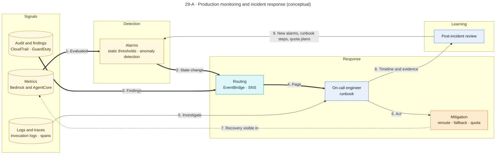
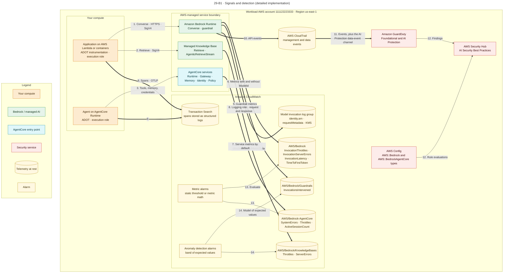
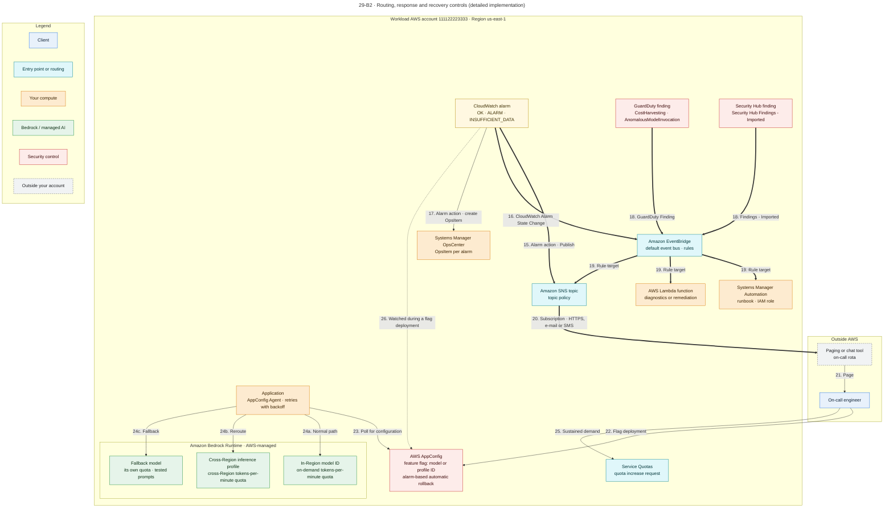
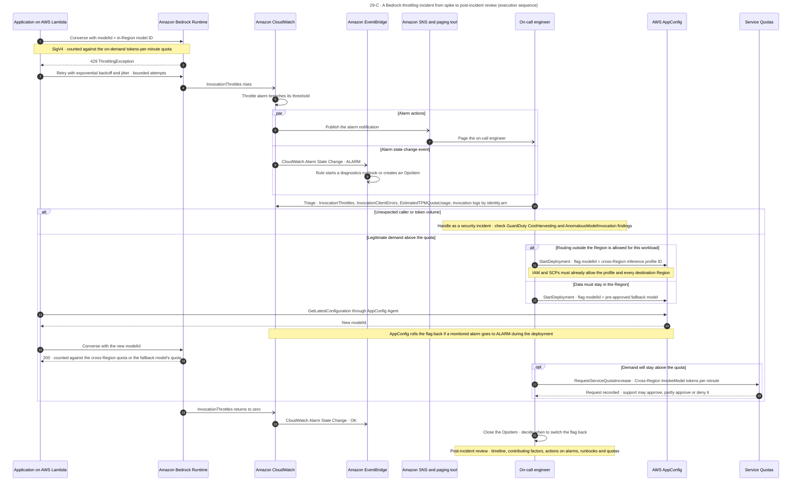

# Diagram 29 — Production monitoring and incident-response architecture

> **Verified:** 2026-11-15 · **Type:** academy design, not an official AWS reference architecture · **Related chapters:** [Production monitoring and incident response](../../08-cost-performance-and-reliability/08-monitoring-and-incident-response.md) · [CloudWatch and Bedrock-specific observability](../../02-related-aws-services/observability/01-cloudwatch-and-bedrock-observability.md) · [AgentCore Observability](../../01-amazon-bedrock/agentcore/07-agentcore-observability.md) · [GuardDuty, Security Hub, AWS Config and Macie](../../02-related-aws-services/security/04-guardduty-security-hub-config-macie.md) · [Quotas, rate limits and throttling](../../08-cost-performance-and-reliability/05-quotas-rate-limits-and-throttling.md) · [Resilience, fallback models and model routing](../../08-cost-performance-and-reliability/06-resilience-fallback-and-model-routing.md)

This set documents how a production generative AI workload on Amazon Bedrock is watched and how an
incident is handled: which signals exist, which ones you must switch on, how a signal becomes a page,
what an on-call engineer can change without a deployment, and how the incident feeds back into better
alarms. It answers the question **"when Bedrock starts throttling my application at 3 a.m., what
fires, who is told, and what can they do in the next ten minutes?"** The signal sources are drawn in
detail in [diagram set 16](16-agentcore-observability.md) (agents) and in
[CloudWatch and Bedrock-specific observability](../../02-related-aws-services/observability/01-cloudwatch-and-bedrock-observability.md);
this set connects them to detection, routing and response.

> [!NOTE]
> **Documented fact** — A CloudWatch alarm can notify an Amazon SNS topic, invoke an AWS Lambda
> function, create an OpsItem in Systems Manager OpsCenter, create an incident in AWS Systems Manager
> Incident Manager or start a CloudWatch investigation; actions run on state transitions, not again
> while the condition persists. Alarms also emit events to Amazon EventBridge, and "CloudWatch
> guarantees the delivery of alarm state change events to EventBridge". Amazon Bedrock's own job
> events, by contrast, are delivered on a best-effort basis.
> Sources: [Alarm actions](https://docs.aws.amazon.com/AmazonCloudWatch/latest/monitoring/alarm-actions.html),
> [Alarm events and EventBridge](https://docs.aws.amazon.com/AmazonCloudWatch/latest/monitoring/cloudwatch-and-eventbridge.html),
> [Monitor Amazon Bedrock job state changes](https://docs.aws.amazon.com/bedrock/latest/userguide/monitoring-eventbridge.html)

> [!IMPORTANT]
> **Status** — AWS Systems Manager Incident Manager has not accepted new customers since
> **2025-11-07** and receives no new features; existing customers can keep using it. For similar
> capabilities AWS points to Systems Manager OpsCenter. This set therefore draws OpsCenter and an
> SNS-connected paging tool, and lists Incident Manager only as a variation.
> Sources: [Incident Manager availability change](https://docs.aws.amazon.com/incident-manager/latest/userguide/incident-manager-availability-change.html),
> [Incident Manager product page](https://aws.amazon.com/systems-manager/features/incident-manager/)

## A. Conceptual view

**What this shows** — Four stages in a loop. Bedrock and AgentCore publish **metrics** without any
setup; **logs, traces and findings** exist only where you enabled them. Alarms turn metrics into state
changes (1–2), security services turn audit events into findings (3), and both are routed to a person
(4). The engineer reads logs and traces (5), changes what the application calls (6) and watches the
same metrics recover (7). The review closes the loop by changing what is detected next time (8–9).

**Legend** — solid arrow: request or human action · dashed arrow: observed result · thick arrow:
asynchronous signal or event · cylinder: telemetry at rest.

## B. Detailed implementation view

The detailed view is split in two so that each diagram stays readable: **B1** shows where the signals
come from and how they are detected; **B2** shows how a detection reaches people and what they can
change. Edge numbers continue from B1 into B2.

### B1. Signals and detection

**What this shows** — Bedrock is the initiator of every Bedrock telemetry flow (4–8, 10); your code
emits only its own spans (9). Metrics are always on; invocation logs, spans, data events and AI
Protection exist only where configured. Alarms read metrics; they never act on Bedrock themselves.

**Walkthrough**

1. The application calls `Converse`, optionally with a guardrail.
2. It retrieves from a managed knowledge base.
3. An agent on AgentCore Runtime uses Gateway, Memory and Identity.
4. Runtime metrics are published with and without the `ModelId` dimension; a request that fails before
   the model is known has no `ModelId`, so per-model alarms undercount errors.
5. Guardrail metrics include `InvocationsIntervened`.
6. Managed knowledge base metrics appear only if the publishing identity (the knowledge base service
   role, or the caller for agentic retrieval) has `cloudwatch:PutMetricData` for the namespace.
7. AgentCore services publish metrics to `AWS/Bedrock-AgentCore` without setup.
8. With model invocation logging on, Bedrock writes full requests and responses; `identity.arn` tells
   you which caller used the tokens.
9. ADOT exports spans; CloudWatch Transaction Search stores them as structured logs.
10. CloudTrail records API activity in the source Region, with `inferenceRegion` for cross-Region calls.
11. GuardDuty analyses management events and, with AI Protection, Bedrock and AgentCore data events.
12. Security Hub collects AWS Config rule evaluations and GuardDuty findings.
13. Metric alarms compare a statistic or a metric-math expression with a threshold.
14. Anomaly detection alarms compare the metric with a band learned from up to two weeks of history,
    including hourly, daily and weekly patterns.

### B2. Routing, response and recovery controls

**Legend** — solid arrow: request or human action · dashed arrow: monitoring relationship · thick
arrow: asynchronous event or notification · grey dashed node: outside your AWS account · nested boxes:
trust boundaries. Edges with the same number are alternatives or fan-out.

**What this shows** — Three routes out of a detection: a direct alarm action (15, 17), an EventBridge
rule (16, 18–19) that can run a runbook or a function, and a human page (20–21). The response levers
are deliberately **configuration, not code**: the model or inference profile the application calls is
a feature flag (22–24), so rerouting needs no deployment, and AWS AppConfig can roll the flag back on
its own if a watched alarm fires during the change (26). A quota increase (25) is a slower, parallel
lever.

**Walkthrough (continues from B1)**

15. The alarm publishes to an SNS topic when it enters `ALARM`.
16. Every alarm state change also reaches EventBridge as `CloudWatch Alarm State Change`, source
    `aws.cloudwatch`.
17. An alarm can create an OpsItem; with a deduplication string, it does not create another one until
    that OpsItem is resolved.
18. Security findings arrive as `GuardDuty Finding` and `Security Hub Findings - Imported` events.
19. Rules start a Systems Manager Automation runbook, invoke a function or notify the topic.
20. The topic delivers to an HTTPS, e-mail or SMS subscription — for example your paging tool.
21. The on-call engineer is paged.
22. The engineer deploys a new value of the model flag.
23. The application's AppConfig Agent picks it up (`StartConfigurationSession`, then
    `GetLatestConfiguration`).
24. The application calls the in-Region model ID (a), a cross-Region inference profile (b) or a
    fallback model (c). Each counts against a different quota.
25. For demand that will last, the engineer requests a quota increase.
26. AppConfig monitors the alarms attached to the environment and rolls the configuration back if one
    goes to `ALARM` or `INSUFFICIENT_DATA` during the deployment.

### Component roles

| Component | Role in this architecture | Security control |
|:--|:--|:--|
| Application and agent | Call Bedrock and AgentCore; emit spans with ADOT; read the model flag | Execution role scoped to the model, profile and fallback ARNs it may use |
| Amazon Bedrock Runtime | Publishes `AWS/Bedrock` and guardrail metrics; writes invocation logs if enabled | IAM; invocation logs contain prompts, so KMS and narrow read access |
| Managed Knowledge Base | Publishes `AWS/Bedrock/KnowledgeBases` metrics, best effort | `cloudwatch:PutMetricData` on the publishing identity |
| AgentCore services | Publish `AWS/Bedrock-AgentCore` metrics by default; spans and logs once enabled | Per-resource tracing and log delivery |
| CloudWatch alarms | Static, metric-math and anomaly detection alarms | Who may change or disable alarm actions is a privileged permission |
| AWS CloudTrail | Audit of API calls; source of GuardDuty analysis | Trail bucket in a log archive account |
| Amazon GuardDuty | `CostHarvesting`, `AnomalousModelInvocation`, `PromptInjection.Direct`, `BedrockLoggingDisabled` findings | AI Protection uses a CloudTrail service-linked channel |
| AWS Security Hub, AWS Config | Posture controls and finding aggregation | Delegated administrator account in an organization |
| Amazon EventBridge | Routes alarm and finding events to targets | Rule target roles; `events.amazonaws.com` and `ssm.amazonaws.com` trust for runbooks |
| Amazon SNS topic | Fan-out to people and tools | Topic policy limits publishers |
| Systems Manager OpsCenter and Automation | Track the operational item; run documented steps | Runbook role with only the actions the runbook needs |
| AWS AppConfig | Holds the model or profile flag; validates and deploys it; rolls back on alarm | IAM on `StartDeployment`; validators; KMS; CloudTrail |
| Service Quotas | Quota increase requests for Bedrock tokens-per-minute quotas | Requests become support cases; may be denied |
| Cross-Region inference profile, fallback model | Alternative capacity pools | IAM and SCPs must already allow them — set up before the incident |

### Connections

| # | From → To | Protocol / operation | Direction of data | Auth |
|--:|:--|:--|:--|:--|
| 1 | Application → Bedrock Runtime | HTTPS · `Converse` | Prompt out, answer in | SigV4, execution role |
| 2 | Application → knowledge base | HTTPS · `Retrieve` | Query out, passages in | SigV4 |
| 3 | Agent → AgentCore | HTTPS · MCP and AgentCore APIs | Tool calls, memory | SigV4 or bearer token |
| 4–7 | Services → CloudWatch metrics | Vended metrics | Counts and timings | Service-internal; knowledge base: `PutMetricData` |
| 8 | Bedrock → log group | Log delivery | Full request and response | Logging role trusted by `bedrock.amazonaws.com` |
| 9 | Application, agent → Transaction Search | OTLP | Spans | Execution role |
| 10–11 | Bedrock → CloudTrail → GuardDuty | Event stream | Call metadata, no prompt text | Service-linked |
| 12 | Config, GuardDuty → Security Hub | Service integration | Evaluations, findings | Service integration |
| 13–14 | Alarms → metrics | Alarm evaluation | Read | — |
| 15 | Alarm → SNS | `Publish` | Notification | Topic policy |
| 16 | CloudWatch → EventBridge | Event | Alarm state, reason, configuration | — |
| 17 | Alarm → OpsCenter | OpsItem creation | Alarm details | `AWSServiceRoleForCloudWatchAlarms_ActionSSM` |
| 18 | GuardDuty, Security Hub → EventBridge | Events | Finding JSON | — |
| 19 | EventBridge → runbook, function, topic | Rule targets | Event | Target permissions or role |
| 20–21 | SNS → paging tool → engineer | HTTPS, e-mail or SMS subscription | Notification | Subscription confirmation |
| 22 | Engineer → AppConfig | `StartDeployment` | New flag value | IAM |
| 23 | Application → AppConfig | `StartConfigurationSession`, `GetLatestConfiguration` (through AppConfig Agent) | Flag value in | Execution role |
| 24 | Application → Bedrock | `Converse` with the flag's `modelId` | Prompt out | SigV4; IAM allows each target |
| 25 | Engineer → Service Quotas | `RequestServiceQuotaIncrease` | Request | IAM; support case |
| 26 | AppConfig → alarms | Deployment monitoring | Alarm state | Environment's monitor configuration |

## C. Sequence view

A throttling incident on an interactive application: a demand spike exceeds the on-demand
tokens-per-minute quota of one model in one Region.

**Steps 1–4 — the spike.** The request is rejected with HTTP 429 because it "exceeded the account
quotas for Amazon Bedrock"; AWS recommends retries with exponential backoff and random jitter. Throttled
requests are counted in `InvocationThrottles` and **not** in `Invocations`, and how many throttles you
see depends on your SDK retry settings.

**Steps 5–10 — detection and routing.** The alarm acts only on the transition to `ALARM`. The SNS path
pages a person; the EventBridge path can start a runbook that collects evidence before anyone logs in.

**Step 11 — triage.** `EstimatedTPMQuotaUsage` is an approximation: throttling is decided on the
upfront reservation of input tokens plus `max_tokens`, so AWS says not to use it alone.
`InvocationClientErrors` includes requests rejected for exceeding a service quota, which are not counted
as throttles — check both. The invocation logs show which `identity.arn` drives the load; an unknown
caller turns this into a security incident (step 12).

**Steps 13–20 — mitigation without a deployment.** Cross-Region profiles have their own
"Cross-Region InvokeModel tokens per minute" quota, separate from the on-demand quota, so rerouting
moves traffic to a different quota and a larger pool. Where residency rules forbid that, a fallback
model gives another quota. AppConfig delivers the flag through the AppConfig Agent, and an alarm on the
new path protects the change.

**Steps 21–22 — quota.** For any model, requesting an increase of the cross-Region quota lets support
offer increases of the on-demand and daily cross-model quotas too. Priority goes to customers who
consume their existing quota, and models in Legacy or Deprecated status get no increase.

**Steps 23–26 — recovery and learning.** The alarm returns to `OK`, which also reaches EventBridge. The
review asks the Well-Architected questions: could detection, diagnosis or mitigation have been faster,
and which runbook steps or alarms would prevent a repeat.

**Failure paths**

- **HTTP 503 `ServiceUnavailable` or 529 `overloaded_error`** — capacity, not your quota. A quota
  increase does not help; retries with jitter and cross-Region inference do.
- **The reroute is denied** — the profile or a destination Region is missing from IAM or an SCP. Test
  the flag path in a pre-production account before you need it.
- **The flag deployment rolls back at once** — **our reading:** an environment that monitors the
  incident's own throttle alarm, already in `ALARM`, works against you; monitor alarms of the new path
  instead. `StopDeployment` with `AllowRevert` reverts a completed deployment.
- **The page never arrives** — an alarm with actions disabled sends no notifications, and a deployment
  does not roll back on it; alarm on the alarm pipeline as well (for example SNS delivery failures).

> [!TIP]
> **Academy recommendation** — Prepare the three levers before the first incident: a throttle alarm
> on `InvocationThrottles` without the `ModelId` dimension (any throttles in 3 of 5 minutes), an
> anomaly detection alarm on guardrail `InvocationsIntervened`, and a model flag whose alternative
> values — a cross-Region profile and a fallback model — are already allowed by IAM and SCPs and
> tested with your prompts. Keep the model ID in configuration
> ([ADR-010](../../ARCHITECTURE-DECISIONS.md#adr-010-model-and-inference-profile-ids-are-always-configuration)).
> Thresholds are ours. This is our design guidance, not an official AWS reference architecture.

## Variations

| Variation | What changes in the diagram |
|:--|:--|
| Traffic on `bedrock-mantle` | `AWS/BedrockMantle` has no latency and no throttle metrics, and invocation logging does not capture mantle calls: alarm on HTTP 429 counts from your application instead of edge 4 and drop edge 8 |
| Agents on AgentCore | Add alarms on `AWS/Bedrock-AgentCore` `Throttles`, `SystemErrors` and `ActiveSessionCount` against the session quota; the trace in Transaction Search shows which tool or model call failed — see [diagram set 16](16-agentcore-observability.md) |
| Managed knowledge base and agentic retrieval | `AWS/Bedrock/KnowledgeBases` `Throttles` by `Operation`; agentic retrieval has its own quota of 300 requests per minute per account — see [diagram set 9](09-agentic-retrieval.md) |
| Global instead of Geographic profile | Edge 24b counts against "Global cross-Region tokens per minute"; SCPs must allow `aws:RequestedRegion` `unspecified`, not each destination Region — see [diagram set 21](21-cross-region-inference.md) |
| Predictable, sustained throughput | AWS suggests the Reserved tier or Provisioned Throughput, where the model supports them, instead of repeated reroutes — see [Service tiers](../../01-amazon-bedrock/inference/06-service-tiers.md) |
| Prompt caching in use | A reroute processes requests elsewhere, so the first requests write new cache entries and cost more until the cache warms |
| Existing Incident Manager customers | Edge 17 can instead create an Incident Manager incident with a response plan; not available to new customers |
| CloudWatch investigations | An alarm can start an investigation when it goes to `ALARM` — an additional alarm action beside edges 15 and 17 |
| Multi-account | A monitoring account receives metrics and logs through CloudWatch cross-account observability and can create anomaly detectors on source-account metrics; routing and paging move there — see [Pattern: multi-account generative AI platform](../../03-architecture-patterns/multi-account/README.md) |
| Security-triggered incident | The path starts at edge 18; GuardDuty's remediation guidance for `CostHarvesting` covers compromised credentials, narrower invoke permissions, AWS Budgets actions and AWS Cost Anomaly Detection |
| Batch inference | No paging path: jobs report `Batch Inference Job State Change` events, best effort — see the [batch job state diagram](../plantuml/bedrock-batch-job-state.puml) |

## Practical example

- [CloudWatch and Bedrock-specific observability](../../02-related-aws-services/observability/01-cloudwatch-and-bedrock-observability.md),
  section "Example" — validated Terraform for model invocation logging and three alarms (throttles,
  server-error rate, log delivery failure) that publish to an SNS topic: edges 4, 8, 13 and 15.
- [AgentCore Observability](../../01-amazon-bedrock/agentcore/07-agentcore-observability.md#13-working-example),
  section 13 — Transaction Search, gateway log delivery and a `SystemErrors` alarm: edges 7 and 9.
- [GuardDuty, Security Hub, AWS Config and Macie](../../02-related-aws-services/security/04-guardduty-security-hub-config-macie.md),
  section "Example" — AI Protection, the AI Security Best Practices standard and an EventBridge rule
  for Bedrock findings: edges 11, 12 and 18.
- [Cross-Region inference: Geo and Global profiles](../../01-amazon-bedrock/inference/04-cross-region-inference.md#13-working-example)
  — the IAM policy and SCP that edge 24b needs.
- The operating procedure around this architecture is the planned chapter
  [Production monitoring and incident response](../../08-cost-performance-and-reliability/08-monitoring-and-incident-response.md).

## References

- [Monitor bedrock-runtime inference using CloudWatch metrics](https://docs.aws.amazon.com/bedrock/latest/userguide/monitoring-runtime-metrics.html) — `InvocationThrottles`, `EstimatedTPMQuotaUsage`, the `ModelId` caveat, log delivery metrics (edges 4, 13; step 11).
- [Troubleshooting Amazon Bedrock API error codes](https://docs.aws.amazon.com/bedrock/latest/userguide/troubleshooting-api-error-codes.html) — `ThrottlingException` 429, `ServiceUnavailable` 503, `overloaded_error` 529, backoff with jitter, cross-Region inference, Reserved tier (steps 1–4, failure paths).
- [Quotas for the bedrock-runtime endpoint](https://docs.aws.amazon.com/bedrock/latest/userguide/quotas-runtime.html) — on-demand, cross-Region and daily quotas; how to request increases; Legacy models (edges 24–25; steps 21–22).
- [Requesting a quota increase](https://docs.aws.amazon.com/servicequotas/latest/userguide/request-quota-increase.html) — `RequestServiceQuotaIncrease`, approval and support cases (edge 25).
- [Model invocation logging](https://docs.aws.amazon.com/bedrock/latest/userguide/model-invocation-logging.html) — log contents, `bedrock-runtime` only (edge 8).
- [Monitor Amazon Bedrock Guardrails using CloudWatch metrics](https://docs.aws.amazon.com/bedrock/latest/userguide/monitoring-guardrails-cw-metrics.html) and [Observability for managed knowledge bases](https://docs.aws.amazon.com/bedrock/latest/userguide/kb-managed-observability.html) — edges 5 and 6.
- [Add observability to your AgentCore resources](https://docs.aws.amazon.com/bedrock-agentcore/latest/devguide/observability-configure.html) — Transaction Search and service metrics (edges 7 and 9).
- [Using CloudWatch anomaly detection](https://docs.aws.amazon.com/AmazonCloudWatch/latest/monitoring/CloudWatch_Anomaly_Detection.html) — the expected-value band, two weeks of training data, cross-account detectors (edge 14).
- [Alarm actions](https://docs.aws.amazon.com/AmazonCloudWatch/latest/monitoring/alarm-actions.html) — SNS, Lambda, OpsItems, Incident Manager, investigations, transition-only behaviour (edges 15, 17).
- [Alarm events and EventBridge](https://docs.aws.amazon.com/AmazonCloudWatch/latest/monitoring/cloudwatch-and-eventbridge.html) — `CloudWatch Alarm State Change`, guaranteed delivery (edge 16).
- [Configure CloudWatch alarms to create OpsItems](https://docs.aws.amazon.com/systems-manager/latest/userguide/OpsCenter-create-OpsItems-from-CloudWatch-Alarms.html) — service-linked role and deduplication (edge 17).
- [Run automations based on EventBridge events](https://docs.aws.amazon.com/systems-manager/latest/userguide/running-automations-event-bridge.html) — a runbook as an EventBridge target and its role trust (edge 19).
- [Security Hub CSPM event types in EventBridge](https://docs.aws.amazon.com/securityhub/latest/userguide/securityhub-cwe-integration-types.html) and [GuardDuty AI Protection finding types](https://docs.aws.amazon.com/guardduty/latest/ug/findings-ai-protection.html) — finding events and the `CostHarvesting` remediation (edges 11, 18).
- [Incident Manager availability change](https://docs.aws.amazon.com/incident-manager/latest/userguide/incident-manager-availability-change.html) — closed to new customers since 2025-11-07.
- [What is AWS AppConfig?](https://docs.aws.amazon.com/appconfig/latest/userguide/what-is-appconfig.html), [Retrieving feature flags and configuration data](https://docs.aws.amazon.com/appconfig/latest/userguide/retrieving-feature-flags.html) and [Monitoring deployments for automatic rollback](https://docs.aws.amazon.com/appconfig/latest/userguide/monitoring-deployments.html) — feature flags, AppConfig Agent, alarm-based rollback, `StopDeployment` with `AllowRevert` (edges 22, 23, 26).
- [Route model inference requests across AWS Regions with cross-Region inference](https://docs.aws.amazon.com/bedrock/latest/userguide/cross-region-inference.html) — profiles, CloudTrail `inferenceRegion` (edges 10, 24b).
- [OPS11-BP02 Perform post-incident analysis](https://docs.aws.amazon.com/wellarchitected/latest/operational-excellence-pillar/ops_evolve_ops_perform_rca_process.html) — the review questions (steps 25–26).
- [Generated API reference](../../references/bedrock-api-operations.md) — Bedrock operation names used in this set.
