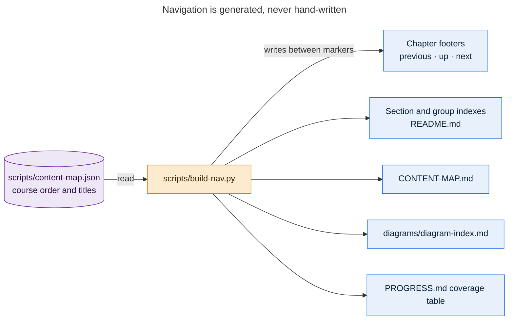

# Scripts

Offline quality checks and generators for the academy. **None of them contact AWS**: there is no
plan, apply, deploy, bootstrap or AWS CLI call anywhere in this folder, and none of them need
credentials.

[Academy home](../README.md) · [Authoring conventions](../templates/CONVENTIONS.md) · [Quality check report](../QUALITY-CHECK-REPORT.md)

## What each script does

| Script | Checks or generates | Needs |
|:--|:--|:--|
| [`validate-all.sh`](validate-all.sh) | Runs everything below and prints one summary table | bash |
| [`check-links.py`](check-links.py) | Every relative Markdown link and `#anchor` resolves inside the academy | Python 3.10+ |
| [`check-mermaid.cjs`](check-mermaid.cjs) | Every Mermaid diagram parses **and renders**, on each Mermaid version available; `--render` writes SVGs | Node 22+, Playwright Chromium, Mermaid |
| [`check-plantuml.sh`](check-plantuml.sh) | PlantUML syntax; `--render` writes SVGs | Java, PlantUML jar |
| [`check-drawio.py`](check-drawio.py) | draw.io XML is well-formed and internally consistent (it is **not** rendered) | Python 3.10+ |
| [`check-data-files.py`](check-data-files.py) | Every JSON and YAML file parses | Python 3.10+, PyYAML |
| [`check-api-names.py`](check-api-names.py) | Every API operation named in a chapter exists in the AWS SDK's service models; unknown names are listed for review | Python 3.10+; `boto3` to recognise non-Bedrock services |
| [`scan-secrets.py`](scan-secrets.py) | No access keys, tokens, private keys, real account IDs or personal e-mail addresses | Python 3.10+ |
| [`validate-terraform.sh`](validate-terraform.sh) | `terraform fmt -check`, `init -backend=false`, `validate`, and `terraform test` where tests exist | Terraform 1.11+ |
| [`validate-cdk.sh`](validate-cdk.sh) | `tsc --noEmit`, Jest, `cdk synth`, then `cfn-lint` on the synthesized templates | Node 22+, project dependencies |
| [`validate-cfn.sh`](validate-cfn.sh) | `cfn-lint` on every hand-written CloudFormation/SAM template | cfn-lint |
| [`build-source-index.py`](build-source-index.py) | Lists every external link cited, by section and domain, into [`references/external-links.md`](../references/external-links.md) and the appendix of [`SOURCES.md`](../SOURCES.md) | Python 3.10+ |
| [`build-nav.py`](build-nav.py) | Generates chapter footers, section indexes, [`CONTENT-MAP.md`](../CONTENT-MAP.md), the diagram index and the progress table from [`content-map.json`](content-map.json) | Python 3.10+ |
| [`gen-terraform-reference.py`](gen-terraform-reference.py) | Builds [`references/terraform-aws-provider-bedrock.md`](../references/terraform-aws-provider-bedrock.md) from the provider's real schema | Python 3.10+, a schema dump |
| [`gen-api-reference.py`](gen-api-reference.py) | Builds [`references/bedrock-api-operations.md`](../references/bedrock-api-operations.md) from the AWS SDK's service models | Python with `boto3` installed |
| [`gen-cdk-reference.py`](gen-cdk-reference.py) | Builds [`references/cdk-and-cloudformation-bedrock.md`](../references/cdk-and-cloudformation-bedrock.md) from an installed `aws-cdk-lib` | Python 3.10+, `node_modules` |

## Quick start

```bash
cd aws-bedrock-architecture-academy

# 1. Documentation checks — Python only
python3 scripts/check-links.py
python3 scripts/scan-secrets.py
python3 scripts/check-data-files.py        # pip install pyyaml

# 2. Diagrams
(cd scripts && npm ci && npx playwright install chromium)
node scripts/check-mermaid.cjs
node scripts/check-mermaid.cjs --render diagrams/rendered

# 3. Infrastructure code — no credentials required
bash scripts/validate-terraform.sh
bash scripts/validate-cfn.sh               # pip install cfn-lint
bash scripts/validate-cdk.sh               # after `npm ci` in each CDK project

# Everything at once
bash scripts/validate-all.sh
bash scripts/validate-all.sh --strict-links --render
```

## How navigation is generated



To add a chapter: add it to `content-map.json`, write the file, run `python3 scripts/build-nav.py`.
The script only rewrites text between its own `<!-- NAME:START -->` and `<!-- NAME:END -->`
markers, so hand-written content is never touched.

## Regenerating the IaC references

The two reference tables are generated from real tooling so that nothing in them is recalled
from memory.

```bash
# Terraform: dump the provider schema from a scratch directory outside the repository
mkdir -p /tmp/schema && cd /tmp/schema
cat > main.tf <<'EOF'
terraform {
  required_providers {
    aws = {
      source  = "hashicorp/aws"
      version = "6.73.0"
    }
  }
}
EOF
terraform init -backend=false
terraform providers schema -json > schema.json
python3 /path/to/academy/scripts/gen-terraform-reference.py schema.json 6.73.0

# CDK: point at any node_modules that contains aws-cdk-lib
python3 scripts/gen-cdk-reference.py path/to/node_modules
```

`terraform init` downloads the provider but creates nothing in AWS, and
`terraform providers schema` only prints what the provider binary supports.

## Why Mermaid is checked on several versions

Markdown hosts bundle their own Mermaid release, which can lag the newest one. A diagram that
only works on the newest Mermaid may show as an error for readers. `check-mermaid.cjs` renders
every diagram on each Mermaid bundle it finds (this repository was validated on 10.9, 11.x and
12.x) and fails if any of them rejects it.

## Limits of these checks

- External URLs are **not** fetched by `check-links.py`; they are listed with `--list-external`
  so they can be verified separately.
- `terraform validate` proves the configuration is internally consistent and matches the
  provider schema. It does not prove that AWS will accept every value — only a real `plan` and
  `apply` in an account can do that, and those are never run here.
- `cdk synth` proves a template can be generated, not that CloudFormation will deploy it.
- draw.io files are structurally checked, not rendered.
