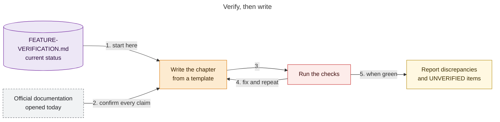

# Author guide — how to write or update a chapter

This is the working procedure for anyone (human or AI) adding content to the academy. It is
short on purpose; the binding rules are in [`CONVENTIONS.md`](CONVENTIONS.md).

[Academy home](../README.md) · [Conventions](CONVENTIONS.md) · [Scripts](../scripts/README.md)

## The loop

## Step by step

1. **Read** [`CONVENTIONS.md`](CONVENTIONS.md) and the template for your file type:
   [standard chapter](chapter-template.md), [Bedrock feature](bedrock-feature-template.md),
   [diagram set](diagram-set-template.md), [project](project-readme-template.md).
2. **Read the register**, [`FEATURE-VERIFICATION.md`](../FEATURE-VERIFICATION.md). Assume that
   anything you remember about Amazon Bedrock may be out of date; the register and the live
   documentation win.
3. **Open the official pages** for your topic and confirm each claim you intend to make. Keep
   the URLs — they go in the chapter's last section.
4. **Check IaC names** against the generated references in [`references/`](../references/README.md),
   never from memory.
5. **Write** using the template's headings unchanged. Embed at least one diagram per chapter.
   Link forward and back to related chapters using paths from
   [`scripts/content-map.json`](../scripts/content-map.json).
6. **Do not** write previous/next links, and do not edit shared files (see Conventions §8).
7. **Run the checks** listed in Conventions §9 until they pass.
8. **Report**: files written, check results, anything that contradicts the register (with the
   URL), and every statement you labelled UNVERIFIED.

## Quality bar for a chapter

- A newcomer can follow the "plain language" section without knowing the jargon.
- An experienced engineer learns something precise from the "how it really works" section.
- Every number has a source. Every opinion is marked as an academy recommendation.
- The diagram shows boundaries, direction, protocol and security controls — not just boxes.
- The knowledge check has questions that require understanding, with answers.
- The chapter says when **not** to use the thing.

## Updating an existing chapter

1. Re-open the sources at the bottom of the chapter.
2. Change the text, then change the **Verified** date in the header.
3. If a feature's status changed, update the register first, then every chapter that cites it
   (`grep -rl "feature name" .`).
4. Add a line to [`CHANGELOG.md`](../CHANGELOG.md).
