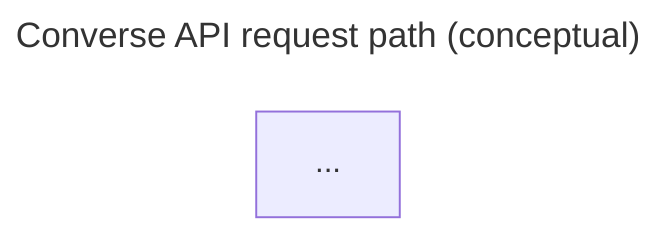

# Authoring conventions

These rules apply to every file in the academy. They exist so that 200 files written at different
times read like one course, and so that a reader can always tell a **documented fact** from an
**opinion**.

[Academy home](../README.md) · [Chapter template](chapter-template.md) · [Bedrock feature template](bedrock-feature-template.md) · [Diagram set template](diagram-set-template.md)

## 1. Accuracy rules (non-negotiable)

1. **Official sources only.** Facts about AWS come from `docs.aws.amazon.com`, `aws.amazon.com`
   (What's New, blogs, pricing, architecture, solutions) and AWS-owned GitHub organisations
   (`aws`, `awslabs`, `aws-samples`, `aws-actions`). Facts about tools come from the tool's own
   documentation or repository (`developer.hashicorp.com`, `registry.terraform.io`,
   `github.com/hashicorp`, `pulumi.com`, the tool's official site).
2. **Only cite a URL you actually opened** while writing, and that contained the claim.
3. **Never invent** an API operation, request field, resource type, argument, construct, quota,
   price, Region list or model ID. If you cannot confirm it, write
   `**UNVERIFIED — REQUIRES DOCUMENTATION REVIEW**` next to the statement and say what you looked for.
4. **Numbers carry their source and date.** Any quota, limit, price or Region count is followed
   by a link and is understood to be "as of the verification date" in the chapter header.
5. **Start from the register.** [`FEATURE-VERIFICATION.md`](../FEATURE-VERIFICATION.md) holds the
   verified status of every feature. If your research contradicts it, do not silently pick one:
   write what you found and report the discrepancy to the editor.
6. **API names are checked mechanically.** Every API operation you name must exist in
   [`references/bedrock-api-operations.json`](../references/bedrock-api-operations.json)
   (generated from the AWS SDK's service models). The OpenAI- and Anthropic-compatible APIs
   and `bedrock-mantle` are not in the SDK models; cite their documentation pages instead.
7. **IaC names are checked mechanically.**
   - Terraform resource types and arguments must exist in
     [`references/terraform-aws-provider-bedrock-schema.json`](../references/terraform-aws-provider-bedrock-schema.json)
     (generated from the provider binary) or pass `terraform validate`.
   - CDK constructs must exist in the installed `aws-cdk-lib` typings
     ([`references/cdk-and-cloudformation-bedrock.md`](../references/cdk-and-cloudformation-bedrock.md)).
   - If a tool has no resource for a feature, say so and name the verified alternative
     (CloudFormation type, API call from a custom resource, console-only, and so on).
8. **Do not present academy designs as AWS reference architectures.** They are ours.
9. **Model IDs change.** Use an ID only if you saw it in the documentation; in code, make the
   model ID a variable and note that the reader must confirm the current ID.

## 2. Callouts — how facts and opinions are marked

Use GitHub alert syntax. The first bold phrase says what kind of statement it is.

```markdown
> [!NOTE]
> **Documented fact** — AgentCore Runtime runs each session in its own microVM.
> Source: [AgentCore Runtime](https://docs.aws.amazon.com/...)

> [!TIP]
> **Academy recommendation** — Put the model ID in configuration, not code.
> This is our design guidance, not an official AWS reference architecture.

> [!IMPORTANT]
> **Status** — Preview / maintenance mode / Region-limited. Say which, with a source.

> [!WARNING]
> **Common mistake** — what goes wrong and how to notice.

> [!CAUTION]
> **Cost or security hazard** — something that can create a bill or a breach.
```

| Callout | Use it for | Needs a source link? |
|:--|:--|:-:|
| `[!NOTE]` Documented fact | Something the documentation states | Yes |
| `[!TIP]` Academy recommendation | Our design guidance and trade-off advice | No — but must say it is ours |
| `[!IMPORTANT]` Status | Preview, GA date, maintenance mode, Region limits | Yes |
| `[!WARNING]` Common mistake | Frequent errors | Optional |
| `[!CAUTION]` Hazard | Billing and security risks | Optional |

Inside running text, a sentence that is our inference rather than a documented fact starts with
"**Our reading:**" or sits in a `[!TIP]` callout. AWS rarely documents service internals, so the
"internal architecture" sections describe the **customer-visible architecture** (planes,
endpoints, what is stored where, who calls whom) and label anything beyond that as a conceptual model.

## 3. Chapter header

Every chapter starts with an H1 and one metadata line:

```markdown
# Title in sentence case

> **Level:** Beginner | Intermediate | Advanced · **Verified:** 2026-11-15 · **Feature status:** GA | Preview | Maintenance mode | n/a · **Time:** ~15 min
```

Then the sections in the order given by the template you are using. Do not rename the section
headings — the knowledge of where to look is part of the course.

- Standard chapters: [`chapter-template.md`](chapter-template.md)
- Bedrock feature chapters (the 14-point structure): [`bedrock-feature-template.md`](bedrock-feature-template.md)
- Numbered diagram sets: [`diagram-set-template.md`](diagram-set-template.md)
- Practical projects: [`project-readme-template.md`](project-readme-template.md)

## 4. Writing style

- **Simple first, then precise.** Open each concept with a plain-language explanation a newcomer
  can follow, then give the exact technical version.
- Short paragraphs (2–4 sentences). Prefer a table, a list or a diagram over a long paragraph.
- 700–1,500 words of prose per chapter, not counting code and diagrams. Depth comes from
  precision, not length.
- Second person ("you"), present tense, no marketing language, no filler.
- Define a term the first time it appears, or link to [`GLOSSARY.md`](../GLOSSARY.md).
- Use the current official product names from the register (for example "Amazon Bedrock Agents
  Classic", "Managed Knowledge Base", "AgentCore harness").
- Write "Region" and "Availability Zone" capitalised, as AWS does.

## 5. Diagrams

Mermaid is the default. Every diagram must render on an older Mermaid as well as the newest, so:

- Use only: `flowchart`, `sequenceDiagram`, `stateDiagram-v2`, `classDiagram`, `erDiagram`,
  `gantt`, `timeline`, `mindmap`. Do **not** use `architecture-beta`, `block-beta`, `C4Context`,
  icons, images, `click` handlers or HTML other than `<br/>`.
- **Quote every label** that contains anything other than letters, digits and spaces:
  `api["Amazon API Gateway<br/>REST API"]`. Edge labels too: `a -- "1. HTTPS + SigV4" --> b`.
- Never use `end`, `graph`, `subgraph`, `class` or `style` as a node ID. Use lowerCamel IDs.
- At most ~25 nodes per diagram. Split rather than shrink.
- Start with a title front-matter block:

````markdown

````

### What every architecture diagram must show

| Requirement | How |
|:--|:--|
| Descriptive title | Mermaid front-matter `title:` |
| Architecture boundary | Outer `subgraph` named for the AWS account / Region |
| AWS service names | Full names in node labels: "Amazon Bedrock Runtime", not "LLM" |
| Directional arrows with protocol | Numbered edge labels: `"3. InvokeModel · HTTPS · SigV4"` |
| Request vs response | Request `-->` solid; response `-.->` dashed; asynchronous event `==>` thick |
| Data storage locations | Cylinder nodes `db[("Amazon S3<br/>documents")]` |
| Trust boundaries | `subgraph` per trust zone (internet, customer VPC, AWS-managed service) |
| Security controls | Label the control on the node or edge (IAM role, KMS key, guardrail, security group) |
| Network boundaries | `subgraph` for VPC, subnet, endpoint where relevant |
| Legend | A `subgraph legend["Legend"]` in the diagram, or a legend table directly under it |
| Explanation | "What this shows" paragraph + numbered walkthrough matching the edge numbers |
| References | Official links for every service drawn |

### Standard colours (copy these `classDef` lines)

```text
classDef client   fill:#E8F1FB,stroke:#1F6FEB,color:#0B1F33
classDef edge     fill:#E0F7FA,stroke:#00838F,color:#00363A
classDef compute  fill:#FDEBD0,stroke:#D97706,color:#3B2300
classDef ai       fill:#E6F4EA,stroke:#1E8E3E,color:#0B2E13
classDef data     fill:#EDE7F6,stroke:#6A1B9A,color:#2A0A3D
classDef security fill:#FDECEA,stroke:#C62828,color:#3D0A0A
classDef obs      fill:#FFF8E1,stroke:#B28704,color:#3D2E00
classDef external fill:#F1F3F4,stroke:#5F6368,color:#202124,stroke-dasharray:4 3
```

| Class | Meaning |
|:--|:--|
| `client` | Users, client applications, callers |
| `edge` | Entry points: CloudFront, API Gateway, load balancers, AgentCore Gateway |
| `compute` | Your compute: Lambda, containers, AgentCore Runtime sessions |
| `ai` | Bedrock model inference and managed AI features |
| `data` | Storage and databases, vector stores, memory |
| `security` | IAM, KMS, guardrails, WAF, policy engines |
| `obs` | CloudWatch, CloudTrail, X-Ray, logs |
| `external` | Anything outside your AWS account: third-party APIs, identity providers, model providers |

### Sequence diagrams

- Add `autonumber`.
- Name participants with the AWS service: `participant BR as Amazon Bedrock Runtime`.
- Request `->>`, response `-->>`, asynchronous `-)`.
- Use `Note over` for security controls (authentication, authorisation, encryption) and
  `alt` / `opt` / `loop` for variations.
- Use `box` to group participants by trust boundary only if the diagram stays readable.

### After every diagram

1. **What this shows** — one paragraph.
2. **Walkthrough** — a numbered list; numbers match the edge numbers.
3. **Variations** — where behaviour differs by model, Region, API or configuration, say so explicitly.

The custom diagrams in this academy are not official AWS diagrams and do not use AWS logos.

### Numbered diagram sets

The 30 numbered sets in `diagrams/mermaid/` each contain three views — **A. Conceptual**,
**B. Detailed implementation**, **C. Sequence** — plus a legend, variations and references.
Chapters embed their own diagrams and link to the matching set for the full picture.

## 6. Links and navigation

- Internal links are **relative** and point only at files listed in
  [`scripts/content-map.json`](../scripts/content-map.json) (or files you are creating).
- Do **not** write previous/next links. `scripts/build-nav.py` generates the footer between
  `<!-- NAV:START -->` and `<!-- NAV:END -->` markers. Never write those markers yourself.
- External links go only to the official sources named in section 1.
- Link text says what is behind the link: `[Converse API reference](url)`, not `[here](url)`.

## 7. Code

Every code block or code directory states its status:

```markdown
> **Code status:** validated with `terraform validate` (provider 6.73.0) · mock-tested · **never planned or applied against AWS**
```

| Status word | Meaning |
|:--|:--|
| illustrative | Shows the shape; not run through any tool |
| syntax-checked | Parsed (for example `python -m py_compile`, JSON/YAML parse) |
| validated | `terraform validate`, `cdk synth` + `tsc`, or `cfn-lint` passed |
| mock-tested | Unit tests with mocks passed (`terraform test` with mock providers, Jest assertions, stubbed boto3) |
| never deployed | Always true in this repository: nothing here has been applied to a real AWS account |

### Terraform

- `required_version = ">= 1.11.0"`; AWS provider `version = "~> 6.73"`.
- Every root and every module has `versions.tf`, `variables.tf`, `main.tf`, `outputs.tf` and a `README.md`.
- No hard-coded account IDs, Regions, ARNs or model IDs — use variables with documented defaults.
- Example values go in `*.tfvars.example`. Real `*.tfvars` files are git-ignored.
- Remote state examples use the S3 backend with `use_lockfile = true` (native locking).
- Tags come from `default_tags` on the provider plus a `tags` variable.
- Run `terraform fmt` before saving.

### AWS CDK

- TypeScript, `aws-cdk-lib` pinned to an exact version in `package.json`, `constructs` `^10`.
- Project setup mirrors the official `cdk init app --language typescript` template shipped with
  CDK CLI 2.1148.1: `typescript` `~7.0.2`, Jest 30 with the `@swc/jest` transform, `tsx` to run
  the app, `"noEmit": true`, and `"app": "npx tsx bin/<name>.ts"` in `cdk.json`. Copy
  `package.json`, `tsconfig.json` and `jest.config.js` from
  [`aws-cdk/construct-library/`](../04-infrastructure-as-code/aws-cdk/construct-library/) — do
  **not** use `ts-jest` or `ts-node` (they do not support TypeScript 7).
- Stacks are environment-agnostic unless the chapter is about environments.
- Unit tests use `aws-cdk-lib/assertions`.
- No Docker bundling and no context lookups, so `cdk synth` works offline with no credentials.

### Application code

- Lambda handlers in Python, using `boto3`. No secrets in environment variables.
- Tests stub AWS clients; nothing calls AWS.

### Placeholders

- Account IDs: `111122223333`, `444455556666`, `777788889999` (AWS documentation placeholders).
- Region default: `us-east-1`, always overridable.
- Never real names, e-mail addresses, keys or tokens. Domains: `example.com`.

### Commands shown to readers

- Deployment commands (`terraform apply`, `cdk deploy`, `aws cloudformation deploy`) may appear in
  documentation **for the reader to run in their own sandbox account**, always with a cost
  warning and a teardown step. They are never run while building this repository.

## 8. File ownership

- Write only the files assigned to you.
- Shared files — `README.md`, `SOURCES.md`, `FEATURE-VERIFICATION.md`, `GLOSSARY.md`,
  `PROGRESS.md`, `CONTENT-MAP.md`, `diagrams/diagram-index.md`, `scripts/content-map.json` —
  are changed by the editor only. Report corrections instead of editing them.

## 9. Checks to run before you hand in

```bash
python3 scripts/check-links.py --allow-planned PATH/TO/YOUR/FILES
node scripts/check-mermaid.cjs PATH/TO/YOUR/FILES
python3 scripts/scan-secrets.py PATH/TO/YOUR/FILES
# if you wrote Terraform / CDK / CloudFormation:
bash scripts/validate-terraform.sh PATH/TO/DIR
bash scripts/validate-cdk.sh PATH/TO/DIR
bash scripts/validate-cfn.sh PATH/TO/DIR
```

All of them must pass. See [`scripts/README.md`](../scripts/README.md) for setup.
