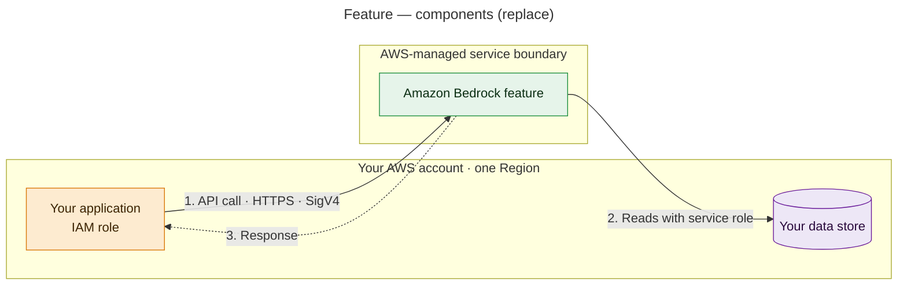
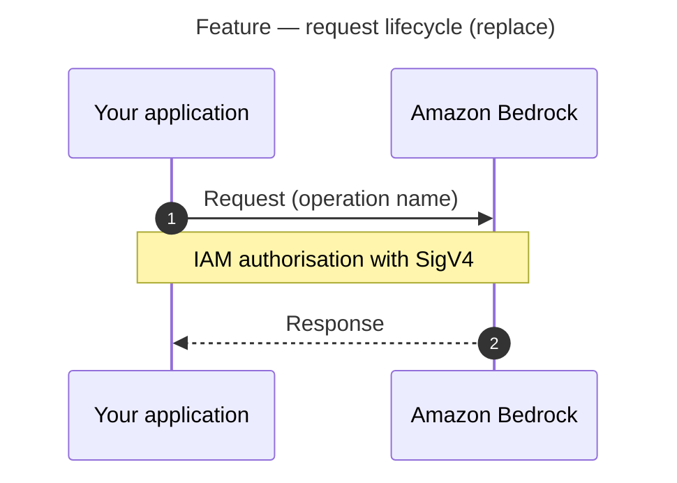

# Feature name (current official name)

> **Level:** Intermediate · **Verified:** 2026-11-15 · **Feature status:** GA · **Time:** ~20 min

One or two sentences: what the feature is and where it sits in a Bedrock architecture.

> [!IMPORTANT]
> **Status** — GA / preview / maintenance mode, launch or change date, and Region limits.
> Source: [Page title](https://docs.aws.amazon.com/)

## Learning objectives

- Three to five objectives, each starting with a verb.

## Prerequisites

- Links to earlier chapters.

## 1. What it is

Plain-language definition first, then the precise one: which service namespace and endpoint it
lives on, and its main API operations.

| Item | Value |
|:--|:--|
| Service namespace / endpoint | |
| Control-plane operations | |
| Data-plane operations | |
| IAM action prefix | |

## 2. Why it exists

The problem it removes. What you would have to build yourself without it.

## 3. When to use it

- Concrete situations.

## 4. When not to use it

- Concrete situations, each with the better alternative and a link to its chapter.

## 5. Internal architecture

The customer-visible architecture: planes, components, what is stored where, who calls whom.
Anything beyond what AWS documents is labelled "**Our reading:**".

**What this shows** — one paragraph, then a numbered walkthrough and the legend.

## 6. Request and response lifecycle

Explain each numbered step, including the error paths that matter (throttling, validation, access denied).

## 7. Dependencies

| Depends on | Why | Required or optional |
|:--|:--|:-:|
| | | |

## 8. Security considerations

IAM actions and resource scoping, service roles and trust policies, encryption (AWS-owned key vs
customer managed KMS key), data handling, logging. State what is documented.

## 9. Networking requirements

Public endpoint, interface VPC endpoints (PrivateLink) with their service names, anything that
needs outbound internet access, cross-Region traffic.

## 10. Pricing dimensions

What is metered — never invent a price. Link the pricing page. Quote a figure only if you saw it there.

| Dimension | Unit | Notes |
|:--|:--|:--|
| | | |

## 11. Scaling considerations

Quotas and limits (with source), throttling behaviour, what to request an increase for, how it
behaves under load.

## 12. IaC support

| Tool | Support | Resource / construct | Notes |
|:--|:-:|:--|:--|
| Terraform (`hashicorp/aws` 6.73.0) | ✅ / ❌ | `aws_…` | |
| CloudFormation | ✅ / ❌ | `AWS::…` | |
| AWS CDK (`aws-cdk-lib` 2.277.0) | L1 / L2 / alpha / ❌ | | |

If there is no support, say what the verified alternative is.

## 13. Working example

> **Code status:** illustrative · **never deployed**

A minimal example of using the feature (SDK call and, where supported, the IaC to create it).

## Common mistakes

| Mistake | Symptom | Fix |
|:--|:--|:--|
| | | |

## Knowledge check

1. Question?
2. Question?
3. Question?

Answers

1. Answer.
2. Answer.
3. Answer.

## 14. Official documentation

- [Page title](https://docs.aws.amazon.com/) — what it covers.
