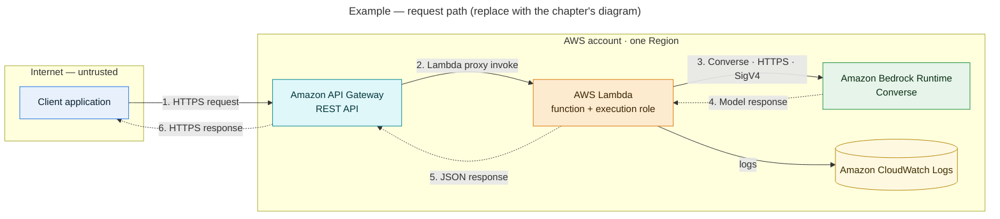

# Chapter title in sentence case

> **Level:** Beginner · **Verified:** 2026-11-15 · **Feature status:** n/a · **Time:** ~15 min

One or two sentences saying what this chapter covers and why it matters for building on Amazon Bedrock.

## Learning objectives

After this chapter you can:

- Objective that starts with a verb (explain, choose, configure, diagnose …).
- Three to five objectives in total.

## Prerequisites

- Links to the chapters a reader should have finished first.

## Concept in plain language

A short explanation with an everyday analogy. No jargon that has not been defined.

## How it really works

The precise version: components, planes, APIs, limits. Tables are welcome.

> [!NOTE]
> **Documented fact** — a statement taken from the documentation.
> Source: [Page title](https://docs.aws.amazon.com/)

## Architecture diagram



**What this shows** — one paragraph.

**Walkthrough**

1. Step matching edge 1.
2. Step matching edge 2.

**Legend** — solid arrow: request · dashed arrow: response · cylinder: data store · boxes: trust boundaries.

## Implementation details

Configuration that matters, in the order a builder meets it. Call out variations by Region, model or API.

## Example

> **Code status:** illustrative · **never deployed**

```python
# Minimal, focused example. Model IDs and Regions are parameters, never literals.
```

## Common mistakes

> [!WARNING]
> **Common mistake** — what people get wrong, how it shows up, and the fix.

| Mistake | Symptom | Fix |
|:--|:--|:--|
| | | |

## Security considerations

- Identity and access, encryption, network exposure, logging — only what is specific to this topic.

## Cost considerations

- What you pay for (the pricing dimensions) and what makes the bill grow.

## Knowledge check

1. Question that tests understanding rather than recall?
2. Scenario question?
3. "What would happen if …" question?

<details>
<summary>Answers</summary>

1. Answer with a one-line reason.
2. Answer.
3. Answer.

</details>

## Further reading

Official sources opened while writing this chapter:

- [Page title](https://docs.aws.amazon.com/) — what it covers.
