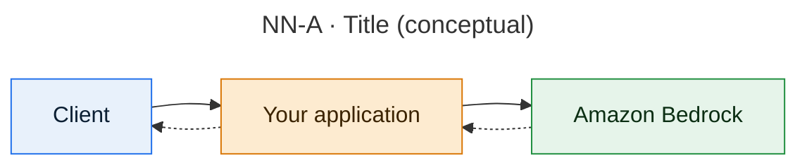
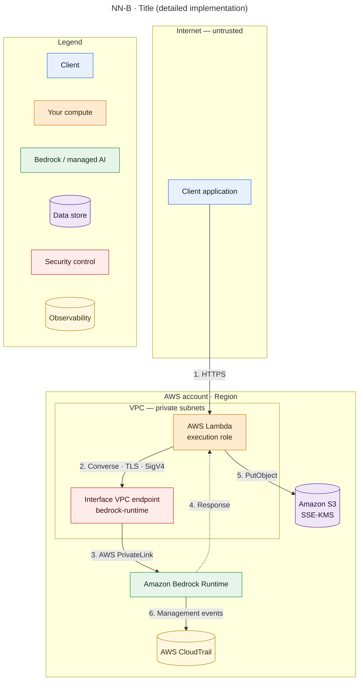
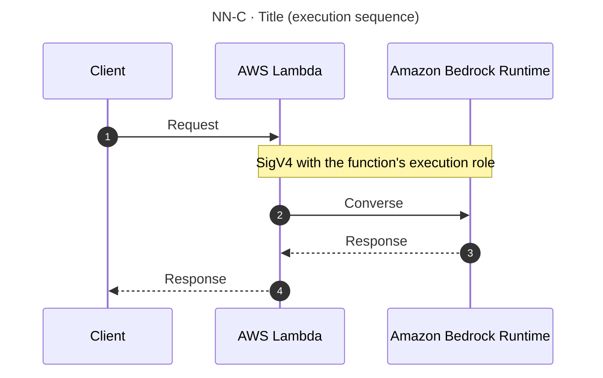

# Diagram NN — Title of the architecture

> **Verified:** 2026-11-15 · **Type:** academy design, not an official AWS reference architecture · **Related chapters:** links

One paragraph: what architecture this set documents and the question it answers.

## A. Conceptual view

The idea in as few boxes as possible — for a reader seeing it for the first time.

**What this shows** — one paragraph.

## B. Detailed implementation view

Every component, boundary, protocol, data store and security control.

**Legend** — solid arrow: request or write · dashed arrow: response · cylinder: data at rest · nested boxes: trust and network boundaries.

### Component roles

| Component | Role in this architecture | Security control |
|:--|:--|:--|
| | | |

### Connections

| # | From → To | Protocol / operation | Direction of data | Auth |
|--:|:--|:--|:--|:--|
| 1 | | | | |

## C. Sequence view

Explain the steps, including failure paths.

## Variations

Where the real implementation differs by model, Region, API or configuration, list each
variation and what changes in the diagram.

| Variation | What changes |
|:--|:--|
| | |

## Practical example

Link to the project or chapter that implements this architecture, and name the files to read.

## References

- [Page title](https://docs.aws.amazon.com/) — what it supports in this diagram.
